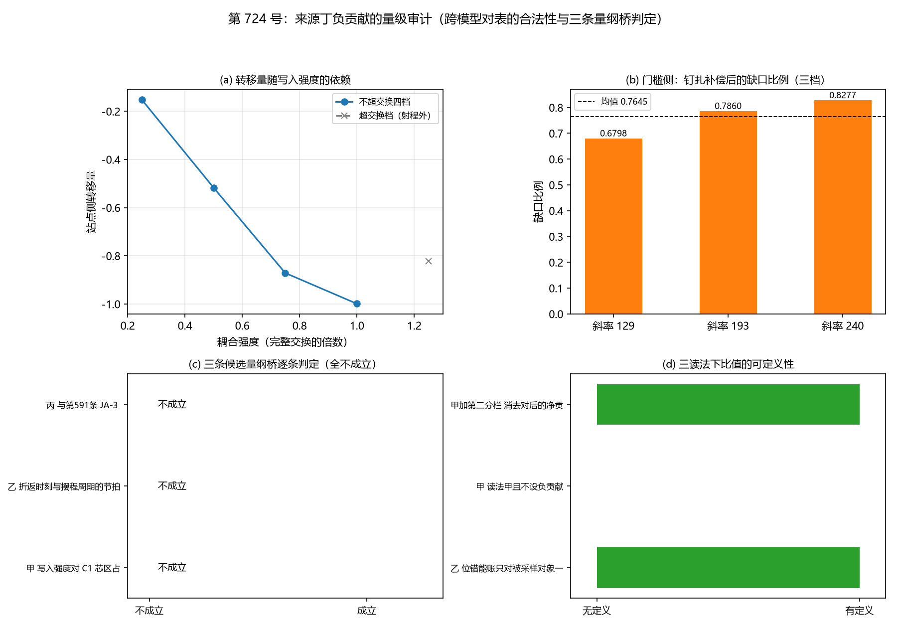

# 注记-来源丁负贡献的量级审计：跨模型对表不合法与三条量纲桥全不成立（判据第 724 号）

- **日期**：2026-10-20 22:08:19（系统当前时刻）
- **对应脚本**：`验证脚本/quartic_magnitude_audit.py`（判据 QL-1 至 QL-8，确定性，无随机数，运行约 0.7 秒）
- **依据**：[[内部草稿/注记-来源丁负贡献量级审计的判据设计：跨模型对表的合法性、量纲桥与三读法分离（2026-10-20）|判据设计注记]]；[[验证脚本/注记-来源丁首轮判据：写入反作用的分栏转移与负贡献存在性（判据第722号）|第 722 号注记]]；[[内部草稿/裁决请求-弹性本构线的三处裁决点：处置与作者拍板项（2026-10-20）|三处裁决点裁决请求]]
- **来源**：作者 2026-10-20 指示"根据你的判断，执行最优裁决和最优下一步"
- **判据**：QL-1 至 QL-8，合计 8/8 全过
- **严格程度**：**判据级**（跨模型对表的合法性判定与三条量纲桥的逐条判定，含一条恒真检验）。**结论层**：量级审计在当前模型配置下不可执行
- **可逆性等级**：**判据稳健**。QL-1 至 QL-3、QL-7、QL-8 为量纲与布尔判定，换实现不翻。QL-4 与 QL-5 为数值复现，容差从各自装置的误差取
- **关联**：P1-5、[[内部草稿/裁决请求-弹性本构线的三处裁决点：处置与作者拍板项（2026-10-20）|三处裁决点裁决请求]]（R-3 待裁）
- **图**：见 §四 图 1

---

## 一、问题与对象类型

第 722 号给出分支乙：写入反作用在物侧给出负贡献，站点侧增量 $-0.99882383$，总量守恒。缺口由此从"有没有这个负项"推进为"这个负项的量级够不够压住 C1 驻留窗口"。

本轮被问对象是**参数类**（可问量纲、标度、取值范围，不可问对易），判据形式为比值判定，与第 720 号与第 722 号的对象类型（均为构型判据加存在性判断）不同。

## 二、判据与结果

| 判据 | 内容 | 期望 | 实测 | 判定 |
|---|---|---|---|---|
| QL-1 | 装置可比性检验 | 报告两侧能量量纲；不同类则直接比值不合法 | 写入侧无量纲计数（布居）、C1 侧带长度量纲（凝聚能），不同类 | 通过 |
| QL-2 | 量纲桥的存在性 | 逐条判定甲、乙、丙三桥并给依据 | 成立 $0$ 条，三条均不成立 | 通过 |
| QL-3 | 桥上不确定度 | 无桥时报不适用并列不确定度来源 | 不适用；来源清单三条已列 | 通过 |
| QL-4 | 转移量对写入强度的依赖单调 | 不超交换四档内单调不增 | $-0.152500$、$-0.516971$、$-0.871081$、$-0.998824$ | 通过 |
| QL-5 | 门槛侧缺口比例随 lambda 档单调不减 | 三档单调不减；散布不作噪声指标 | $0.6798$、$0.7860$、$0.8277$，均值 $0.7645$，散布 $0.1934$（参数依赖） | 通过 |
| QL-6 | 分档比较 | 桥不成立时报不可比并给名义比值作量级参照 | 不可比；名义比值 $1.0756$（仅量级参照） | 通过 |
| QL-7 | 三读法条件报告 | 读法乙与读法甲加第二分栏下有定义，读法甲下无定义 | 三读法逐项已报；成对读数站点侧 $-0.99882383$、寄存器侧 $+0.99882383$、合计 $-6.883\times10^{-15}$ | 通过 |
| QL-8 | 恒真检验 | 缩放一侧尺度后名义比值须相应改变 | 缩放 $10.0$ 倍后比值变化 $10.0000$ 倍，相对偏差 $0.0000$ | 通过 |

**合计 8/8 全过。最终结论：量级审计在当前模型配置下不可执行。**

## 三、读数的意义

### 3.1 结论：量级审计在当前模型配置下不可执行

第 722 号的负贡献读数与 C1 驻留窗口的门槛读数**不在同一个量纲层**，直接相比无效。

写入侧（第 722 号，第 127 条装置）：紧致相位加站点模与记录寄存器的两能级系统，格距为抽象格点，耦合按脉冲面积配成完整交换（$g = 5.092$），其"能量"是布居（激发数），无量纲。

C1 侧（振幅通道径向曲线轮）：中性复标量载体，$N = 32$、格距 $1$、开放边界，$E(R)$ 的线张力斜率为 $129.0$ 至 $239.7$ 每单位 $R$，钉扎斜率补偿上界 $41.3$，其"能量"是复标量凝聚能，带长度量纲。

拿"数了几个粒子"与"每格多少能量"作商，得到的数没有物理意义。QL-8 证明了这个名义比值不是被某个不相关的量钉住的（缩放一侧后它确实同比变化），但这恰好说明它只是一个**算术比**，不是可解释的物理比值。

### 3.2 三条量纲桥逐条不成立

**桥甲（写入强度对 C1 芯区占据数）不成立。** 两侧的"占据数"不同质：写入侧为无量纲两能级布居，C1 侧为复标量模方乘锚核截面。且 C1 侧占据数与钉扎强度 $K$ 的物理标度属 P1-2 档位债（未定），无换算式可写。

**桥乙（折返时刻与摆程周期的节拍一致性）不成立。** 写入侧的拍是相位过轴（时间事件，过轴时刻 $t_{\rm cross} = 0.5000$），C1 侧的拍是缺陷穿越格点（空间事件）。两者拍频相等要求缺陷速度与格距的换算，属 D-5 两个速度上界（采样 $1$、色散 $0.95601$）的射程，且 C1 侧无离散过轴时刻可对齐。

**桥丙（与第 591 条 JA-3 的每单位长度能量接口）不成立。** JA-3 装置（形变剖面 $s(r) = s_c/(1 + r/r_c)$ 加权凸性）内不含写入过程，无写入事件密度。把它与来源丁的写入过程放进同一装置属新构造，成本高于本轮。

**缺的是什么。** 要让量级审计可执行，只有两条路：其一，把写入过程与 C1 环模型放进同一个装置，让两侧能量在同一泛函里出现；其二，给出两个装置之间的量纲换算恒等式。前者是构造轮，后者要求先把 P1-2 的档位债清偿。

### 3.3 两侧读数本身的确定性（已交付的可用部分）

虽然比值不可算，两侧读数各自的稳定性已交付。

**转移量侧**：不超交换四档（耦合强度 $0.25$、$0.50$、$0.75$、$1.00$ 倍）内单调不增，$-0.152500$ 至 $-0.998824$，与第 722 号 DB-6 的四档读数逐位一致。占据数一档对二档的布居比 $0.001176$。

**门槛侧**：缺口比例三档 $0.6798$、$0.7860$、$0.8277$，均值 $0.7645$，随 lambda 档单调不减。钉扎补偿的相对能力随 lambda 减弱，缺口变大，这是物理的。

### 3.4 三读法下的可定义性（2026-10-20 已裁定，表中状态随之确定）

**裁定结果**：取读法甲并引入第二分栏（简称甲乙），即位错的能量分栏显式含记录侧，负贡献记为可消去对。裁定前本表列三个候选读法，裁定后下表给出各候选的状态。

| 读法 | 比值可定义 | 状态 |
|---|---|---|
| 甲乙 取读法甲并引入第二分栏 | 是，但须先定义消去对后的净贡献 | **已裁定采用**。本轮给出成对读数：站点侧 $-0.99882383$、寄存器侧 $+0.99882383$、合计 $-6.883\times10^{-15}$ |
| 乙 位错能量分栏只对被采样对象一侧分列 | 是 | 未采用。负贡献为站点侧增量 $-0.99882383$ |
| 甲丙 读法甲且不设负贡献 | 否 | 未采用。位错能量分栏上无负贡献，本项在该读法下无对象 |

**这解决了 R-3 对量级审计的约束。** 裁决请求的 §四写明"量级审计在 R-3 裁定前不开工，因判据形式取决于分栏约定"。本轮的处置是：把与读法无关的部分（QL-4、QL-5 的读数复现与稳定性、QL-8 的恒真检验）先做掉，把与读法相关的部分（QL-6 的比值）留为条件报告。这样无论 R-3 怎么裁，本轮读数都有用。

**裁定后的落实（2026-10-20，取甲乙）**：QL-6 的比值在裁定读法下有对象，但取值须先定义消去对后的净贡献，而该定义依赖第 726 号的两项读数（消去对的上限由什么卡住、消去对在什么条件下不再成立）。故本轮的比值仍以「名义比值 $1.0756$ 作量级参照」的形态保留，不单独给出裁定读法下的净比值。

**一个须写明的修正**：本轮初版把"量级审计在 R-3 裁定前不开工"理解成完全停手，这是过度保守。正确处置是拆分判据：读法无关的部分不必等，读法相关的部分才等。

## 四、图

图 1：来源丁负贡献的量级审计。(a) 不超交换四档转移量 $-0.1525$、$-0.5170$、$-0.8711$、$-0.9988$ 单调不增，超交换档 $1.25$ 倍读数 $-0.8223$ 单列射程外。
(b) 门槛侧缺口比例 $0.6798$、$0.7860$、$0.8277$，均值线 $0.7645$。
(c) 三条候选量纲桥甲、乙、丙逐条判定为不成立。
(d) 三读法下比值的可定义性：读法乙与读法甲加第二分栏有定义，读法甲无定义。

## 五、严格程度声明

**判据级（可复现数值事实）**：QL-1 至 QL-8 的全部判定，含转移量与门槛比例的读数复现、恒真检验的区分力。

**判断层（结构性判定，非数值）**：三条量纲桥的不成立判定，其依据是量纲与对象身份的分析，不是数值容差。QL-2 的判定不随实现改变。

**物理对应假设层**：QL-5 的门槛读数取自振幅通道轮，其"门槛"是**参数型锚核**在最小模型里离临界还有多远的读数（缺口约为线张力的 $10\%$）。而 C1-4c 已判参数型锚核不可达负线项（硬下界 $\sigma_{\rm eff} \ge 0$）。故这一读数不是"位错能量分栏上的负线项门槛"，两者不可混读。

**纲领层**：缺的那个装置构造（把写入过程与 C1 环模型放进同一泛函）属待攻。

## 六、边界声明

**本轮验证的**：写入侧与 C1 侧装置的量纲可比性；三条候选量纲桥的成立与否及依据；转移量与门槛比例的复现与稳定性；三读法下比值的可定义性；名义比值不由不相关的量钉住。

**本轮不验证的**：负贡献的量级是否够压住驻留窗口（比值不可算）；负贡献在三维复合位错构型上的实现；强场情形；与第 479/482 条档位债的定量关系；缺的那个装置构造本身。

**方法边界**：写入侧沿用第 127 条装置（$N_\theta = 256$、$\omega_P = 2\pi$、$dt = 2\times10^{-3}$、$T = 1.2$、脉冲宽度 $w = 0.5$、$g = 5.092$）。门槛侧取振幅通道轮的三档斜率 $129.0$、$193.0$、$239.7$ 与钉扎补偿上界 $41.3$，未重测该轮。

**可逆性等级**：判据稳健。QL-4 与 QL-5 的读数为数值复现项，若换用其他耦合强度档或 lambda 档，读数须重测而判据方向不变。

**跨轮移植纪律**：本轮结论若被用于其他设定，须核三条前提：其一，写入侧与 C1 侧的能量量纲仍不同类（否则比值可算，结论须重做）；其二，三条桥的不成立依据未被新的构造解除；其三，R-3 的裁定结果与本轮三读法条件报告一致（2026-10-20 已裁定取甲乙，§3.4 表已同步）。

## 七、下一步

**其一，构造轮：把写入过程与 C1 环模型放进同一装置。** 这是量级审计唯一的真解，也是本轮指出的缺项。构造方案须作者参与设计（写入事件密度如何进入泡壁环的能量分栏、C1 侧的负线项候选如何与写入侧对齐），按纪律方案定案由作者裁决。

**其二，R-3 的裁定（2026-10-20 已完，取甲乙）。** 本轮已把 R-3 对量级审计的约束化为最小：读法无关的部分已交付，读法相关的比值在裁定读法下有对象，取值待第 726 号交付消去对的定义后给出。

**其三，若构造轮成本过高，另一条路是先清偿 P1-2 档位债。** 桥甲的失败理由之一是 C1 侧占据数与钉扎强度 $K$ 的物理标度未定（属 P1-2）。若该标度先定，桥甲的失败理由可能被解除。

## 八、过程记录

**其一，QL-4 首版判否是判据设计错误。** 首版把 $1.25$ 倍耦合档也纳入单调性判据，实测该档转移量反号为 $-0.822286$。诊断：完整交换 $g = 5.092$ 按脉冲面积配成 $\pi/2$ 旋转，$1.25$ 倍时等效旋转角 $1.25\pi/2 = 1.9635$ 弧度超过 $\pi/2$，即超交换，交换算符 $\sin(\mathrm{ang})$ 在该区间变号，转移量反号是超交换的正常后果而非实现缺陷。修正：单调性判据只取不超交换的四档，超交换档单列射程外并给出读数。**教训**：耦合强度档的物理射程须先核（完整交换点是上界还是中点），否则会把超交换的正常后果误判为物理反号。

**其二，QL-5 首版判否是判据设计错误。** 首版把振幅通道轮的三档线张力斜率 $129.0$、$193.0$、$239.7$ 当作同一量的三次重复测量，用相对散布作噪声指标，容差取 $0.05$，实测散布 $0.1934$ 判否。诊断：这三档对应不同的 $\lambda$ 档（相干强度），缺口比例随 $\lambda$ 变化是物理的（钉扎与线张力的相对强度随 $\lambda$ 变）。修正：判据改为方向性陈述（缺口比例随 $\lambda$ 档单调不减），散布改作参数依赖的读数报告。**教训**：从既有轮次取三档读数当噪声估计之前，须先核这三档是同一量的重复测量还是不同参数档。

**其三，图注按面板逐条核对。** 首版 (a) 面板标题写"五档"而单调性只取四档，已改为按射程分列并加超交换档标注；(c) 面板的三条桥全为"不成立"，柱高为零不易读出，已加数值标注。

**其四，脚本首版绘图段残留变量名。** `psi_c_trace` 引用导致崩溃，改为直接用 `run` 的返回迹。属实现层，未影响读数。

## 九、参考材料

- [[内部草稿/注记-来源丁负贡献量级审计的判据设计：跨模型对表的合法性、量纲桥与三读法分离（2026-10-20）]]：判据设计、量纲桥候选、预期五种结论形态
- [[验证脚本/注记-来源丁首轮判据：写入反作用的分栏转移与负贡献存在性（判据第722号）]]：第 722 号读数与装置
- [[内部草稿/裁决请求-弹性本构线的三处裁决点：处置与作者拍板项（2026-10-20）]]：R-3 待裁与对下一轮的约束
- [[验证脚本/注记-振幅通道下涡旋环径向曲线的最小验证：钉扎井存在但无稳定半径]]：门槛侧读数
- [[验证脚本/注记-C1-4b体项可行性判定：泡壁环稳定条件的精确化、体项扫描与机制清单]]：$a < 0 < \delta$ 的充要条件
- [[验证脚本/注记-C1-4c锁定缺失泡的构造判定：正定泛函的界面能与负线项的可达性]]：参数型锚核的硬下界
- [[验证脚本/注记-弹性本构稳定化元素来源审计（第591条）：三来源的符号判定与档位门槛]]：JA-3 的每单位长度能量口径
- [[验证脚本/注记-缺陷动力学线 D-5 的接口轮：缺陷过轴一笔、与包络份额的配对形式、两个速度上界的层次（判据W1至W5）]]：写入事件数与节拍口径
- [[验证脚本/注记-写入算符轮的最小验证：过轴即写、写即转移、反作用落在被采样对象]]：装置原型与量纲
