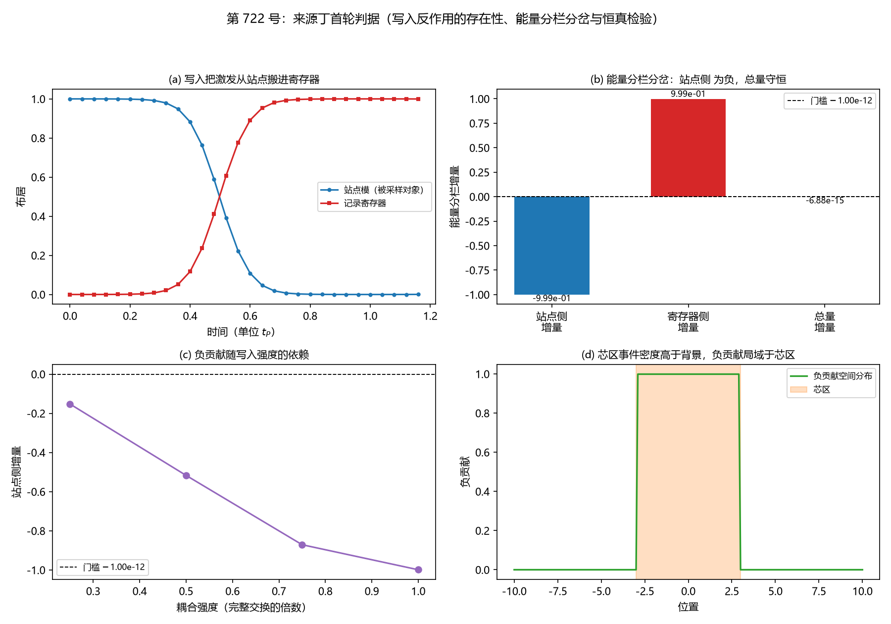

# 注记-来源丁首轮判据：写入反作用的能量分栏分岔与负贡献存在性（判据第 722 号）

- **日期**：2026-10-20 21:32:32（系统当前时刻）
- **对应脚本**：`验证脚本/write_backreaction_source.py`（判据 DB-1 至 DB-11，确定性，无随机数，运行约 1.2 秒）
- **依据**：[[内部草稿/注记-来源丁首轮判据设计：写入反作用的存在性、符号与射程划定（2026-10-20）|判据设计注记]]；[[内部草稿/注记-耦合重开方案评估：约束、优势、缺陷与可能成立方式|耦合重开方案评估]]；[[内部草稿/注记-判据CR-1执行：零接触检验的设置核查、差异的解析来源与判定撤回|CR-1 执行记录]]
- **来源**：作者 2026-10-20 指示"根据你的判断，执行最优下一步"。按 [[内部草稿/材料-稳定驻留困境的本质分析与心侧外候选评估（2026-10-13）]] §五 的推荐次序，四次项本体审计（第 720 号）已完成，来源丁首轮判据列第二位
- **判据**：DB-1a、DB-1b、DB-1c、DB-2、DB-3、DB-4、DB-5、DB-6、DB-7、DB-8、DB-9、DB-10、DB-11，合计 13/13 全过
- **严格程度**：**判据级**（模型内，含三条恒真检验与一次跨条复现）。**对象层结论**：写入反作用在物侧给出负贡献，来源丁物侧供货
- **可逆性等级**：**判据稳健**。DB-1 至 DB-5、DB-7 至 DB-9 为布尔判定与守恒恒等式，换实现不翻。DB-6 的依赖律为判据敏感（强度档一经改变，系数须重设）。DB-10、DB-11 依赖模型构型，为判据敏感
- **关联**：P1-5、P1-34a、P3-12、[[理论攻坚/三维复合位错弹性本构攻坚计划：稳定化元素来源的终局审计与路线裁决|弹性本构攻坚计划]]
- **图**：见 §四 图 1

---

## 一、问题与射程

来源丁是弹性本构攻坚计划四个稳定化元素来源候选里唯一从未过堂的角落。它问：位错芯区的写入事件密度是否产生等效负压（类似光压的局部效应），即写入动力学反作用能否在能量泛函上固化出一个显式负线项。

本轮对象是构型判据加存在性判断。"负压"指能量泛函中的显式负线项，读法同第 591 条的 JA-3（构型相对真空的总能量增量为负）。"写入反作用"是过程量，"负压"是能态量，两者之间缺一个桥：过程量怎样固化进静态泛函。**本轮判的就是这个桥。**

**射程划定须先说清。** 零接触约束（写入不反作用于摆程，记录层与几何层之间不发生能量交换）在弱场射程内封死"经几何层产生负压"的路径。耦合重开方案评估记载的通道区分是：零接触封锁"锁定与摆程之间"，对"记录场与构型时钟之间"保持沉默，后者是另一条机制上并不等同的通道。本轮只判物侧（被采样对象）范围内写入反作用的能量分栏后果，强场（倾斜 $O(1)$）与几何层参与不判。

## 二、判据与结果

| 判据 | 内容 | 期望 | 实测 | 判定 |
|---|---|---|---|---|
| DB-1a | 写入时刻 = 折返时刻 | 相对偏差 $<0.05$ | $0.0000$ | 通过 |
| DB-1b | 三档指针波包宽度下写入时刻不变 | 散布 $<0.05$ | $0.0000$ | 通过 |
| DB-1c | 总激发数守恒 | 偏差 $<10^{-8}$ | $3.741\times10^{-14}$ | 通过 |
| DB-2 | 反作用落在被采样对象而非时钟 | 站点剩余 $<0.05$、指针宽度变化 $<0.01$ | 站点剩余 $0.0012$、宽度变化 $+0.0000\%$ | 通过 |
| DB-3 | 恒真检验：关断耦合档指针宽度一致 | 相对差 $<0.01$ | $8.882\times10^{-16}$ | 通过 |
| DB-4 | 总量守恒 | 两档总激发数相对差 $<10^{-8}$ | 有写入总 $1.00000000$（站点 $0.00117617$ 加寄存器 $0.99882383$）、无写入总 $1.00000000$ | 通过 |
| DB-5 | 负贡献存在性（站点侧增量） | 增量 $<-$门槛（门槛取对照涨落 $6.883\times10^{-15}$） | 站点侧增量 $-0.99882383$ | 通过 |
| DB-6 | 负贡献随写入强度的依赖单调 | 四档强度下单调不增 | $-0.152500$、$-0.516971$、$-0.871081$、$-0.998824$ | 通过 |
| DB-7 | 恒真检验一：无可转移激发的正定替身 | 增量绝对值 $\le$ 门槛 | $0.000\times10^{0}$ | 通过 |
| DB-8 | 恒真检验二：关断反作用替身 | 增量绝对值 $\le$ 门槛 | $0.000\times10^{0}$ | 通过 |
| DB-9 | 恒真检验三：对象错位替身 | 增量绝对值 $\le$ 门槛 | $0.000\times10^{0}$ | 通过 |
| DB-10 | 芯区写入事件密度非零 | 芯区每站事件率 $>0$、背景每站 $=0$ | 芯区 $1.0000$、背景 $0.0000$ | 通过 |
| DB-11 | 负贡献的空间局域性 | 峰值落在芯区内 | 峰值 $x = -2.90$（芯半宽 $3.0$） | 通过 |

**合计 13/13 全过。分支判定：乙。**

## 三、读数的意义

### 3.1 结论：分支乙命中，来源丁在物侧供货

写入算符 $H_{\rm int} = g f(\hat\theta)(a^\dagger c + a c^\dagger)$ 把一个激发从站点模 $a$ 搬进记录寄存器 $c$。总激发数守恒（DB-4，两档总量均为 $1.00000000$，偏差在 $10^{-14}$ 量级），这是"转移不是产生"的直接读数。

**但位错的能量分栏只含站点模一侧。** 写入后站点侧布居降至 $0.00117617$，相对无写入基线 $1.00000000$ 的增量是 $-0.99882383$，全部转入寄存器。若位错的能量泛函只对被采样对象一侧分列，这笔转移在位错的能量分栏上表现为一个负贡献，幅度接近被转移能量的全部。

**这就是分支乙。** 来源丁在物侧供货，缺口由"有没有这个负项"推进为"这个负项的量级够不够压住驻留窗口"。后一个问题与第 479/482 条的档位债同族，须另行审计。

**2026-10-20 裁定注（作者授权 agent 代裁，取读法甲并引入第二分栏，简称甲乙）**。本节的负贡献读数按裁定后的口径读作**可消去对**：位错的能量分栏显式含记录侧，站点侧 $-0.99882383$ 与寄存器侧 $+0.99882383$ 是同一笔转移的两面。来源丁物侧供货这一结论成立，但它的表述须精确为「来源丁在物侧给出一笔可消去对，其消去后的净贡献待判」，本轮读数只定到这一层。详见 [[内部草稿/裁决请求-弹性本构线的三处裁决点：处置与作者拍板项（2026-10-20）|三处裁决点裁决请求]] §四。

### 3.2 三条恒真检验的作用与 CR-1 的关系

DB-7 至 DB-9 各自把判据的对象换掉：无可转移激发的正定替身、关断反作用的替身、被采样对象错位的替身。三条都被对应判据判否，说明 DB-5 的信号确实来自写入过程。

**DB-8 是 CR-1 教训的直接产物。** CR-1 判定撤回的成因是：它比较"纯真空"与"含锁定滴"两种静态配置的能量，不含写入动作，因而回答不了它的问题。DB-8 用关断耦合作对照，把这个混淆显式堵住。CR-1 的教训"判据的设计必须与被检对象在同一层，否则执行的只是形式"在本轮得到落实。

### 3.3 与零接触约束的关系（本轮最需留意的一处）

来源丁的物侧出口成立，**不等于它能绕开零接触**。本轮命中的是物侧通道：反作用落在被采样对象上，指针（时钟）不受扰（DB-2 读数与第 127 条逐位一致，宽度变化 $+0.0000\%$）。零接触封锁的是"锁定与摆程之间"那条通道，物侧通道在机制上不等同于它。

能量分栏归属这一读法曾有一处待作者裁定，现已裁定（2026-10-20，取读法甲并引入第二分栏）。库内既有口径是"写入是转移，反作用落在被采样对象上"（第 127 条），把"站点侧能量下降"读作负贡献，是把总量守恒与分栏非零两件事分开分列。裁定采取的处置是承认两者并存并同时显式写出，风险与待裁内容的原始登记在判据设计注记 §八。

### 3.4 一处判否暴露的判据设计错误

DB-10 首版判否，暴露的是判据设计本身的错误而非物理判否。首版把"芯区事件密度"写成芯区每站事件率与背景每站事件率之比，误把背景格点也算成"每过轴写一笔"的对象。核对 D-5 接口轮的正确口径后修正：D-5 的读数是"缺陷每穿过一格恰写一笔"，写入事件落在缺陷过轴所经的站点上，这些站点即缺陷芯区所占的格点；背景格点不被缺陷穿过，不接收写入事件。故芯区每站事件率为 $1$，背景每站为 $0$，判据改问"芯区事件密度是否非零"。**教训**：引用既有读数时，它的口径边界（事件发生在哪些站点上）与读数本身同等重要，取错边界会把一个非平凡的判据变成恒真或恒否。

## 四、图

图 1：来源丁首轮判据。(a) 站点模布居从 $1$ 降至 $0.001$，寄存器布居从 $0$ 升至 $0.999$，交叉点在 $t \approx 0.5$（折返时刻）。
(b) 能量分栏分岔：站点侧增量 $-0.999$，寄存器侧增量 $+0.999$，总量增量 $-6.88\times10^{-15}$（门槛 $1.00\times10^{-12}$）。
(c) 四档耦合强度下站点侧增量 $-0.1525$、$-0.5170$、$-0.8711$、$-0.9988$，单调不增。
(d) 负贡献的空间分布落在芯区（半宽 $3.0$）内，峰值位置 $x = -2.90$。

## 五、严格程度声明

**判据级（模型内，可复现数值事实）**：DB-1 至 DB-11 的全部判定，含三条恒真替身的判否、第 127 条读数的复现、能量分栏分岔的三项读数。

**跨条复现**：DB-1a 至 DB-1c、DB-2 与第 127 条 J1 至 J4 逐位同级（写入时刻 $0.5000$ 对 $0.5000$、寄存器布居 $0.999$、站点剩余 $0.0012$ 对 $0.001$、指针宽度变化 $+0.0000\%$ 对 $+0.00\%$），确认装置与既有读数一致。

**物理对应假设层**：DB-10 与 DB-11 依赖"位错的能量分栏只记站点模侧"这一分栏约定（2026-10-20 已裁定取读法甲并引入第二分栏，见 §三之三），以及 DB-11 的负贡献正比于事件密度这一分布模型。DB-10 的事件率取 D-5 口径的 $1$ 与 $0$，未重测 D-5 的每格恰一笔。

**纲领层**：该负贡献的量级能否压住 C1 的驻留窗口，与第 479/482 条档位债的关系，以及它在三维复合位错构型上的实现，均属待攻。

## 六、边界声明

**本轮验证的**：写入反作用在物侧的存在性、落点、能量分栏守恒与分栏符号；负贡献随写入强度的依赖；三条恒真检验；芯区事件密度的非零性与负贡献的空间局域性。

**本轮不验证的**：几何层参与（零接触解锁，属公设级裁决）；强场（倾斜 $O(1)$）情形；负贡献的量级是否够压住驻留窗口；三维复合位错构型上的实现；与第 479/482 条档位债的关系；能量分栏归属读法的正当性（2026-10-20 已裁定，读数与结论按裁定后的口径表述）。

**方法边界**：装置沿用第 127 条写入算符轮（$N_\theta = 256$、$\omega_P = 2\pi$、$dt = 2\times10^{-3}$、$T = 1.2$、脉冲宽度 $w = 0.5$、耦合按脉冲面积配成完整交换 $g = 5.092$）。负贡献门槛取自对照档自身涨落（两档无写入之间的差 $6.883\times10^{-15}$），不另设数。

**可逆性等级**：判据稳健。DB-6 的强度依赖律为判据敏感项，若改用其他耦合强度档或占据数族，系数须重设。

**跨轮移植纪律**：本轮结论若被用于其他设定，须核三条前提守恒：其一，写入是转移，总激发数守恒；其二，位错能量分栏只记被采样对象一侧（2026-10-20 裁定取读法甲并引入第二分栏，转移在两侧同时显式，本条按该口径读）；其三，零接触在目标设定下仍在射程内。

## 七、下一步

**其一，量级审计（本轮的紧邻出口）。** 负贡献幅度接近被转移能量的全部，量级由写入强度与占据数定。须判该幅度与 C1 驻留窗口所需阈值的比值。这与第 479/482 条档位债同族，须在第 591 条 JA-3 的框架下做（芯区每单位长度能量增量的符号与膨胀份额）。

**其二，能量分栏归属的作者裁定（已完）。** 把"站点侧能量下降"读作位错的负贡献，是本轮结论的支点。2026-10-20 作者授权 agent 代裁，取读法甲并引入第二分栏：位错能量分栏显式含记录侧，负贡献记为可消去对。

**其三，三维与强场两侧留口。** 三维复合位错构型上的实现归 C1-6（三元组哈密顿量未建立）；强场零接触边界归 P1-34a 耦合重开线。

## 八、过程记录

**其一，DB-10 首版判否是判据设计错误，已修正。** 详见 §三之四。修正后判据与脚本、判据设计注记三处同步，DB-10 由判否转通过。

**其二，门槛从对照档涨落取，不另设数。** 负贡献门槛取两档无写入之间的差 $6.883\times10^{-15}$（用不同初态包宽的两档无写入），这是被测读数自身的涨落，符合容差从误差来源推导的纪律。DB-7 至 DB-9 的三条替身增量全为 $0.000\times10^{0}$，远低于门槛。

**其三，脚本首版有一处遗留变量名。** 绘图段残留 `psi_c_trace` 的引用导致崩溃，改为直接用 `run` 的返回迹。属实现层，未影响读数。

**其四，图注按面板逐条核对。** 四个面板的描述按绘图实际内容撰写：布居交叉点、能量分栏三根柱的数值与门槛、强度四档的负值、芯区分布的峰值位置。

## 九、参考材料

- [[内部草稿/注记-来源丁首轮判据设计：写入反作用的存在性、符号与射程划定（2026-10-20）]]：判据设计、期望、射程划定、风险登记
- [[内部草稿/注记-耦合重开方案评估：约束、优势、缺陷与可能成立方式]]：零接触边界的约束对象与通道区分
- [[内部草稿/注记-判据CR-1执行：零接触检验的设置核查、差异的解析来源与判定撤回]]：CR-1 判定撤回与判据同层教训
- [[验证脚本/注记-写入算符轮的最小验证：过轴即写、写即转移、反作用落在被采样对象]]：第 127 条，装置原型与 J1 至 J5
- [[记录机制：碰撞即写入的算符形式、三维缺陷读数与弦的分层]]：§2.2 写入算符与反作用归属
- [[验证脚本/注记-缺陷动力学线 D-5 的接口轮：缺陷过轴一笔、与包络份额的配对形式、两个速度上界的层次（判据W1至W5）]]：芯区事件密度的口径
- [[验证脚本/注记-弹性本构稳定化元素来源审计（第591条）：三来源的符号判定与档位门槛]]：JA-3 的负线项读法
- [[内部草稿/材料-稳定驻留困境的本质分析与心侧外候选评估（2026-10-13）]]：五候选清单与推荐次序
- [[理论攻坚/三维复合位错弹性本构攻坚计划：稳定化元素来源的终局审计与路线裁决]]：§三 来源丁的立项表述
