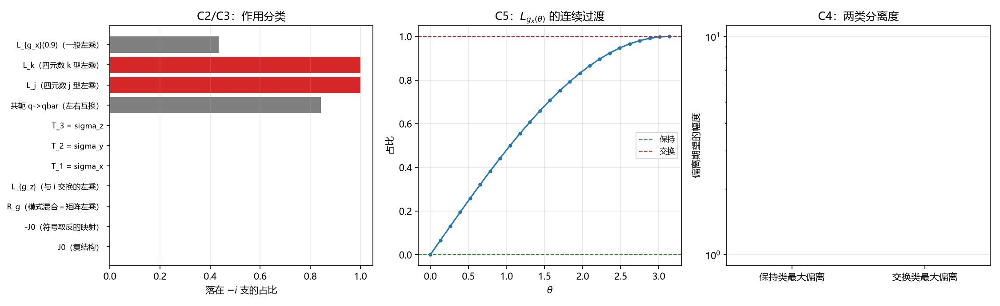

# 注记-来源层判据化第二轮：CR 结构类型分解与作用分类（判据第 663 号）

## 元数据

- **日期**：2026-10-17 10:24:23（取系统当前时刻）
- **脚本**：`验证脚本/minimal_verification_cr_structure_typing.py`
- **判据**：冒烟 M1 至 M2、C1 至 C7，共 12 项（12/12 通过）
- **可逆性等级**：判据稳健。全部读数为解析恒等式与投影范数之比，不依赖采样阈值；五个测试点与 $\theta$ 扫描仅用于稳定性核对。
- **类型**：判据级读数（来源层判据化第二轮：为"手征分支"给出合法载体并分类各算符的作用）
- **关联**：[[验证脚本/注记-来源层判据化第一轮：模态空间复结构的定义域与左右作用三约定对表（判据第662号）|第 662 号]]（本轮的直接上游：该条指出 $\pm i$ 分支在 $\mathbb{C}^2$ 层无区分、合法载体是 CR 结构）；[[手征性的几何本质与宇称不守恒：模态复结构与宇称自发破缺]] §3.1 与 §5.1；[[内部草稿/总结注记-手征问题攻坚全面总结：定理射程、逐轮清点与接口缺口（2026-10-16）|手征攻坚总结]] §八
- **图**：见 §三 图 1

---

## 摘要

第 662 号指出正稿的"复结构 $J$ 的 $\pm\mathrm{i}$ 本征分支"在 $\mathbb{C}^2$ 层没有区分内容，其合法载体是 $S^3$ 上的 CR 结构。本轮把该结构做实，并对各类算符的作用给出分类读数。

**其一，CR 结构成立。** 水平分布 $H$ 为实维 2，$J_0$ 保持 $H$ 且在其上限制为复结构，两支 $H^{1,0}$ 与 $H^{0,1}$ 各复维 1，$\Pi_\pm = (I \mp \mathrm{i}J_0)/2$ 为互补幂等投影。

**其二，作用分三类。** 保持手征分支的七项（$J_0$、$-J_0$ 的映射实现、模式混合 $R_g$、与 $\mathrm{i}$ 交换的左乘、三个弱荷算符 $T_k$）占比全零；交换手征分支的两项（$L_j$、$L_k$，即四元数 $j$、$k$ 型左乘）占比 $1.000000$；一般左乘 $L_{g_x(\theta)}$ 落在中间，占比随 $\theta$ 由 $0$ 连续升到 $1$（中间档 $0.707107$）。

**其三，三个操作须分辨。** 符号取反的映射实现交换矢量支；左右互换的共轭把 $J_0$ 变成**另一个**复结构 $R_{-\mathrm{i}}$，对 $J_0$ 的支是混合作用（占比 $0.630$ 至 $0.997$，随点变化）；模式混合保持。故"宇称交换手征分支"在矢量层面由 $L_j$ 型左乘实现。

## 一、模型设定与依据

模态系数空间 $\mathbb{C}^2 \cong \mathbb{H}$，复结构 $J_0$ = 四元数左乘 $\mathrm{i}$。在 $\psi \in S^3$ 处，切空间为 $\{\psi\}^\perp$，垂直方向为 $J_0\psi$，水平分布取

$$H_\psi = T_\psi S^3 \cap J_0(T_\psi S^3) = \{\psi,\ J_0\psi\}^\perp,$$

实维 $2$。复化后按 $J_0$ 的本征值分为 $H^{1,0}$（$+\mathrm{i}$）与 $H^{0,1}$（$-\mathrm{i}$），投影算符 $\Pi_\pm = (I \mp \mathrm{i}J_0)/2$。

判据是"把一个算符送过 $H^{1,0}$ 的基矢，读它落在 $-\mathrm{i}$ 支的占比"：保持给 $0$，交换给 $1$。

被分类的算符包括复结构本身、符号取反、模式混合（四元数右乘，等于模态态矢量的矩阵左乘）、四元数左乘的三个方向族、三个弱荷算符，以及左右互换的四元数共轭。

## 二、判据与结果

| 判据 | 内容 | 实测 | 期望 |
|---|---|---|---|
| M1 | $H$ 为实维 2 且与 $\psi$、$J_0\psi$ 正交 | $2.22\times10^{-16}$ 与 $1.20\times10^{-16}$ | 机器零 |
| M2 | $J_0$ 保持 $H$ 且限制为复结构 | $3.33\times10^{-16}$ 与 $4.44\times10^{-16}$ | 机器零 |
| C1 | $H^{1,0}$ 基矢满足 $J_0v = \mathrm{i}v$ | $0$ | 严格零 |
| C1 | 两支投影互补且 $\Pi_+$ 幂等 | $0$ 与 $0$ | 严格零 |
| C2 | 保持类七项占比 | 最大 $0$ | $0$ |
| C3 | 交换类两项占比 | 最小 $1.000000$ | $1$ |
| C4 | 两类分离度 | $1.000000$ 对 $0$ | 完全分离 |
| C5 | $\theta$ 扫描两端 | $0$ 与 $1.000000$，单调 | 单调连续 |
| C6 | 恒真检验（中间档与恒等项） | $0.707107$ 落中间；恒等重合 $0$ 项 | 判据有区分力 |
| C7 | 三操作分辨（见下） | 见读数表 | 分类互异 |

作用分类的逐项读数：

| 算符 | 五档占比（首档） | 分类 |
|---|---|---|
| $J_0$（复结构） | $0.000000$ | 保持 |
| $-J_0$（符号取反的映射） | $0.000000$ | 保持 |
| $R_g$（模式混合 = 矩阵左乘） | $0.000000$ | 保持 |
| $L_{g_z}$（与 $\mathrm{i}$ 交换的左乘） | $0.000000$ | 保持 |
| $T_1 = \sigma_x$、$T_2 = \sigma_y$、$T_3 = \sigma_z$ | 各 $0.000000$ | 保持 |
| $L_j$、$L_k$（$j$、$k$ 型左乘） | 各 $1.000000$ | 交换 |
| $L_{g_x}(0.9)$（一般左乘） | $0.434966$ | 中间 |
| 共轭 $q \mapsto \bar q$（左右互换） | $0.630$ 至 $0.997$（随点变化） | 混合 |

## 三、图

图注按脚本绘图面板逐条核对撰写。

## 四、结论

**结论一，CR 结构是"手征分支"的合法载体。** 水平分布 $H$ 实维 2（$J_0$ 在其上为复结构），两支各复维 1 且互补。第 662 号指出的"$\pm \mathrm{i}$ 分支在 $\mathbb{C}^2$ 层无区分"由此获得落点：分支不是 $\mathbb{C}^2$ 的性质，是 $H$ 上复结构的性质。

**结论二，作用分三类，分类有明确物理内容。** 保持类七项里，模式混合与三个弱荷算符的分量最重。正稿 §5.1 的第一句"模式混合保持复结构 $J$，因此是定义在全纯分支上的变换"由此获得确认：模式混合确实保持手征分支，它不把矢量送到另一支。同时，三个弱荷算符也全在保持类（因为它们的左分量同为 $\mathrm{i}$，与 $J_0$ 对易，见第 662 号），即**弱荷在模态空间层面不区分手征分支**。这与第 662 号的结论一致，本轮把它从"身份分解"层推到"作用分类"层。

**结论三，三个操作须分辨，正稿的"宇称交换手征分支"要说明是哪一种。** 读数给出三者互异：符号取反的映射实现（$L_j$、$L_k$）交换矢量支（占比 $1.000000$）；左右互换的共轭把 $J_0$ 变成另一复结构 $R_{-\mathrm{i}}$，对 $J_0$ 的分支是混合作用（占比随点变化，既不保持也不交换）；模式混合保持。宇称在模态层面的实现是复结构符号的重拨（$J \to -J$），它改变的是"哪一支叫左手"这一标注，不把矢量送到另一支；把矢量送到另一支的活儿由 $L_j$ 型左乘完成。

## 五、严格程度声明与边界声明

**严格层**：$H$ 的维数与正交性（$1.20\times10^{-16}$）、$J_0$ 的限制为复结构（$4.44\times10^{-16}$）、$H^{1,0}$ 本征关系与投影幂等（严格零）、保持类占比全零、交换类占比 $1.000000$、$\theta$ 扫描的单调连续。全部为解析恒等式与投影范数之比。

**弱荷算符身份的前提标注（2026-10-17）**：本轮把 $T_k$ 取作"模态侧弱荷"的标准代表，依据的是体系既有口径（弱二重态电荷算符取 $T_3 = \sigma_z$，正稿 §5.1）。但这个身份本身有一条未决的跨线缺口：P1-58 抓手二 B3 在 2026-10-17 核实发现，锁定在复二维内部空间上的算符身份缺失，摆程方向因子属外部侧、模态因子 $\kappa\sigma_z$ 属内部侧且第 661 号明示不判其物理身份，两者是否同一无读数，故 B3 第一步暂停。本轮的读数是在"这三枚算符即弱荷"的前提下成立的；若该身份归属另有裁决，本轮的算符身份需相应重标，结构性读数（定义域、作用分类、态层条件）不受影响。

**物理对应假设层**：$\mathbb{C}^2 \cong \mathbb{H}$ 与 $S^3$ 的识别；$J_0$ = 四元数左乘 $\mathrm{i}$；$T_k = \sigma_k$；模式混合 = 模态态矢量的矩阵左乘（在四元数记法下为右乘）。

**纲领层**：把 CR 类型读作物理手征分支，仍依赖模态叠加前提与跨侧桥（与 $\gamma_5$ 对应 $J$ 同级）。

**边界声明**：不判定弱荷单分支能否由模态空间供给（本轮读数倾向于"模态空间层面不区分"，但正面判定属跨侧桥）；不判定 $SU(2)_L$ 真动力学；不改动 `理论总纲/` 基准；不重开第 507、508、662 号的任何判定。

## 六、登记衔接

本条为来源层判据化第二轮，登记入 [[内部草稿/开放问题档案/开放问题-P1-1-手征性|P1-1 档案页]] 与开放问题总览 P1-1 卡。下一轮的落点由本轮的结论二给出：既然模态空间层面不区分手征分支，则"左手加载"必须在跨侧桥或前提层找依据，可做成"桥面两侧的对应物在什么条件下单侧"的判据。

## 七、过程记录

**判据设计三处更正，均因把不同操作混为一谈。**

其一，首版把 $-J_0$（符号取反的映射）列为交换类，实测占比 $0$。核对：对 $v \in H^{1,0}$，$(-J_0)v = -\mathrm{i}v = (-\mathrm{i})v$ 是 $v$ 的复标量倍，仍在 $H^{1,0}$ 内，故该映射保持矢量支。"$J \to -J$"改变的是分支的**标注**，与"矢量被映到另一支"是两件事。

其二，首版把三元共轭（$q \mapsto \bar q$，即左右互换）列为交换类，实测占比 $0.630$ 至 $0.997$（随点变化）。核对：$QJ_0Q^{-1} = R_{-\mathrm{i}}$，它把 $J_0$ 换成另一个复结构，故对 $J_0$ 的分支是混合作用，既不保持也不交换。共轭与"符号取反"也不是同一个操作。

其三，首版的交换类用了 $\theta = 0.9$ 的一般左乘，实测占比 $0.434966$。核对：$L_{g_x(\theta)}$ 共轭 $J_0$ 给 $L_{g_x(\theta)\,\mathrm{i}\,g_x(\theta)^{-1}}$，是 $L_{\mathrm{i}}$ 与 $L_k$ 的连续插值，只有 $\theta = \pi$ 型（即 $j$、$k$ 元素）才给纯交换。C5 的 $\theta$ 扫描（$0$ 到 $\pi$）正是这一结构的读数。

**方法论沉淀**：这三个更正的共同点是"把算符的代数身份与它对某个结构的类型作用混起来"。判据化时必须先固定被作用的对象（这里是 $H^{1,0}$），再读算符对它的作用，不可以用算符的命名（"符号取反""共轭""左乘"）代替读数。

## 八、来源

- 上游：[[验证脚本/注记-来源层判据化第一轮：模态空间复结构的定义域与左右作用三约定对表（判据第662号）|第 662 号]]（定义域与左右作用三约定）
- 脚本：`验证脚本/minimal_verification_cr_structure_typing.py`（确定性，种子 $20261017$，约 $2$ 秒）
- 图：`images/fig_cr_structure_typing.png`

## 修订记录

- **2026-10-17 弱荷算符身份前提标注**（触因：与 P1-58 线缺口对齐）：前提层补身份标注，见下文；结构性读数不受该缺口影响。
- **2026-10-17 10:24:23 初版**（来源层判据化第二轮，判据 12/12）
    - CR 结构成立：$H$ 实维 2、$J_0$ 限制为复结构、两支各复维 1、投影幂等
    - 作用三类：保持七项（$J_0$、$-J_0$、模式混合、$L_{g_z}$、$T_1$ 至 $T_3$）占比全零；交换两项（$L_j$、$L_k$）占比 $1.000000$；一般左乘落中间（$\theta$ 扫描 $0$ 到 $1$）
    - 三操作分辨：符号取反的映射实现交换矢量支、左右互换的共轭为混合、模式混合保持
    - 弱荷 $T_k$ 在模态空间层面对手征分支中性，与第 662 号一致
    - 判据设计三处更正（符号取反、共轭、一般左乘的误分类）
