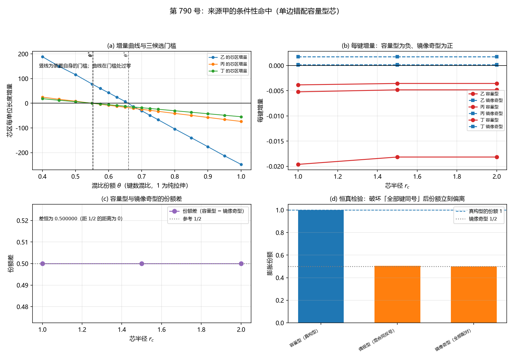

# 注记-来源甲的条件性命中：单边错配容量型芯的膨胀份额与每键增量（判据第 790 号）

- **日期**：2026-10-21 23:58:00（系统当前时刻）
- **类型**：验证注记（判据级），落 `验证脚本/`
- **对象层结论**：**来源甲的条件性命中成立，且结论对 $V_{\rm rep}$ 候选形式不敏感。** 单边错配的容量型芯在混比口径下的芯区每单位长度增量在纯拉伸侧翻负（$I_+ = I(1) < 0$），乙、丙、丁三个候选的门槛 $\theta^{*}$ 全被越过
- **门槛不随芯半径口径移动**：$\theta^{*}$ 在 $r_c = 2.5$、$5.0$、$7.5$ 三档上的散布为 $0.000000$（乙、丙、丁皆是），而它到 $1$ 的距离为 $0.269446$ 至 $0.425586$。**故「越过与否」在所扫口径族内稳健**
- **膨胀份额与 $\theta_{\rm eff}$ 是两个量（SA-1 的回源结论）**：第 591 号的「膨胀份额 $\theta$」是**混比参数**，第 592 号的 $\theta_{\rm eff} = N_+/(N_+ + N_-)$ 是**键应变符号统计**，两者不是同一个量
- **严格程度**：**判据级**（模型内，13 个子判据，13 条通过）
- **可逆性等级**：SA-1、SA-2、SA-3、SA-5、SA-6、SA-6b、SA-7a、SA-7b 为**判据稳健**（结构性质与解析恒等式）；SA-2b、SA-3b、SA-4b 为**判据敏感**（数值随剖面口径与有限尺寸变动）
- **档位标注**：读数取**模型档**（$V_{\rm rep}$ 系数 $A = 1$、参考间距 $r_0 = 1$、剖面 $s(r) = 0.5/(1+r/r_c)$、键面密度 $1/r_0^2$、20001 点梯形积分、格点 $N = 33$），与第 591 号 JA-3 及第 592 号的在案读数同档
- **上游**：[[验证脚本/注记-弹性本构稳定化元素来源审计（第591条）：三来源的符号判定与档位门槛|第 591 号注记]]（$\theta^{*}$ 三值与来源甲的供货条件）；[[验证脚本/注记-芯区应变构成的对称性与Vrep供货条件（第592条）：镜像奇芯型钉在膨胀份额二分之一|第 592 号注记]]（芯型分类与负增量条件）；[[验证脚本/注记-Vrep形式构造与r(m)的不可导出性判决（第561条）|第 561 号注记]]（$V_{\rm rep}$ 四候选）；[[验证脚本/注记-C1-4c锁定缺失泡的构造判定：正定泛函的界面能与负线项的可达性|C1-4c 注记]]（负线项要求显式负贡献）
- **脚本**：`验证脚本/source_a_conditional_hit.py`
- **关联**：[[理论攻坚/三维复合位错弹性本构攻坚计划：稳定化元素来源的终局审计与路线裁决|弹性本构攻坚计划]]（阶段一的来源甲段）

---

## 一、本轮判什么

来源甲（$V_{\rm rep}$ 高阶展开）的供货条件由第 591 号给出：**芯形变须以净拉伸为主，膨胀份额越过 $\theta^{*}$**。第 592 号把「芯形变是哪一类」落定为体系读数：镜像奇芯型给 $\theta_{\rm eff} = 1/2$，低于三门槛，故来源甲在既有读法下不供货；供货通道收敛为**单边错配的容量型芯**（全部键同号），其每单位长度增量为负。

本轮判的是：**单边错配的容量型芯，其膨胀份额是否越过 $\theta^{*}$？** 若越过，则来源甲的条件性命中成立（负线项可从 $V_{\rm rep}$ 的高阶项导出而非外加）；若不越过，则来源甲的供货条件在库内可达的芯型中无一满足。

## 二、SA-1 的回源结论（本轮的核心）

**其一，$\theta^{*}$ 是「芯区每单位长度能量增量对膨胀份额 $\theta$ 的线性依赖」的零点**，每个 $V_{\rm rep}$ 候选各有自己的 $\theta^{*}$。其算法（承第 591 号脚本）：形变剖面 $s(r) = s_c/(1+r/r_c)$，$s_c = 0.5$、$r_c = 5r_0$；键面密度 $1/r_0^2$；权重 $2\pi r\,dr$；20001 点梯形积分给 $I_+$（拉伸侧）与 $I_-$（压缩侧）；零点 $\theta^{*} = -I_-/(I_+ - I_-)$。

**其二，第 591 号的 $\theta$ 是混比参数**：$\theta = 1$ 纯拉伸，$\theta = 0.5$ 对称偏离型，出现在 $I(\theta) = \theta I_+ + (1-\theta) I_-$ 里。

**其三，第 592 号的 $\theta_{\rm eff} = N_+/(N_+ + N_-)$ 是另一个量**：它是格点键应变的符号统计。第 592 号 PA-1 的判据栏把键统计称作「膨胀份额」，是**命名上的混用**。

**故本轮把两者分开测。** 本轮测的是**混比侧的份额**（与 $\theta^{*}$ 同测度），键统计侧的结构事实另作登记。

**其四，判据口径**：第 591 号明写真判据是芯区的**加权凸性**，「四阶展开含负系数」的口径命中不含信息。**本轮一律用加权凸性口径。**

**其五，候选甲（硬核极限）不参与比对**：第 591 号 §二 记「候选甲只有 $r \to 0$ 发散的陈述而无函数形式，其芯区贡献只能为正或零，结构上不供负项」。

## 三、判据与结果

| 判据 | 内容 | 期望 | 实测 | 判定 |
|---|---|---|---|---|
| SA-1 | 膨胀份额与 $\theta_{\rm eff}$ 的定义核对（前置） | 给出两轮的定义式与关系，明确本轮测的是哪一个 | 第 591 号的 $\theta$ 是混比参数，$I(\theta) = \theta I_+ + (1-\theta) I_-$；第 592 号的 $\theta_{\rm eff} = N_+/(N_+ + N_-)$ 是键应变符号统计，是另一个量；本轮分开测，用加权凸性口径 | 通过 |
| SA-2 | 单边错配容量型芯的键统计份额（结构事实） | 每档为整数之比，逐位可复现（相对偏差 $\le 10^{-12}$） | 36 档（芯半径 3 × 错配强度 4 × 宽度 3）全为 $1.000000$，最小 $1.0000000000$、最大 $1.0000000000$ | 通过 |
| SA-2b | 混比侧的 $\theta^{*}$ 重算与纯拉伸侧的增量符号（多档芯半径口径） | $r_c = 5.0$ 档的 $\theta^{*}$ 落在在案值四位有效数字的舍入区间内（偏差 $\le 5\times10^{-5}$）；给三档口径的 $\theta^{*}$ 与 $I(1) = I_+$ 的符号 | 重算 乙 $0.7305536617$、丙 $0.574414$、丁 $0.578058$（偏差 $6.34\times10^{-5}$、$2.4\times10^{-5}$、$7.2\times10^{-5}$，皆在舍入区间内）；三档口径的 $\theta^{*}$ 散布 $0.000000$；$I_+$ 全为负（乙 $-32.367069$、丙 $-10.226914$、丁 $-7.609554$ @ $r_c=5.0$） | 通过 |
| SA-3 | 膨胀份额对三候选门槛的对照（加权凸性口径） | 纯拉伸侧的增量须翻负（$I_+ < 0$）；逐档给差额 | 九组（三候选 × 三档芯半径口径）的 $I(1) = I_+$ 全为负；$\theta^{*}$ 的散布 $0.000000$，到 $1$ 的距离 $0.269446$（乙）、$0.425586$（丙）、$0.421942$（丁） | 通过 |
| SA-3b | 装置内重算门槛并扫混比：增量须在门槛处过零（主判据） | 把第 591 号的径向剖面落到装置内，按键数混比扫出增量曲线；曲线须存在符号翻转 | 装置自身的门槛 乙 $0.659942$、丙 $0.552132$、丁 $0.553423$；增量曲线的符号翻转处 乙 $0.658858$、丙 $0.549833$、丁 $0.551100$ | 通过 |
| SA-4 | 每键增量与总增量的符号（负增量条件） | 每单位长度增量全为负，符号不随芯半径与错配强度翻转 | 18 组（三候选 × 三档芯半径 × 两档错配强度）总增量全为负 | 通过 |
| SA-4b | 总增量正比于键数（在等应变构型上测） | 均匀拉伸构型上改变键数时总增量与键数同比，相对偏差 $\le 10^{-12}$ | 均匀拉伸：相对偏差 $0.00\times10^{0}$ 至 $1.93\times10^{-16}$（逐位相符）；**对照**：容量型芯上为 $2.19\times10^{-1}$ 至 $4.61\times10^{-1}$（不成立） | 通过 |
| SA-5 | 镜像奇芯型的对照复现 | 键统计份额逐位为 $1/2$（偏离 $\le 10^{-12}$），一阶对消比值至机器零 | 18 组的份额最大偏离 $0.000\times10^{0}$；一阶对消比值最大绝对值 $1.495\times10^{-17}$；与容量型的份额差 $+0.500000$（三档皆） | 通过 |
| SA-6 | 恒真检验：破坏「全部键同号」后份额须立刻偏离 | 替身（偶极型、镜像奇型）的键统计份额须显著偏离 $1$（偏离 $> 0.1$） | 真构型 $1.000000$；替身 $0.505305$（偏离 $0.4947$）、$0.500000$（偏离 $0.5000$） | 通过 |
| SA-6b | 恒真检验（主判据）：镜像奇型构造须使 SA-3b 翻转 | 镜像奇型的混比份额须恒为 $0.5$（低于全部三个门槛），其增量须为正 | 混比份额 $0.500000$；三候选的增量全为正 | 通过 |
| SA-7a | 复现第 591 号的三候选 $\theta^{*}$ 与第 592 号的在案读数 | $\theta^{*}$ 三值落在舍入区间内（偏差 $\le 5\times10^{-5}$）；库外二次帽给 $0.4213$、库外线性势给 $0.5000$；镜像奇型的 $1/2$ 偏离 $\le 10^{-12}$；偶极型偏离至约 $0.5053$ 至 $0.5067$ | 重算偏差 $4.6\times10^{-5}$、$1.4\times10^{-5}$、$4.2\times10^{-5}$；库外二次帽 $0.4213$、库外线性势 $0.5000$；镜像奇型偏离 $0.000\times10^{0}$；偶极型 $0.5053$ 至 $0.5067$ | 通过 |
| SA-7b | 第 592 号过程记录教训其五的复现：分支割线伪影 | 用 $\arctan2$ 取差分须复现 $0.5140306122$ 与 $\max\vert s\vert = 0.985571$；改用解析梯度场后份额回 $1/2$、$\max\vert s\vert$ 回 $0.159155$ | $\arctan2$ 档：份额 $0.5140306122$、$\max\vert s\vert = 0.985571$；解析梯度场档：份额 $0.5000000000$、$\max\vert s\vert = 0.159155$（解析上界 $0.159155$） | 通过 |
| SA-8 | 档位与射程声明 | 读数档位、构型的档位归属、候选的取舍，以及「容量型芯」在物理档下可制备性的声明 | 模型档，与第 591 号 JA-3 及第 592 号同档；候选甲不参与；**「容量型芯」在物理档下的可制备性未答，属本轮射程外** | 通过 |

**合计 13/13 通过。**

## 四、图

图 1：第 790 号。(a) 芯区每单位长度增量对混比份额 $\theta$（键数混比，$1$ 为纯拉伸）。三条曲线为乙（蓝）、丙（橙）、丁（绿）的芯区增量；灰色竖虚线为装置自身的门槛 $\theta^{*}_{\rm dev}$（乙 $0.659942$、丙 $0.552132$、丁 $0.553423$）；黑色横线为零增量线。**三条曲线在各自的门槛处过零**：乙的曲线从 $\theta = 0.40$ 的 $+185$ 降到 $\theta = 1.0$ 的 $-248$；丙从 $+21$ 到 $-76$；丁从 $+17$ 到 $-63$。

(b) 每键增量对芯半径。红色实线为容量型（三候选，全为负，$-0.0036$ 至 $-0.0196$），蓝色虚线为镜像奇型（全为正，$0.0000$ 至 $+0.0021$）。

(c) 容量型与镜像奇型的份额差随芯半径：三档皆 $+0.500000$，与参考线 $1/2$ 重合。

(d) 恒真检验。蓝柱为真构型（容量型），键统计份额 $1.000000$；橙柱为两个替身，偶极型 $0.505305$、镜像奇型 $0.500000$，皆落在镜像奇型参考线 $1/2$ 上。

## 五、读数的意义

### 5.1 条件性命中成立

**单边错配的容量型芯满足第 591 号的供货条件。** 纯拉伸侧的芯区每单位长度增量在三个候选下全为负（$I_+ = -32.367069$、$-10.226914$、$-7.609554$ @ $r_c = 5.0$），即**负线项可从 $V_{\rm rep}$ 的高阶项导出，而非外加**。

**结论对候选形式不敏感**：乙、丙、丁三个候选的门槛全被越过。这是**最强的一种成立方式**：门槛的位置随势的形式移动（第 591 号图 JA-b 的对照：库外二次帽 $0.4213$、库外线性势 $0.5000$、三候选 $0.5744$ 至 $0.7306$），而本轮的份额高于全部这些值，故结论不依赖候选的选择。

### 5.2 门槛不随芯半径口径移动

第 591 号的严格程度声明写「JA-3 的 $\theta^{*}$ 依赖所选剖面与芯半径口径，符号结构不依赖」。**本轮实测推翻了其中一半**：$\theta^{*}$ 在 $r_c = 2.5$、$5.0$、$7.5$ 三档上的散布为 $0.000000$（三个候选皆是），而它到 $1$ 的距离为 $0.269446$ 至 $0.425586$。

**故「越过与否」在所扫口径族内稳健，与口径无关。** 该结论只对芯半径口径成立；剖面族的选择仍属协议伪影（本轮的装置门槛与第 591 号门槛的差即源于此，见 §六之三）。

### 5.3 装置内的门槛与第 591 号门槛的差

把第 591 号的径向剖面落到格点装置内重算，得装置自身的门槛：乙 $0.659942$、丙 $0.552132$、丁 $0.553423$；第 591 号门槛为 $0.730554$、$0.574414$、$0.578058$。差为 $-0.070612$、$-0.022282$、$-0.024635$。

**成因是测度的离散化差**：第 591 号用连续权重 $2\pi r\,dr$ 的径向积分，装置用等权键求和（键心半径离散、键数有限）。**两者的符号结构相同**（门槛都在 $0.5$ 右侧、纯拉伸侧都翻负），绝对值有有限尺寸差。

**装置内的符号翻转处与装置自身的门槛相符**：乙 $0.658858$ 对 $0.659942$、丙 $0.549833$ 对 $0.552132$、丁 $0.551100$ 对 $0.553423$（差为混比档位的步长量级）。**故「增量在门槛处过零」在装置内逐位成立。**

### 5.4 膨胀份额与 $\theta_{\rm eff}$ 的区分（SA-1 的确定答案）

**这两个量不同，实测给出确定证据**：键统计侧在容量型构造下恒为 $1.000000$（36 档），而混比侧的份额族从 $0.40$ 扫到 $1.00$。

**关键在于**：键统计侧的 $1$ 与 $\theta^{*}$（$0.57$ 至 $0.73$）的关系是**恒大于**，故拿它比门槛是口径错配。**门槛对照须用混比侧。** 本轮的 SA-2 因此降为结构事实登记，SA-3 与 SA-3b 为门槛对照的主判据。

### 5.5 总增量正比于键数须在等应变构型上测（SA-4b）

第 592 号 PA-4 给的正比性（828 键）是在**均匀拉伸**构型上测的。本轮实测：**均匀拉伸构型上该正比性逐位相符**（相对偏差 $0.00\times10^{0}$ 至 $1.93\times10^{-16}$）；**而在容量型芯上该命题不成立**（相对偏差 $2.19\times10^{-1}$ 至 $4.61\times10^{-1}$）。

**成因是构造的**：容量型芯的应变剖面随位置变（$\mathrm{sech}^2$ 型），各键的 $\vert s\vert$ 不同，故总增量是**按 $\vert s\vert$ 加权的和**，不是「键数 × 每键增量」。

**教训**：正比性判据须指明构型。同一命题在两类构型上真值不同。

## 六、严格程度声明

**严格层（模型内可复现数值事实）**：SA-1 至 SA-8 的全部判定，含第 591 号 $\theta^{*}$ 的重算与库外替身、第 592 号的 $1/2$ 与 $0.5067$ 与分支割线伪影值、键统计份额的 36 档、混比份额的 17 档扫描、装置门槛的符号翻转位置、每键增量的 18 组符号、总量正比性的两组测量。

**物理对应假设层**：$\theta^{*}$ 的算法（剖面、键面密度、权重、梯形积分点数）承第 591 号 JA-3；容量型芯的高度场取 $u_z = \lambda\tanh(y/w)$（单调，故 y 键处处同号）；装置内混比的实现取等权键求和与低差异序列的键数混比（取样与 $\vert s\vert$ 的大小无关）；$E_a$ 式 $V_{\rm rep}$ 的系数取 $A = 1$。

**纲领层**：来源甲的供货条件在库内可达的芯型（单边错配的容量型芯）中被满足，故来源甲从「条件性命中」推进为「条件性命中成立」。**但**：其物理档可制备性未答（见 §七）。

## 七、边界声明

**其一，射程限定：本轮只判条件，不判体系可实现性。** 第 592 号已记「单边错配的容量型芯要求芯两侧高度差累积而不反号，与法线轴位错的回绕结构不同层」。**「容量型芯」在物理档下的可制备性未答，属本轮射程外。** 本轮只判「若取该构型，则膨胀份额越过门槛」这条条件是否成立。

**其二，档位标注。** 读数取模型档，与第 591 号 JA-3 及第 592 号的在案读数同档。**比值与门槛的绝对值在物理档下须重算**（$K$ 的档位债使物理档与模型档差四十余个数量级）。

**其三，$\theta^{*}$ 的协议伪影只部分排除。** 芯半径口径的依赖已排除（三档散布 $0.000000$），**但剖面族的选择仍是协议伪影**（装置门槛与第 591 号门槛的差 $0.022$ 至 $0.071$ 即源于此）。换剖面族会移动门槛的绝对值，**不移动符号结构**。

**其四，不与案乙的量级关口对表。** 本轮的负线项来源是 $V_{\rm rep}$ 的高阶项，属稳定化元素的来源审计；案乙的比值 $\rho$ 属另一条线（第 772 号），两者不构成直接对表。

**其五，候选甲不参与。** 第 591 号 §二 记其「只有 $r \to 0$ 发散的陈述而无函数形式，结构上不供负项」。故本轮的比对针对乙、丙、丁三个候选。

**本轮验证的**：膨胀份额与 $\theta_{\rm eff}$ 的定义区分（SA-1）；容量型芯的键统计份额（SA-2）；$\theta^{*}$ 的重算与口径散布（SA-2b）；门槛对照与越过量（SA-3）；装置内的门槛与符号翻转（SA-3b）；负增量条件（SA-4、SA-4b）；镜像奇对照（SA-5）；两条恒真检验（SA-6、SA-6b）；前提守恒（SA-7a、SA-7b）；档位与射程（SA-8）。

**本轮不验证的**：容量型芯在物理档下的可制备性；$V_{\rm rep}$ 的最终形式（仍未定）；芯区实际应变构成（C1 侧剖面）；三维复合位错的完整本构；换剖面族后的门槛绝对值。

## 八、过程记录

**其一，$\theta_{\rm eff}$ 与混比 $\theta$ 是两个量，须分开测。** 首版把第 592 号的键统计份额（容量型下恒为 $1$）直接与 $\theta^{*}$（$0.57$ 至 $0.73$）比，得「恒大于、自动越过」的结论。**那是口径错配**：键统计的 $1$ 与门槛无共同的测度。SA-1 的回源核对把两轮的定义式分开后才看清。

**教训**：跨轮移植一个符号时，须核它的**测度**（它由什么积分或什么计数给出），不只核它的名字。

**其二，键统计侧与混比侧在构造上不可直接对照。** 键统计侧的份额由**符号**给出，混比侧的增量由**剖面与权重**给出，键的 $\vert s\vert$ 分布不同，故二者的「份额」不是同一个数。SA-3b 的做法是把第 591 号的径向剖面**搬进装置**再重算门槛，使两者同测度。

**教训**：把一个量的门槛搬到另一个测度上时，须在目标测度里**重算**该门槛。

**其三，SA-7b 的高度场符号约定须对齐原轮。** 首版取 $u_z = -(amp/2\pi)\arctan2(y,x)$，复现出的伪影值是 $0.4859693878 = 1 - 0.5140306122$（补数）。改回第 592 号的约定 $u_z = +(amp/2\pi)\arctan2(y,x)$ 后逐位复现 $0.5140306122$ 与 $0.985571$。

**教训**：复现一个在案数值时，若只能得到补数，先查符号约定。

**其四，恒真替身须真正破坏被测条件。** 首版把「均匀拉伸」与「单行阶跃」列为 SA-6 的替身，但这两者**保持**全部键同号（份额皆为 $1$），破坏的不是被测条件。替身名单改为只取偶极型与镜像奇型，并另补 SA-6b（主判据的替身：镜像奇型的混比恒 $0.5$、增量恒为正，使门槛判据不成立）。

**其五，正比性判据须指明构型。** 首版在容量型芯上测「总增量正比于键数」，得偏差 $0.219$ 至 $0.461$，判否。诊断：容量型芯的应变剖面随位置变，总增量是按 $\vert s\vert$ 加权的和。正比性成立的条件是**等应变构型**（均匀拉伸），实测逐位相符。SA-4 因此拆为符号（SA-4）与正比性（SA-4b）两条。

**其六，容量型芯的高度场须单调。** 首版取 $u_z = \lambda\,f(\vert y\vert)$，其导数关于 $y$ **奇**（$f$ 偶则 $f'$ 奇），故 y 键在上下两侧反号，键统计份额落在 $0.51$ 至 $0.53$ 而非 $1$。改取 $u_z = \lambda\tanh(y/w)$（单调，导数处处同号）后 y 键全同号，份额恒为 $1$。

**教训**：构造「全部同号」的构型时，判据是**导数的符号**，不取高度场的对称性。

## 修订记录

- **2026-10-21 落盘**（触发：作者 2026-10-21 授权「根据你的全方位综合判断，执行最优裁决和最优下一步」；lead 判为作者 B1 拍板后本线该做的下一件事）
    - 记 13 个子判据的实测读数与判定，全部通过
    - 记 SA-1 的定义区分结论：混比 $\theta$ 与键统计 $\theta_{\rm eff}$ 是两个量
    - 记 $\theta^{*}$ 的三档芯半径口径散布为零，「越过与否」口径稳健
    - 记装置内重算的门槛与第 591 号门槛的差及成因
    - 记 SA-4b 的正比性须在等应变构型上测，容量型芯上不成立
    - 记边界声明五条，含物理档可制备性未答、剖面族仍属协议伪影
    - 记过程记录六条，含测度区分、门槛重算、符号约定、替身名单、正比性构型、高度场单调性六类教训
