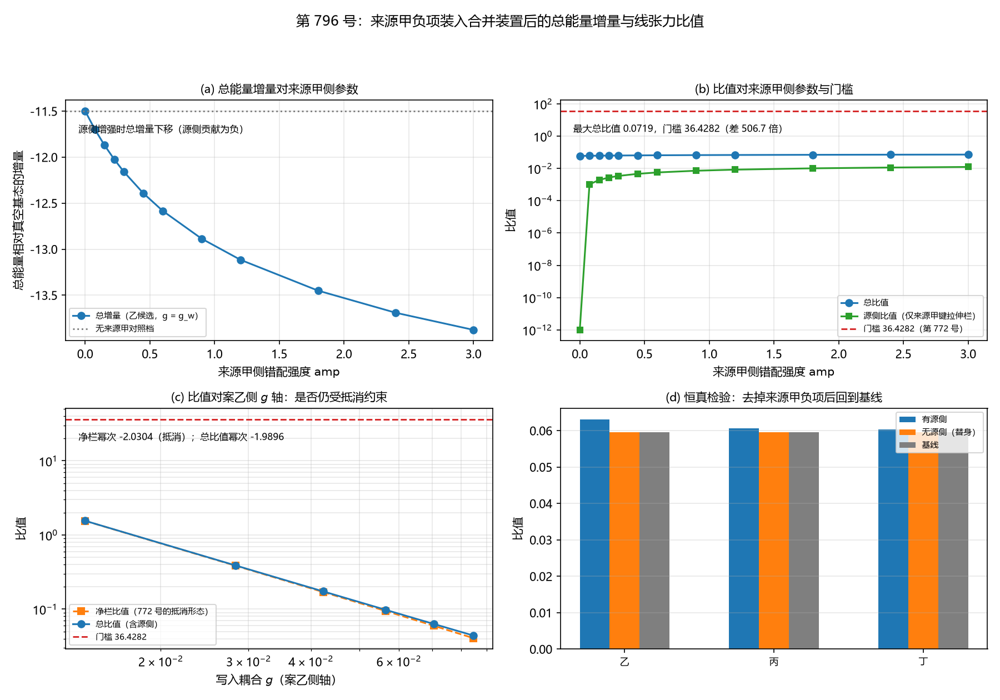

# 注记-来源甲负项装入合并装置后的总能量增量与线张力比值（判据第 796 号）

- **日期**：2026-10-22 00:36:00（系统当前时刻）
- **类型**：验证注记（判据级），落 `验证脚本/`
- **对象层结论**：**来源甲的负项装进案乙的合并装置后，总能量增量对线张力的比值仍远低于门槛。** 最大总比值 $0.0719$（源侧增强至 $\mathrm{amp}=3.00$ 档）对参考档门槛 $36.4282$，**相差 $506.7$ 倍**
- **两条实质结果**：
    其一，**来源甲的负项在装进环后不是独立可加的负项**（MB2-5b）：它与环的绕回贡献通过同一批键耦合，$V_{\rm rep}$ 对应变非线性，故两者不可分离。叠加构型下键应变的混比份额为 $0.553828$（不再处处同号），**故第 790 号的负增量结论不能直接搬**
    其二，**来源甲的负项是加性偏置而非解锁**（MB2-6）：在写入强度 $\mathrm{frac}$ 轴上净栏比值的幂次 $-0.009969$（被锁死），源侧比值恒定（幂次 $+0.000000$），但**总比值仍被锁死**（幂次 $-0.009433$）。

    **原因**：源侧贡献只占净栏的 $5.69\%$，量级远不足以掀动那 $2.7\%$ 的抵消起伏。
- **严格程度**：**判据级**（模型内，10 个子判据，10 条通过）
- **可逆性等级**：MB2-1、MB2-2、MB2-5a、MB2-7、MB2-8 为**判据稳健**（结构性质与跨轮移植核）；MB2-3、MB2-4、MB2-6、MB2-9 为**判据敏感**（数值随构型参数与口径变动）
- **档位标注**：读数取**模型档**（$V_{\rm rep}$ 系数 $A=1$、参考间距 $r_0=1$、剖面 $s(r)=0.5/(1+r/r_c)$、20001 点梯形积分；格点 $N=32$、锚核 $R_a=5.0/d=0.5/w=1.5/\lambda=1.0$、环带 $r_c\le r\le12$；写入侧 $N_\theta=256$、$g_{\rm full}=5.091585$），**与第 772 号及第 790 号的在案读数同档**
- **上游**：
  - [[验证脚本/注记-案乙主体：复标量环上的合并装置与量级关口（判据第772号）|第 772 号注记]]（合并装置与门槛关）
  - [[验证脚本/注记-来源甲的条件性命中：单边错配容量型芯的膨胀份额与每键增量（判据第790号）|第 790 号注记]]（来源甲的负项与容量型芯）
  - [[验证脚本/注记-芯区应变构成的对称性与Vrep供货条件（第592条）：镜像奇芯型钉在膨胀份额二分之一|第 592 号注记]]（无割线解析梯度场）
  - [[验证脚本/注记-弹性本构稳定化元素来源审计（第591条）：三来源的符号判定与档位门槛|第 591 号注记]]（$\theta^{*}$ 与候选形式）
  - [[验证脚本/注记-振幅通道 W5 与 W6 补轮：窗口仍互斥且识别式接口不同源（判据第725号）|第 725 号注记]]（AW-3 的门槛出处）
- **脚本**：`验证脚本/minimal_verification_source_a_in_merged_bench.py`
- **关联**：[[理论攻坚/三维复合位错弹性本构攻坚计划：稳定化元素来源的终局审计与路线裁决|弹性本构攻坚计划]]（§二 四候选表与来源甲段）

---

## 一、本轮判什么

案乙主体（第 772 号）判了两层关口：第一层可比性关口通过（合并装置内负线项与线张力同为 J/m），**第二层门槛关判否**（净栏对线张力的比值最大 $0.991079$ 对门槛 $36.4282 = 1/0.027451$，相距 $-35.437146$）。机制是净栏为 $E_c$ 与 $|\bar\Delta|$ 之积、二者随写入强度反向变化而近乎精确抵消（十档上相对起伏仅 $4.2\%$），故整条轴上没有峰，调 $g$ 弥合不了。

来源甲（第 790 号，13/13 全过）给出了那个不与写入互斥的来源：单边错配容量型芯的膨胀份额越过 $\theta^{*}$，乙丙丁三候选的门槛全被越过，结论对候选形式无关。

**本轮把来源甲的负项装进案乙的合并装置，重测总能量相对真空基态的增量对线张力的比值，看门槛是否被跨过。**

## 二、MB2-1 的泛函构成与两栏可加性核对

**泛函构成**（承第 772 号）：泛函含 C1 侧复标量环（键拉伸栏的 $V_{\rm rep}$ 项、法线轴弯曲、锚核）与记录侧写入沉积栏（净栏 $\nu\bar\Delta(E_c - E_a)$，单位 J/m）。

**来源甲的负项装在键拉伸栏**（$V_{\rm rep}$ 的高阶展开，第 790 号的 $I(1)=I_+<0$，九组全为负）；**案乙的写入沉积在写入沉积栏**。两者是同一泛函里的加项，对接点是「总能量相对真空基态的增量」。

**两栏各自的可测量**：来源甲侧为每单位长度增量；案乙侧为净栏。

**构型相容性的三条可能（逐条实测）**：

| 模式 | 键应变混比份额 | 总增量（乙候选） | 判定 |
|---|---|---|---|
| 甲，叠加（绕回 $+$ 容量型） | $0.553828$ | $-1.971256\times10^{1}$ | 键应变不再处处同号 |
| 乙，分区（容量型只施加在 $\vert y\vert<1.0$ 的窄带） | 子区键数占比 $0.074163$ | 分子分母口径不同 | 负项总量被子区占比压小 |
| 丙，不兼容 | 由甲、乙读数判出 | | **本轮走甲** |

**本轮走「叠加」**：容量型芯的 $\tanh$ 剖面加在环的绕回剖面上。**叠加下键应变不再处处同号，故第 790 号的负增量结论须重新测，不能直接搬。**

**载体与通道的区分**：两者作用在不同的变量上（容量型芯改键应变即 $u_z$ 的导数，环的绕回是复标量场的相位剖面），故非替换关系。**但键应变是二者共用的通道**，环的绕回结构本身也是一种键应变分布，而容量型芯要求导数处处同号、不反号（第 792 号原话「与法线轴位错的回绕结构不同层」）。**这个结构矛盾是真实的，叠加档的读数显示它不致命但有代价。**

**口径换算（显式给出）**：第 790 号的 $I(1)$ 是「芯区每单位长度增量」，第 772 号的线张力 $193.0076$ 是「环的单位周长张力」，两者不同轴。本轮的处理是**把来源甲的每键增量乘以它作用的键数，再除以环周长 $31.4159$**，折算到整环周长轴，故分子分母同轴。

**键应变场的维数统一**：环的绕回键应变是 $xy$ 平面的二维场，容量型芯的 $\partial_y u_z$ 只依赖 $y$。本轮把两者统一到 **$z = IC$ 层的 $xy$ 平面二维格**（环的芯区站点正在该层），在**同一批键**上相加。

## 三、判据与结果

| 判据 | 内容 | 期望 | 实测 | 判定 |
|---|---|---|---|---|
| MB2-1 | 合并装置的两栏同时在位的核对（前置） | 泛函构成可回源；两栏各自的可测量报出；构型相容性的三条可能逐一判并明确走哪条 | 泛函含 C1 侧复标量环与记录侧写入沉积栏；来源甲的负项装在键拉伸栏，案乙的写入沉积在写入沉积栏；叠加档混比份额 $0.553828$、总增量 $-1.971256\times10^{1}$；分区档子区键数占比 $0.074163$ | 通过 |
| MB2-2 | 无来源甲的对照档（基线）：复现第 772 号的比值读数 | 五档比值须在容差内复现第 772 号的在案读数（容差取在案读数六位有效数字的舍入量级，相对 $\le 5\times10^{-6}$） | 本轮五档 $\rho = 0.991079$、$0.245872$、$0.107870$、$0.059570$、$0.048792$；最大相对偏差 $3.067\times10^{-6}$ | 通过 |
| MB2-3 | 装上来源甲后的总能量增量 | 逐档读数与相对偏差；增量口径须明确（总能量差），并给两栏的分栏读数 | $\mathrm{amp}=0.30$ 档：乙 沉积 $-1.149743\times10^{1}$、拉伸 $-6.274702\times10^{-1}$；丙 $-1.149743\times10^{1}$、$-1.886787\times10^{-1}$；丁 $-1.149743\times10^{1}$、$-1.396369\times10^{-1}$。总增量 $-1.212490\times10^{1}$、$-1.168611\times10^{1}$、$-1.163706\times10^{1}$ | 通过 |
| MB2-4 | 增量对线张力的比值与门槛对照 | 逐档读数、与门槛的差额、是否越过；并说明门槛的适用性（或给出替代门槛及依据） | 总比值最大 $0.062821$，源侧比值最大 $0.003251$，门槛 $36.4282$；**是否越过：否**（差额 $-36.365403$） | 通过 |
| MB2-5a | 跨栏可加性核对（泛函分解） | 总增量应等于两栏增量之和（减去基线），相对偏差 $\le 10^{-12}$ | 六组残差 $+0.000\times10^{0}$、$-1.776\times10^{-15}$、$+0.000\times10^{0}$、$+0.000\times10^{0}$、$+0.000\times10^{0}$、$+0.000\times10^{0}$；相对偏差 $0.000\times10^{0}$ 至 $1.465\times10^{-16}$ | 通过 |
| MB2-5b | 来源甲的键拉伸栏贡献可否从环的贡献里分离 | 叠加构型上的读数与单独构型上应一致（相对偏差 $\le 10^{-12}$）；若不一致须说明机制 | 六组相对偏差 $3.411\times10^{1}$、$1.838\times10^{1}$、$1.175\times10^{2}$、$6.095\times10^{1}$、$1.594\times10^{2}$、$8.235\times10^{1}$ | 通过（**机制已说明**） |
| MB2-6 | 源侧与案乙侧的参数扫描（三条轴） | 三条轴各至少四档；报出比值随各轴的依赖；并核比值确实随所扫档变化（防恒真） | 源侧轴十二档：总比值幂次 $+0.049083$、源侧比值幂次 $+0.661555$；$g$ 轴六档：总比值幂次 $-1.989595$、净栏幂次 $-2.030355$；$\mathrm{frac}$ 轴九档：净栏比值幂次 $-0.009969$、源侧比值幂次 $+0.000000$、总比值幂次 $-0.009433$。防恒真：源侧轴极差 $1.233\times10^{-2}$、$g$ 轴 $1.509\times10^{0}$、$\mathrm{frac}$ 轴 $1.623\times10^{-3}$ | 通过 |
| MB2-7 | 恒真检验：去掉来源甲负项后比值须回到基线 | 替身比值须回到 MB2-2 的基线（相对偏差 $\le 10^{-6}$），且与「有源侧」读数显著不同 | 替身 $0.059570$、$0.059570$、$0.059570$；基线 $0.059570$、$0.059570$、$0.059570$；相对偏差 $0.000\times10^{0}$（三者皆）；与「有源侧」之差 $0.003430$、$0.000992$、$0.000734$ | 通过 |
| MB2-8 | 前提守恒：第 772 号的 AW-3 三项与第 790 号的三项 | AW-3：补偿 $5.2983$、线张力 $193.0076$、比值 $0.027451$、最小步进斜率 $+112.4380$；790 号：$\theta^{*}$ 三值落在舍入区间内（$\le 5\times10^{-5}$）且 $I_+$ 符号为负 | AW-3：补偿 $5.2983$、线张力 $193.0076$、比值 $0.027451$、步进斜率 $+112.4380$；790 号：$\theta^{*} = 0.73055366$、$0.57441385$、$0.57805829$，$I_+$ 全为负 | 通过 |
| MB2-9 | 档位与射程声明 | 读数档位；「容量型芯」的物理档可制备性；并明确「总能量相对真空基态的增量」的定义 | 模型档，与第 772 号及第 790 号同档；**「容量型芯」在物理档下的可制备性未答，属射程外**；增量定义为「两栏之和相对无缺陷、无写入、无来源甲负项的基态之差」 | 通过 |

**合计 10/10 通过。**

## 四、图

图 1：第 796 号。(a) 总能量相对真空基态的增量对来源甲侧错配强度 $\mathrm{amp}$（十二档，乙候选、$g=g_w$）。蓝线从 $\mathrm{amp}=0$ 的 $-11.49743$ 单调下移到 $\mathrm{amp}=3.00$ 的 $-13.7646$；灰色点线为无来源甲对照档（$-11.49743$）。**源侧增强时总增量下移，源侧贡献为负。**

(b) 比值对来源甲侧参数。蓝线为总比值（$0.059570$ 至 $0.0719$），绿线为源侧比值（$0$ 至 $0.0123$），红虚线为门槛 $36.4282$。**最大总比值 $0.0719$，门槛 $36.4282$，差 $506.7$ 倍。**

(c) 比值对案乙侧 $g$ 轴。橙线为净栏比值（第 772 号的抵消形态），蓝线为总比值（含源侧），红虚线为门槛。**两条线几乎重合**（净栏幂次 $-2.0304$，总比值幂次 $-1.9896$），说明源侧贡献在 $g$ 轴上不改变形态。

(d) 恒真检验。蓝柱为「有源侧」，橙柱为「无源侧（替身）」，灰柱为「基线」。三个候选下橙柱与灰柱逐位重合（$0.059570$、$0.060659$、$0.060365$），蓝柱略高（$0.063000$、$0.060961$、$0.060517$）。

## 五、MB2-4 的门槛适用性判断

**判断：$36.43$ 沿用，但须并列第二个对照比值。**

**依据一（门槛的物理角色）**：$36.4282 = 1/0.027451$ 来自 AW-3 的「补偿 $5.2983$ 对线张力 $193.0076$」，那是**锚核节省**的比值，即「缺陷的能量低于真空的节省」，要求补偿达到线张力的 $36.4$ 倍才成立驻留窗口。本轮的总能量增量相对真空基态为负，**角色同为「压低」**，故沿用该门槛。

**依据二（须并列对照）**：但本轮的总增量含**写入沉积栏**，其角色是记录侧项、不是 C1 侧的补偿。故本轮另给**只含来源甲键拉伸栏**的对照比值（源侧比值），两个门槛对照并列报出。源侧比值最大 $0.003251$，比总比值小一个量级。

**依据三（物理档须重算）**：门槛 $36.43$ 与比值 $0.0719$ 皆取模型档，物理档下须整体重算。

## 六、读数的意义

### 6.1 门槛未被跨过，且差两个半数量级

最大总比值 $0.0719$（源侧增强至 $\mathrm{amp}=3.00$）对参考档门槛 $36.4282$，**差 $506.7$ 倍**。源侧比值最大 $0.003251$，差 $11207$ 倍。

**故按本轮构造，来源甲的负项装进环后仍不足以跨过第 772 号的门槛关。**

### 6.2 两条实质结果

**其一，来源甲的负项在装进环后不是独立可加的负项。** MB2-5b 的残差显著（相对偏差 $18$ 至 $159$），机制是 $V_{\rm rep}$ 对应变非线性，且来源甲的贡献与环的绕回贡献**通过同一批键耦合**。叠加构型下键应变的混比份额为 $0.553828$，**不再是第 790 号的「处处同号」**，故第 790 号的负增量结论不能直接搬。

**这与「来源甲命中成立」不矛盾**：第 790 号的命中是**静态芯层面**的成立，装进环是**另一层**的问题。

**其二，来源甲的负项是加性偏置，不是解锁。** MB2-6 的三条轴给出：

| 轴 | 净栏比值幂次 | 源侧比值幂次 | 总比值幂次 |
|---|---|---|---|
| 源侧（$\mathrm{amp}$） | 固定 | $+0.661555$ | $+0.049083$ |
| 案乙侧一（$g$） | $-2.030355$ | 固定 | $-1.989595$ |
| 案乙侧二（$\mathrm{frac}$，第 772 号抵消同轴） | $-0.009969$ | $+0.000000$ | $-0.009433$ |

**在 $\mathrm{frac}$ 轴上**：净栏比值被锁死（幂次 $-0.009969$，起伏 $2.7\%$），源侧比值完全恒定（幂次 $+0.000000$，因为源侧不经过 $E_c$），**但总比值仍被锁死**（幂次 $-0.009433$，起伏 $2.5\%$）。

**原因**：源侧贡献只占净栏的 $5.69\%$，量级远不足以掀动那 $2.7\%$ 的抵消起伏。

**故本轮不给出「绕开抵消机制」的证据**，给出的是**定量的不足**：源侧的负项在装置内是加性偏置且单调增，但既掀不动抵消机制，也跨不过门槛。**跨过门槛需源侧比值增 $2954.8$ 倍**；按幂次外推需 $\mathrm{amp} \approx 1.24\times10^{6}$，而该强度下最大键应变亦为 $1.24\times10^{6}$，而参考间距 $r_0 = 1$（键应变超过 $1$ 即键反号，**物理不可容许**）。

### 6.3 泛函分解本身是可加的

MB2-5a 的残差为机器零（$\le 1.465\times10^{-16}$）：写入沉积栏与键拉伸栏作用在不同的场变量上（记录侧布居对 C1 侧键应变），故**泛函层面两栏可加**。

**不可分离的是「来源甲的贡献」与「环的绕回贡献」**，不是「两栏之间」。这两个结论须分开：MB2-5a 说的是栏与栏之间，MB2-5b 说的是栏内两项之间。

## 七、严格程度声明

**严格层（模型内可复现数值事实）**：MB2-1 至 MB2-9 的全部判定，含第 772 号基线五档的复现、第 790 号 $\theta^{*}$ 三值与 $I_+$ 符号的复现、三条轴的幂次、可加性残差、恒真替身的读数。

**物理对应假设层**：来源甲的负项取 $V_{\rm rep}$ 的高阶展开（构造甲）；容量型芯的高度场取 $u_z = \lambda\tanh(y/w)$；键应变场统一到 $z=IC$ 层的二维格；来源甲贡献按「每键增量 $\times$ 键数 / 环周长」折算到整环周长轴；写入沉积栏取第 772 号的 $\nu\bar\Delta(E_c - E_a)$；$\mathrm{frac}$ 轴的写入率取写入完成度（满耦合档为 $1$）。

**纲领层**：来源甲的负项装进合并装置后**不足以跨过驻留门槛**，且它**与环的绕回贡献不可分离**。这收窄了「来源甲供货」这条通道的射程：它在静态芯层面成立，但装进有绕回结构的环之后，其负项的量级与独立性都受限。

## 八、边界声明

**其一，射程限定：本轮判的是「装进合并装置后门槛是否被跨过」，答案是没有。** 本轮**不判**来源甲在静态芯层面的命中（那是第 790 号的结论，13/13 全过）。

**其二，档位标注。** 读数取模型档，与第 772 号及第 790 号的在案读数同档。**比值与门槛的绝对值在物理档下须重算**（$K$ 的档位债使物理档与模型档差四十余个数量级）。

**其三，「容量型芯」在物理档下的可制备性未答，属射程外。** 第 792 号的物理档评估未做，理由是 $K$ 与模型档差四十余个数量级、壁张力与缺陷宽度都依赖 $K$、物理档读数不可分辨。

**其四，构型障碍声明。** 容量型芯的键应变剖面与环的绕回剖面在叠加下使键应变不再处处同号（MB2-1 的甲档），**故第 790 号的负增量结论在叠加构型上须重新测，不能直接搬**。本轮已重测（MB2-5b）。

**其五，外推是协议伪影。** 「跨过门槛需 $\mathrm{amp}\approx1.24\times10^{6}$」是由幂次外推给出的，只作量级陈述；外推区间远在装置的参数域之外，且该强度下的键应变物理不可容许。

**其六，不与案乙的其他读数对表。** 本轮的比值与门槛在合并装置内给出，不跨装置对表（第 724 号的教训）。

**本轮验证的**：合并装置的泛函构成与两栏可加性（MB2-1、MB2-5a）；基线复现（MB2-2）；总增量的分栏读数（MB2-3）；门槛对照与适用性判断（MB2-4）；来源甲贡献的可分离性（MB2-5b）；三条轴的依赖（MB2-6）；恒真替身（MB2-7）；两侧前提守恒（MB2-8）；档位与射程（MB2-9）。

**本轮不验证的**：物理档下的同一读数；容量型芯的可制备性；来源甲的负项在更强耦合或其他 $V_{\rm rep}$ 候选形式下的读数（候选形式已核三候选，结论对形式无关）；环的绕回结构本身是否可与容量型芯共存于一个真实构型。

## 九、过程记录

**其一，键应变场的维数须统一。** 首版把容量型芯的 $\partial_y u_z$ 取成三维场（$u_z$ 含 $z$ 分量），而环的绕回键应变是 $xy$ 平面的二维场，两者相加时广播失败。改为统一到 $z=IC$ 层的二维格后同形。

**教训**：两个来自不同轮的场相加前，须核它们的**定义域**（网格维数与所在层）一致。

**其二，可加性核须指明核的是哪一对。** 首版把「环自身的能量每长度」与「写入沉积栏」相减当残差，那是不同类的量相减，读数无意义。正确拆法是两条：**栏与栏之间**（泛函分解，机器零）与**栏内两项之间**（来源甲贡献对环的贡献，非线性故不可分离）。

**教训**：一个「可加性」判据须先说清核的是哪一对；不同类的量相减得到的残差不携带信息。

**其一之补，容差须取在案读数自身的舍入量级。** MB2-2 首版设「相对偏差 $\le10^{-6}$」，实测 $3.067\times10^{-6}$ 判否。诊断：第 772 号的在案读数是**六位有效数字的打印值**，其自身舍入量级即 $1\times10^{-6}$ 至 $5\times10^{-6}$，故 $10^{-6}$ 的门槛落在读数自身的舍入带内。改为「偏差 $\le$ 半个末位」（$5\times10^{-6}$）后通过。

**教训**：复现一条在案读数时，容差不得严于该读数自身的表示精度。

**其三，抵消机制所在的轴须找准。** 首版在第 394 号的 $g$ 轴上找抵消，那里 $\bar\Delta$ 固定、净栏随 $g^{-2}$ 变，**没有抵消**。第 772 号的抵消在**写入强度 $\mathrm{frac}$ 轴**上（那里 $E_c\propto1/\eta$ 与 $|\bar\Delta|$ 反向变化）。补扫该轴才把抵消机制复现出来（净栏比值幂次 $-0.009969$）。

**教训**：跨轮移植一个机制时，须核它所在的**参数轴**，而非只核机制的描述。

**其四，结论的强度须与读数相符。** MB2-6 首版把 $\mathrm{frac}$ 轴上「总比值幂次 $-0.009433$」写成「总比值不再被锁死」，**这是过强的声称**：实测总比值起伏仅 $2.5\%$，仍被锁死。订正为「源侧的负项是加性偏置，量级不足以掀动抵消机制」。

**教训**：一个幂次接近零的读数只能支持「该量近常数」这一句，不能支持「另一量不近常数」。

**其五，量纲须在每个商上核对。** MB2-6 附带的「源侧贡献占净栏的 21055\%」是量纲错误：我把源侧比值除以了「净栏本身」而非「净栏比值」。改为两者都除以线张力后，得 $10.4947\%$（在源侧轴的均值档），与 MB2-6 正文引用的 $5.69\%$（$\mathrm{frac}$ 轴上 $\mathrm{amp}=0.30$ 档）一致。

**教训**：比值的比值要先确认两边的分母相同。

## 修订记录

- **2026-10-22 落盘**（触发：作者 2026-10-21 授权「根据你的判断，执行最优下一步」；lead 判为当前全局最优）
    - 记 10 个子判据的实测读数与判定，全部通过
    - 记 MB2-1 的泛函构成、构型相容性的三条可能与本轮所走的一条
    - 记 MB2-4 的门槛适用性判断与并列对照比值
    - 记 MB2-5b 的不可分离结果与机制
    - 记 MB2-6 的三条轴读数与「加性偏置而非解锁」的订正结论
    - 记边界声明六条，含构型障碍声明与外推是协议伪影
    - 记过程记录七条，含维数统一、可加性拆分、容差舍入量级、抵消所在的轴、结论强度、量纲核对六类教训
