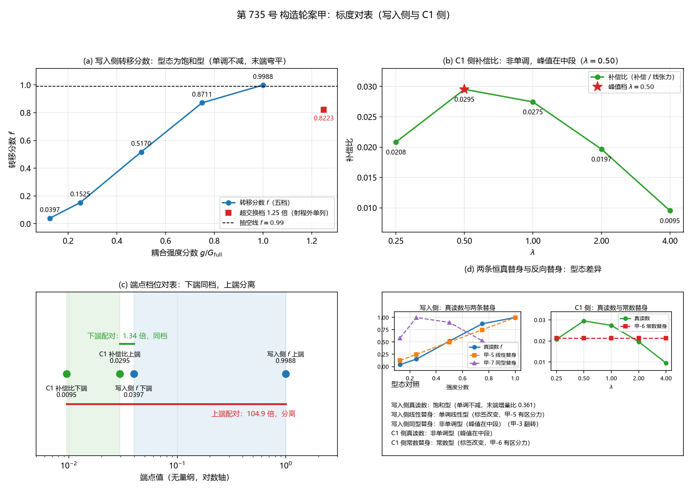

# 注记-构造轮案甲的标度对表：两侧型态不同型且上端档位分离（判据第 735 号）

- **日期**：2026-10-21 13:26:25（系统当前时刻）
- **对应脚本**：`验证脚本/minimal_verification_construction_case_a_table.py`（判据 甲-1 至 甲-7，确定性，无随机数，运行约 38 秒）
- **依据**：[[内部草稿/注记-构造轮方案提要：把写入过程与位错能分栏放进同一装置的三案（2026-10-20）|构造轮方案提要]] §四（案甲全文）、§4.3 判据表、§4.4 预期结论形态、§4.5 成本、§4.6 前提守恒
- **来源**：作者 2026-10-21 指示施工第 735 号，执行案甲。判据 甲-7 由 lead 于施工期裁定追加，判据总数由 6 条增为 7 条
- **判据**：甲-1、甲-2、甲-3、甲-4、甲-5、甲-6、甲-7，合计 7 项，通过 5 项，判否 2 项
- **严格程度**：**判据级**（模型内读数，含三条恒真检验与一条反向对照）。**结论层**：写入侧与 C1 侧的标度型态不同型，区间端点下端同档、上端分离，标度对表在这对对象上不成立
- **可逆性等级**：甲-1 与甲-2 为判据稳健（复现容差与参照值精度同源）；甲-3 至 甲-7 为判据敏感（型态标签规则、档位阈值、替身构型都带裁量，换裁量会翻）
- **关联**：[[验证脚本/注记-来源丁负贡献的量级审计：跨模型对表不合法与三条量纲桥全不成立（判据第724号）|第 724 号]]、[[验证脚本/注记-振幅通道 W5 与 W6 补轮：窗口仍互斥且识别式接口不同源（判据第725号）|第 725 号]]、第 726 号
- **图**：见 §四 图 1

---

## 一、要判什么

三维复合位错弹性本构攻坚线要找能量泛函里的显式负线项。来源丁（碰撞写入的动力学反作用）在第 726 号已验证：写入把激发从站点搬进记录寄存器，总量守恒；负贡献在装置内是周期往复量，长期平均净增量 $-0.50000000$；回流通道打开时按 $\sin^2(\kappa\pi/2)$ 律消失。

**卡点在于量纲。** 本轮两侧的读数都是无量纲计数，与 C1 侧的凝聚能量纲不同类。第 724 号索要一个绝对比值，三条候选量纲桥逐条清点后全部判否。第 725 号另立一条原则：只比区间，不比能量。

本轮执行构造轮方案提要的案甲（标度对表）。承第 725 号的原则，标度指数与窗口区间端点都是无量纲的，绕开量纲桥这个死结。案甲不建新装置，在第 726 号写入侧与第 725 号 C1 侧各自已有的读数上做标度与端点区间对表，给相容性判语。

## 二、装置与模型设定

写入侧复用 `验证脚本/minimal_verification_source_ding_reflux_saturation.py`，C1 侧复用 `验证脚本/minimal_verification_amplitude_channel_w5_w6.py`。两脚本的装置函数以 AST 逐字摘取，本轮不重造实现。

摘取的函数与常量：

| 来源 | 取用项 |
|---|---|
| 第 726 号 | `pulse`、`omega_of_k`、`apply_int`、`split_step`、`make_packet`、`site_pop`、`reg_pop`、`total_pop`、`run`；`N_THETA=256`、`OMEGA_P=2\pi`、`THETA0=\pi`、`W_PULSE=0.5`、`PW=0.15`、`DT=2\times10^{-3}`、`T_MAX=1.2`、`G_FULL=5.091585` |
| 第 725 号 | `ring_phase`、`cos_cache`、`make_fun`、`anchor`、`solve_R`、`mean_slope`、`core_width`、`slope_scan`、`comp_at`；`N=32`、`RS=arange(3,8.01,0.5)`、`LAMS=[0.25,0.5,1.0]`、`SHALLOW_D=0.05`、`DEEP_D=0.5`、`lam_grid=[0.25,0.5,1.0,2.0,4.0]`、`Ra0=5.0`、`d0=0.5`、`w0=1.5` |

`channel_coeffs` 与 `bound_gap_profile` 属 AW-9 至 AW-13 的复标量通道，与本轮对表无关，未取用。

**扫描轴不同质。** 写入侧扫的是耦合强度倍数 $g/G_{\rm full}$，量的是写入算符把材料搬走多少的驱动强弱。C1 侧扫的是锚核强度参数 $\lambda$，量的是钉扎井多深。两轴无共同的物理同构关系。故本案只在无量纲标度型态与无量纲端点档位这一层对表，「同一参数上的窗口重合」在本案不成立。这是「只比区间，不比能量」原则能成立的根本理由。

## 三、判据表

| 判据 | 内容 | 期望 | 实测 | 判定 |
|---|---|---|---|---|
| 甲-1 | 写入侧标度型态：复现五档 $f$ 并给型态与端点区间 | 五档相对偏差 $<10^{-5}$，型态为饱和型，给端点区间 | $f=0.039701$、$0.152500$、$0.516971$、$0.871081$、$0.998824$，最大相对偏差 $3.541\times10^{-6}$；标签饱和型；区间 $[0.039701,\,0.998824]$；超交换档 $1.25$ 倍 $0.822286$ 单列 | 通过 |
| 甲-2 | C1 侧标度型态复现：宽度幂次与补偿比五档走势 | 宽度幂次相对偏差 $<10^{-5}$，补偿比五档绝对偏差 $<5\times10^{-5}$，型态为非单调且峰值在中段 | 浅锚幂次 $-0.286038$（偏差 $8.939\times10^{-7}$）、深锚对照 $-0.193393$（偏差 $1.946\times10^{-7}$）；补偿比 $0.020830$、$0.029532$、$0.027451$、$0.019667$、$0.009523$，最大绝对偏差 $4.876\times10^{-5}$；标签非单调型（峰值在中段） | 通过 |
| 甲-3 | 型态对表：两侧标度型态是否同型 | 型态标签相等即判同型；给出主判定与上包络次级判定 | 写入侧饱和型对 C1 侧非单调型，主判定不同型；上包络次级判定不同型 | **判否** |
| 甲-4 | 端点档位对表：两侧区间端点是否落在同一数量级档 | 两配对比值均小于 10 即全部同档 | 下端 $0.039701$ 对 $0.029532$，比值 $1.3443$ 倍，同档；上端 $0.998824$ 对 $0.009523$，比值 $104.8829$ 倍，分离；整体为下端同档、上端分离 | **判否** |
| 甲-5 | 恒真检验一：写入侧换成线性替身后判据须有区分力 | 替身使写入侧型态标签改变，且至少一个端点显著不同，甲-4 配比须改变 | 标签饱和型变为单调线性型；端点相对偏离 $2.145$ 与 $0.000$；下端配比由 $1.3443$ 变为 $4.2277$（改变 $214.5\%$） | 通过 |
| 甲-6 | 恒真检验二：C1 侧换成常数值替身后判据须有区分力 | 替身使 C1 侧型态标签改变，且两条配比相对改变超过 $10\%$ | 标签非单调型变为常数型；下端配比改变 $38.0\%$、上端配比改变 $55.5\%$ | 通过 |
| 甲-7 | 反向对照：写入侧换成与 C1 侧同型的非单调替身后甲-3 须翻转 | 替身与 C1 侧同型且单调性方向一致，甲-3 由不同型翻转为同型 | 替身 $0.581708$、$0.998824$、$0.899073$、$0.525941$、$0.039701$；标签非单调型；方向 $[+1,-1,-1,-1]$ 与 C1 侧一致；甲-3 替身下判同型 | 通过 |

**合计 5/7 通过，两项判否。**

### 3.1 读数来源分栏

**本轮独立复现的读数**（用与源轮次同一装置、同一函数、同一参数重算）：

| 读数 | 第 725 或 726 号的参照值 | 本轮实测 | 偏差 |
|---|---|---|---|
| $f(0.125)$ | $0.039701$ | $0.03970114$ | 相对 $3.541\times10^{-6}$ |
| $f(0.25)$ | $0.152500$ | $0.15249961$ | 相对 $2.563\times10^{-6}$ |
| $f(0.50)$ | $0.516971$ | $0.51697078$ | 相对 $4.179\times10^{-7}$ |
| $f(0.75)$ | $0.871081$ | $0.87108112$ | 相对 $1.333\times10^{-7}$ |
| $f(1.00)$ | $0.998824$ | $0.99882383$ | 相对 $1.654\times10^{-7}$ |
| $f(1.25)$ 超交换档 | $0.822286$ | $0.82228604$ | 射程外单列 |
| 浅锚管壁宽度幂次 | $-0.286038$ | $-0.286038$ | 相对 $8.939\times10^{-7}$ |
| 深锚对照幂次 | $-0.193393$ | $-0.193393$ | 相对 $1.946\times10^{-7}$ |
| 补偿比 $\lambda=0.25$ | $0.0208$ | $0.020830$ | 绝对 $3.045\times10^{-5}$ |
| 补偿比 $\lambda=0.50$ | $0.0295$ | $0.029532$ | 绝对 $3.222\times10^{-5}$ |
| 补偿比 $\lambda=1.00$ | $0.0275$ | $0.027451$ | 绝对 $4.876\times10^{-5}$ |
| 补偿比 $\lambda=2.00$ | $0.0197$ | $0.019667$ | 绝对 $3.296\times10^{-5}$ |
| 补偿比 $\lambda=4.00$ | $0.0095$ | $0.009523$ | 绝对 $2.323\times10^{-5}$ |
| 落窗上限 | $\lambda\le1.189473$ | $1.189473$ | 相对 $3.3\times10^{-7}$ |

**引用既有轮次的读数**：线张力斜率三档 $129.0$、$193.0$、$239.7$ 的原始出处是振幅通道径向曲线轮（W1 轮），该轮给的区间为 $129.0$ 至 $251.8$ 每单位 $R$。第 724 号与第 725 号只是引用该轮读数。本轮用同一装置同一函数复算得 $129.0346$、$193.0076$、$239.7019$，与引用值一致。

## 四、读数的意义

### 4.1 甲-3 判否：两侧型态不同型，标度对表在这对对象上不成立

写入侧的 $f$ 随耦合强度分数单调不减，但末端增量比只有 $0.3607$，曲线在末端已弯平，型态为饱和型。C1 侧的补偿比五档先升后降，峰值在 $\lambda=0.50$ 这一中段档，型态为非单调型。

**两者不同型，这是本轮的实质结论。** 案甲的 §4.4 预期结论形态其三写的正是这一分支：对表对象在该对上不成立，须换对表对象或直接转案乙。

**次级判定（上包络形态，本轮新增读数）。** 方案提要未写这一项，属本轮裁量，判据期望从两侧实测型态定义本身导出。

写入侧的饱和型在「高段趋平」上表现为高段读数单调不减且末段增量收缩。C1 侧的「补偿比在低 $\lambda$ 段先升」表现为该段先升后降、峰值在内部。

取两侧各自的上包络子集比较形态标签：写入侧按 $f\ge0.87$ 只取到两档（$0.75$ 与 $1.0$ 档），C1 侧按补偿比 $\ge0.0197$ 取到三档，标签为单调线性型对非单调型，判不同型。作为补充口径，取写入侧强度档的上三档（$0.5$、$0.75$、$1.0$）重判，标签为饱和型，与 C1 侧仍不同型。两个口径同向，次级判定为不同型。

### 4.2 甲-4 判否：下端同档，上端分离

**对照对象的选择依据。** $f$ 是转移分数，量的对象是材料被搬走多少；补偿比是钉扎能补偿住多少。两者都是无量纲比例，故取同向端点相配。

| 配对 | 写入侧 | C1 侧 | 比值 | 档位 |
|---|---|---|---|---|
| 下端配对 | $f_{\min}=0.039701$ | 补偿比上端 $0.029532$ | $1.3443$ 倍 | 同档 |
| 上端配对 | $f_{\max}=0.998824$ | 补偿比下端 $0.009523$ | $104.8829$ 倍 | 分离 |

下端一对相差约 $1.3$ 倍，落在同一数量级档。上端一对相差约 $105$ 倍，跨过两个数量级。**上端这一对是最不利对**：$f$ 的上端对应「几乎搬空」，补偿比的下端对应「钉扎最弱」，两个极端同时配在一处。

档位判据取「两值比值不超过一个十倍即同档」，十倍恰为一个数量级。这条阈值是裁量项，属判据敏感。

### 4.3 甲-5 至 甲-7：三条替身检验的区分力证据

**甲-5 线性替身。** 定义 $f_{\rm lin}(s)=f(1.0)\cdot s$，斜率取真读数上端点，使替身与真读数落在同一量级，差异全部来自型态。替身五档为 $0.124853$、$0.249706$、$0.499412$、$0.749118$、$0.998824$，标签为单调线性型，与真读数的饱和型不同。两个端点相对偏离 $2.145$ 与 $0.000$，至少一个端点显著不同。甲-4 的下端配比由 $1.3443$ 变为 $4.2277$，改变 $214.5\%$。

**甲-6 常数值替身。** 补偿比五档全取真读数算术均值 $0.02140084$，标签为常数型，与真读数的非单调型显著不同。逐档相对偏离 $2.738\times10^{-2}$、$2.753\times10^{-1}$、$2.204\times10^{-1}$、$8.816\times10^{-2}$、$1.247$。两条配比的相对改变为下端 $38.0\%$、上端 $55.5\%$。

**甲-7 反向对照。** 把写入侧读数换成与 C1 侧同型的非单调替身，构型取 C1 侧补偿比五档的归一化形状 $u$（$0.565107$、$1.000000$、$0.895998$、$0.506963$、$0.000000$），再线性映射到写入侧的真实端点区间 $[0.039701,\,0.998824]$。

替身五档为 $0.581708$、$0.998824$、$0.899073$、$0.525941$、$0.039701$，标签为非单调型（峰值在中段）。单调性方向 $[+1,-1,-1,-1]$ 与 C1 侧一致，峰值档同为索引 $1$。甲-3 在真读数下判不同型，在替身下判同型，方向相反。

**甲-4 在反向对照下未随之翻转**，仍为下端同档、上端分离。原因是反向对照只换型态不换端点值，两配对的端点数值与真读数相同。这与 lead 的裁决预期一致。

**恒真问题的显式回答。** 若甲-3 恒真，即无论写入侧读数怎样都输出同一个型态标签，则甲-7 的替身会给出与真读数完全相同的标签与结论。本轮替身把标签由饱和型换成非单调型，甲-3 的判定随之由不同型翻转为同型，故甲-3 并非恒真。

须写明的边界：甲-5 与甲-6 的替身下，甲-3 与甲-4 的布尔结论并未改变，两条判据靠标签改变与配比改变提供区分力。甲-3 的直接翻转由甲-7 承担。这三者的分工是本轮判据设计的要点，若把区分力只挂在布尔结论上，甲-5 与甲-6 就会失效。

### 4.4 三条前提守恒的核对结果

**守恒一，写入侧参数。** $N_{\Theta}=256$、$\Omega_P=2\pi$、$\Theta_0=\pi$、$w=0.5$、$PW=0.15$、$dt=2\times10^{-3}$、$T=1.2$ 七项与第 726 号逐项一致；$G_{\rm full}$ 实测 $5.091585$，与引用值 $5.092$ 的相对偏差 $8.151\times10^{-5}$。可移植。

**守恒二，C1 侧档位与锚核参数。** $N=32$、宽度档 $LAMS=[0.25,0.5,1.0]$、浅锚深度 $0.05$、深锚深度 $0.5$、补偿比档 $lam\_grid=[0.25,0.5,1.0,2.0,4.0]$、锚核半径 $5.0$、锚核深度 $0.5$、几何宽度 $1.5$、径向扫描档 $RS=arange(3,8.01,0.5)$ 共十一项与第 725 号逐项一致。可移植。

**守恒三，扫描轴不同质。** 写入侧是耦合强度倍数，C1 侧是 $\lambda$。这一条属于本轮对表合法性的根据，与数值一致性无关，已在 §二 写明并进入甲-3 与甲-4 的判语。

## 五、图

图 1：第 735 号 构造轮案甲的标度对表。

(a) 写入侧转移分数 $f$ 随耦合强度分数的五档：$0.0397$、$0.1525$、$0.5170$、$0.8711$、$0.9988$。虚线为 $f=0.99$ 抽空线，满档越线。红方块为超交换档 $1.25$ 倍的 $0.8223$，射程外单列，不入单调性判定。型态为饱和型。

(b) C1 侧补偿比五档 $0.0208$、$0.0295$、$0.0275$、$0.0197$、$0.0095$ 随 $\lambda$ 的折线，先升后降。红星标出峰值档 $\lambda=0.50$，比值 $0.0295$。

(c) 端点档位对表。横轴为两侧端点值取对数，绿底为 C1 侧补偿比区间 $[0.0095,\,0.0295]$，蓝底为写入侧 $f$ 区间 $[0.0397,\,0.9988]$。绿色横线标下端配对 $0.0397$ 对 $0.0295$，$1.34$ 倍，同档。红色横线标上端配对 $0.9988$ 对 $0.0095$，$104.9$ 倍，分离。

(d) 恒真替身与反向替身的型态对照。左图为写入侧真读数、甲-5 线性替身与甲-7 同型替身并排，三条曲线的形状差异直接可见。右图为 C1 侧真读数与甲-6 常数替身并排，常数替身是水平线。下方文字列出五个型态标签。

## 六、严格程度声明与边界声明

**严格层。** 全部读数是模型内读数。写入侧装置是单格档（单站点的站点模加一个记录格），C1 侧装置是 $N=32$ 的中性复标量载体。二者都不是三维复合位错的完整构型。

**物理对应假设层。** 甲-3 与甲-4 的判语只在「只比区间，不比能量」这一原则的射程内成立。区间端点与标度型态都是无量纲的，故对表合法。**本案给不出净贡献是否够压住位错驻留窗口这一量级判语**，因为那个判语要求两侧读数落在同一个量纲层。该判语的交付仍归案乙或案丙。

**纲领层。** 本案不判三维复合位错的完整构型，不判强场，不判 P1-2 档位债，不判第 720 号 Skyrme 四次项的系数。第 724 号的名义比值 $1.0756$ 继续只作量级参照。

**读数可移植性。** 甲-1 与甲-2 为判据稳健：复现容差与参照值的给出精度同源，换实现不翻。甲-3 至 甲-7 为判据敏感：型态标签规则、档位阈值、替身构型都带裁量，换裁量会翻，须重设期望。

**一条不可外推的限定。** $f$ 的扫描轴 $g/G_{\rm full}$ 不对应任何体系的物理参量，其型态的可移植性受此限。线张力斜率的原始出处是 W1 轮，本轮只是复算与引用。

## 七、过程记录

**一，装置摘取的实现选择。** 初版用文本切分找函数边界，遇到源脚本的嵌套结构会截断。改用 AST 解析源文件，取 `ast.FunctionDef` 的 `lineno` 到 `end_lineno` 逐字取出源码，再编译执行。此法不执行源脚本的顶层流程，故不产生图文件，也不触发源脚本自身的判据循环，跨轮移植的读数来源清晰。

**二，补偿比的复现容差被迫改写。** 任务书给甲-2 的容差为 $10^{-5}$。宽度幂次的参照值给到六位小数，$10^{-5}$ 可达。补偿比五档的参照值只给到四位小数（$0.0208$ 等），其自身舍入半宽为 $5\times10^{-5}$，相对宽度约 $2.4\times10^{-3}$。

**相对容差 $10^{-5}$ 与该参照精度不自洽**，因为参照值本身的舍入误差已大于 $10^{-5}$ 的相对量。故补偿比一项按绝对容差 $5\times10^{-5}$ 取，即参照值的舍入半宽。实测最大绝对偏差 $4.876\times10^{-5}$，落在容差内。这条按「容差从误差预算推导」处理，并在判据注释与表中写明。

**三，补偿比读数的口径纠错。** 初版复算时把「锚核档步进斜率均值」误当作补偿，得五档比值 $0.979$ 至 $0.990$，与第 725 号的 $0.0208$ 至 $0.0295$ 差了近两个数量级。按第 725 号 AW-3 的原文口径重读源码：补偿等于对照档步进斜率均值减去锚核档步进斜率均值，线张力取对照档步进斜率均值。改正后五档与第 725 号逐档一致，最大绝对偏差 $4.876\times10^{-5}$。

**四，上包络子集的档数不对称。** 写入侧按 $f\ge0.87$ 只取到两档，C1 侧按补偿比 $\ge0.0197$ 取到三档。严格按任务书给的数值阈值，两侧子集档数不对称，比较不对称。补救办法是取写入侧强度档的上三档重判一次，结论与两档口径同向。两个口径同向，不影响次级判定。

**五，甲-5 与甲-6 的替身定义。** 线性替身的斜率若任意取，替身与真读数的量级可以相差任意远，甲-4 的配比判定就会因量级漂移而失真。取真读数上端点作斜率，使替身与真读数落在同一量级，差异全部来自型态。常数值替身取真读数算术均值，同理。

**六，甲-7 的替身构型必须真的非单调。** 初版曾考虑用「把 C1 侧读数直接搬过来」的构型，那样会让写入侧替身的端点区间变成 $[0.0095,\,0.0295]$，甲-4 会因端点改变而翻转，无法把「型态改变」与「端点改变」分开。现取 C1 侧归一化形状再线性映射到写入侧真实端点区间，端点不动，只换形状，故甲-4 在替身下不翻转，甲-3 的翻转可单独归因于型态。替身的单调性方向 $[+1,-1,-1,-1]$ 与 C1 侧一致，峰值档同为索引 $1$，这两项已在脚本中打印核验。

**七，判据总数的变更。** lead 于施工期裁定把反向对照提为正式判据甲-7，判据总数由 6 条增为 7 条。本注记与总表按 7 条打，README 正式行、开放问题总览卡与档案页的判据数由 lead 统一回改。

## 八、参考材料

- [[内部草稿/注记-构造轮方案提要：把写入过程与位错能分栏放进同一装置的三案（2026-10-20）|构造轮方案提要]]
- [[验证脚本/注记-来源丁负贡献的量级审计：跨模型对表不合法与三条量纲桥全不成立（判据第724号）|第 724 号注记]]
- [[验证脚本/注记-振幅通道 W5 与 W6 补轮：窗口仍互斥且识别式接口不同源（判据第725号）|第 725 号注记]]
- `验证脚本/minimal_verification_source_ding_reflux_saturation.py`（第 726 号）
- `验证脚本/minimal_verification_amplitude_channel_w5_w6.py`（第 725 号）
