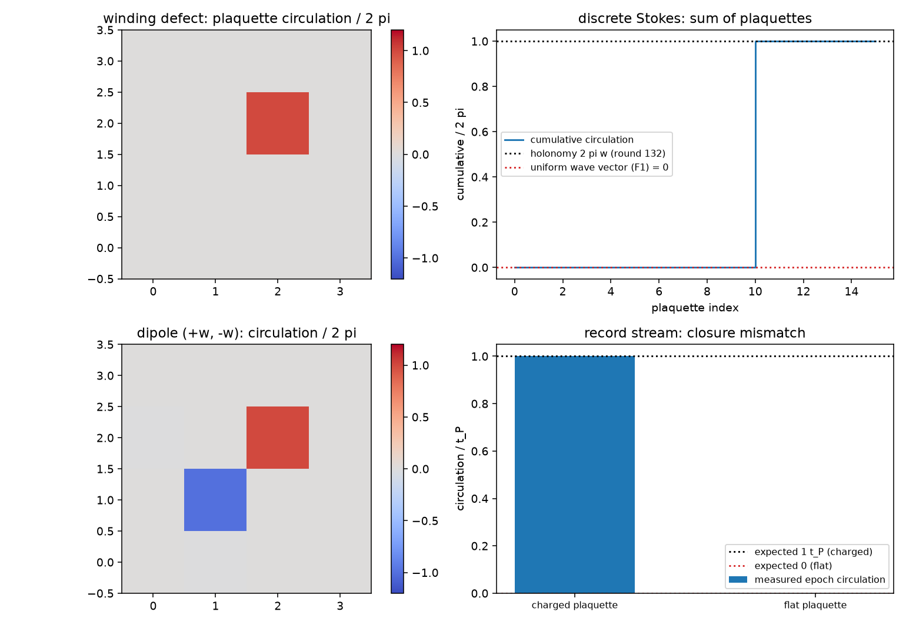

# 注记-标架场曲率轮的最小验证：面元环量、离散 Stokes 与半整数绕数的障碍

- **日期**：2026-09-18
- **对应脚本**：`验证脚本/minimal_verification_frame_curvature.py`（判据 F1 至 F7 共 9 项，9/9 通过；确定性，无随机数；运行约 0.4 秒；图存 `images/frame_curvature.png`，见 §一 图 1）
- **依据**：[[验证脚本/注记-写入算符三维推广轮的最小验证：逐站点直和、底噪按站点数标度、绕数缺陷的整周期滑移]]（第 132 条，环路 holonomy 与写入时刻平移）；[[验证脚本/注记-写入算符轮的最小验证：过轴即写、写即转移、反作用落在被采样对象]]（第 127 条）；[[内部草稿/开放问题总览：元相子理论待解决问题清单]] P3-12
- **状态**：判据 9/9 通过。核心读数：梯度型标架场（均匀波矢）的 16 个面元环量全为零；绕数型构型只有核面元非零，读数 $6.283185$（$2\pi w$），切片内总和 $6.283185$；带电面元的写入时刻闭合错位为一个整周期（$1.0000\,t_P$），平坦面元为零（$0.0000\,t_P$）；核移动时带电面元跟随而总和不变；双缺陷给 $+2\pi w$ 与 $-2\pi w$，总和 $-4.4\times10^{-16}$；$w = 1/2$ 的构造核面元与全场净环量均为零，记录流错位为零，切割处最大相邻跳变 $2.9442$ rad（连续极限 $2\pi w = 3.1416$ rad）。

---

## 一、判据与结果

| 判据 | 内容 | 通过条件 | 实测 |
|---|---|---|---|
| F1 | 均匀波矢处处零曲率 | $< 10^{-12}$ | $0.000$ |
| F2 | 曲率局域在核面元 | 只有核面元非零，总和 $2\pi w$ | $6.283185$ |
| F3 | 带电面元的记录流错位 | $1\,t_P$（偏差 $< 5\%$） | $1.0000\,t_P$ |
| F3 附 | 平坦面元零错位 | $< 0.02$ | $0.0000\,t_P$ |
| F4 | 核移动时曲率跟随 | 带电面元跟随，总和不变 | 核移至 $(1,1)$，总和 $6.283185$ |
| F5 | 双缺陷总曲率为零 | $+2\pi w$ 与 $-2\pi w$，总和零 | $-4.4\times10^{-16}$ |
| F6 | 半整数构造给不出净环量 | 核面元与总和为零，错位为零 | 均为 $0$ |
| F6 附 | 切割处跳变接近 $2\pi w$ | 落在 $[0.70, 1.05]\times 2\pi w$ | $2.9442$ rad |
| F7 | 口径登记 | 见 §三 | 登记 |

图注：左上为绕数型构型的逐面元曲率（单位 $2\pi$，只有核面元点亮）；右上为离散 Stokes 的累加阶梯（终点为 $2\pi w$，两条虚线分别为第 132 条的 holonomy 与均匀波矢构型的零曲率）；左下为双缺陷 $+w$ 与 $-w$ 的曲率分布（$+1$ 与 $-1$ 两点，总和零）；右下为记录流的闭合错位（带电面元实测 $1.0000\,t_P$，平坦面元 $0.0000\,t_P$）。

## 二、模型设定

格点取 $5 \times 5 \times 3$（开放边界，取 $z = 0$ 的切片），面元为 $xy$ 平面上的 $16$ 个单位正方形，角点按逆时针取序。标架场取 $A_j$ 为站点局部实轴方向，三种构型：梯度型 $A_j = q(x_j + y_j)$（$q = 0.30$，对应均匀波矢）；绕数型 $A_j = w\,\theta_{\rm az}(j)$，核取在某个面元中心（故核面元恰有一个）；双缺陷取两个绕数型构型之差（$+w$ 与 $-w$）。

面元曲率取沿面元一周的相邻方向差之和，每一差取最小角差（模 $2\pi$ 归到 $(-\pi, \pi]$）。动力学读数复用第 132 条的站点写入动力学（相位环 $256$ 点、$\omega_P = 2\pi$、步长 $2\times10^{-3}$、窗口 $1.05$），把站点写入时刻按 $t_P$ 取最小差后绕面元求和。

## 三、读数的意义

曲率是面元环量，它把第 132 条的环路 holonomy 分解成局部读数。梯度型标架场的 $16$ 个面元环量全为零（F1），均匀波矢不产生曲率；绕数型构型只有核面元非零，读数为 $2\pi w$，其余 $15$ 个面元严格为零，切片内总和等于 $2\pi w$（F2）。这就是离散 Stokes：逐面元的局部曲率之和等于绕核一周的 holonomy。波矢（梯度侧）与曲率（旋度侧）因此是两个独立读数。

曲率在记录流上留痕。绕带电面元一周，四个角点的写入时刻闭合错位恰为一个整周期（$1.0000\,t_P$），绕平坦面元一周为零（$0.0000\,t_P$，F3）。换算关系是错位等于 $F/\omega_P$，故曲率可由记录流直接读出，不必先有场侧坐标。

局域性与守恒成立。核移到相邻面元后，带电面元随之移动而切片内总和不变（F4）；双缺陷（$+w$ 与 $-w$）在两核面元分别给 $+2\pi w$ 与 $-2\pi w$，总和为零（F5），即缺陷对在曲率上是中性的，这与拓扑荷守恒一致。

半整数绕数碰到场侧障碍（本轮新读数）。$w = 1/2$ 的构造在圆上方向场的口径下核面元环量为零、全场净环量为零、记录流错位为零（F6），而它的相邻方向跳变最大 $2.9442$ rad，接近连续极限 $2\pi w = 3.1416$ rad（F6 附）。读法是：标架场取值模 $2\pi$，单值方向场只允许整数绕数；半整数绕数要求一条弦，弦上方向跳变不为 $2\pi$ 的整数倍。

**口径登记。** 三条。其一，曲率（旋度侧）与波矢（梯度侧）分开读，均匀波矢给零曲率。其二，与标架联络轮的分工：那一轮读散度侧的势与远场，本轮读旋度侧的局部曲率。其三，第 132 条 W5 的 $w = 1/2$ 读数（$3.141593$）按方位角分支展开得到，即把方位角当实数求和后再乘 $w$；按本轮的圆上方向场口径，该构型净环量为零并要求一条弦。$w = 1$ 的读数两种口径一致。

## 四、过程记录

判据订正一处。F6 首版按分支展开预期总曲率 $\pi$，实测核面元与全场都是 $0$。原因在口径：标架场取值模 $2\pi$，半整数绕数的切割跳变恰为 $\pi$，落到最小角差的阈值上，净环量被读成零。判据改为障碍式表述，并补一条切割跳变的读数（F6 附），原预期的 $\pi$ 作为分支展开读数在 §三 登记。

效率记录：脚本约 $0.4$ 秒，无字体问题。
