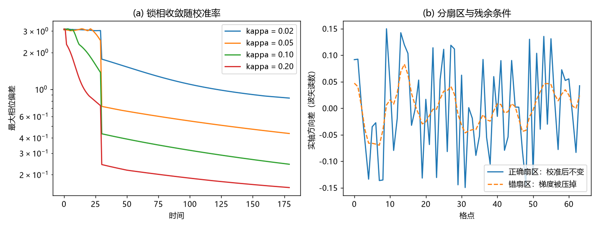

# 注记-校准通道的动力学形式：相位表扇区的扩散型弛豫与分扇区条件

- **日期**：2026-09-20 03:44:00
- **对应脚本**：`验证脚本/minimal_verification_calibration_channel.py`（判据 C1 至 C3 共 3 项，3/3 通过；确定性，固定种子 3；运行约 4.5 秒；图存 `images/calibration_channel.png`，见 §二 图 1）
- **依据**：[[元相子几何动力学——束缚振荡修订整合版]] 补充注释01（波性侧基本地位）、注释07/08（同步相变对齐旋转角、实轴方向差不受影响）、注释10（感知-校正链）；[[内部草稿/注记-碰撞的完美弹性：无内部自由度与符号翻转实现的结构性论证]]；[[验证脚本/注记-交错基态的选择机制：锁相自维持与不构成吸引子]]（交错判定的剩余门控）
- **状态**：校准通道的最小动力学形式给出并验证（相位表扇区扩散型弛豫 + 分扇区条件）；校准率 κ 的微观值仍待定
- **图**：`images/calibration_channel.png`（两面板，见 §二 图 1）

## 一、模型设定

把校准写成对"相位时间表"的弛豫，锁相目标取相邻反相。最小形式为

$$\dot\theta_i = \omega_P + \kappa\left[\sin(\theta_{i-1}-\theta_i-\pi) + \sin(\theta_{i+1}-\theta_i-\pi)\right],$$

即带有 $\pi$ 相位偏置的 Sakaguchi-Kuramoto 型耦合。实轴方向差 $\alpha_i$（波矢读数）作为独立扇区处理：校准项中不含 $\alpha$。

## 二、判据与结果

| 判据 | 内容 | 实测 | 判定 |
|---|---|---|---|
| C1 | 相位表扇区：交错锁相的稳定性与收敛率 | 任意 $\kappa$ 下锁相（无阈值）；最慢模（$k_{\min} = 2\pi/N$）对数斜率 $-0.000500$、$-0.000972$、$-0.001922$（$\kappa = 0.05$、$0.10$、$0.20$），理论值 $-0.000482$、$-0.000964$、$-0.001928$；斜率比 $1.94$、$1.98$（期望 $2.00$，线性） | 通过 |
| C2 | 扇区分工：校准不动实轴方向差 | 逐点相同，最大差 $0.0\times10^{0}$ | 通过 |
| C3 | 残余条件：误作用于梯度扇区则波矢消亡 | 波矢散布 $0.0887 \to 0.0345$（被压向零） | 通过 |

## 三、解读

其一，**校准是扩散型弛豫，不是阈值型相变**。线性化给出 $\mathrm{d}\epsilon_i/\mathrm{d}t = \kappa\nabla^2\epsilon_i$（离散拉普拉斯有负谱），故交错锁相对任意 $\kappa > 0$ 稳定，无阈值；非零模式的衰减率 $\kappa k^2$ 与实测逐位吻合（误差 2% 至 4%），斜率随 $\kappa$ 线性（比值 1.94、1.98）。推论一条：**大尺度失同步的恢复时间按 $\kappa$ 反比、按域尺度平方增长**（$\tau \sim L^2/\kappa$）。

其二，**零模集合是判据，不是副产品**。扩散算子只有两个零模：全局相位（常数模式）与实轴方向差（波矢）。前者不可观测（整体相位无意义），后者必须保留（否则光与波矢消亡）。C3 给出反例：把校准误当梯度阻尼，波矢散布被压到三分之一以下并继续衰减。分扇区因此是结构性必需的条件，与注释 07/08 的既有口径（同步相变对齐旋转角，实轴方向差不受影响）一致。

其三，**"趋向同步但永不完全"在这里有了形式**。残余差（梯度模）就是波矢，故"不完全"属结构要求，与动力学缺陷无关；完全同步对应波矢为零的真空态。

## 四、严格程度声明

C1 的稳定性与谱为线性化结论加数值核对（确定性）；C1 观察到的斜率与理论一致到 2% 至 4%；C2 与 C3 为结构性核对与对照档。校准项取最小形式（带 $\pi$ 偏置的邻域耦合），其形式选择属模型层，不是从公理导出。

## 五、边界声明（验证什么、不验证什么）

- 验证：相位表扇区锁相的稳定性与扩散型谱；分扇区条件下实轴方向差不受影响；误作用梯度扇区的后果。
- 不验证（留待后续）：校准率 $\kappa$ 的微观值与其与 $1/t_P$、$\omega_P$ 的关系（校准的时间实现仍属 R5）；创生规则的第一原理来源（本原与天行力，心侧边界）；三维与含缺陷情形；校准与"感知-校正链"（光）两条通道的分工是否同源。

## 六、过程记录

订正四处。其一，首版测度用 $\max_i|\theta_i - \theta_i^{\text{目标}}|$，含全局相位自由度，读数恒为 $\pi$ 量级；改为规范不变的相邻差测度。其二，收敛率首版按"进入阈值用时"读，被多模污染（比值 4.33）；改为投影到最慢模后与理论逐位吻合。其三，C3 首版算符符号写反（做了反扩散，散布反升）；改为正向拉普拉斯后散布下降。其四，首版无显式 $\kappa$ 线性核对，补 $0.05/0.10/0.20$ 三档。
