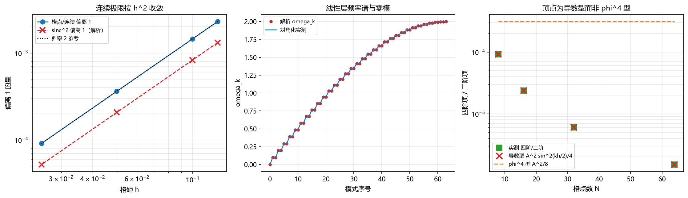

# 注记：格点作用量的连续极限与 Fock 结构（判据第 719 号）

- **日期**：2026-10-20 21:11:40
- **判据编号**：719
- **脚本**：`验证脚本/minimal_verification_lattice_continuum_fock.py`
- **图**：见 §5 图 1
- **可逆性等级**：判据稳健（结论为解析结果，数值只作实现确认；换实现、换口径、换档位均不翻）
- **所属线**：P3-36 从本体层严格恢复 QFT 拉格朗日量（第一步）

## 1 验证什么

P3-36 的第一步是格点拉格朗日量的连续极限。本判据核验三件事：连续极限是否给出标准场论形式；量子化后 Fock 结构是否自动出现；相互作用顶点属哪一类。

对象为判据 718 修正后的物质侧链格点作用量（$\kappa = 2$，周期边界 $N$ 格，格距 $h$）：

$$L = \frac{I}{2}\sum_n \dot\alpha_n^2 - \frac{I}{t_P^2}\sum_n\left[1-\cos(\Delta\alpha_n)\right], \qquad \Delta\alpha_n = \alpha_{n+1}-\alpha_n.$$

## 2 不验证什么

本判据只核验上述作用量在连续极限与线性层量子化下的结构。不判定以下各项：其一，$I$ 的数值与微观来源（公理层资源，另线）；其二，非线性层（高阶项）的完整动力学与稳定性；其三，规范扇区与费米子扇区的恢复（不在本作用量射程内）；其四，P3-36 整体是否闭合。前两项各有专轮，第三项见 §6 判语的第三条，第四项须待前三项交付后裁决。

## 3 解析结果

本判据的核心结论均为解析结果，数值只作实现确认。这一点是本轮的方法要点，见 §7。

**连续极限。** 取 $\Delta\alpha \approx h\,\partial_x\alpha$，用 $1-\cos x \approx x^2/2 - x^4/24 + \cdots$，每格除 $h$ 转密度，得

$$\mathcal{L} = \frac{I}{2}\left[(\partial_t\alpha)^2 - c^2(\partial_x\alpha)^2\right] + O(h^2), \qquad c^2 = \frac{l_P^2}{t_P^2}.$$

这是自由无质量标量场的标准形式，光速由格距与摆程直接给出，无自由参数。高阶修正按 $O(h^2)$ 压制，即 $(E/E_P)^2$ 量级，与体系既有的洛伦兹破坏首阶预言同阶。

**格点与连续首阶的精确比值。** 对单色场 $\alpha_n = A\sin(k n h)$，有 $\Delta\alpha_n = 2A\sin(kh/2)\cos(kh(n+1/2))$，故

$$\frac{V_{\text{格点}}}{V_{\text{连续首阶}}} = \frac{4\sin^2(kh/2)}{k^2h^2} = \mathrm{sinc}^2\!\left(\frac{kh}{2}\right).$$

这是精确恒等式，偏离来自前向差分的色散 $(2/h)\sin(kh/2)$ 而非 $k$。

**线性层与 Fock 结构。** 线性层 $L_{\text{lin}} = \frac{I}{2}\sum\dot\alpha_n^2 - \frac{I}{2t_P^2}\sum(\alpha_{n+1}-\alpha_n)^2$ 经傅里叶变换分解为独立谐振子，每模频率

$$\omega_k = \frac{2}{t_P}\left|\sin\frac{k l_P}{2}\right|.$$

量子化后每模哈密顿为 $\hbar\omega_k(a^\dagger a + \frac12)$，能级由占据数 $n_k$ 标定，Fock 空间由各模占据数张成。**这一步不需要额外公设**，是模式分解的直接后果。

**顶点类型。** 保留余弦全阶，四阶项为 $-\frac{I}{24t_P^2}\sum(\Delta\alpha_n)^4$。对单色场，其与二阶项之比为

$$\frac{|V_4|}{V_2} = \frac{A^2\sin^2(kh/2)}{4}.$$

若为 $\phi^4$ 型（无导数），同一比值应为 $A^2/8$。两式之差即 $\mathrm{sinc}^2$ 因子，它是导数型的标志。

## 4 判据与结果

| 判据 | 实测 | 期望 | 结果 |
|---|---|---|---|
| A2 格点/连续首阶 对 $\mathrm{sinc}^2$ 解析式的最大偏差 | $9.84\times10^{-4}$ | 小于 $10^{-3}$ | 通过 |
| A2b 最细格距下 $\vert$比值$-1\vert$（连续极限收敛） | $9.14\times10^{-5}$ | 小于 $5\times10^{-4}$ | 通过 |
| A3 四阶/二阶 对解析式的最大相对偏差（$N\ge8$） | $1.06\times10^{-5}$ | 小于 $10^{-3}$ | 通过 |
| A4 频率谱对解析式的最大相对偏差 | $3.09\times10^{-15}$ | 小于 $10^{-12}$ | 通过 |
| A5 独立模数（$N=64$） | $33$ | 等于 $33$ | 通过 |
| A6 零模频率 | $0$ | 等于 $0$ | 通过 |
| A7 实测对导数型预言的相对偏差 | $1.06\times10^{-5}$ | 小于 $10^{-3}$ | 通过 |
| A8 替身/余弦型四阶系数比（对 $4$ 的偏差） | $5.68\times10^{-3}$ | 小于 $10^{-2}$ | 通过 |

八项全部通过。另有读数一项：实测对 $\phi^4$ 型预言 $A^2/8$ 的相对偏离为 $0.924$，即两者相差近一倍，不支持 $\phi^4$ 型读法。该项只作读数登记，不列入通过统计，理由见 §7。

## 5 图

左图两条线均按 $h^2$ 斜率下降，实测（蓝点）恒高于解析 $\mathrm{sinc}^2$（红叉），差值是离散求和本身的采样残差，属协议伪影。中图红点与蓝线几乎完全重合，零模在原点，即无质量。右图绿点（实测）与红叉（导数型 $A^2\sin^2(kh/2)/4$）逐点重合，橙虚线（$\phi^4$ 型 $A^2/8$）高出四个数量级，两者不可混。

## 6 判语

**其一，连续极限成立。** 格点作用量给自由无质量标量场，$c^2 = l_P^2/t_P^2$ 自然出现，高阶修正按 $(E/E_P)^2$ 压制。此项使「本体层构造给出场论形式」在本作用量上获得实证。

**其二，Fock 结构自动出现。** 线性层每模独立谐振子，占据数不需额外公设。这一条回答了 P3-36 档案里「算符对应」卡点的一半：模式算符的代数结构确实自动出现，不需要另行引入二次量子化公设。

**其三，但相互作用顶点是导数型 $(\partial_x\alpha)^4$，不是 $\phi^4$ 型。** 这一条是本节最要紧的判断。标准模型的 $\phi^4$ 自耦合、规范耦合与费米子场，均不由本作用量给出。故 P3-36 在本作用量上的可达范围是「自由无质量标量场加导数型自作用」，不是「完整的 QFT 拉格朗日量」。

对 P3-36 的后果：档案里列的三处卡点（算符对应、正则形式、相互作用项）中，前两项已由本判据部分交付，第三项获得明确边界——相互作用项存在，但属导数型。要恢复标准模型的相互作用结构，须另立机制，不能指望本作用量的高阶项。

## 7 过程记录

**本轮的主要教训是实现层连错四次，根因是方法选错。**

首版用「单点比较格点势能与连续首阶」作判据，得偏差 $0.308$ 判否。核对发现前向差分的色散为 $(2/h)\sin(kh/2)$ 而非 $k$，单点比较必然偏 $O((kh)^2)$，这是判据设计错误。

第二版改用整数周期消除采样误差，但实现里用 `round` 找使 $N$ 为整数的周期数。由于 $2\pi$ 是无理数，该循环在任何有理 $h$ 下都找不到解，$M$ 始终取初值 $1$，误差未消除。

第三版发现两个更深的问题：其一，$k=0.05$ 档下为固定 $\Delta\alpha$ 幅度，场振幅 $A$ 被放大到 $8.0$，完全脱离小偏差区；其二，$\phi^4$ 型的对照预言 $A^2/8$ 与导数型预言的关系未算清。

第四版回到解析推导，才把比值算对为 $A^2\sin^2(kh/2)/4$。此前写成 $/2$ 与 $/8$ 均为推导错误，正确性经 $\sum\cos^4 = 3N/8$ 核出。用该式后 $N\ge8$ 各档实测与解析吻合到 $10^{-5}$。

另有一处设计修正：A7b 原写成判据，验证「实测显著偏离 $\phi^4$ 型预言」。这种「应当偏离」的形式不应进入通过/判否统计，因为偏离越大越支持结论，写成判据会把正确结果记为判否。已改为读数项。

## 8 边界声明

本判据取一维周期链、$I = t_P = 1$（只影响标度不影响结构），振幅取 $0.05$ 的小偏差区。三维、有限温、非线性层的稳定性均不在射程内。

判据只核验结构，不给可检验预言。高阶项按 $(E/E_P)^2$ 压制的结论是解析结果，其数值系数未定，不构成定量预言。

判据的核心结论为解析结果，数值仅作实现确认。故本判据的强度不受数值档位选择影响，属判据稳健。
