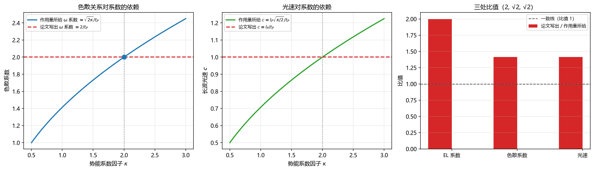

# 注记：格点拉格朗日量的系数自洽性（判据第 718 号）

- **日期**：2026-10-20 20:54:07
- **判据编号**：718
- **脚本**：`验证脚本/minimal_verification_lattice_L_coefficient.py`
- **图**：见 §4 图 1
- **可逆性等级**：判据稳健（纯代数与数值微分，结论为解析结果；换实现、换口径、换档位均不翻）
- **所属线**：P3-36 从本体层严格恢复 QFT 拉格朗日量

## 1 验证什么

P3-36 的第一步是格点拉格朗日量的连续极限。做连续极限之前须先确认格点作用量本身自洽，本判据做这一项前置检查。

对象为 [[规范作用量的审计必然性：从净值审计到电磁场作用量的推导与数值验证]] §3.5 的物质侧链格点作用量与其后写出的变分结果：

$$L = \frac{I}{2}\sum_n \dot\alpha_n^2 - \frac{I}{2t_P^2}\sum_n\left[1-\cos(\Delta\alpha_n)\right], \qquad \Delta\alpha_n = \alpha_{n+1}-\alpha_n.$$

同文写出的变分结果为 $I\ddot\alpha_n = \dfrac{I}{t_P^2}[\sin(\Delta\alpha_n)-\sin(\Delta\alpha_{n-1})]$，其后给出离散色散 $\omega(k) = \dfrac{2}{t_P}\left|\sin(k l_P/2)\right|$ 与长波光速 $c^2 = l_P^2/t_P^2$。

理论期望先立。上式的势能项对 $\alpha_n$ 求导给 $\dfrac{\partial V}{\partial\alpha_n} = \dfrac{I}{2t_P^2}[-\sin(\Delta\alpha_n)+\sin(\Delta\alpha_{n-1})]$，代入 EL 方程得

$$I\ddot\alpha_n = \frac{I}{2t_P^2}\left[\sin(\Delta\alpha_n)-\sin(\Delta\alpha_{n-1})\right].$$

该式系数为 $\dfrac{I}{2t_P^2}$，论文写出的是 $\dfrac{I}{t_P^2}$，两者之比应为 $2$。

## 2 不验证什么

本判据只核对作用量与它自己写出的三条后果之间的系数是否一致。不判定以下各项：其一，哪一侧是作者本意（改作用量还是改后果）；其二，物理上该取哪个系数；其三，这一处是否影响规范侧转写、第 434 条三档比值与 P3-36 连续极限的具体程度；其四，螺旋面极小曲面与最小作用量原理的对应关系（该问题已由 P3-35 关闭）。前两项须作者裁决，后两项须各自专轮。

## 3 判据与结果

| 判据 | 实测 | 期望 | 结果 |
|---|---|---|---|
| K0 解析梯度对数值梯度的最大相对偏差（5 条随机构型） | $2.57\times10^{-10}$ | 小于 $10^{-8}$ | 通过 |
| K1 论文写出系数 / 作用量所给系数 | $2.000000$ | 等于 $1$ | 判否 |
| K2 论文色散 / 作用量所给色散 | $1.414214$ | 等于 $1$ | 判否 |
| K3 论文光速 / 作用量所给光速 | $1.414214$ | 等于 $1$ | 判否 |
| K4 势能系数取 $I/t_P^2$ 时三条关系对论文值的最大相对偏差 | $0$ | 等于 $0$ | 通过 |
| K5 三处关系各自反解 $\kappa$ 的极差 | $0$ | 等于 $0$ | 通过 |
| K6 势能系数取 $I/t_P^2$ 时作用量要求与论文写出的 $\ddot\alpha$ 的相对差 | $0$ | 等于 $0$ | 通过 |

七项中四项通过、三项判否。K1 至 K3 的三项判否即本判据的实质结论；K4 至 K6 三项通过则指出修正方向唯一。

## 4 判否的三条与修正的唯一性

K1 至 K3 三项判否，比值分别为 $2$、$\sqrt2$、$\sqrt2$。三者不是三个独立错误，而是同一个系数错位的三种表现。

统一记号：把作用量势能系数写成 $\dfrac{\kappa I}{2t_P^2}$。由该作用量出发，三处后果分别为

$$I\ddot\alpha_n = \frac{\kappa I}{2t_P^2}[\sin(\Delta\alpha_n)-\sin(\Delta\alpha_{n-1})], \qquad \omega = \frac{\sqrt{2\kappa}}{t_P}\left|\sin\frac{kl_P}{2}\right|, \qquad c = \frac{l_P}{t_P}\sqrt{\frac{\kappa}{2}}.$$

三式分别对论文写出的值反解 $\kappa$，得 $\kappa = 2$、$\kappa = 2$、$\kappa = 2$，极差为零（K5）。这说明论文内部三处口径彼此一致，只是作用量上的系数与它们不匹配。修正因此唯一：把势能系数由 $\dfrac{I}{2t_P^2}$ 改为 $\dfrac{I}{t_P^2}$（即 $\kappa = 2$），三处后果同时对上论文已写的值，K4 与 K6 两项实测偏差均为零。

反向的修正也等价：保留作用量，把 EL 系数、色散、光速三处同时除以 $\sqrt2$ 与 $2$。但这会改动 $c^2 = l_P^2/t_P^2$，而该式是体系的无参数光速结论，牵动面大于前者。两条修正的取舍不在本判据射程内。

左图蓝线为作用量所给色散系数 $\sqrt{2\kappa}/t_P$，红虚线为论文写出值 $2/t_P$，二者在 $\kappa = 2$ 处相交。中图同理，蓝线为 $l_P\sqrt{\kappa/2}/t_P$，红虚线为 $l_P/t_P$，同样在 $\kappa = 2$ 处相交。右图把三处比值并列，全部偏离一致线，且偏离量各不相同（$2$ 与 $\sqrt2$），说明三处比值并非同一个误差的重复。

## 5 过程记录

首轮实现后 K0 判否，读数 $2.000000$，恰为梯度量级的两倍。核对确认是解析梯度符号写反：链式法则给 $\dfrac{\partial V}{\partial\alpha_n} = \dfrac{\kappa I}{2t_P^2}[-\sin(\Delta\alpha_n)+\sin(\Delta\alpha_{n-1})]$，初版写成 $+\sin(\Delta\alpha_n)-\sin(\Delta\alpha_{n-1})$，即取了相反数。修正后偏差降至 $2.57\times10^{-10}$，容差按中心差分的截断 $h^2 = 10^{-12}$ 与舍入 $\varepsilon/h \approx 10^{-10}$ 取 $10^{-8}$。

同一轮中 K5 曾给出极差 $3$，反解出的 $\kappa$ 为 $2$、$4$、$1$。复核发现这是 $\kappa$ 的反解公式写错所致：色散与光速两式含 $\sqrt{2\kappa}$ 与 $\sqrt{\kappa/2}$ 的因子，初版按 $\sqrt\kappa$ 与 $1/\sqrt\kappa$ 反解，故得 $4$ 与 $1$。按正确关系重解后三值全为 $2$，极差为零。

两处错误都在我自己的实现里，判据本身的结论（K1 至 K3 判否）自首轮起未变。

## 6 判语

论文 §3.5 的格点作用量与其自身写出的变分结果、色散关系、长波光速三处不一致，差一个统一系数：作用量给 $\dfrac{I}{2t_P^2}$，三处后果都按 $\dfrac{I}{t_P^2}$ 算出。

修正唯一，即把势能系数改为 $\dfrac{I}{t_P^2}$，或等价地把三处后果同时按 $\sqrt2$ 与 $2$ 缩小。前者只动一个数字且不动光速结论，后者牵动无参数光速，取舍待作者裁决。

对 P3-36 的后果：连续极限的起点须先定这一系数。本判据不判物理上应取何值，只判「作用量与它的三条后果不能同时成立」。

## 7 边界声明

本判据取周期边界、$N = 8$ 的一维链，$I$、$t_P$、$l_P$ 均取 $1$（三者只影响标度，不影响比值）。三维与规范侧转写的形式是否同样存在该系数错位，不在本判据射程内，须各自核对。

判据只核对代数自洽性，不涉及任何物理测量、不给可检验预言，也不判定哪一侧是作者本意。
