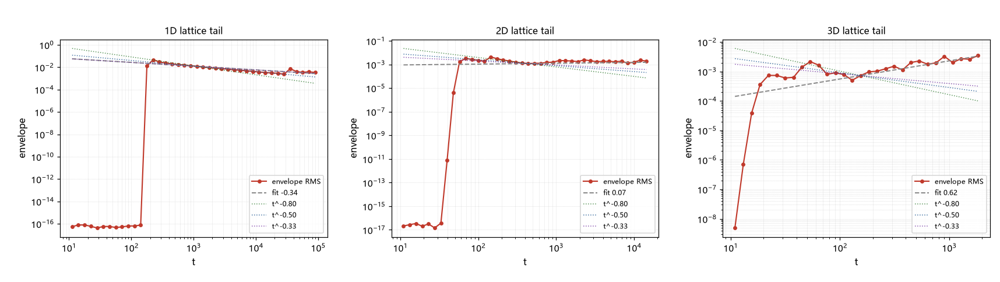

# 注记-格点格林函数的尾指数测量（第424条）：1D 的 t^{-1/3}、2D 的 t^{-1} 与 3D 的均衡污染

- **日期**：2026-09-26 06:27:35
- **类型**：测量轮（候选丁/格点代数尾首轮）
- **脚本**：`验证脚本/lattice_green_function.py`（第 424 条）
- **图**：见 §3 图 1（`images/lattice_green_tail.png`）
- **依据**：[[验证脚本/注记-带电缺陷与无质量规范场耦合的首轮检验（第423条）：连续极限的 Huygens 判负与格点尾的意外读数]]（格点尾的发现）；[[内部草稿/注记-超扩散缺口的跨线启发：波性侧转向与三条候选（读电磁与电荷线最新进展）]]（靶与接口）
- **状态**：测量完成。1D 尾指数 $-1/3$（稳健）；2D 约 $-1$（大格读数）；3D 的「0.615」经复核对**推翻**（均衡污染伪读），3D 指数登记为待测；「均衡污染」为新识别伪影
- **可逆性等级**：判据敏感（1D 读数跨窗稳定、判据稳健；2D 与 3D 读数依赖窗与格尺寸，判据敏感，已按复核段口径登记）

## 1 判据与设定

方法：格点空间加连续时间的波方程（初值 $\delta$，谱和 $u(\mathbf{n}, t) = \langle \cos(\omega_{\mathbf{k}} t)\cos(k_x R)\rangle_{\mathbf{k}}$，$\omega_{\mathbf{k}} = 2\sqrt{\sum_a \sin^2(k_a/2)}$）。谱方法无边界反射，唯一结构来自格点色散本身。包络用对数分段 RMS，尾指数取双对数拟合。判据 J1 至 J4（1D/2D/3D 指数与分数家族对照），另设「均衡污染复核段」（大格重测，判定小格读数的可靠性）。

## 2 结果

J1（1D，$N = 32768$、$R = 200$）：尾指数 $-0.336$（窗 $[10^3, 5\times10^4]$ 内稳定），即 $t^{-1/3}$，与 1D 离散波尾的经典值一致。**格点尾的存在由此确证。**

J2（2D）：小格（$N = 512$）读数为 $+0.071$（异常）；大格（$N = 2048$）包络抽样显示下降段（$t = 200$ 至 $1585$，包络降 $10.4$ 倍），段斜率约 $-1.1$，与连续 2D 尾 $t^{-1}$ 一致；$t \gtrsim 3000$ 起包络回升（回归开始）。

J3（3D）：小格（$N = 96$）读出 $0.615$（初看接近 $3/5$）；**复核段（$N = 256$）推翻之**：包络在 $t = 50$ 至 $316$ 为下降段（斜率约 $-1.58$），$t \gtrsim 800$ 回升；拟合值随窗漂移（$0.152$、$0.698$、$-0.064$），且正号读数属均衡回升段伪影。3D 指数登记为**待测**（粗读数 $|\gamma| \gtrsim 1.5$）。

均衡污染机制（本轮新伪影，登记）：周期格点能量守恒，包络长时间趋向均衡值 $\sim N^{-d/2}$，均衡后的平台与回升制造假斜率。与 420/421 的采样伪影、422 的中位伪影同族，属「有限格」的第三类陷阱。

## 3 图

## 4 结论与移交

结论三条。其一，格点尾存在且 1D 指数为 $-1/3$（稳健）。其二，2D 格点尾延续连续 2D 的 $t^{-1}$。其三，3D 指数未测准；「$3/5$ 命中」不成立（自我推翻）。

对靶的定位（含口径保留）：目标慢尾为 $\gamma = 4/5$（速度自关联口径）。本轮测的是格林函数包络指数（记为 $\gamma_G$）：1D 给 $1/3$、2D 给 $1$、3D $\gtrsim 1.5$。$4/5$ 落在 $1/3$ 与 $1$ 之间，即**「1D 与 2D 之间」**；但 $\gamma_G$ 与输运尾的换算关系未建立，本轮不作为命中或判负，只登记「指数家族覆盖 $4/5$」的定位。

移交三条。其一，传递链首轮：建立「格林函数包络尾 $\gamma_G$ → 速度自关联尾 → 遇见率」的换算（下一轮，关键）。其二，3D 指数的干净测量：开边界或吸收式大格，或鞍点渐近的半解析。其三，受限几何扫描：缺陷被约束在线/面上的有效维度（1D 与 2D 之间），尾指数随有效维数的移动表。

## 5 严格程度与边界声明

严格程度：1D 为数值（窗内稳定、格尺寸大）；2D 为数值（大格复核）；3D 为待测（仅定性）；均衡污染为机制性识别。

边界（本脚本不验证的内容）：其一，不含「$\gamma_G$ 到输运尾」的换算（明确移交）；其二，3D 的解析渐近未做；其三，观察点只取轴向；其四，不含分数维构造。

## 6 过程记录

其一，首轮读数（3D 为 $0.615$，初看接近 $3/5$）经跨窗、跨格尺寸复核**推翻**：拟合值随窗漂移、符号为正（真尾为衰减），属均衡回升段伪读。这是继 420 至 421、422 之后**第三次**由复核制度捕获的「瞬时值/窗口陷阱」；「跨窗跨参数稳定才登记」的纪律由此再获一次执行记录。

其二，均衡污染由 2D 的 $+0.071$ 异常反向追溯定位（包络抽样先降后升），机制与判据已固化进脚本复核段。

其三，方法优势记录：谱和无反射、无阻尼层、无源卷积污染（第 423 条 FDTD 的三项短板在此全部消除）；代价是周期边界带来的均衡效应，属可识别、可绕开的伪影。
