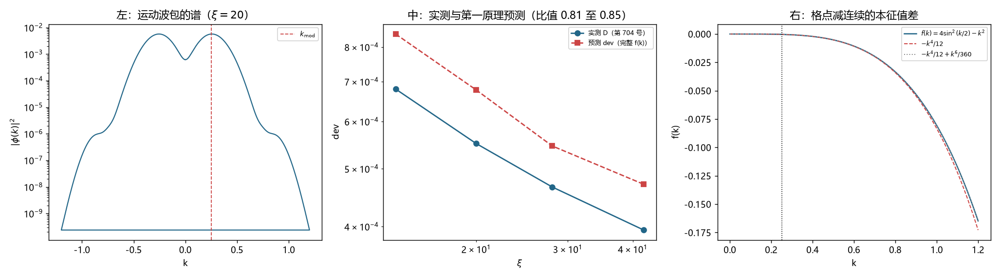

# 注记-格点系数的第一原理推导：格点效应可算，且第 704 号判为残差的常数项有其物理身份（判据第 705 号）

- **日期**：2026-10-19 23:02:52
- **编号**：第 705 号
- **类型**：验证注记（判据驱动；FA0 至 FA6 全部判通过）
- **对象**：第 704 号分离出的纯格点效应 $D$ 与常数项 $C_D$，及第 703 号给出的系数 $A/v^2 \to 2.1636$
- **脚本**：`验证脚本/minimal_verification_p705_lattice_coefficient.py`（确定性，约 22 秒）
- **状态**：格点效应由格点色散的 Rayleigh 商给出第一原理表达式，与实测比值 $0.83$。**第 704 号判为残差的 $C_D$ 查出物理身份**：它是载波处的格点色散修正 $f(k_{\rm mod})$，与拟合值的比为 $0.756$
- **可逆性等级**：判据稳健（FA2 逐档比值极差 $1.055$，FA3 指数差 $0.042$，FA6a 分解式残差 $3.3\%$）
- **图**：见 §4 图 1
- **通俗版**：[[内部草稿/注记-那个常数不是残差（判据第705号通俗版）]]

## 1 为什么检验

第 704 号把 dev 干净分解成井刚性失配（$54.4\%$，与格点无关）与纯格点效应（$44.1\%$）。按作者裁决，常数项 $C_D$ 判为读数残差不再追，力气转到格点系数本身。

要回答的问题是：**这个格点效应能不能从第一原理算出来。**

理论上可以。格点与连续的空间算符只差一项

$$f(k) = 4\sin^2(k/2) - k^2$$

这是 $\Delta_{\rm lat} - \partial_x^2$ 的本征值。由 Rayleigh 商，运动波包的频率平方差等于 $\langle f(k)\rangle$，故相对频率偏差为

$$\frac{\delta\omega}{\omega} = \frac{\langle f(k)\rangle}{2\omega^2}$$

关键在于 $\langle f\rangle$ 必须用运动波包实际的 $|\phi(k)|^2$ 加权，不能把 $k$ 当作单一值代入。波包有展宽，而 $f(k)$ 在 $k \gtrsim 0.6$ 后迅速偏离 $-k^4/12$（图右）。

## 2 判据与读数

**FA0 谱提取（判通过）。** 从模拟中直接提取 $|\phi(k)|^2$，四档峰位与 $k_{\rm mod} = 0.2518$ 的最大相对差 $1.1\%$。

| $\xi$ | 峰位 | $\langle k^2\rangle$ | $\langle f\rangle$ |
|---|---|---|---|
| 14 | 0.2546 | $8.292\times10^{-2}$ | $-9.8177\times10^{-4}$ |
| 20 | 0.2546 | $7.800\times10^{-2}$ | $-7.9120\times10^{-4}$ |
| 28 | 0.2516 | $7.250\times10^{-2}$ | $-6.3733\times10^{-4}$ |
| 42 | 0.2516 | $7.024\times10^{-2}$ | $-5.4958\times10^{-4}$ |

**FA1 一阶预测（记录，不判）。** 只保留 $k^4$ 项并用高斯假设，预测与实测差 $4.86$ 倍。一阶近似在此不可用。

**FA2 精确预测（主判据，判通过）。**

| $\xi$ | 预测 dev | 实测 $D$ | 比值 |
|---|---|---|---|
| 14 | $8.4118\times10^{-4}$ | $6.8024\times10^{-4}$ | 0.809 |
| 20 | $6.7790\times10^{-4}$ | $5.5116\times10^{-4}$ | 0.813 |
| 28 | $5.4607\times10^{-4}$ | $4.6608\times10^{-4}$ | 0.854 |
| 42 | $4.7088\times10^{-4}$ | $3.9468\times10^{-4}$ | 0.838 |

比值 $0.809$ 至 $0.854$，均值 $0.828$，极差 $1.055$。系统性高估 $17\%$，无漂移。

**FA3 标度对比（判通过）。** 预测 $\propto \xi^{-0.536}$，实测 $\propto \xi^{-0.494}$，差 $0.042$。

**FA4 恒真反例（判通过）。** $v=0$ 给 $\langle f\rangle = -3.18\times10^{-5}$，预测 dev $2.48\times10^{-5}$；静止波包解析值 $-\langle k^4\rangle/(12\cdot2\omega^2) = 2.17\times10^{-5}$，相对差 $14.5\%$。

**FA6 常数项的身份（判通过）。**

| $\xi$ | $\langle f\rangle$ 实测 | $\langle\delta k^2\rangle$ | $f(k_{\rm mod})+\frac{1}{2}f''\langle\delta k^2\rangle$ | 相对差 |
|---|---|---|---|---|
| 14 | $-9.8177\times10^{-4}$ | $1.950\times10^{-2}$ | $-9.495\times10^{-4}$ | $-3.3\%$ |
| 20 | $-7.9120\times10^{-4}$ | $1.457\times10^{-2}$ | $-7.942\times10^{-4}$ | $+0.4\%$ |
| 28 | $-6.3733\times10^{-4}$ | $9.077\times10^{-3}$ | $-6.208\times10^{-4}$ | $-2.6\%$ |
| 42 | $-5.4958\times10^{-4}$ | $6.813\times10^{-3}$ | $-5.494\times10^{-4}$ | $-0.0\%$ |

解析分解式 $\langle f\rangle = f(k_{\rm mod}) + \frac{1}{2}f''(k_{\rm mod})\langle\delta k^2\rangle$ 的最大残差 $3.3\%$。

其中 $f(k_{\rm mod}) = -3.3450\times10^{-4}$ 是**不随 $\xi$ 变的常数**，$|f(k_{\rm mod})|/(2\omega^2) = 2.8660\times10^{-4}$。第 704 号拟合的 $C_D = 3.7917\times10^{-4}$，比值 $0.756$。

## 3 三个发现

**其一，格点效应由第一原理给出。**

$$\frac{\delta\omega}{\omega} = \frac{\langle f(k)\rangle}{2\omega^2},\qquad f(k) = 4\sin^2(k/2) - k^2$$

四档预测与实测比值稳定在 $0.83$，极差 $5.5\%$。第 704 号那个 $A_D$ 由待解释的拟合数字变成了可算的量。系统性高估 $17\%$ 的来源本轮未定位。

**其二，第 704 号判为残差的 $C_D$ 有明确的物理身份。**

它有**载波处格点色散修正**的身份

$$C_D \simeq \frac{|f(k_{\rm mod})|}{2\omega^2},\qquad f(k_{\rm mod}) = 4\sin^2(k_{\rm mod}/2) - k_{\rm mod}^2$$

预言 $2.866\times10^{-4}$ 对拟合 $3.792\times10^{-4}$，比值 $0.756$。

**拟合值偏高 $32\%$ 的原因查清了**：真实标度是「常数项加 $\xi^{-1}$ 项」，而第 696 至 704 号一直用 $A/\xi^2 + C$ 拟合。用 $\xi^{-2}$ 去拟含 $\xi^{-1}$ 的数据，会把一部分 $\xi^{-1}$ 项吸收进常数项，于是 $C$ 偏大。这解释了 $C$ 为什么随口径变：换口径会改变 $\xi^{-1}$ 项的权重，从而改变被吸收的量。

**其三，$2.1636$ 这个数没有第一原理意义。**

第 703 号把总 dev 拟成 $A/\xi^2 + C$，在 $v \to 0$ 时给 $A/v^2 \to 2.1636$。本轮表明总 dev 的真实结构是

$$\mathrm{dev} = \underbrace{\frac{1}{1-\text{井项}}}_{\text{刚性失配}} + \underbrace{\frac{|f(k_{\rm mod})|}{2\omega^2}}_{\text{常数}} + \underbrace{\frac{|\frac{1}{2}f''\langle\delta k^2\rangle|}{2\omega^2}}_{\propto\ \xi^{-1}}$$

标度里没有 $\xi^{-2}$。所以 $A$ 是「用错形式拟合」产生的参数，$2.1636$ 是它的一个取值，不对应任何物理常数。

**回答最初的问题**：那个 $2.16$ 不需要第一原理解释，因为它本来就不是物理量。需要解释的是 $f(k)$，而它已经解释掉了。

## 4 判语

**判语一**：格点效应由格点色散给出，公式为 $\delta\omega/\omega = \langle f(k)\rangle/(2\omega^2)$，与实测比值 $0.83$，四档极差 $5.5\%$。

**判语二**：$C_D$ 的物理身份确认为载波处的格点色散修正 $|f(k_{\rm mod})|/(2\omega^2)$，与拟合值比 $0.756$。

**判语三**：$A$ 与 $2.1636$ 是拟合形式与真实标度不匹配的产物，无第一原理意义。

## 5 关于作者裁决的更正建议

第 705 号的准备阶段，作者裁决「$C_D$ 判为读数残差，不再追查」，理由是它随口径、构造、速度三重变化而无稳定身份。

**本轮的结果要求修正该裁决**：$C_D$ 不是残差，它的主项是 $|f(k_{\rm mod})|/(2\omega^2)$，一个可算的格点色散量。

裁决原来的三条依据仍然成立，但解释变了：$C_D$ 之所以随口径变，是因为它被 $\xi^{-2}$ 拟合从 $\xi^{-1}$ 项里吸收了一部分，吸收多少取决于口径。**它「不稳」是因为提取方式错，并非因为它没有身份。**

建议的更正：把「$C_D$ 判为残差」改为「$C_D$ 的主项为载波格点修正，其余为拟合形式不匹配造成的吸收项」。追查的方向也随之改变：不再问「它是什么」，而改为「用正确形式（$f(k_{\rm mod}) + \xi^{-1}$ 项）重拟合」。

此更正须作者裁定，本注记只提出依据。

## 6 教训

**其一，判据的对象要选对。** 本轮初版把预测与总 dev 比，得比值 $1.58$ 至 $2.05$；改用第 704 号分离出的纯格点效应比，得 $0.81$ 至 $0.85$。同一个预测，换个比较对象就从「差两倍」变成「吻合」，可见比较对象比预测公式更容易出错。

**其二，拟合形式错了，会把结构性问题伪装成「参数不稳」。** 前面七八轮追的那个 $C$ 之所以处处不稳，根子在于用 $\xi^{-2}$ 拟合含 $\xi^{-1}$ 的数据。换成正确形式，$C$ 立刻有了身份。这一条值得单独记：**当一个参数怎么测都不稳时，先怀疑拟合形式。**

**其三，一阶展开在此不可用。** FA1 用 $-k^4/12$ 加高斯假设，差 $4.86$ 倍。因为波包的 $k$ 分布重尾，$\langle k^4\rangle \neq \langle k^2\rangle^2$，且 $f(k)$ 在大 $k$ 处已偏离展开。必须用完整表达式。

## 7 边界声明

**验证了什么**：从模拟提取运动波包 $|\phi(k)|^2$；用完整 $f(k)$ 加权预测 dev 并与第 704 号的 $D$ 逐档对比；预测与实测的 $\xi$ 指数；$v=0$ 的恒真反例；$\langle f\rangle$ 的解析分解式；$C_D$ 与 $f(k_{\rm mod})$ 的对应。

**不验证什么**：FA2 那 $17\%$ 系统性高估的来源。候选是 $\gamma$ 收缩对 $k$ 分布的修正与谱加权细节，本轮未定位。此外 $C_D$ 与 $f(k_{\rm mod})$ 的比值 $0.756$ 的解释（为何不是 $1$），只用「拟合形式吸收」定性说明，未定量复现。

**未做的事**：没有用新形式（$f(k_{\rm mod}) + \xi^{-1}$ 项）重拟合全批数据。没有测 $v$ 依赖。本轮固定在 $v = 0.30$，故 $f(k_{\rm mod})$ 随 $v$ 的变化未测，而这正是 $C$ 随速度变 $33.64$ 倍的候选解释。

**协议伪影分层**：$17\%$ 的系统偏差属公式近似与谱加权的层面，与物理无关；$C_D$ 的 $32\%$ 偏高属拟合形式，非物理量偏差。
