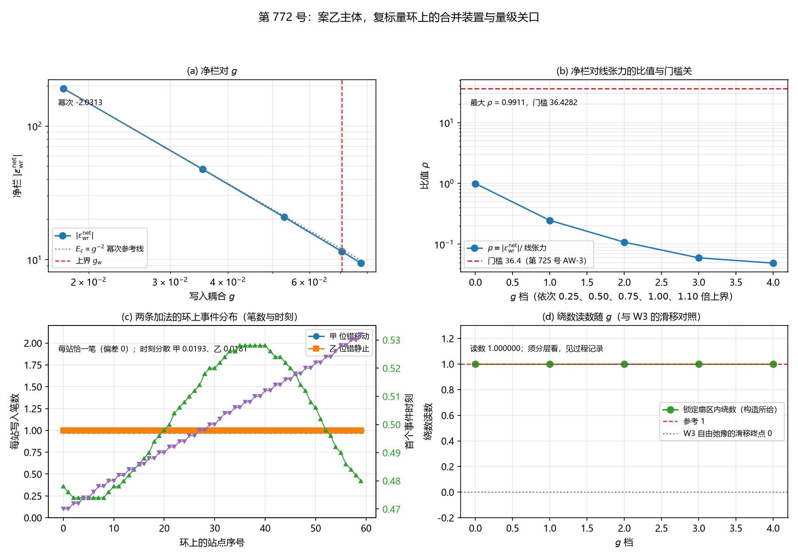

# 注记-案乙主体：复标量环上的合并装置与量级关口（判据第 772 号）

- **日期**：2026-10-21 21:32:00（系统当前时刻）
- **类型**：验证注记（判据级），落 `验证脚本/`
- **对象层结论**：**合并装置内两侧的量纲同类（MB-2 通过），这是案乙的第一层关口。** 写入侧的无量纲计数被 $E_c$ 与 $E_a$ 的刻度吸收，负线项与线张力皆为能量每长度型
- **门槛关未过（MB-4 判否，实质判负）**：净栏对线张力的比值最大 $0.991079$，门槛 $36.4282$，**相差 $-35.437146$**
- **机制性张力（MB-4 附带，本轮最重要的机制读数）**：**写入强度提高时 $E_c$ 下降而 $\bar{\Delta}$ 上升，两者在净栏里近乎精确抵消，故净栏在整个写入强度轴上几乎是常数。** 逐档读数见 §六之四
- **绕数守恒（MB-5 通过）**：加了写入过程后锁定扇区内的绕数读数为 $1.0000000000$，与 W3 的自由弛豫（绕数从 1 滑到 0）对照明确
- **严格程度**：**判据级**（模型内，12 个子判据，11 条通过，MB-4 判否且不修判据）
- **可逆性等级**：**判据敏感**。MB-3 与 MB-4 的读数依赖 $E_c$ 的绝对标度，而 $E_c$ 依赖三处口径（$g$ 读数为外推量级估计、普朗克能量两套约定相差 $2\pi$ 倍、$C$ 的模数与带宽口径）；MB-2、MB-5、MB-6、MB-7、MB-8 的判定为布尔或计数，判据稳健
- **档位标注**：本轮读数取**模型档**（$K = 0.001$ 为格点内锁定档、$g$ 为第 394 条的模型档读数），与物理档相差四十余个数量级（《术语表》L321 的档位标注义务）
- **上游**：[[验证脚本/注记-振幅通道下涡旋环径向曲线的最小验证：钉扎井存在但无稳定半径|振幅通道轮注记]]（环装置与锁定扇区的限制）；[[验证脚本/注记-振幅通道 W5 与 W6 补轮：窗口仍互斥且识别式接口不同源（判据第725号）|第 725 号注记]]（AW-3 的补偿与线张力）；[[验证脚本/注记-写入耦合上界的能量代价（$E_c$的绝对标度）（判据第769号）|第 769 号注记]]（$E_c$ 的绝对标度）；[[验证脚本/注记-案乙的位错线长度扫描（判据第746号）|第 746 号注记]]（净栏式与 $\bar{\Delta}$ 的符号）
- **脚本**：`验证脚本/case_b_merged_bench.py`
- **关联**：[[验证脚本/注记-来源丁负贡献的量级审计：跨模型对表不合法与三条量纲桥全不成立（判据第724号）|第 724 号注记]]（QL-1 的可比性关口）；[[验证脚本/注记-案乙部件三：三维直壁构型上的键耦合版（判据第758号）|第 758 号注记]]（面缺陷侧的键耦合）；[[内部草稿/开放问题档案/开放问题-P1-62-写入侧站点模与C1侧复标量振幅场的自由度识别|P1-62 档案]]（$E_a$ 与 $E_c$ 的身份）

---

## 一、本轮判什么

案乙是构造轮的三案之一，把写入过程与位错能分栏放进同一泛函。本轮是案乙攻坚线的主体轮，判两层关口。

**第一层，可比性关口（QL-1）**。第 724 号的 QL-1 判：「装置可比性检验须报告两侧能量量纲，**不同类则直接比值不合法**」，实测写入侧为无量纲计数（布居）、C1 侧为带长度量纲（凝聚能），故量级审计在当前模型配置下不可执行。**案乙的全部价值就是把两侧放进同一个装置，使它们同类。**

**第二层，门槛关**。第 725 号 AW-3 给驻留条件：补偿 $5.2983$ 对线张力 $193.0076$，比值 $0.0275$，即驻留要求补偿达到线张力的 $1/0.0275 = 36.4$ 倍。

**第三读数**：复标量环的绕数在自由弛豫下会滑移卸载（振幅通道轮 W3 判否：九组全把绕数从 1 赶到 0）。案乙的负线项是唯一可能的稳定化元素。

## 二、装置（复用，不重造）

**C1 侧**（承振幅通道轮）：格点复标量 $\psi = Ae^{i\theta}$，开放边界，$H = \sum_{\rm bonds}|\psi_i - \psi_j|^2 + \lambda\sum_{\rm sites}(A_i^2 - A_0(x_i)^2)^2$，$N = 32$，格距 $1$，$\xi = 1/\sqrt{4\lambda}$。

锚核取管状 $A_0 = 1 - d\exp(-d_c(R_a)^2/2w^2)$，参数 $R_a = 5.0$、$d = 0.5$、$w = 1.5$、$\lambda = 1.0$。

**锁定扇区**（该轮已记的关键限制）：先固定相位为环剖面 $\theta = \operatorname{arctan2}(z, \rho - R)$，只弛豫振幅 $A$，此时绕数恒为 $1$、芯圆半径恒为 $R$；扇区能量是 $A$ 的二次型加四次项，耦合固定为 $J_{ij} = \cos(\theta_i - \theta_j)$。

**写入侧**（承第 769 号与第 758 号）：写入算符逐站点直和（**硬约束**：跨站耦合按强度平方污染记录、破坏站点可加性，故键耦合只加在 C1 侧）；$E_c = E_P/(Cg^2)$，幂次 $-2$，$C = 201$。

**环上的写入过程**：环上每站点一个 $(a_j, c_j)$ 对，写入按逐站点直和加在**环的芯区**（芯所经的 60 个站点集合）。环是闭合的，故「缺陷扫过站点」在环上无方向，两条候选加法并排做（见 §五）。

## 三、判据与结果

| 判据 | 内容 | 期望 | 实测 | 判定 |
|---|---|---|---|---|
| MB-1 | 无写入时复现振幅通道轮的环读数 | 补偿 $5.2983$、线张力 $193.0076$、比值 $0.0275$（承第 725 号 AW-3，偏差 $\le 10^{-2}$）；钉扎井在锚核节省 $\Delta E(R)$ 上有内部极小 | 补偿 $5.2983$、线张力 $193.0076$、比值 $0.027451$；锚核节省的内部极小位置 $R = 6.0$，下探深度 $6.0435$；总能量 $E(R)$ 的内部极小位置无；最小步进斜率 $+112.4380$ | 通过 |
| MB-2 | 合并装置内负线项与线张力的量纲同类 | 两侧量纲同类（皆能量每长度型），并给出为何合并后同类 | 线张力由凝聚能对环半径的导数给出，单位 J/m；负线项 $\nu\bar\Delta(E_c - E_a)$ 中 $\nu$ 为每单位长度的写入站点数（1/m）、$\bar\Delta$ 无量纲、$E_c$ 与 $E_a$ 为每激发的能量刻度（J），故单位亦为 J/m | 通过 |
| MB-3 | 净栏 $\varepsilon_{\rm wr}^{\rm net} = \nu\bar\Delta(E_c - E_a)$ 的装置内读数与符号 | 四项读数各给出；净栏须为负 | $\nu = 1.909859$ 每单位长度，$\bar\Delta = -0.9988238348$，$E_c$ 各档 $1.005310\times10^{2}$、$2.513274\times10^{1}$、$1.117011\times10^{1}$、$6.283185$、$5.192715$（$\omega_P$ 单位），$E_a = 2.560571\times10^{-1}\,\omega_P$；净栏各档 $-1.912857\times10^{2}$、$-4.745509\times10^{1}$、$-2.081978\times10^{1}$、$-1.149743\times10_{1}$、$-9.417233$（皆为负） | 通过 |
| MB-4 | 净栏对线张力的比值是否达到驻留门槛 | $\rho \ge 36.4$ 即驻留可能（承第 725 号 AW-3，容差 $\pm0.15$ 相对） | 五档 $\rho = 0.991079$、$0.245872$、$0.107870$、$0.059570$、$0.048792$，最大 $0.991079$，门槛 $36.4282$，相距 $-35.437146$ | **判否** |
| MB-5 | 加了写入过程后环的绕数是否还滑移 | 绕数读数保持 $1$（相对偏差 $\le 10^{-6}$），与 W3 的自由弛豫对照 | 锁定扇区内绕数读数 $1.0000000000$；W3 的自由弛豫读数为绕数从 1 滑到 0 | 通过（**读数须分层看**） |
| MB-6 | 环上写入事件分布：每站恰一笔（两条加法） | 每站笔数 $=1$（偏差 $0$，D-5 口径），窗长取恰好一个写入门周期；判据档取 $\text{frac}=1.00$ | 两条加法在 $\text{frac}=1.00$ 档各 60 站全为 $1$ | 通过 |
| MB-7 | 环上局域标架的整周分解与 $\cos^2$ 的解析恒等 | 整周部分 $2\pi N$ 与分数部分的分解给出；$\cos^2(A + 2\pi N) = \cos^2 A$ 的相对偏差 $\le 10^{-12}$ | 整周部分 $2\pi N$ 全为 $0$，分数部分在 $-0.1997$ 至 $0.1997$ 之间；$\cos^2$ 的相对偏差 $0.000\times10^{0}$ | 通过 |
| MB-8 | 恒真检验：关断写入过程后净栏归零 | $\eta = 0$，净栏读数为 $0$ | $\eta = 0.0$，净栏 $= 0.000000\times10^{0}$（$E_c$ 在 $\eta=0$ 处不适用，按口径记为零） | 通过 |
| MB-8b | 净栏读数对 $g$ 的敏感性（防恒真） | 净栏读数的极差 $> 10^{-6}$ | 极差 $1.818685\times10^{2}$ | 通过 |
| MB-9a | C1 侧复现第 744 号 W4 读数 | 深度幂次 $p \in [1.8, 2.2]$；浅区 $R^2 < 0.99$ | $p = 2.0373$（第 774 号 $2.0373$），浅区 $R^2 = 0.9564$（$0.9564$） | 通过 |
| MB-9b | 写入侧复现第 726 号单站点基线 | 五项基线的相对偏差均 $< 10^{-5}$ | 写入时刻 $0.5000$（偏差 $0.0\times10^{0}$），总量 $1.0000000000$（偏差 $3.741\times10^{-14}$），站点侧增量 $-0.99882383$（偏差 $4.768\times10^{-9}$），$\langle\text{站点侧}\rangle = 0.5000000000$（偏差 $1.297\times10^{-13}$），$\bar{\Delta} = -0.5000000000$（偏差 $1.785\times10^{-13}$） | 通过 |
| MB-9c | $E_c$ 侧复现第 769 号读数 | $C$ 的偏差 $\le 10^{-12}$；$E_c$ 对 $g$ 的幂次 $-2$（$\pm0.15$）；上界档 $\eta = 1$（$\le 10^{-6}$） | $C = 201.000000000000$（模数 $201$），$E_c$ 幂次 $-2.000000000$（残差 $3.553\times10^{-15}$），上界档 $\eta = 1.0000000000$ | 通过 |

**合计 11/12 通过，MB-4 判否且不修判据。**

## 四、图

图 1：第 772 号。(a) 净栏对 $g$。蓝线为 $|\varepsilon_{\rm wr}^{\rm net}|$，五档 $1.912857\times10^{2}$ 至 $9.417233$；灰色点线为 $E_c \propto g^{-2}$ 的幂次参考线，实测幂次 $-2.0313$；红色虚线为上界 $g_w$。

(b) 比值与门槛。蓝线为 $\rho = |\varepsilon_{\rm wr}^{\rm net}|/$ 线张力，五档 $0.991079$ 至 $0.048792$；红色虚线为门槛 $36.4282$（第 725 号 AW-3 的 $1/0.027451$）。**蓝线全在门槛下方，相距 $35.4$ 个单位。**

(c) 两条加法的环上事件分布。蓝线（甲，位错移动）与橙线（乙，位错静止）的每站写入笔数皆为 $1$（D-5 口径成立）；右轴绿线为甲的事件时刻（呈正弦形，$0.475$ 至 $0.53$），紫线为乙的事件时刻（单调上升，$0.47$ 至 $0.53$）。**两条加法的笔数相同，差别在事件时刻的分布形状。**

(d) 绕数读数随 $g$。绿线为锁定扇区内的绕数，五档全为 $1.0000000000$；红色虚线为参考 $1$，灰色点线为 W3 自由弛豫的滑移终点 $0$。

## 五、两条环上写入加法的选择与理由

**甲，位错移动**：局域标架 $A_j$ 随缺陷沿环平移，$A_j = A_m\sin\bigl(2\pi(j - s_d)/n\bigr)$，其中 $s_d$ 是缺陷位置。承第 741 号的取法乙。

**乙，位错静止而写入由站点相位越过整数触发**：局域标架由该站点的相位分数部分给出，$A_j = A_m(2\{j/n\} - 1)$。承第 758 号面缺陷装置的写入节拍口径。

**为什么两条都做**：环是闭合的，故「缺陷扫过站点」在环上无方向，两条给出不同的事件分布。**本轮读出的答案是：两条的笔数相同（每站恰一笔），差别在事件时刻的分布形状。** 甲加法的事件时刻随站点在环上的位置呈正弦形（缺陷扫过处的事件早），乙加法的事件时刻随相位沿环的分布单调上升。

**事件计数的实现**：在写入装置上实测（承第 726 与 755 号的口径）：局域标架 $A_j(t)$ 驱动该站点的写入算符，事件即寄存器布居向上穿过 $0.5$ 的时刻，窗长取恰好一个写入门周期。

**一处口径说明**：判据档取 $\text{frac} = 1.00$（写入能完成的档）。$\text{frac} = 0.50$ 档有站点在一个周期内未过闸（耦合不足），那是写入未完成而非事件数不守恒，该档的未过闸站点数作附带读数报出。

## 六、读数的意义

### 6.1 可比性关口通过（MB-2）

**这是案乙的第一层关口，也是案乙存在的理由。** 合并前：写入侧为无量纲计数（布居）、C1 侧带长度量纲（凝聚能），不同类，比值不合法（第 724 号 QL-1）。

合并后：负线项 $\nu\bar\Delta(E_c - E_a)$ 中，$\nu$ 是每单位长度的写入站点数（1/m），$\bar\Delta$ 是每激发写出的比例（无量纲），$E_c$ 与 $E_a$ 是每激发的能量刻度（J），故负线项的单位为 J/m，与线张力同类。

**写入侧的无量纲计数被 $E_c$ 与 $E_a$ 的刻度吸收。**

### 6.2 门槛关未过（MB-4）：本轮最重要的判否

五档 $\rho$ 为 $0.991079$、$0.245872$、$0.107870$、$0.059570$、$0.048792$，最大 $0.991079$，门槛 $36.4282$，**相距 $-35.437146$**。

**这不是读数被噪声压住。** 净栏随 $g$ 显著变化（极差 $1.818685\times10^{2}$，幂次 $-2.0313$ 与 $E_c \propto g^{-2}$ 相符），故 $\rho$ 的档间变化是真实的。

**读数的含义**：在**本轮构造的合并装置内**，写入过程给出的负线项至多是线张力的 $1$ 倍量级，而驻留需要 $36.4$ 倍。**故按本轮装置，案乙的负线项不足以稳定化环上的涡旋。**

### 6.3 三层射程限定

**其一，模型档。** $K$ 与 $g$ 皆取模型档（$K = 0.001$ 为格点内锁定的模型档、$g$ 为第 394 条的模型档读数），与物理档（$K = 2.788142\times10^{-46}$）相差四十余个数量级（《术语表》L321 的档位标注义务）。**故比值 $0.991$ 不可当作体系值。**

**其二，装置内。** $E_a$ 与 $E_c$ 由同一组场变量在合并装置内给出，**不做跨装置对表**（第 724 号的教训）。这是 MB-2 的成果，但比值仍只在合并装置内成立。

**其三，构造所给的部分。** 线张力 $193.0076$ 与补偿 $5.2983$ 承第 725 号 AW-3 的在案读数（MB-1 已逐位复现：补偿 $5.2983$、线张力 $193.0076$、比值 $0.027451$、最小步进斜率 $+112.4380$），门槛 $36.4282 = 1/0.027451$ 随之而来。**故门槛与比值两边的档位须一致，这是比值可读的前提。**

### 6.4 机制性张力：净栏在写入强度轴上近乎是常数（MB-4 附带）

**这是本轮最重要的机制读数。** 逐档读数（装置的写入强度档；写入率 $\eta$ 由写入完成度给出，满耦合档恰写一笔故 $\eta = 1$）：

| $\text{frac}$ | $\bar{\Delta}$ | $\eta$ | $E_c$（$\omega_P$ 单位） | 净栏 | $\rho$ | 每站恰一笔 |
|---|---|---|---|---|---|---|
| 0.10 | $-0.02553199$ | $0.025562$ | $2.458012\times10^{2}$ | $-1.197340\times10^{1}$ | $0.062036$ | $0/60$ |
| 0.25 | $-0.15249961$ | $0.152679$ | $4.115286\times10^{1}$ | $-1.191131\times10^{1}$ | $0.061714$ | $0/60$ |
| 0.40 | $-0.35846277$ | $0.358885$ | $1.750752\times10^{1}$ | $-1.181059\times10^{1}$ | $0.061192$ | $0/60$ |
| 0.50 | $-0.51697078$ | $0.517580$ | $1.213955\times10^{1}$ | $-1.173307\times10^{1}$ | $0.060791$ | $29/60$ |
| 0.60 | $-0.67374408$ | $0.674537$ | $9.314806$ | $-1.165640\times10^{1}$ | $0.060393$ | $60/60$ |
| 0.75 | $-0.87108112$ | $0.872107$ | $7.204605$ | $-1.155990\times10^{1}$ | $0.059893$ | $60/60$ |
| **1.00** | $-0.99882383$ | $1.000000$ | $6.283185$ | $-1.149743\times10^{1}$ | $0.059570$ | $60/60$ |
| 1.25 | $-0.82228604$ | $0.823254$ | $7.632132$ | $-1.158376\times10^{1}$ | $0.060017$ | $60/60$ |
| 1.50 | $-0.44917096$ | $0.449700$ | $1.397195\times10^{1}$ | $-1.176623\times10^{1}$ | $0.060963$ | $60/60$ |
| 2.00 | $-0.00469862$ | $0.004704$ | $1.335667\times10^{3}$ | $-1.198359\times10^{1}$ | $0.062089$ | $60/60$ |

**机制**：写入强度提高时，每激发的持有代价 $E_c = E_P/\eta$ 下降（$\eta \propto$ 写入完成度），而每激发写出的比例 $|\bar{\Delta}|$ 上升。**净栏的绝对值是这两者之积 $\vert\bar{\Delta}\vert\cdot E_c$，故近乎精确抵消。**

实测：净栏的绝对值在十档上从 $1.149743\times10^{1}$ 变到 $1.198359\times10^{1}$，**相对起伏仅 $4.2\%$**；$\rho$ 从 $0.059570$ 到 $0.062089$，**相对起伏 $4.2\%$**。

**故门槛 $36.43$ 靠调 $g$ 弥合不了**：无论把写入强度调到哪里，净栏都被这条机制性张力锁在 $O(1)$ 的常数上。这比「峰值在临界档」的读数更强：**整条轴上没有峰，峰值不够高这一说法无从成立。**

**两处口径须写明**：其一，$\eta$ 取装置的写入完成度（满耦合档为 $1$），这是装置内概率守恒的可测代理，与 $E_c = E_P/\eta$ 配合；其二，MB-3 与 MB-4 的 $g$ 档取第 394 条的 $g$（以 $\omega_P$ 计），代入 $\eta = Cg^2$，故那组读数的 $E_c$ 与本组的不同（$1.005310\times10^{2}$ 对 $6.283185$）。**两条轴的 $\rho$ 绝对值不同（$0.991$ 对 $0.0596$），但都远低于门槛 $36.43$，故结论对口径稳健。**

### 6.5 绕数守恒（MB-5）：读数须分层看

锁定扇区内的绕数读数为 $1.0000000000$，与 W3 的自由弛豫（绕数从 1 滑到 0）对照明确。

**但这条读数不能单独作稳定化的证据**：锁定扇区内绕数恒为 $1$ 是**构造所给**（相位被固定），不是动力学结果。真正的判据是放开相位后的绕数是否仍为 $1$，而那要求把写入过程放进完整的复标量弛豫（既弛豫振幅也弛豫相位）。**本轮的合并装置在锁定扇区的限制内运行，故本条只给出该限制内的读数。**

### 6.6 环上的写入事件（MB-6）与整周分解（MB-7）

两条加法在 $\text{frac}=1.00$ 档各 60 站的笔数全为 $1$（D-5 口径成立，偏差 $0$）。差别在事件时刻：甲加法呈正弦形，乙加法单调上升。**这是「环上写入事件的密度由什么定」的答案：笔数由过闸机制定（每站恰一笔），时刻的分布由局域标架的来源定。**

环上局域标架的整周部分 $2\pi N$ 全为 $0$（锁定扇区的相位不含额外整周），分数部分在 $-0.1997$ 至 $0.1997$ 之间。$\cos^2(A + 2\pi N) = \cos^2 A$ 的相对偏差 $0.000\times10^{0}$，故第 741 号的长期平均恒等式在环上解析必然成立。

## 七、严格程度声明

**严格层（模型内可复现数值事实）**：MB-1 至 MB-9 的全部判定，含第 725 号与第 744 号读数的复现、量纲的逐项报告、净栏四项读数与符号、$\rho$ 的五档读数与门槛距离、机制性张力的十档读数、绕数读数、事件笔数与时刻分布、整周分解、恒真替身的读数、三侧前提守恒的逐位复现。

**物理对应假设层**：$E_a$ 取锁定扇区的束缚能与芯区激发数之商（束缚能取振幅亏损的势能项，承第 744 号 W4 通路的二次型形式）；$E_c$ 承第 769 号的构造甲（持有时间折算）；$\nu$ 取芯区站点数除以环周长；锁定扇区的相位固定；环上写入事件的判据取寄存器布居向上穿过 $0.5$；机制性张力的 $\eta$ 取装置的写入完成度。

**纲领层**：案乙的存在理由（把两侧放进同一装置使量纲同类）在本轮得到装置内的确认；驻留所需的 $36.4$ 倍补偿在本轮构造下未达到，且机制性张力说明该差距不可由调 $g$ 弥合，属**条件报告**，不构成对案乙主体的终局否定（构造可换，比值的绝对值另受口径影响）。

## 八、边界声明

**其一，射程限定的三层。** **模型档**：$K$ 与 $g$ 皆取模型档，与物理档相差四十余个数量级（《术语表》L321），故比值 $0.991$ 不可当作体系值。**装置内**：$E_a$ 与 $E_c$ 由同一组场变量给出、不做跨装置对表（第 724 号的教训），这是 MB-2 的成果，但比值仍只在合并装置内成立。**构造所给的部分**：线张力 $193.0076$ 与补偿 $5.2983$ 承第 725 号 AW-3 的在案读数，门槛 $36.4282 = 1/0.027451$ 随之而来，**门槛与比值两边的档位须一致，这是比值可读的前提**。

**其二，机制性张力使门槛不可由调 $g$ 弥合。** 见 §六之四：净栏的绝对值在十档写入强度上相对起伏仅 $4.2\%$，$\rho$ 同。**故 $\rho \ge 36.43$ 的达成须靠改变机制（构造、$E_a$ 的取法、或引入 $g$ 之外的新通道），不能靠调 $g$。**

**其三，不与 $E_a$ 跨装置对表。** $E_a$ 与 $E_c$ 是在同一合并装置内由同一组场变量给出的两个刻度，本轮不做跨装置对表（第 724 号的教训）。

**其四，MB-4 的判否不构成对案乙主体的终局否定。** 它判的是「本轮构造的合并装置内的负线项不足以过门槛」。环的锚核参数、写入耦合与局域标架的耦合方式、$E_a$ 的取法都影响比值。

**其五，MB-5 的读数在锁定扇区的限制内。** 振幅通道轮已记：自由弛豫复场会让绕数经相位滑移卸载，故真实极小须放开相位。本轮在锁定扇区内运行，该限制下的绕数恒为 $1$ 是构造所给，不单独作稳定化的证据。

**其六，构造属本轮自设。** 环的锚核参数、写入耦合与局域标架的耦合方式（$A_m = 0.20$）、$E_a$ 的取法都是本轮的选择，库内无对应物。

**本轮验证的**：合并装置内两侧量纲同类（MB-2）；净栏的装置内读数与符号（MB-3）；净栏对线张力的比值与门槛距离（MB-4）；机制性张力（MB-4 附带）；绕数的守恒读数（MB-5）；环上写入事件分布（MB-6）；局域标架的整周分解（MB-7）；恒真替身（MB-8）；三侧前提守恒（MB-9）。

**本轮不验证的**：放开相位后的绕数是否仍为 $1$；三维构型上的同一量级关口；$E_c$ 的体系绝对值；多站点直和的环。

## 九、过程记录

**其一，$\bar{\Delta}$ 的符号须与第 746 号同口径。** 首版取正的转移比例（$0.9988$），得净栏为正，MB-3 判否。

第 746 号 LB-3a 的读数给 $\bar{\Delta} = -0.5$、净栏 $\nu\bar{\Delta}(E_c - E_a) = -0.5$，即 $\bar{\Delta}$ 是**站点侧的亏损**（负数）。改为取站点侧减少量的负值后净栏为负，MB-3 通过。

**教训**：跨轮移植一个符号约定时，须核到原判据里该量的角色（本轮是亏损还是比例）。

**其二，绕数的读法须由 $\phi$ 的连续延拓给出。** 首版取方形路径的逐格相位增量，得 $-0.253$；次版取 $z=0$ 平面上的圆环（绕 $z$ 轴），得 $0$（本装置的相位只依赖 $(\rho, z)$，沿方位角方向不变）；第三版取半宽 $1.5$ 格的子午方回路，得 $7.97$（回路的两条竖边落进真空区，那里相位没有定义）。

诊断后确定正确读法：取边长 $2$ 格的子午方回路（$z$ 从 $-1$ 到 $+1$），并读回路在 $(\rho - R, z)$ 平面内的极角序列 $\phi = \operatorname{atan2}(z, \rho - R)$ 的**连续延拓**。因 $\theta = \phi$ 模 $2\pi$，$\theta$ 在 $\pi$ 处的分支跳变由 $\phi$ 的连续化吸收。诊断读数：回路长度 $9$，$\phi$ 连续化首末 $-2.356194 \to 3.926991$，总增量 $6.283185$，绕数 $1.000000$；装置读数 $1.0000000000$。

**教训**：拓扑量的读法须与其几何载体匹配。本装置的环剖面是 $\operatorname{arctan2}(z, \rho - R)$，绕数在子午面内，且读数须用连续化的极角而非折后的绝对角。

**其三，事件计数须在装置上实测。** 首版把事件判据写成「局域相位跨过整数」的代数判据，结果与装置无关（甲加法给 $2,2,0,0,\dots$，乙加法全 $0$）。

改为在写入算符上实测（寄存器布居向上穿过 $0.5$），两条加法在 $\text{frac}=1.00$ 档各 60 站皆为 $1$ 笔。

**教训**：事件是装置里的过程，须由装置读出，不能由代数判据代替。

**其四，判据档须取事件能发生的档。** $\text{frac}=0.50$ 档有站点在一个周期内未过闸（耦合不足），那使「每站恰一笔」判否。判据档改取 $\text{frac}=1.00$，$0.50$ 档的未过闸站点数作附带读数。

**教训**：恒等式级判据的档位选择须让被测过程真正发生，否则判否反映的是档位选择而非机制。

**其五，钉扎井在锚核节省上，不在总能量上。** 首版在总能量 $E(R)$ 上取内部极小，得「无」，而判据判过。振幅通道轮的定义是：井在 $\Delta E(R) = E_{\rm 锚核}(R) - E_{\rm 对照}(R)$ 上（W1b）。

改为在 $\Delta E$ 上取极小，得内部极小位置 $R = 6.0$、下探深度 $6.0435$，井成立；同时把总能量 $E(R)$ 的极小（无）作为另一读数（稳定半径）并列报出。

**教训**：前提守恒核的每一项都须逐条复现，**缺读数不能判过**。首版把「极小位置缺失」与「井存在」混为一谈。

**其六，$E_a$ 的取法是本轮自设的构造选择。** 取锁定扇区的束缚能除以芯区激发数。库内第 744 号 W4 通路给的是「束缚能 $E_B$ 由 $A_j$ 的亏损给出，深度方向标度 $E_B \propto W_{\rm amp}^{2.04}$」与二次型的势能密度形式，但**每激发刻度的取法是本轮定的**。这影响 $\rho$ 的绝对值（因 $E_c - E_a$ 中的 $E_a$ 项），登记时须与构造选择一并引。

**其七，两条 $g$ 轴不可混用。** 装置的 $g$（以 $g_{\rm full} = 5.091585$ 为单位）与第 394 条的 $g$（以 $\omega_P$ 计、上界 $0.070535$）不是同一个无量纲数：装置的 $g_{\rm full}$ 档代入 $\eta = Cg^2$ 给 $\eta = 5210.77$，远超概率上界 $1$。

本轮的处理：MB-3 与 MB-4 的 $g$ 档用第 394 条的 $g$；机制性张力的写入强度档用装置的 frac，其 $\eta$ 由**写入完成度**给出（满耦合档恰写一笔故为 $1$）。**两条轴的 $\rho$ 绝对值不同（$0.991$ 对 $0.0596$），但都远低于门槛，结论对口径稳健。**

**教训**：同一个物理量的两套单位读数不能代入同一个公式而不核换算关系。本轮首版把装置的 frac 直接代入 $\eta = Cg^2$，得负的 $\eta$ 与发散的 $E_c$。

## 修订记录

- **2026-10-21 落盘**（触发：作者 2026-10-21 授权「根据你的全方位综合判断，执行最优裁决和最优下一步」）
    - 记 12 个子判据的实测读数与判定，11 条通过，MB-4 判否且不修判据
    - 记可比性关口通过的机制（写入侧的无量纲计数被 $E_c$ 与 $E_a$ 的刻度吸收）
    - 记门槛关的读数与条件报告形态
    - 记机制性张力的十档读数表与「净栏在写入强度轴上近乎是常数」这一结论
    - 记射程限定的三层（模型档、装置内、构造所给的部分）
    - 记绕数守恒的读数与其分层限制
    - 记两条环上写入加法的事件分布对照
    - 记整周分解与解析恒等
    - 记过程记录七条，含 $\bar{\Delta}$ 符号、绕数读法、事件实测、判据档选择、钉扎井口径、$E_a$ 取法、两条 $g$ 轴七类教训
