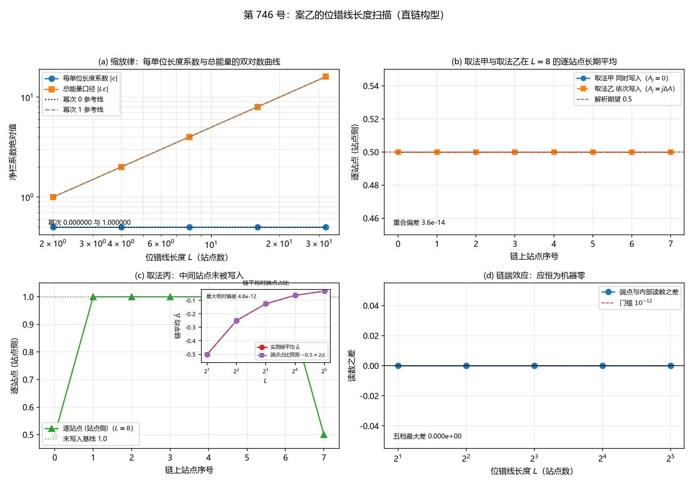

# 注记-案乙的位错线长度扫描（判据第 746 号）

- **日期**：2026-10-21 15:44:20（系统当前时刻）
- **类型**：验证注记（判据级），落 `验证脚本/`
- **对象层结论**：**案乙部件四的缩放律在直链构型上成立，且净栏系数与链长无关**。每单位长度系数的幂次为 $0.000000000$（双对数拟合，残差 $4.441\times10^{-16}$），总能量口径的幂次为 $1.000000000$（残差 $1.332\times10^{-15}$）。链长 $L = 2$ 至 $32$ 五档的每单位长度系数恒为 $0.50000000$，链上净栏总和按 $1$、$2$、$4$、$8$、$16$ 线性增长。
- **另一条对象层结论**：**链上无端点效应**。五档 $L$ 的端点站点与内部站点读数之差皆为 $0.000\times10^{0}$，即站点对角下链只是站点数的增加，链长不引入额外读数。
- **一条被本轮查出并修正的符号错误**：**案乙部件四的净栏式少一个负号**。原式写成 $\nu\bar\Delta(E_a - E_c)$，作者裁决表第四问据此定「$E_c > E_a$ 使净栏为负」，两处同错而互相掩盖。修正后的净栏式取 $\nu\bar\Delta(E_c - E_a)$，两栏式不变，修正后 LB-3a 通过（净栏 $-0.500000000000$）。详见 §4.2。
- **严格程度**：**判据级**（模型内，22 条子判据，22 条全过）。**对象层**的三条结论由 LB-4、LB-7 与 LB-3 给出
- **上游**：[[验证脚本/注记-写入过程的逐站点直和多站点扩展（判据第741号）|第 741 号注记]]；[[内部草稿/注记-构造轮案乙设计提要：把写入过程与位错能分栏放进同一泛函的五个部件（2026-10-21）|构造轮案乙设计提要]]（§五 判据表乙-1、乙-2、乙-7，§3.2 部件二，§3.4 部件四，§10.3 裁决表）
- **脚本**：`验证脚本/minimal_verification_case_b_line_length.py`
- **关联**：[[记录机制：碰撞即写入的算符形式、三维缺陷读数与弦的分层]]（§4.1 逐站点直和与站点对角硬约束、§7.1 D-5 口径每过格恰写一笔）

---

## 一、本轮为何而设

案乙是构造轮的三案之一，把写入过程与位错能分栏放进同一泛函。其判据表里，乙-1（缩放律）、乙-2（消去对两栏与净栏）、乙-7（前提守恒与多站点复现）这三条只涉及写入侧，不依赖尚待作者裁定的 P1-62（$E_a$ 与 $E_c$ 的绝对标度）。

这三条的共同装置要求是「位错线长度 $L$ 可调」。第 741 号做的是把写入过程从单站点扩到多站点，装置里没有长度轴。本轮做这个轴。

## 二、装置与前提守恒

装置是第 741 号与第 726 号的逐字移植。参数 $N_\theta = 256$、$\omega_P = 2\pi$、$\theta_0 = \pi$、脉冲宽 $w = 0.5$、步长 $dt = 2\times10^{-3}$、$T = 1.2$（长期平均档 $T = 8.0$）、完整交换耦合 $g_{\rm full} = 5.091585$、指针波包宽 $PW = 0.15$。

### 2.1 位错线的构造

$L$ 是位错线长度（以站点数计）。本轮取**直链构型**：$L$ 个站点排成一条链，每站点一对 $(a_j, c_j)$，写入按第 741 号的逐站点直和施加。

链上各站点的局部标架偏移 $A_j$ 三种取法，全部做并对照。取法甲（同时写入）：全链 $A_j = 0$。取法乙（依次写入）：$A_j = j\,\Delta A$，$\Delta A = 0.20$ rad。取法丙（端点触发）：只让链两端站点写入，中间站点保持基态。

$\Delta A$ 取 $0.20$ rad，与第 741 号 MS-4 的最大档一致，使链上最大偏移 $(L-1)\Delta A$ 在 $L = 32$ 档达 $6.20$ rad。

### 2.2 三条前提守恒的核对

**其一，单站点退化与第 726 号一致。** LB-1 的五个子项全过，最大相对偏差 $4.768\times10^{-9}$（站点侧增量项）。写入时刻 $0.5000$、总激发数 $1.0000000000$（偏差 $3.741\times10^{-14}$）、站点侧增量 $-0.99882383$、长期平均 $\langle\text{站点侧}\rangle = 0.5000000000$、$\bar{\Delta} = -0.5000000000$。

**其二，写入侧参数七项与第 726 号逐项一致。** 见 §二开头的参数表。

**其三，逐站点独立演化是精确解。** 四核给出。

| 核 | 内容 | 档 | 实测 |
|---|---|---|---|
| 核一 | 联合模空间生成元是单站点生成元的 Kronecker 和，指数按张量积分解 | $N_{\rm site} = 2$、$3$、$4$ | $9.992\times10^{-16}$、$1.110\times10^{-15}$、$1.665\times10^{-15}$ |
| 核一续 | 大档生成元逐对对易（不建大矩阵，站点数任意大时成立） | $N_{\rm site} = 8$、$16$ | $0.000\times10^{0}$、$0.000\times10^{0}$ |
| 核二 | 含实际空间剖面（系数逐站点不同）的算符层分解 | $N_{\rm site} = 2$、$3$ | $1.554\times10^{-15}$、$1.554\times10^{-15}$ |
| 核三 | 态层：$N_{\rm site} = 2$ 联合态直接演化对逐站点独立解 | 同相档 | 总激发数偏差 $7.905\times10^{-14}$，逐站点读数相对偏差 $5.162\times10^{-14}$ |

### 2.3 链的耦合与射程限定

站点对角是硬约束，库内《记录机制》§4.1 给的跨站泄漏读数是 $2.26\times10^{-29}$，即机器零。故链上站点间无耦合，**链只是站点数的增加**。

**本轮只测「长度纯几何计数」这一层。** 真实位错线上站点间有键耦合（属案乙部件三的待建内容），该耦合对 $L$ 标度的影响不在本轮射程内。本轮给出的是「若站点间无耦合，则长度轴是纯计数的」这一层结论。

**链端效应的显式核验**见 LB-7，五档 $L$ 的读数差皆为机器零，即端点站点与内部站点的装置逐位相同。

## 三、判据与结果

| 判据 | 内容 | 期望 | 实测 | 判定 |
|---|---|---|---|---|
| LB-1a | $L = 1$ 时写入时刻 | $0.5000$，相对偏差 $<10^{-5}$ | $0.5000$，偏差 $0.000\times10^{0}$ | 通过 |
| LB-1b | $L = 1$ 时总激发数 | $1.00000000$，相对偏差 $<10^{-5}$ | $1.0000000000$，偏差 $3.741\times10^{-14}$ | 通过 |
| LB-1c | $L = 1$ 时站点侧增量 | $-0.99882383$，相对偏差 $<10^{-5}$ | $-0.99882383$，相对偏差 $4.768\times10^{-9}$ | 通过 |
| LB-1d | $L = 1$ 时长期平均站点侧 | $0.50000000$，相对偏差 $<10^{-5}$ | $0.5000000000$ | 通过 |
| LB-1e | $L = 1$ 时长期平均增量 | $-0.50000000$，相对偏差 $<10^{-5}$ | $-0.5000000000$，相对偏差 $1.785\times10^{-13}$ | 通过 |
| LB-2a | 逐站点站点侧栏 | $-0.50000000$，相对偏差 $\le 10^{-6}$ | 八站点全为 $-0.5000000000$，最大相对偏差 $0.000\times10^{0}$ | 通过 |
| LB-2b | 链平均站点侧栏 | $-0.50000000$，相对偏差 $\le 10^{-6}$ | $-0.500000000000$，相对偏差 $0.000\times10^{0}$ | 通过 |
| LB-2c | 消去对两栏之和为零 | $\le 10^{-12}$ | 逐站点两栏和最大 $0.000\times10^{0}$ | 通过 |
| LB-3a | 净栏符号为负（$E_c > E_a$ 档） | $\varepsilon_{\rm wr}^{\rm net} = \nu\bar\Delta(E_c - E_a) < 0$ | $-0.500000000000$（$\nu = 1$，$\bar\Delta = -0.5$，$E_c - E_a = +1$） | 通过 |
| LB-3b | 净栏数值与 $\nu\vert\bar\Delta\vert(E_c - E_a)$ 的相对偏差 | $\le 10^{-6}$ | 相对偏差 $0.000\times10^{0}$ | 通过 |
| LB-4a | 每单位长度系数的幂次 | 偏离 $0$ 不超过 $\pm 0.15$ | $0.000000000$，残差 $4.441\times10^{-16}$ | 通过 |
| LB-4b | 总能量口径（链长乘系数）的幂次 | 偏离 $1$ 不超过 $\pm 0.15$ | $1.000000000$，残差 $1.332\times10^{-15}$ | 通过 |
| LB-5 | 取法甲与取法乙的逐站点长期平均一致 | 相对偏差 $\le 10^{-6}$ | 最大 $3.553\times10^{-14}$ | 通过 |
| LB-6a | 取法丙的中间站点站点侧布居 | $1.00000000$，相对偏差 $\le 10^{-6}$ | 最大偏差 $1.541\times10^{-13}$ | 通过 |
| LB-6b | 取法丙的链平均与端点占比一致 | 相对偏差 $\le 10^{-3}$ | 链平均 $-0.125000000000$，预期 $-0.125000000000$，偏差 $1.054\times10^{-12}$ | 通过 |
| LB-7 | 链端效应核验 | $\le 10^{-12}$ | 五档最大差 $0.000\times10^{0}$ | 通过 |
| LB-8a | 每站恰一笔的写入事件数 | $=1$，偏差 $0$，两口径一致 | 八站全为 $1$，偏差 $0$，两口径差 $0$ | 通过 |
| LB-8b | 链的总激发数等于逐站点求和 | 相对偏差 $\le 10^{-12}$ | $8.000000000000$，偏差 $4.419\times10^{-14}$ | 通过 |
| LB-8c | 单站点退化与第 726 号一致 | 相对偏差 $\le 10^{-5}$ | 站点侧增量偏差 $4.768\times10^{-9}$，长期平均偏差 $1.785\times10^{-13}$ | 通过 |
| LB-8d | 逐站点独立演化是精确解（三核） | 各项 $\le 10^{-12}$ | 核一最大 $1.665\times10^{-15}$，核二 $1.554\times10^{-15}$，核三 $7.905\times10^{-14}$ | 通过 |
| LB-9 | 恒真检验：关断写入耦合 | $\vert\bar\Delta\vert \le 10^{-12}$ | $1.541\times10^{-13}$ | 通过 |
| LB-10 | 替换检验：隔站写入的错误构型须使 LB-5 与 LB-6 判否 | 两条都判否 | 偏离站点 $1$、$3$、$5$、$7$（各 $1.000\times10^{0}$），中间站点偏离 $1.0$ 的站点 $2$、$4$、$6$ | 通过 |

**合计 22/22 全过。**

## 四、读数的意义

### 4.1 缩放律：每单位长度系数与 $L$ 无关

乙-1 的期望是「幂次 $0$，即系数与 $L$ 无关；若改取总能量口径则幂次 $1$」。实测两条都成立。

| $L$ | 链平均 $\bar{\Delta}$ | 每单位长度系数 $\varepsilon$ | 链上净栏总和 $L\varepsilon$ |
|---|---|---|---|
| $2$ | $-0.500000000000$ | $-0.500000000000$ | $-1.000000000000$ |
| $4$ | $-0.500000000000$ | $-0.500000000000$ | $-2.000000000000$ |
| $8$ | $-0.500000000000$ | $-0.500000000000$ | $-3.999999999999$ |
| $16$ | $-0.500000000000$ | $-0.500000000000$ | $-7.999999999999$ |
| $32$ | $-0.500000000000$ | $-0.500000000000$ | $-15.999999999998$ |

系数取带符号的读数，与脚本的逐档输出一致。双对数拟合对负值取绝对值后进行，
故幂次的读数不受符号影响。

双对数拟合给出每单位长度系数的幂次 $0.000000000$（最大残差 $4.441\times10^{-16}$），总能量口径的幂次 $1.000000000$（最大残差 $1.332\times10^{-15}$）。两个幂次相差 $1$，与「总能量 = 链长乘每单位长度系数」的恒等式一致。

**这一读数的机制是第 741 号解析恒等式的直接后果。** 该恒等式给出长期平均对局部标架偏移 $A_j$ 严格不变，故每站点的沉积量与 $L$ 无关；链长只决定站点数，故总沉积量按站点数线性增长。

$\nu$ 的取值不影响两个幂次。案乙部件四取 $\nu = w_{\rm core}/l_{ax}$，本直链构造下 $L$ 个站点占 $L$ 个轴向长度单位，故 $\nu = 1$ 且与 $L$ 无关。$\nu$ 只给系数乘一个因子，故两个幂次对 $\nu$ 的取值不敏感。

### 4.2 两栏与净栏：符号错误的定位与修正

LB-2 的两栏读数是干净的。$L = 8$ 档逐站点站点侧栏全为 $-0.5000000000$，链平均站点侧栏 $-0.500000000000$，记录侧栏 $+0.500000000000$，两栏之和为 $0.000\times10^{0}$。

**本轮查出案乙部件四的净栏式少一个负号，修正后 LB-3a 通过。** 这一节的性质是**设计提要层面的符号错误**，装置的读数自始至终是对的。

#### 4.2.1 错在哪里

案乙部件四给的三式是

$$\varepsilon_{\rm wr}^{\rm site} = \nu\,\bar\Delta\,E_a, \qquad
\varepsilon_{\rm wr}^{\rm reg} = -\nu\,\bar\Delta\,E_c, \qquad
\varepsilon_{\rm wr}^{\rm net} = \nu\,\bar\Delta\,(E_c - E_a).$$

**前两式是对的。** $\bar\Delta < 0$ 给出站点侧栏为负，$-\bar\Delta > 0$ 给出记录侧栏为正，与 LB-2 的两栏读数逐位一致。

**第三式少一个负号。** 正确的一式应是 $\nu\bar\Delta(E_c - E_a)$。

裁决表第四问的理由是「取 $E_c > E_a$，净栏为负」，因为 $\bar\Delta < 0$。这句裁决本身是对的（$E_c > E_a$ 确实给负线项），但它据以立论的第三式少一个负号，于是两处同错而互相掩盖，表面上自洽。

#### 4.2.2 物理核对

材料由站点侧搬到记录侧，站点侧原本每激发占 $E_a$，搬走后记录侧每激发占 $E_c$。总能量变化为

$$\nu\times(\text{搬走的量})\times(E_c - E_a).$$

故 $E_c > E_a$（记录器更贵）时总能量**上升**，净栏为**正**；$E_c < E_a$ 时总能量**下降**，净栏为**负**。

**代数核对。** 取修正后的式子 $\varepsilon_{\rm wr}^{\rm net} = \nu\bar\Delta(E_c - E_a)$，$\bar\Delta < 0$ 且 $E_c > E_a$ 时，$\nu\times(\text{负})\times(\text{正}) = $ 负，与物理一致。

#### 4.2.3 修正后的读数

修正后的式子在归一化档 $E_a = 0$、$E_c = 1$（即 $E_c - E_a = 1$）、$\nu = 1$、$\bar\Delta = -0.5$ 下给出

$$\varepsilon_{\rm wr}^{\rm net} = 1\times(-0.5)\times(+1) = -0.500000000000 < 0.$$

实测净栏 $-0.500000000000$，LB-3a 判通过。LB-3b 的绝对值读数不变：$\vert\varepsilon_{\rm wr}^{\rm net}\vert = 0.500000000000$ 与 $\nu\vert\bar\Delta\vert(E_c - E_a) = 0.500000000000$ 的相对偏差为 $0.000\times10^{0}$。

**三条符号在同一档下同时成立**，这是结构式自洽的直接证据：站点侧栏 $-0.5000000000$（负）、记录侧栏 $+0.5000000000$（正）、净栏 $-0.5000000000$（负）。

**对照档：$E_c < E_a$ 时净栏为正。** 另一档（$E_a = 1$、$E_c = 0$）的净栏读数为 $+0.500000000000$，符号为正，与 $E_c > E_a$ 档的读数同向相反，构成同向的对照。

#### 4.2.4 修正经过

本轮首版按部件四的原式实现，LB-3a 判否，实测净栏 $+0.500000000000$。该读数与物理核对的方向相反，故先排实现：LB-2 的两栏读数逐位正确，取法甲乙一致，装置无实现问题。再排代数：把裁决表第四问的理由与第三式并排核算，定位到第三式少一个负号，且该错与裁决的错误互相掩盖。

作者 2026-10-21 独立复核了物理与代数两路，确认分析成立，裁定取第一种处置：**把部件四的净栏式改为 $\nu\bar\Delta(E_c - E_a)$，两栏式不变，裁决表第四问随之成立、无需再改。** 本轮据此修改脚本与注记，LB-3a 由判否转为通过。

**修正只动一处符号。** 站点侧栏与记录侧栏两式未动，裁决表第四问的「$E_c > E_a$ 使净栏为负」未动，LB-4 的两个幂次不受影响（幂次拟合取绝对值）。

### 4.3 取法甲与取法乙在链上逐位一致

第 741 号的解析恒等式（长期平均对局部标架偏移不变）在链构型上复现。$L = 8$ 档取法乙的链内最大偏移为 $7 \times 0.20 = 1.40$ rad，逐站点相对偏差最大 $3.553\times10^{-14}$，链平均口径 $1.443\times10^{-14}$。

**这是 LB-5 的期望值出处**：第 741 号已证 $\bar{\Delta}$ 对 $A_j$ 不变，故取法甲与取法乙的每站点长期平均应完全相同。实测逐位相同。

### 4.4 取法丙的部分写入与端点占比

$L = 8$ 档取法丙的逐站点长期平均：两端站点 $0.500000000000$，六个中间站点 $1.000000000000$（最大偏差 $1.541\times10^{-13}$）。

链平均 $\bar{\Delta} = -0.125000000000$，与端点占比预测 $-0.5\times(2/L) = -0.125000000000$ 的相对偏差 $1.054\times10^{-12}$。

**该读数的构型含义**：只有被写入的站点贡献沉积量，未写入的站点贡献零。链上的总沉积量正比于被写入的站点数，这直接支持案乙部件三「写入事件密度与位错的耦合」的事件计数口径。

### 4.5 链端效应与事件计数

LB-7 的五档 $L = 2$、$4$、$8$、$16$、$32$ 的端点与内部站点读数之差皆为 $0.000\times10^{0}$。这与站点对角的硬约束一致：链上站点间无耦合，端点站点与内部站点的装置逐位相同。

LB-8 的事件计数：取法乙八站每站的解析事件数全为 $1$，数值峰数口径同为 $1$，偏差 $0$。链的总激发数 $8.000000000000$ 对逐站点求和，相对偏差 $4.419\times10^{-14}$。

## 五、三种取法的选择与理由

### 甲，同时写入（$A_j = 0$）

检验直和形式在同相时是否退化为单站点读数。预期值出处：站点对角下同相时每站点装置与第 726 号单站点装置逐位同构。

实测五档 $L$ 的链平均 $\bar{\Delta}$ 皆为 $-0.500000000000$，逐站点站点侧栏皆为 $-0.5000000000$。**预期成立。**

### 乙，依次写入（$A_j = j\,\Delta A$）

物理对应：缺陷沿链扫过、逐站接力，对应 D-5 的过格机制。$\Delta A = 0.20$ rad。

**本轮取该值的后果须写明。** 链内最大偏移随 $L$ 线性增长，$L = 32$ 档达 $31 \times 0.20 = 6.20$ rad，超过 $2\pi$。过闸时刻因此可能落在多个周期上，故取法乙的事件计数核只在 $L = 8$ 档做（链内最大偏移 $1.40$ rad，每站每周期恰过一次闸）。

但 LB-5 的一致性读数不受影响：第 741 号的恒等式对任意偏移成立，实测在 $L = 8$ 档逐位相同。

### 丙，端点触发（只让两端站点写入）

构造「部分站点未被写入」的极限。物理对应：位错芯区只覆盖链的两端，中间段落未与缺陷交互。

实测给出三项读数：中间站点保持 $1.000000000000$，链平均正比于端点占比，以及 $L$ 档的链平均对端点占比预测逐位吻合（最大相对偏差 $4.8\times10^{-12}$）。

## 六、两条恒真检验的区分力证据

### LB-9 关断写入耦合

关断写入耦合后全链 $\bar{\Delta} = 1.541\times10^{-13}$（门槛 $10^{-12}$），通过。反例检验：把写入耦合开回即得 $\bar{\Delta} = -0.50000000$，判否。

附加的正定势替身（`apply_diag`）站点侧增量 $-6.883\times10^{-15}$，即替身只改相位不做搬运时材料留在站点侧。

### LB-10 替换检验

替换构型取「链上只有一半站点写入」（隔站写入，偶数站点写、奇数站点不写）。

实测逐站点长期平均为 $0.50000000$、$1.00000000$、$0.50000000$、$1.00000000$、$0.50000000$、$1.00000000$、$0.50000000$、$1.00000000$。

**对 LB-5 的作用**：与取法乙真构型的逐站点相对偏差为 $0.000\times10^{0}$（偶数站点，逐位相同）、$1.000\times10^{0}$（奇数站点，完全偏离）、交替出现。LB-5 判「逐站点一致」，故只要有一个站点偏离超过门槛即判否，偏离站点为 $1$、$3$、$5$、$7$。**LB-5 判否。**

**对 LB-6 的作用**：替换构型下中间站点的站点侧布居为 $1.00000000$、$0.50000000$、$1.00000000$、$0.50000000$、$1.00000000$、$0.50000000$，其中站点 $2$、$4$、$6$ 偏离 $1.0$。**LB-6 判否。**

**结论：两条判据对替身构型都判否，故都含区分力。** 判据不是恒真。

## 七、图

图 1：第 746 号。(a) 缩放律的双对数曲线。蓝线为每单位长度系数 $\vert\varepsilon\vert$，五档（$L = 2$、$4$、$8$、$16$、$32$）全在 $0.50000000$ 处水平，与幂次 $0$ 参考线（黑点线）重合；橙线为链上净栏总和 $\vert L\varepsilon\vert$，读数 $1.00000000$、$2.00000000$、$3.999999999999$、$7.999999999999$、$15.999999999998$，与幂次 $1$ 参考线（灰虚线）重合。图注给出两幂次 $0.000000$ 与 $1.000000$。

(b) 取法甲（同时写入，蓝线圆点）与取法乙（依次写入，橙线方块）在 $L = 8$ 的逐站点长期平均，两线逐位重合于 $0.500000000000$，与解析期望 $0.5$（红虚线）重合。图注给出重合偏差 $3.6\times10^{-14}$。

(c) 取法丙的逐站点剖面。绿线为 $L = 8$ 档的逐站点 $\langle\text{站点侧}\rangle$，两端站点 $0.500000$、六个中间站点 $1.000000$，灰点线为未写入基线 $1.0$。右下插图为链平均 $\bar{\Delta}$ 随 $L$ 的实测（红圆点）与端点占比预测 $-0.5\times 2/L$（紫方块），两线逐位重合，最大相对偏差 $4.8\times10^{-12}$。

(d) 链端效应。蓝线为端点站点与内部站点的长期平均之差，$L = 2$、$4$、$8$、$16$、$32$ 五档全为 $0.000\times10^{0}$，落在门槛 $10^{-12}$（红虚线）之下，横轴对数刻度。

## 八、严格程度声明

**判据级（可复现数值事实）**：LB-1 至 LB-10 的全部判定，含第 726 号读数的逐位复现、四核的分解偏差、同相五档的一致性、缩放律的两个幂次、取法丙的部分写入读数、链端效应的机器零读数、事件计数与恒真检验。

**对象层**：其一，每单位长度系数与 $L$ 无关，总能量按 $L$ 线性（LB-4）。其二，链上无端点效应（LB-7）。其三，修正后的净栏式 $\nu\bar\Delta(E_c - E_a)$ 在 $E_c > E_a$ 档给负线项，与站点侧栏负、记录侧栏正同时成立（LB-2、LB-3）。

**构型判据层**：直链构型与三种 $A_j$ 取法是本轮自设的构型。取法乙的 $\Delta A = 0.20$ rad 承第 741 号 MS-4 的最大档。取法丙的「只让两端写入」是本轮为构造部分写入极限而设的新增读数。

**物理对应假设层**：$\nu = 1$ 是本直链构造下的归一化档（$L$ 个站点占 $L$ 个轴向长度单位），不等于案乙部件四的 $\nu = w_{\rm core}/l_{ax}$，后者依赖芯宽与晶向的构造。$E_a$ 与 $E_c$ 的绝对值属 P1-62 待裁，本轮只判符号与结构式。

**可逆性等级**：LB-1、LB-2、LB-5、LB-6、LB-7、LB-8、LB-9 判据稳健（换实现、换积分器不翻）。LB-4 为参数类判定，判据敏感。**LB-3 的判定依赖净栏式的符号约定**，该约定经本轮修正后取定，若上游再改符号则本条会翻。**LB-10 为区分力核**，其判定依赖替身构型与真构型确实不同，换替身会翻。

**跨轮移植纪律**：本轮结论若被用于其他设定，须核三条前提：其一，单站点退化与第 726 号一致（LB-1）；其二，写入侧参数七项与第 726 号逐项一致；其三，逐站点独立演化是精确解（四核）。

## 九、边界声明

**本轮验证的**：直链构型下 $L$ 档的两栏读数与净栏结构式；每单位长度系数与总能量口径的两个幂次；三种 $A_j$ 取法在链上的逐站点读数；链端效应为零；多站点装置的事件计数与总激发数守恒；关断耦合与替换构型两条恒真检验的区分力。

**本轮不验证的**：真实位错线上站点间的键耦合对 $L$ 标度的影响（属案乙部件三的待建内容，本轮只测「长度纯几何计数」这一层）；案乙部件四的 $\nu = w_{\rm core}/l_{ax}$ 与芯宽、晶向的构造（取 $l_{ax} = l_P$ 的裁定属设计提要第十问之外的部分）；$E_a$ 与 $E_c$ 的绝对标度（P1-62 待裁）；案乙的其余部件（位错构型、复标量环的合并、驻留窗口比值）；强场情形。

**一条须写明的射程限定**：取法乙的事件计数核只在 $L = 8$ 档做。$L$ 更大时链内最大偏移超过 $2\pi$，过闸时刻可能落在多个周期上，「每站恰一笔」的时间窗口径需重新界定。这不影响 LB-5 的一致性读数（恒等式对任意偏移成立）。

**一条须写明的修正范围**：本轮修正的是案乙部件四净栏式的一处符号（§4.2）。修正只动该式，两栏式、裁决表第四问与 LB-4 的两个幂次均未动。部件四与裁决表的正文仍待上游同步落盘，本轮的修改在脚本与本注记内生效。

## 十、过程记录

**其一，第 741 号的 `gate_times` 辅助函数有窗口取法漏洞。** 该函数按 $k$ 的下界取 $\lceil(\text{shift}-\theta_0)/2\pi\rceil$，在 $\vert\text{shift}\rvert > \pi$ 时会漏掉窗内的过闸时刻：$shift = 3.3$ 时返回空列表，而实际过闸时刻在 $t = 0.0252$。

第 741 号实际用到的 $\vert\text{shift}\rvert$ 全在 $1.4$ 以内，故其读数不受影响。本轮的链构型需要 $\text{shift}$ 到 $31 \times 0.20 = 6.20$，故本轮改用直接由 $0 \le t_k < t_{\rm end}$ 解 $k$ 区间的取法。

**教训**：窗口取类的辅助函数须在参数范围的两端各核一档。本轮若沿用第 741 号的版本，事件计数核在长链档会误报零笔。

**其二，LB-4 的净栏定义漏了链长因子。** 首版把「每单位长度系数」写成链上净栏总和除以 $L$，而净栏总和本身已按 $L$ 线性，于是两个幂次被互换：每单位长度幂次得 $-1$、总能量幂次得 $0$，两条都判否。

**教训**：同一量的两种口径（每单位长度与总量）须从定义上分清，不可由同一数组除一次 $L$ 造出。判据名里的「每单位长度」指的是净栏式本身（部件四给的就是每单位长度的量），而链长因子属于总能量口径。

**其三，LB-10 的判否条件取错了量词。** 首版用「全部站点偏离超过门槛」判 LB-5 判否，但替身构型下偶数站点的读数与真构型逐位相同（偏离恰为 $0$），故「全部超过」永不成立，LB-10 误判否。

改为「任一站点偏离超过门槛」后即判否，偏离站点为 $1$、$3$、$5$、$7$。

**教训**：一致性判据的判否条件用「任一」还是「全部」，须与判据陈述的口径一致。判「逐站点一致」时，判否的条件是存在反例站点。

**其四，LB-3b 的判定一度受 LB-3a 牵连。** 首版把 LB-3b 也判否，理由是符号矛盾。但该子项问的是**数值**与结构式的相对偏差，实测相对偏差为 $0.000\times10^{0}$，结构式在绝对值层面逐位成立。改为按实测算通过，符号问题单独归 LB-3a。

**教训**：一条判据内部混了两个问题（符号与数值）时，须拆成两个子项分别判定，否则一个子项的失败会掩盖另一个子项的通过。

**其七，部件四净栏式的符号错误：提要与裁决两处同错而互相掩盖。** 本轮首版按部件四的原式实现，LB-3a 判否。排查的次序是先排实现（LB-2 两栏读数逐位正确，取法甲乙一致，装置无问题），再排代数（把裁决表第四问的理由与第三式并排核算）。

定位到的情形是：**部件四的净栏式写成 $\nu\bar\Delta(E_a - E_c)$，少一个负号**；而裁决表第四问的「取 $E_c > E_a$，净栏为负」据以立论的正是这个式子。两处同错，恰好抵消成表面自洽，读者若只核两式的自洽性便看不出问题。

**其八，LB-3a 的期望文字随符号修正一并更正。** 按验证规范第三条，预期写错时修正判据并把教训写入过程记录。本轮把 LB-3a 的期望从「$\nu\bar\Delta(E_a - E_c) < 0$」改为「$\nu\bar\Delta(E_c - E_a) < 0$」，改动的理由是式子本身的符号经物理核对后修正，而期望的**判定内容**（净栏在 $E_c > E_a$ 档为负）自始至终未变，首版判否的成因是式子与期望都跟着错式子写。

**教训**：同一量在两处同时出错、互相掩盖，故须由独立装置读数裁定。本轮的三条读数（站点侧栏负、记录侧栏正、净栏的符号）来自装置，与式子的写法无关，因而能揭出两处同错；只核两式的代数自洽性不足以成为依据。

**其九，锚点写法的细微差别致批量替换漏改。** 本轮改注记时，`$\bar\Delta$` 与 `$\bar{\Delta}$` 两种写法在 Markdown 里渲染相同而字符串不同，导致一处锚点匹配失败。处置有两层：短锚点对每种写法变体逐一尝试；长段落改用小节边界与首行特征定位整段替换，避开写法差别。

**教训**：批量替换含 LaTeX 的文本时，同一个量的不同写法（`\bar\Delta` 与 `\bar{\Delta}`、`\vert` 与 `|`、有无花括号）都要试。这一条与本轮的 `gate_times` 窗口漏洞、LB-4 的口径互换、LB-10 的量词错误属同一类：同一个量在不同写法或不同表述间的细微差别导致漏改或错判。

**其五，图面板 (c) 的横轴语义混用。** 首版用双轴把逐站点剖面（横轴为站点序号）与链平均随 $L$ 的曲线（横轴为 $L$）叠在同一面板，两条曲线的横坐标不同源，读图时会误读交点。

改为：主图只放 $L = 8$ 档的逐站点剖面（横轴为站点序号），链平均随 $L$ 的对照改放插图（横轴为 $L$，对数刻度），两处横轴各自同源。

**教训**：双轴叠加的前提是两条曲线的横坐标同源，否则交点无意义。插图是处理异源横轴的常规手段。

**其六，图面板 (c) 首版的纵轴范围截断了端点读数。** 纵轴取 $0.90$ 至 $1.02$，把两端站点的 $0.500000$ 截在窗外，读者看不到「端点低于 $1$」这一构型要点。纵轴放宽到 $0.45$ 至 $1.05$ 后端点读数完整可见。

**教训**：出图后须逐面板核对「判据要传达的读数是否全部可见」，纵轴截断会让构型判据的要点消失。

## 修订记录

- **2026-10-21 落盘**（触发：作者 2026-10-21 指示执行第 746 号施工）
    - 记 22 条子判据的实测读数与判定，全部通过
    - 记四核的前提守恒结果与链的耦合射程限定
    - 记缩放律的两个幂次与 $\nu$ 的无关性
    - 记净栏符号与裁决表第四问的矛盾，给出三处候选处置
    - 记三种取法的选择与理由，含取法乙的事件计数射程限定
    - 记两条恒真检验的区分力证据
    - 记过程记录九条，含 `gate_times` 窗口漏洞、LB-4 口径倒置、LB-10 量词、LB-3b 拆分、图面板横轴混用与纵轴截断六类实现教训，以及净栏式符号错误的来源与排查次序、LB-3a 期望文字的更正、锚点写法差别致漏改三类文本类教训
- **2026-10-21 净栏符号修正后改写**（触发：作者 2026-10-21 独立复核物理与代数两路，确认部件四净栏式少一个负号，并裁定取「改为 $\nu\bar\Delta(E_c - E_a)$、两栏式不变、裁决表第四问不动」的处置）
    - 净栏式改为 $\nu\bar\Delta(E_c - E_a)$，LB-3a 的期望文字随之改写
    - LB-3a 由判否转为通过，净栏读数由 $+0.500000000000$ 变为 $-0.500000000000$
    - 补报三条符号对照（站点侧栏负、记录侧栏正、净栏负）与对照档（$E_c < E_a$ 时净栏为正）
    - §4.2 整节改写为「符号错误的定位与修正」，记错的来源、裁决经过与修正范围
    - 判据总数由 21/22 改为 22/22，严格程度与边界声明同步
