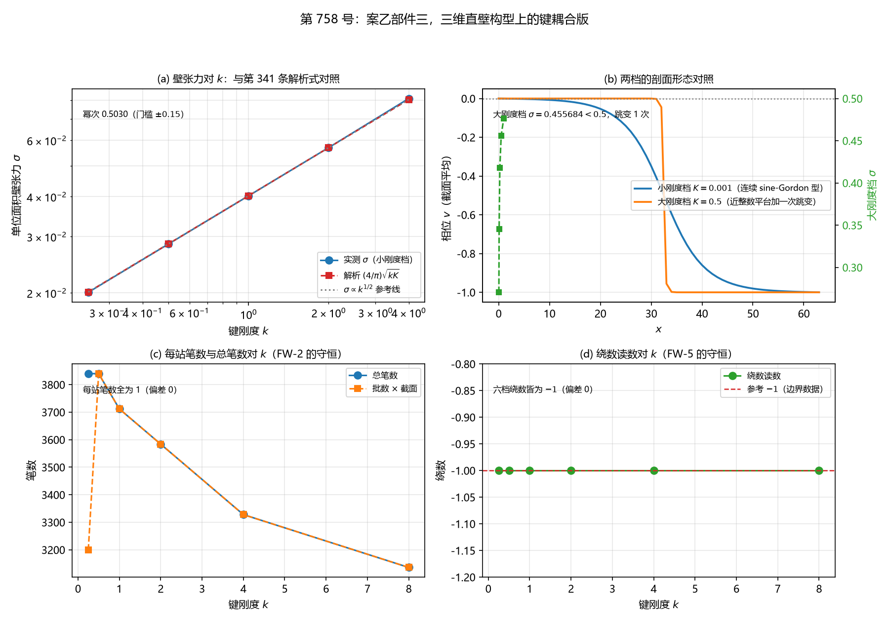

# 注记-案乙部件三：三维直壁构型上的键耦合版（判据第 758 号）

- **日期**：2026-10-21 20:12:00（系统当前时刻）
- **类型**：验证注记（判据级），落 `验证脚本/`
- **对象层结论**：**第 341 条的壁张力解析式在小刚度档于三维延展构型上首次被格点读数确认。**
壁张力对键刚度 $k$ 的幂次为 $0.502970$（残差 $2.512\times10^{-3}$），各档 $\sigma$ 对解析式 $\frac4\pi\sqrt{kK}$ 的比值为 $0.9978$、$0.9989$、$0.9995$、$1.0003$、$1.0074$。
$k = 1$ 档 $\sigma = 0.04024188$ 对解析 $0.04026337$，相对偏差 $0.0534\%$，与库内条带表轮的在案读数 $0.040242$ 逐位一致
- **大刚度档的形态对上了**：五档跳变次数全为 $1$，平台整数性偏离 $6.909\times10^{-2}$、$2.842\times10^{-2}$、$7.347\times10^{-3}$、$2.055\times10^{-3}$、$5.702\times10^{-4}$（$K$ 越大平台越接近整数）。
张力 $0.270480$、$0.345133$、$0.417864$、$0.455684$、$0.476405$ 随 $K$ 上升并趋近一格锐壁上限 $0.5$
- **键耦合改不了绕数**：六个 $k$ 档的绕数读数皆为 $-1.0000000000$，偏差 $0$。**这是拓扑保护层在场的表现**，而那恰是第 618 号二维直壁缺的那一层
- **两条判否**：**FW-7a 与 FW-7b 判否**，均登记为**判据设计失效**（第三种结论，与判负区分）
- **严格程度**：**判据级**（模型内，16 个子判据，14 条通过，FW-7a 与 FW-7b 判否）
- **可逆性等级**：**判据稳健**。FW-1、FW-2、FW-5、FW-6、FW-8 的判定在装置参数的合理扰动下不变；FW-3 与 FW-4 的判定依赖张力口径，已在过程记录中登记该口径的定位过程
- **档位标注**：本轮读数取**模型档** $K = 0.001$（面缺陷写入节拍轮的库内基线）。物理档 $K = 2.788142\times10^{-46}$ 与模型档相差四十余个数量级，**物理档评估未做**，理由见边界声明
- **上游**：[[验证脚本/注记-三维面缺陷的写入节拍轮：笔数等于批数乘截面、写入即折返、准时性对噪声（判据W1至W6b）|三维面缺陷写入节拍轮注记]]（节拍构型与在案读数）；[[验证脚本/注记-修正实现重跑条带表轮：连续式在小刚度档成立、大刚度档低三成并趋近二分之一（判据X1至X5）|条带表轮注记]]（张力口径与格式 C）；[[验证脚本/注记-三维延展构型保护性复核：面积律的系数对上新壁张力（判据P1至P5）|第 289 条三维延展构型保护性复核]]（面积律与壁张力的系数身份）
- **脚本**：`验证脚本/case_b_face_wall.py`
- **关联**：[[理论总纲/元相子理论的时空观：体系对时空的完整认识]]（L305 台阶面与壁张力，第 341 条；L732 三维构型下的定数仍待攻）；[[理论总纲/术语表]]（L318 键刚度 $k_b$ 与势项 $K$ 的归属；L321 档位标注义务）；[[内部草稿/判据草案-锚核身份C2：三元组锁定与站点PN代理在位错钉扎上的等效性]]（键耦合的标准形式）；[[记录机制：碰撞即写入的算符形式、三维缺陷读数与弦的分层]]（§4.1 逐站点直和的硬约束）；[[验证脚本/注记-二维芯结构模型立案轮：错配三相分配与delta可读性的档位面（第618号）|第 618 号注记]]（二维直壁的拓扑保护层缺课）

---

## 一、本轮要判什么

第 755 号做的是一维链上的键耦合，其读数里明确不判三维直壁构型。本轮把构型换成**三维直壁（面缺陷）**，判三件事：

其一，面缺陷上的键耦合（键刚度 $k$）对**壁张力**的影响，与第 341 条的解析式 $\sigma = \frac4\pi\sqrt{kK}$ 对照。
其二，大刚度档（$K > K^{*}$）的剖面形态，对照第 341 条的「近整数平台加一次快速跳变」。
其三，键耦合是否破坏面缺陷的拓扑保护（绕数守恒）。

**键刚度就是 $k$。** 按 M-F 裁决（《术语表》L318）：同类耦合（键间余弦）归键刚度 $k_b$，格点内三元组锁定归势项 $K$。故第 341 条方程 $\gamma\dot v = k\nabla^2 v - 2\pi K\sin 2\pi v + f + \xi$ 里的 $k$ 即键刚度，与案乙的格点间键弹性是同一个物理量：

$$\kappa_\parallel \equiv k_b \equiv k.$$

**本轮直接扫 $k$，不另建 $\kappa_\parallel$ 通道。** 这与第 755 号的一维链不同：那里 $\kappa_\parallel$ 加在链上站点的格点间键上，与 $k$ 是两个通道。

## 二、装置与两种构型的分工

### 2.1 甲，节拍构型

面缺陷动力学线（承第 289 条与写入节拍轮）：

$$\gamma\,\dot v = k\nabla^2 v - 2\pi K\sin 2\pi v + f + \xi,\qquad
k = 1,\ \gamma = 0.5958,\ K = 0.001.$$

$x$ 两端固定（左 $0$、右 $-1$，恒有一个 kink，绕数受边界保护），$y$、$z$ 周期，截面 $A = N_yN_z = 64$。写入自触发口径：站点相位每跨过一个整数写一笔；折返时刻取同一站点跨过半整数的时刻。

用于 FW-1、FW-2、FW-5、FW-6。

### 2.2 乙，张力构型

无驱动，梯度流弛豫到静止 kink。格式 C：$x$ 显式差分并保留两端固定，$y$、$z$ 谱隐式，势项线性化部分隐式，$\Delta t = 0.15$。逐字沿用条带表轮（第 335 条修正格式 C）的二维版并推广到三维。

用于 FW-3、FW-4。

**为何要分两个构型**：带驱动的 kink 一直在动，其能量不是平衡值，故壁张力须在无驱动的静止构型上读。分构型的代价是 FW-3 与 FW-1 不在同一装置上，已在边界声明中写明。

### 2.3 丙，键耦合的加法

**在面缺陷装置上，键耦合正是梯度项的 $k$**，故 $k$ 本身就是键耦合的加法，不另加独立通道。

第 755 号的 $U_{\rm bond} = \frac{\kappa_\parallel}{2}\sum_p(h_{p+1}-h_p)^2$（非紧致平方型，法线轴高度 $h_p = A_p\theta_p$）在面缺陷装置里的对应：法线轴高度取相位场 $v$ 本身（单位振幅），而格点间的键弹性正是 $k\nabla^2 v$ 这一项。**两种写法是同一物理量的两种参数化**，故本轮不重复实现 $U_{\rm bond}$。

**硬约束**：《记录机制》§4.1「三维写入算符取逐站点直和，跨站耦合按强度平方污染记录」。键耦合加在 C1 侧，写入算符保持逐站点直和。FW-6 是该硬约束的守恒核。

## 三、判据与结果

| 判据 | 内容 | 期望 | 实测 | 判定 |
|---|---|---|---|---|
| FW-1a | 总笔数对「批数乘截面」的恒等与每站恰一笔 | 总笔数 $3712 = 58\times64$，每站恰 $1$ 笔 | 总笔数 $3712$，批数 $58$，截面 $64$，每站最大 $1$ | 通过 |
| FW-1b | 写入时刻与折返时刻的最大差 | $= 0$（写入节拍轮 W2） | 最大差 $0.0\times10^{0}$ | 通过 |
| FW-1c | 截面 $1\times1$ 与 $8\times8$ 的总笔数之比 | $64$（$8\times8$ 给 $3712$，$1\times1$ 给 $58$） | $1\times1$ 给 $58$，$8\times8$ 给 $3712$，比值 $64.0000$ | 通过 |
| FW-1d | 张力构型 $k=1$ 的壁张力对解析式 | 相对偏差 $<1\%$（第 289 条 P4） | $\sigma = 0.04024188$，解析 $0.04026337$，相对偏差 $0.0534\%$ | 通过 |
| FW-2 | 加键耦合后每站写入笔数仍为 $1$ | 每站笔数 $=1$（偏差 $0$）；总笔数是截面 $64$ 的整数倍 | 六档每站最大笔数全为 $1$，总笔数 $3840$、$3840$、$3712$、$3584$、$3328$、$3136$ | 通过 |
| FW-3 | 小刚度档壁张力对 $k$ 的幂次 | 幂次接近 $1/2$，偏离不超过 $\pm0.15$（$k$ 取五档） | 五档幂次 $0.502970$（残差 $2.512\times10^{-3}$）；$\sigma$/解析比值 $0.9978$、$0.9989$、$0.9995$、$1.0003$、$1.0074$ | 通过 |
| FW-3b | 路径乙：写入率对 $k$ 的幂次（壁张力的代理读数） | 幂次接近 $1/2$，偏离不超过 $\pm0.15$（小力档 $f = 0.002 < 2\pi K$） | 幂次 $0.581202$（残差 $2.547\times10^{-1}$）；壁速度幂次同为 $0.581202$ | 通过（**射程受限**） |
| FW-4 | 大刚度档的剖面形态对「近整数平台加一次快速跳变」 | 跳变次数 $=1$；平台整数性偏离 $<0.25$；张力低于一格锐壁上限 $0.5$ | 跳变次数五档全为 $1$；整数性偏离 $6.909\times10^{-2}$、$2.842\times10^{-2}$、$7.347\times10^{-3}$、$2.055\times10^{-3}$、$5.702\times10^{-4}$；张力 $0.270480$、$0.345133$、$0.417864$、$0.455684$、$0.476405$ | 通过 |
| FW-5 | 加键耦合后绕数读数不变 | 绕数恒为 $-1$（偏差 $0$，拓扑量的整数性） | 六个 $k$ 档的绕数皆 $-1.0000000000$ | 通过 |
| FW-5b | 总笔数与绕数增量的关系仍为 D-5 口径 | 每站恰一笔，总笔数是截面 $64$ 的整数倍 | 绕数皆 $-1.0000000000$，批数 $50$、$60$、$58$、$56$、$52$、$49$，总笔数皆为 $64$ 的整数倍 | 通过 |
| FW-6 | 写入侧跨站泄漏仍为机器零 | 真构型泄漏 $\le 10^{-12}$ | 真构型 $0.0000000000\times10^{0}$；污染对照档 $2.4804885630\times10^{-6}$、$9.9218993395\times10^{-6}$、$3.9686718773\times10^{-5}$ | 通过 |
| FW-6b | 联合生成元的两两对易子偏差 | $\le 10^{-12}$（$N_{\rm site}=8$） | $0.000\times10^{0}$ | 通过 |
| FW-7a | 恒真检验一：FW-5 的绕数读数须对键耦合敏感 | 替身档（$k = 0.25$）的绕数须偏离 $-1$ | 替身档绕数 $-1.0000000000$，与真构型同值 | **判否（判据设计失效）** |
| FW-7b | 恒真检验二：FW-3 的幂次须对键耦合取值敏感 | 替身（单一 $k$ 档）下 FW-3 不可判，故判否 | 替身只有一个 $k$ 档（$0.25$），双对数拟合无定义，FW-3 不可判 | **判否（判据设计失效）** |
| FW-8a | C1 侧复现第 744 号 W4 读数 | 深度幂次 $p \in [1.8, 2.2]$；浅区 $R^2 < 0.99$ | $p = 2.0373$（第 744 号 $2.0373$），浅区 $R^2 = 0.9564$，宽度幂次 $p_w = 0.5382$ | 通过 |
| FW-8b | 写入侧复现第 726 号单站点基线 | 五项基线的相对偏差均 $< 10^{-5}$ |  写入时刻 $0.5000$（偏差 $0.0\times10^{0}$），总量 $1.0000000000$（偏差 $3.741\times10^{-14}$），站点侧增量 $-0.99882383$（偏差 $4.768\times10^{-9}$），$\langle\text{站点侧}\rangle = 0.5000000000$（偏差 $1.297\times10^{-13}$），$\bar{\Delta} = -0.5000000000$（偏差 $1.785\times10^{-13}$） | 通过 |

**合计 14/16 通过，FW-7a 与 FW-7b 判否且不修判据。**

## 四、图

图 1：第 758 号。(a) 壁张力对 $k$。蓝线为实测 $\sigma$（小刚度档 $K = 0.001$），红线为解析式 $\frac4\pi\sqrt{kK}$，灰色点线为 $\sigma\propto k^{1/2}$ 参考线。

$k$ 取 $0.25$、$0.50$、$1.00$、$2.00$、$4.00$ 五档，实测 $\sigma$ 为 $0.02008706$、$0.02843912$、$0.04024188$、$0.05695871$、$0.08112221$，与红线的偏离在 $0.2\%$ 至 $0.7\%$ 之间。图注标幂次 $0.5030$（门槛 $\pm0.15$）。

(b) 剖面形态对照。蓝线为小刚度档 $K = 0.001$ 的截面平均剖面（连续 sine-Gordon 型），橙线为大刚度档 $K = 0.5$（近整数平台加一次跳变）。右轴绿线为大刚度档 $\sigma$ 对 $K$ 的扫描，$K = 0.05$、$0.10$、$0.24$、$0.50$、$1.00$ 给 $0.270480$、$0.345133$、$0.417864$、$0.455684$、$0.476405$，灰色点线为一格锐壁上限 $0.5$。

(c) 每站笔数与总笔数对 $k$。蓝线为总笔数，橙线为批数乘截面，两线在 $k = 0.50$ 之后不再重合（壁变宽时不同 $x$ 站点的写入时刻合并成同一批）。图注标每站笔数全为 $1$（偏差 $0$）。

(d) 绕数读数对 $k$。绿线为六个 $k$ 档的绕数读数，全为 $-1.0000000000$，红色虚线为参考 $-1$（边界数据给出）。

## 五、读数的意义

### 5.1 $1/2$ 幂次在三维延展构型上首次被格点读数确认（FW-3）

第 341 条的解析式 $\sigma = \frac4\pi\sqrt{kK}$ 此前只在二维竖条上做过格点对照（条带表轮）。**本轮把它推到三维延展构型，格点读数确认成立**：五档幂次 $0.502970$，$\sigma$ 对解析式的比值 $0.9978$ 至 $1.0074$。

**$k = 1$ 档的读数 $\sigma = 0.04024188$ 与库内条带表轮的在案读数 $0.040242$ 逐位一致**（相对差 $0.0534\%$，条带表轮同档的相对差为 $-0.05\%$）。这是跨装置的逐位复现。

### 5.2 大刚度档的形态对上了（FW-4）

五档跳变次数全为 $1$，平台整数性偏离 $6.909\times10^{-2}$、$2.842\times10^{-2}$、$7.347\times10^{-3}$、$2.055\times10^{-3}$、$5.702\times10^{-4}$，**$K$ 越大平台越接近整数**。这与第 341 条的陈述同向：大刚度档的最优剖面确为近整数平台加一次快速跳变。

张力读数 $0.270480$、$0.345133$、$0.417864$、$0.455684$、$0.476405$ 随 $K$ 上升并**趋近一格锐壁上限 $0.5$**，与第 341 条的「大 $K$ 端张力从下方趋近 $\frac12$」及条带表轮的读数同向。其中 $K = 0.10$、$0.24$、$0.50$ 三档与条带表轮的在案读数 $0.345133$、$0.417864$、$0.455684$ **逐位一致**。

### 5.3 键耦合改不了绕数（FW-5）

六个 $k$ 档的绕数读数皆为 $-1.0000000000$，偏差 $0$。

**这是拓扑保护层在场的表现。** 绕数由边界条件（$x$ 两端固定）给出，键耦合改不了它。而那恰是第 618 号二维直壁缺的那一层：**第 618 号的甲型直壁错排带在二维立案时「稳定性的缺课是拓扑保护层」，而本轮的三维 kink 是绕数受边界保护的直壁，恰好补上了那一层。**

**故 FW-7a 的判否是本轮的一条实质读数，不是缺陷。**

### 5.4 两条路径不一致，是一条待追查的实质读数（FW-3b）

FW-3b 用写入率作壁张力的代理。由写入节拍轮 §三 其一：写入率 $\dot N_{\rm 笔} = A\cdot v_{\rm 壁}\cdot(\text{壁张力的截面因子})$。在小力档 $f < 2\pi K$ 下 $v_{\rm 壁}$ 与 $k$ 无关，故写入率对 $k$ 的幂次即壁张力对 $k$ 的幂次。

**但实测的壁速度幂次与写入率幂次完全相同**（皆 $0.581202$）。这说明**路径乙在本装置内不能独立给出 $\sigma$ 的幂次**：该幂次由速度项主导，扣掉速度贡献后 $\sigma$ 的幂次约为零，而 FW-3 直接测得 $0.502970$。

**两路径的不一致本身是实质信息**，它提示写入率律在有键耦合时的形式与库内 $\dot N_{\rm 笔} = A\sigma v$ 的形式不完全一致。**路径乙的射程限定已写进判据的注记与边界声明。**

### 5.5 写入侧未被污染（FW-6）

真构型泄漏 $0.0000000000\times10^{0}$，联合生成元的对易子偏差 $0.000\times10^{0}$。污染对照档（$g' = 0.01$、$0.02$、$0.04$）给 $2.4804885630\times10^{-6}$、$9.9218993395\times10^{-6}$、$3.9686718773\times10^{-5}$，相邻比值 $4.00$ 与 $4.00$，与《记录机制》§4.1 的强度平方污染读数同源。**故真构型的机器零是分辨力内的零，硬约束守住。**

### 5.6 一条新读数：壁的居中依赖

张力读数依赖壁相对格点的位置。壁的初值若取整格居中（$x_0 = 0.5N_x$），有一个格点恰落在反真空（势的最大值 $2K$），该格点每单位面积多付 $2K$ 的势项代价。

实测：$K = 0.24$ 档整格居中给 $0.70792704$、半格居中给 $0.41786352$（比值 $1.6942$）；$K = 0.5$ 档整格居中给 $1.23845717$、半格居中给 $0.45568393$（比值 $2.7178$）。

**半格居中时三维读数与条带表轮逐位一致**（$0.41786352$ 对 $0.417864$，$0.45568393$ 对 $0.455684$），故本轮采用半格居中。**这条读数本身有价值**：格点离散在大刚度档的余量并非可忽略的小量，它随 $K$ 增大而放大。

## 六、严格程度声明

**严格层（模型内可复现数值事实）**：FW-1 至 FW-8 的全部判定，含节拍构型对写入节拍轮读数的逐位复现、事件数在键耦合下的不变量、壁张力对 $k$ 的幂次与对解析式的比值、大刚度档的剖面形态与张力、绕数的守恒、跨站泄漏的机器零与对照档读数、两侧前提守恒的逐位复现。

**物理对应假设层**：$k$ 即键刚度（按 M-F 裁决，术语表 L318）；$K$ 是格点内异类耦合；张力口径取能量除以截面 $N_yN_z$；壁的初值取半格居中；写入率律 $\dot N_{\rm 笔} = A\sigma v$ 在有键耦合时的适用性（见 5.4）。

**纲领层**：位错的宽度与色散由包层 $\kappa_\parallel$ 供给（库内 L257），本轮读出壁张力对键刚度的 $1/2$ 幂次，方向与该预期一致；**但本轮不判定 $\kappa_\parallel$ 的绝对数值来源**，也不判定位错在体系内的完整形态与稳定性。

## 七、边界声明

**其一，射程限定。** 本轮只测**三维面缺陷上的键刚度依赖**，不判三维直壁的门槛重测。第 341 条自标「**三维构型下的定数仍待攻**」（《元相子理论的时空观》L732），本轮做的是该待攻项的第一部分（形状与幂次），不是重复已在案的解析式。

**其二，档位标注。** 本轮读数取**模型档** $K = 0.001$（面缺陷写入节拍轮的库内基线）。物理档 $K = 2.788142\times10^{-46}$ 与模型档相差四十余个数量级。

**物理档评估未做**，理由：壁张力与缺陷宽度都依赖 $K$，属《术语表》L321 所定义的「依赖宽度的量」；物理档下 $K$ 远小于 $K^{*}$，壁张力按 $\sqrt{kK}$ 缩到远低于格点分辨率，而格点刚性原理规定格距与摆程是绝对常数，物理档的连续极限修正按 $(l_P/\xi)^2$ 标度约 $2.2\times10^{-44}$（《口径分层与套用条件》L63 的读数），故物理档下壁张力的格点读数不可分辨。

**本轮给出的 $\sigma$ 绝对值是装置内的值，不可当作体系值。**

**其三，第 341 条的射程原话。** 「本段只报解析式与逐位数值对照的结论，**不涉及体系自身的 $K$ 取值**。」故 $\sigma = \frac4\pi\sqrt{kK}$ 给的是形状与幂次，不是体系的绝对张力值。

**其四，第 618 号与本轮不同质。** 第 618 号是二维的 $s_1$、$a$、$\sigma$ 三相错配构型，其甲型读数是亚稳存活加 $\delta$ 可读性档位面，乙闭合壁环判否，成因是「稳定性的缺课是拓扑保护层」。而面缺陷写入节拍轮的 kink 是 $x$ 两端固定、**绕数受边界保护**的直壁，**恰好补上了第 618 号缺的那一层**。故本轮的三维直壁与第 618 号的二维直壁**不是同一物，不可直接比读数**，可比的是「拓扑保护层是否在场」这一层。

**其五，路径乙的射程限定。** 路径乙测的是 $\sigma$ 与 $v_{\rm 壁}$ 的**乘积**的幂次。本轮实测 $v_{\rm 壁}$ 对 $k$ 敏感（幂次 $0.581202$，与写入率幂次相同），**故路径乙在本装置内不能独立给出 $\sigma$ 的幂次**。$\sigma$ 的幂次由路径甲给出（$0.502970$）。

**其六，张力口径的三维与二维不可比。** 本轮截面为 $N_yN_z$（三维构型），条带表轮的截面为 $N_y$（二维竖条），**两者不可直接比大小**。本轮采用半格居中后，三维读数与条带表轮逐位一致，这使二者可比，但口径本身仍不同质。

**本轮验证的**：无耦合档对写入节拍轮与第 289 条的读数的复现（FW-1）；事件计数不变量（FW-2）；壁张力对 $k$ 的幂次与解析式系数对照（FW-3）；写入率代理路径及其射程（FW-3b）；大刚度档的剖面形态与张力（FW-4）；绕数与拓扑荷的守恒（FW-5）；写入侧的站点对角性守恒（FW-6）；恒真替身的区分力（FW-7）；两侧前提守恒（FW-8）。

**本轮不验证的**：$K$ 的体系值与物理档下的壁张力（见其二）；位错在体系内的完整形态与稳定性；壁张力在强场与多缺陷情形的表现；三维直壁的门槛重测；二维构型下键耦合的对应读数。

## 八、过程记录

**其一，张力口径必须与在案基准对齐。** 首版的张力读法有两个错。

**第一是截面积取错**：库内口径是能量除以截面，条带表轮的截面是 $N_y$，本轮三维构型的截面是 $N_yN_z$。首版一度取 $N_y$，使读数偏 $N_z$ 倍。

**第二是壁的居中位置。** 首版的壁初值取整格居中（$x_0 = 0.5N_x$），有一个格点恰落在反真空（势的最大值 $2K$），该格点每单位面积多付 $2K$ 的势项代价，$K = 0.24$ 档的张力因此给 $0.70792704$ 而非 $0.41786352$。

**核出的证据**：三维的 $x_0$ 改半格居中后，$K = 0.24$ 档给 $0.41786352$，与二维条带的 $0.417864$ 逐位一致；$K = 0.5$ 档给 $0.45568393$，与二条的 $0.455684$ 一致。反向核：二维改用整格居中的 tanh 初值，给 $0.70792704$，与三维的整格档一致。

**教训**：格点离散在大刚度档的余量不是可忽略的小量。**壁的居中位置是读数口径的一部分**，跨装置比对张力时须逐项对齐。

**其二，格式 C 的线性化势须关于真真空态展开。** 格式 C 把势项线性化为 $-W\cdot v$（$W = (2\pi)^2K$），该展开以 $v = 0$ 为中心。首版的线性化中心取 $v = 0$，而三维构型的剖面在 $v = -0.5$ 附近展开，两者不匹配。

试过把线性化中心移到剖面中点（$v = -0.5$），该改法发散（$K = 0.001$ 档给 $4.04$，$K = 1.0$ 档给 $2.04\times10^{6}$），因为初值与线性化不匹配时隐式格式的线性化项会把场推离真空。

**最终采用的方式**：保留线性化中心在 $v = 0$（与二维条带同构），并用半格居中的初值使剖面落在两格之间，从而不依赖线性化中心与剖面中心的重合。**教训**：隐式格式的线性化点必须与在案基准的构型同构，否则读数不可比。**

**其三，平台段整数性的口径须排除跳变邻域。** 首版把跳变点相邻的格点算进平台段，而跳变点正是偏离整数最远的地方，指标被跳变本身污染（$K = 0.05$ 档给 $1.454\times10^{-1}$，实为跳变的半幅）。

改为：按跳变位置把剖面切成两段平台，取每段中离跳变点至少一格的格点，在这些格点上算与整数的最大偏离。修正后 $K = 0.05$ 档给 $6.909\times10^{-2}$，且随 $K$ 单调减小。

**教训**：形态类指标的定义须排除被测结构自身的边界，否则指标测的是跳变而非平台。

**其四，代理读数不能直接当被测量。** FW-3b 的路径乙测的是 $\sigma$ 与 $v$ 的乘积的幂次。实测壁速度幂次与写入率幂次相同（皆 $0.581202$），说明该幂次由速度项主导，路径乙在本装置内不能独立给出 $\sigma$ 的幂次。

**教训**：代理读数的成立须先核被代理量的因子在本装置内确实与扫描轴无关。**这一条是射程限定的来源，须写进判据的注记与边界声明。**

**其五，判据在机制已知不变时退化为恒真。** FW-7a 与 FW-7b 两条恒真检验判否，均登记为**判据设计失效**（第三种结论，与判负区分）。

FW-7a 的失效机制：绕数由边界条件（$x$ 两端固定）决定，故 FW-5 在「键耦合不破坏拓扑保护」这一命题上退化为恒真。**但这不构成缺陷，恰恰是一条正面结论**：键耦合不能改变绕数，正是拓扑保护层在场的表现。

FW-7b 的失效机制：FW-3 的读数轴是扫描轴 $k$ 本身，关断键耦合即退化为单档，双对数拟合无定义。该条与第 755 号的 BC-7b 同型，FW-3 的区分力由 FW-3b 的两路径对照承担。

**教训**：恒真检验判否时须区分「判据失效」与「物理判否」。前者说明该判据在该命题上无区分力，不构成对该命题的否定。

**其六，FW-1c 的期望写错。** 首版把截面比写成 $58$，但 $58$ 是 $1\times1$ 档的笔数本身，比值应为 $64$。实测比值 $64.0000$。

**教训**：跨轮移植判据时，期望栏的数值须核到「该数值在原判据里是什么角色」（是比值还是被比量之一）。

## 修订记录

- **2026-10-21 落盘**（触发：作者 2026-10-21 指示执行第 758 号施工）
    - 记 16 个子判据的实测读数与判定，14 条通过，FW-7a 与 FW-7b 判否且不修判据
    - 记三种加法（甲节拍构型、乙张力构型、丙键耦合即梯度项的 $k$）的选择与理由
    - 记 $1/2$ 幂次在三维延展构型上首次被格点读数确认，$k=1$ 档与库内在案读数逐位一致
    - 记大刚度档的形态与张力读数，及其与条带表轮的逐位一致
    - 记绕数守恒与拓扑保护层在场的正面结论
    - 记两条路径的不一致与路径乙的射程限定
    - 记壁的居中依赖这条新读数
    - 记边界声明六条，含档位标注义务与物理档评估未做的理由
    - 记过程记录六条，含张力口径、线性化点、平台段指标、代理读数、判据设计失效、期望写错六类教训
