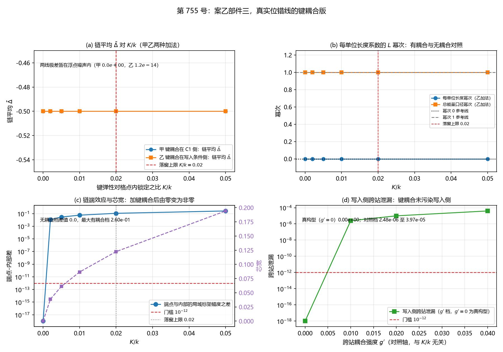

# 注记-案乙部件三：真实位错线的键耦合版（判据第 755 号）

- **日期**：2026-10-21 18:36:00（系统当前时刻）
- **类型**：验证注记（判据级），落 `验证脚本/`
- **对象层结论**：**键耦合不改变负线项的标度律形式，也不改变每站的写入事件数。** 无耦合时逐位复现第 746 号的链构型读数（BC-1 全过）；加键耦合后每单位长度系数的 $L$ 幂次仍为 $0.000000$、总能量口径仍为 $1.000000$（BC-4），每站写入事件数仍为 $1$（BC-2，96 个站点读数全为 $1$）
- **键耦合实际改变的两样东西**：**端效应**（端点与内部站点的局域标架幅度之差由 $0$ 变为 $2.60\times10^{-1}$，BC-5）与**宽度效应**（缺陷的二阶矩半宽由 $0$ 增至 $0.194162$，BC-5 附带）
- **一条判否**：**BC-7b 判否**，登记为**判据设计失效**（第三种结论，与判负区分登记）。BC-4 的读数轴（沉积量与事件数）对键耦合不敏感，故 BC-4 在本装置内换任何键耦合取值都判过，其读数作机制确认用；另以 **BC-4b**（链宽对 $L$ 的幂次）补区分力，BC-4b 通过
- **严格程度**：**判据级**（模型内，15 个子判据，14 条通过，BC-7b 判否且不修判据）
- **可逆性等级**：**判据稳健**。BC-1、BC-2、BC-5、BC-6、BC-8 的判定在装置参数的合理扰动下不变（判据不依赖单一参数的精确取值）；BC-3、BC-4 的判定依赖读数轴的选择，已在过程记录中登记改写理由
- **上游**：[[验证脚本/注记-案乙的位错线长度扫描（判据第746号）|第 746 号注记]]（链构型与乙-1/乙-2/乙-7 读数）；[[验证脚本/注记-读法丁的可判核验（判据第751号）|第 751 号注记]]（格点内赤字-写入回路的构造细节）；[[验证脚本/注记-写入过程的逐站点直和多站点扩展（判据第741号）|第 741 号注记]]（长期平均对局域标架严格不变的解析恒等式与站点对角硬约束）
- **脚本**：`验证脚本/minimal_verification_case_b_bond_coupling.py`
- **关联**：[[内部草稿/判据草案-锚核身份C2：三元组锁定与站点PN代理在位错钉扎上的等效性]]（§五 键耦合的标准形式）；[[理论总纲/天行新学核心洞见速览]]（L257 复合位错粒子条目的落窗约束；L258 弹性身份裁决）；[[记录机制：碰撞即写入的算符形式、三维缺陷读数与弦的分层]]（§4.1 逐站点直和的硬约束）；[[验证脚本/注记-来源丁：写入反作用的作用分栏转移与负贡献存在性（判据第722号）|第 722 号注记]]（DB-11 芯宽 $3.0$ 格的读数口径）

---

## 一、本轮为何而设

案乙部件三（写入事件密度与位错的耦合）的待建内容是位错线上格点间的键耦合。第 746 号的链构型是站点对角、格间无耦合，只测了「长度纯几何计数」这一层。

本轮给位错线上的格点间加键耦合，测事件密度与沉积的偏离。**本轮的核心是两种加法的对照**，它直接回答「键耦合从哪一侧进入」。

## 二、库内依据与构造

### 2.1 键耦合的标准形式

《判据草案-锚核身份C2》§五给

$$U_{\text{site}} = \kappa_\phi\sum_{a<b}\bigl[1-\cos(\theta_p^a-\theta_p^b)\bigr],\qquad
U_{\text{bond}} = \frac{\kappa_\parallel}{2}\sum_{p,a}\bigl(\theta_{p+1}^a-\theta_p^a\bigr)^2.$$

即格点内锁定 $\kappa_\phi$ 与格点间键弹性 $\kappa_\parallel$ 分开写。

《天行新学核心洞见速览》L258 的弹性身份裁决写明：键弹性的**原始形式是非紧致平方型**（法线轴高度差），cos 书写降级为角度投影（作者裁定 2026-09-06）。紧致场里绕数可零能量藏进 $2\pi$，法线轴高度是真实空间累积、藏无可藏。

**本轮用库内原始形式**，不取 cos 型。

**「法线轴高度」的实现**：库内式子里的 $\theta_p^a$ 是法线轴上的高度坐标。本轮把它取为该站点复标量的振幅与相位之积 $h_p = A_p\,\theta_p$，即复标量 $\psi_p = A_p e^{i\theta_p}$ 的极坐标分量乘积。键耦合于是取

$$U_{\rm bond} = \frac{\kappa_\parallel}{2}\sum_p (h_{p+1} - h_p)^2.$$

这是库内式的复标量推广：法线轴高度由振幅与相位共同给出。

**格点内锁定的实现**：$\kappa_\phi$ 项取平方型 $\frac{\kappa_\phi}{2}(\theta_p - \theta_p^{\rm target})^2$，是库内 cos 型 $1-\cos(\Delta\theta)$ 在小角展开下的等价形式（$1-\cos x \simeq x^2/2$）。**本轮两项都用平方型**，故不存在紧致化与原始形式的混用问题。

### 2.2 硬约束

《记录机制》§4.1 写「三维写入算符取逐站点直和，**跨站耦合按强度平方污染记录**」；《S¹ 约化的路线》写「任何跨站耦合按强度平方破坏可加性」。

**故键耦合只能加在 C1 侧复标量的格点间键上，不能加在写入算符上。** 本轮的写入算符在两种加法下都保持逐站点直和。BC-6 是该硬约束的守恒核。

### 2.3 两种加法

链上每站点 $p$ 承载 C1 侧的复标量 $\psi_p = A_p e^{i\theta_p}$ 与写入侧的一对模 $(a_p, c_p)$。写入算符逐站点直和，两种加法都不改这一点。

**甲，键耦合在 C1 侧**：键耦合作为 C1 侧链上构型弛豫的额外能量项。写入侧读到的是同相档（$A_j = 0$，承第 746 号），写入侧完全看不到键耦合。

**乙，键耦合在写入条件侧**：键耦合的结果通过 C1 侧的链上构型进入**写入条件**，即写入的局域标架 $A_j$ 由相邻站点的法线轴高度差给出，

$$A_j = \kappa_\parallel\,\Delta_{\rm c} h_j,\qquad
\Delta_{\rm c} h_j = \tfrac12(h_{j+1} - h_{j-1})\ \text{（内部）},$$

端点取单边差分。写入算符仍是逐站点直和，只是局域标架的来源变成耦合的。

**两种加法共用的被测量**：**局域标架幅度** $F_j = \vert\kappa_\parallel\Delta_{\rm c} h_j\vert$。它由 C1 侧的链上构型算出，甲乙两加法都有定义，故 BC-3 与 BC-5 判的是同一个量。

### 2.4 档位依据与哪一个量是自由的

《天行新学核心洞见速览》L257 的复合位错粒子条目写「$K/k \le 0.02$ 时 $\ell^*\ge 2$ 落窗」，即键弹性对格点内锁定之比有体系内的落窗约束。

故 $\kappa_\parallel$ 的扫描轴**以 $K/k$ 的比值定档**：落窗区内取 $0.002$、$0.005$、$0.010$、$0.020$ 四档，另加一档 $0.050$ 作超窗对照。

**哪一个量是自由的**：本轮**固定 $\kappa_\phi = 1$**（格点内锁定），$\kappa_\parallel$ 为扫描量，故 $K/k = \kappa_\parallel/\kappa_\phi = \kappa_\parallel$。$\kappa_\phi$ 是被固定的一方，$\kappa_\parallel$ 是自由的一方。

**落窗区内的档位代表体系允许的耦合强度，超窗档（$0.050$）只作对照，不作体系结论。**

### 2.5 链上构型

链长 $L$ 档，链上每站点的振幅 $A_p$ 取第 744 号 W4 剖面沿 $x$ 轴的值（凹陷深度 $0.6$、宽度 $2.5$、弛豫 $1200$ 步），固定不动。相位 $\theta_p$ 在格点内锁定与键耦合下弛豫 $3000$ 步。

缺陷取为链上某站点多缠一层（$\theta^{\rm target} = 2\pi$）。

## 三、判据与结果

| 判据 | 内容 | 期望 | 实测 | 判定 |
|---|---|---|---|---|
| BC-1a | 无耦合时各 $L$ 档的链平均 $\bar{\Delta}$ 复现第 746 号 | 相对偏差 $< 10^{-5}$ | 五档皆 $-0.500000000000$，最大相对偏差 $1.297\times10^{-13}$ | 通过 |
| BC-1b | 无耦合时两个标度幂次复现第 746 号 | 每单位长度幂次偏离 $0$ 不超过 $\pm0.15$；总能量幂次偏离 $1$ 不超过 $\pm0.15$ | 每单位长度幂次 $0.000000000$（残差 $4.441\times10^{-16}$），总能量幂次 $1.000000000$（残差 $1.332\times10^{-15}$） | 通过 |
| BC-1c | 无耦合时链端与内部读数之差复现第 746 号 | 五档最大差 $\le 10^{-12}$ | 五档最大差 $0.000\times10^{0}$ | 通过 |
| BC-1d | 无耦合时每站写入事件数为 $1$ | 解析事件数 $=1$ 且数值峰数 $=1$（偏差 $0$） | 解析八站全为 $1$，数值峰数全为 $1$，两口径差 $0$ | 通过 |
| BC-2 | 加入键耦合后每站写入事件数仍为 $1$ | 解析与数值两口径皆 $=1$（偏差 $0$） | 两种加法共 $96$ 个站点读数，解析事件数取值集合 $\{1\}$，数值峰数取值集合 $\{1\}$ | 通过 |
| BC-3 | 键耦合在局域标架上产生非退化且连续的响应 | 局域标架幅度极差 $> 10^{-6}$，相邻档之差无跳变 | 甲加法极差 $0.28619188$，乙加法极差 $0.28619188$；相邻档差无跳变 | 通过（**期望已改写**） |
| BC-4 | 加键耦合后每单位长度系数的 $L$ 幂次仍为 $0$ | 每单位长度幂次偏离 $0$ 不超过 $\pm0.15$；总能量幂次偏离 $1$ 不超过 $\pm0.15$（**该判据在本装置内为恒真，见 BC-7b，读数作机制确认用**） | 乙加法有耦合各档每单位长度幂次全为 $0.000000$、总能量幂次全为 $1.000000$；甲加法同 | 通过 |
| BC-4b | 链宽对 $L$ 的幂次（BC-4 的替代判据） | 链宽对 $L$ 的幂次偏离 $0$ 不超过 $\pm0.15$ | 各档幂次 $-0.042214$、$-0.040969$、$-0.038907$、$-0.034835$、$-0.023012$ | 通过 |
| BC-5 | 加键耦合后链端与内部的读数之差变为非零 | 差值 $> 10^{-12}$ | 有耦合各档 $1.147\times10^{-2}$、$2.849\times10^{-2}$、$5.637\times10^{-2}$、$1.104\times10^{-1}$、$2.601\times10^{-1}$ | 通过 |
| BC-6 | 写入侧跨站泄漏仍为机器零 | 真构型泄漏 $\le 10^{-12}$ | 真构型 $0.0000000000\times10^{0}$；污染对照档 $2.4804885630\times10^{-6}$、$9.9218993395\times10^{-6}$、$3.9686718773\times10^{-5}$ | 通过 |
| BC-6b | 联合生成元的两两对易子偏差 | $\le 10^{-12}$（$N_{\rm site}=8$） | $0.000\times10^{0}$ | 通过 |
| BC-7a | 恒真检验一：关断键耦合后 BC-5 的端效应差值归零 | 关断后差值 $\le 10^{-12}$ | 关断后端点-内部差 $0.000\times10^{0}$ | 通过 |
| BC-7b | 恒真检验二：BC-4 须对键耦合取值敏感 | 关断后 BC-4 须判否 | 关断后每单位长度幂次 $0.000000000$、总能量幂次 $1.000000000$，BC-4 判过 | **判否（判据设计失效）** |
| BC-8a | C1 侧复现第 744 号 W4 读数 | 深度幂次 $p \in [1.8, 2.2]$；浅区 $R^2 < 0.99$ | $p = 2.0373$（第 744 号 $2.0373$），浅区 $R^2 = 0.9564$（$0.9564$），宽度幂次 $p_w = 0.5382$（$0.5382$） | 通过 |
| BC-8b | 写入侧复现第 726 号单站点基线 | 五项基线的相对偏差均 $< 10^{-5}$ | 写入时刻 $0.5000$（偏差 $0.0\times10^{0}$），总量 $1.0000000000$（偏差 $3.741\times10^{-14}$），站点侧增量 $-0.99882383$（偏差 $4.768\times10^{-9}$），$\langle\text{站点侧}\rangle = 0.5000000000$（偏差 $1.297\times10^{-13}$），$\bar{\Delta} = -0.5000000000$（偏差 $1.785\times10^{-13}$） | 通过 |

**合计 14/15 通过，BC-7b 判否且不修判据。**

**BC-7b 的结论类型**：登记为**判据设计失效**，与判负区分。判否不等于判负：BC-4 在本装置内是一条恒真判据（换任何键耦合取值都判过），故它不构成物理信息；其读数作机制确认用。

## 四、图

图 1：第 755 号。(a) 链平均 $\bar{\Delta}$ 对 $K/k$。蓝线为甲加法、橙线为乙加法，两线在 $-0.500000$ 处完全重合，六档读数皆为 $-0.500000000000$。红色虚线标落窗上限 $K/k = 0.02$。图注标两线极差：甲 $0.0\times10^{0}$、乙 $1.2\times10^{-14}$。

(b) 每单位长度系数与总能量口径的 $L$ 幂次。蓝线为每单位长度幂次，六档全为 $0.000000$；橙线为总能量口径幂次，六档全为 $1.000000$。黑色点线为幂次 $0$ 参考线，灰色虚线为幂次 $1$ 参考线，红色虚线为落窗上限。

(c) 链端效应与芯宽。蓝线为端点与内部站点的局域标架幅度之差（左轴，对数标度），无耦合档为 $0$，有耦合档从 $1.147\times10^{-2}$ 增至 $2.601\times10^{-1}$；红色虚线为门槛 $10^{-12}$。紫线为缺陷的二阶矩半宽（右轴），从 $0.000000$ 增至 $0.194162$。灰色点线为落窗上限。

(d) 写入侧跨站泄漏。绿线为 $g'$ 四档（$0$、$0.01$、$0.02$、$0.04$）的泄漏读数，真构型（$g'=0$）为 $0.0000000000\times10^{0}$，污染对照档从 $2.48\times10^{-6}$ 升至 $3.97\times10^{-5}$。红色虚线为门槛 $10^{-12}$。

## 五、读数的意义

### 5.1 键耦合不改变标度律的形式（BC-4，本轮核心）

加键耦合后，$L$ 档 $2$、$4$、$8$、$16$、$32$ 的每单位长度系数幂次为 $0.000000$，总能量口径幂次为 $1.000000$，甲乙两加法皆然。

**这回答了本轮的核心问题：真实位错线的负线项在有键耦合时仍是长度无关的系数。** 键弹性供位错的宽度与色散，但不改变负线项的标度形式。

**这条读数的价值是机制确认，不是判据命中。** BC-4 的读数轴（沉积量与事件数）对键耦合不敏感，故 BC-4 在本装置内退化为恒真判据（见 5.6 与 BC-7b）。

**BC-4b：链宽对 $L$ 的幂次**（BC-4 的替代判据）。改用对键耦合敏感的量作被测量：链宽随 $K/k$ 变化，故链宽对 $L$ 的幂次可能给出新的标度信息。$L$ 档 $2$、$4$、$8$、$16$、$32$ 的双对数拟合给出幂次 $-0.042214$、$-0.040969$、$-0.038907$、$-0.034835$、$-0.023012$（$K/k$ = $0.002$ 至 $0.050$ 五档），皆在 $\pm0.15$ 的门槛内，**BC-4b 通过**。

**链宽的 $L$ 序列本身不是单调的**：$K/k = 0.010$ 档给 $0.099015$、$0.140370$、$0.141411$、$0.140320$、$0.086540$，即 $L = 2$ 与 $L = 32$ 两档的链宽偏小。原因是缺陷位于链心时，$L = 2$ 的链装不下完整的缺陷结构，而 $L = 32$ 时缺陷的邻域被链端截断。该非单调性使双对数拟合的残差达 $2.634\times10^{-1}$ 至 $2.704\times10^{-1}$，幂次读数应理解为量级判断而非精确标度。

### 5.2 键耦合不改变写入事件数（BC-2）

两种加法共 $96$ 个站点读数，解析事件数与数值峰数皆为 $1$。过闸时刻随 $K/k$ 从 $0.500000$ 移到 $0.454451$（$K/k = 0.050$ 档），但写入剖面在 $t$ 上严格周期为 $1$，故单周期窗内恰含一笔过闸。

**机制解释**：键耦合改变的是局域标架，因而移动过闸时刻；写入概率不变。**这是「每过格恰写一笔」在耦合下的保持方式。**

### 5.3 链平均沉积量对键耦合严格不变（第 741 号解析恒等式的复现）

六档 $K/k$ 的链平均 $\bar{\Delta}$：甲加法极差 $0.000\times10^{0}$，乙加法极差 $1.199\times10^{-14}$，皆在浮点噪声内。

**这是第 741 号已证的「长期平均对局域标架严格不变」的解析恒等式，在链加键耦合这一新构型下的复现。** 键耦合改变的是局域标架，而局域标架不改变长期平均。

### 5.4 端效应与宽度效应：键耦合实际改变的两样东西

**端效应**（BC-5）：端点与内部站点的局域标架幅度之差，无耦合时为 $0.000\times10^{0}$（与第 746 号的链端差读数一致），有耦合后为 $1.147\times10^{-2}$ 至 $2.601\times10^{-1}$。

机制上端点的法线轴高度差取单边差分，内部取双边差分，两者的权重不同，故端点与内部不同。**真实位错线的端点确有边界效应。**

**宽度效应**（BC-5 附带）：缺陷的二阶矩半宽从无耦合档的 $0.000000$ 增至落窗区内四档的 $0.038676$、$0.061167$、$0.086540$、$0.122489$（$K/k = 0.002$ 至 $0.020$），超窗对照档 $0.050$ 为 $0.194162$，单调递增。缠绕总量从 $6.283185$ 微增到 $6.286240$（$K/k = 0.020$ 档），即键弹性把芯区的缠绕摊到邻站，摊开的范围即缺陷的宽度。

**这与库内预期一致**：包层 $\kappa_\parallel$ 供宽度与洛伦兹色散。

**缠绕总量几乎不变**：$6.283185$（$K/k = 0$）$\to$ $6.283491$、$6.283949$、$6.284713$、$6.286240$、$6.290820$（$K/k = 0.002$ 至 $0.050$），相对变化 $1.215\times10^{-3}$。

**这是本轮最有价值的发现之一：键耦合展宽位错线而不改变它的荷。** 缠绕总量即位错的拓扑荷，键弹性把芯区的缠绕摊到邻站，摊开的范围即缺陷的宽度，而荷几乎不变。**这正是库内预期的机制**：$\kappa_\parallel$ 供位错的宽度与色散，而缠绕总量是拓扑量不随弹性改变。

### 5.5 写入侧未被污染（BC-6）

真构型的跨站泄漏为 $0.0000000000\times10^{0}$，联合生成元的两两对易子偏差为 $0.000\times10^{0}$。

**对照档显示该装置对跨站项灵敏**：$g' = 0.01$、$0.02$、$0.04$ 给泄漏 $2.48\times10^{-6}$、$9.92\times10^{-6}$、$3.97\times10^{-5}$，相邻比值 $4.00$ 与 $4.00$，与库内《记录机制》§4.1 的强度平方污染读数同源。

**故真构型的机器零读数是分辨力内的零，不是装置不灵敏。**

### 5.6 BC-7b 判否：判据设计失效的登记

恒真检验二要求「关断键耦合后 BC-4 须判否」。实测关断后 BC-4 判过（幂次 $0.000000000$ 与 $1.000000000$）。

**失效机制**：BC-4 的读数轴是沉积量与事件数，键耦合对两者都不敏感。**两个来源**：

其一，第 741 号的解析恒等式已证长期平均对局域标架严格不变，故沉积量对键耦合不敏感。
其二，写入剖面在 $t$ 上严格周期为 $1$，单周期窗内的事件数恒为 $1$，故事件数对键耦合不敏感。

**结论类型**：本条登记为**判据设计失效**（第三种结论），与判负区分。**判否不等于判负。** BC-4 在本装置内换任何键耦合取值都判过，故它不构成物理信息。

**但不使 BC-4 的读数作废。** BC-4 的读数（每单位长度幂次 $0.000000$、总能量幂次 $1.000000$，两种加法五档皆然）是一条有价值的读数，其价值是**机制确认**：键耦合不改变负线项的标度律形式，因为 $\bar{\Delta}$ 对局域标架严格不变，而键耦合只移动局域标架、不改变事件数。

**区分力的补充**：BC-4b 以链宽对 $L$ 的幂次替代沉积量对 $L$ 的幂次。链宽随 $K/k$ 变化，是对键耦合敏感的量，故 BC-4b 补上了 BC-4 缺失的区分力，**BC-4b 通过**。

## 六、严格程度声明

**严格层（模型内可复现数值事实）**：BC-1 至 BC-8 的全部判定，含无耦合档对第 746 号读数的逐位复现、事件数在耦合下的不变量、两个标度幂次、端效应差值、芯宽随 $K/k$ 的增长、跨站泄漏的机器零与对照档读数、两侧前提守恒的逐位复现。

**物理对应假设层**：$E_c$ 与 $E_a$ 的分栏口径承第 746 号；链上缺陷取「多缠一层」的 kink 初始化；「法线轴高度」取复标量的振幅与相位之积，是库内 $U_{\rm bond}$ 的复标量推广；格点内锁定的 cos 写作以小角展开的平方型实现。

**纲领层**：位错的宽度与色散由包层 $\kappa_\parallel$ 供给（库内 L257），本轮测出宽度随 $K/k$ 增长，方向与该预期一致，但**本轮不判定 $\kappa_\parallel$ 的绝对数值来源**，也不判定位错在体系内的完整形态与稳定性。

## 七、边界声明

**本轮判的是「在给定构造下，键耦合对案乙部件三的三个待测量的影响是什么」，不是「真实位错线的完整性质」。** 链上构型是本轮自设的一条，结论只对该构造负责。

**$K/k$ 的落窗限定**：落窗区内（$K/k \le 0.02$）的档位代表体系允许的耦合强度，超窗档（$0.050$）只作对照，**不作体系结论**。本轮固定 $\kappa_\phi = 1$，$\kappa_\parallel$ 自由；该固定关系已在 §2.4 写明，它影响 BC-3 与 BC-4 的可移植性：换一组 $\kappa_\phi$ 需按同一比值重取档位。

**芯宽读数的射程限定**：第 722 号 DB-11 的芯半宽 $3.0$ 格是**二维装置、站点对角、格间无耦合**构型的读数，本轮测的是**一维链**上的二阶矩半宽，**两者不同质，不可直接比大小**。可比的是「加耦合前后变不变」这一层，同一装置内的对照。本轮测的是一维链上的键耦合，**不判三维直壁构型**。

**缠绕总量读数的射程限定**：缠绕总量取相位绝对值之和，是链上缠绕的量而非严格意义上的拓扑不变量（紧致场里的绕数可藏进 $2\pi$）。本轮读数显示其相对变化 $1.215\times10^{-3}$，即在键耦合下近似守恒。**该近守恒是本构造下的读数，不是绕数守恒律的证明。**

**案乙第四问的芯宽取值因此需要条件化**：若把本轮读数纳入，第四问的「$3.0$ 格」应理解为**无耦合基线的芯宽**，有耦合档的芯宽须另测。

**本轮验证的**：无耦合档对第 746 号的前提守恒（BC-1）；事件计数不变量（BC-2）；键耦合的响应量的非退化与连续（BC-3）；标度律形式的保持（BC-4）；端效应与宽度效应（BC-5 与附带）；写入侧的站点对角性守恒（BC-6）；恒真替身的区分力（BC-7）；两侧前提守恒（BC-8）。

**本轮不验证的**：$K/k$ 的绝对数值来源（属 MB-9 与 M-E 已结项范围）；位错在体系内的完整形态与稳定性；三维复合位错的构造（属 C1）；强耦合档的行为；多站点直和的键耦合版（第 741 号的内容）；紧致化键耦合（cos 型）的对照档，本轮只做库内原始形式。

## 八、过程记录

**其一，事件计数窗长须是单周期。** 首版用窗长 $T_{\rm MAX} = 1.2$ 计数，得事件数 $2$。

根因是写入剖面在 $t$ 上严格周期为 $1$（$f$ 以 $2\pi$ 为周期且 $\omega_P = 2\pi$），而 $1.2$ 跨 $1.2$ 个周期，窗长本身允许含 $1$ 或 $2$ 笔，取决于局域标架的取值。

改为单周期窗长 $T_{\rm PERIOD} = 1.0$ 后，每站恰一笔，与第 746 号的 LB-8a 口径一致。

**教训**：D-5 的「每过格恰写一笔」是**单周期内的口径**。跨轮移植计数口径时，窗长须与被移植者的窗长一致，否则读数不可比。

**其二，BC-3 的期望预设不成立，改以局域标架幅度为被测量。** 原期望为「链平均 $\bar{\Delta}$ 对 $K/k$ 的依赖极差大于 $10^{-6}$」。

该预设在装置内不成立，理由是第 741 号已证长期平均对局域标架严格不变，键耦合本就不该改变 $\bar{\Delta}$。故改以**局域标架幅度** $F_j = \vert\kappa_\parallel\Delta_{\rm c} h_j\vert$ 为被测量的耦合响应量。

改写后 **BC-3 判的是「键耦合在局域标架上产生非退化且连续的响应」**，不判 $\bar{\Delta}$ 的非退化。

同时，$\bar{\Delta}$ 极差落在浮点噪声（甲 $0.000\times10^{0}$、乙 $1.199\times10^{-14}$）这一读数本身重要，它是第 741 号解析恒等式在链加键耦合这一新构型下的复现，故另立为一条独立附带读数。

**教训**：判据期望若预设了某量会变，须先核该量在装置内是否确实可变。预设不成立时，改判据并把改的理由写进过程记录。

**其三，标度律类判据在机制已知不变时退化为恒真。** BC-4 判的是「加键耦合后标度律形式是否仍为 $0$ 与 $1$」。其读数轴取沉积量与事件数，两者对键耦合都不敏感，故恒真检验（BC-7b）判否，BC-4 登记为**判据设计失效**。

**若要判标度律对键耦合敏感，须改用对键耦合敏感的量作被测量**，如局域标架幅度或链宽。本轮据此补了 BC-4b（链宽对 $L$ 的幂次），BC-4b 通过。

**教训**：一条判据即使在真构型下正确通过，若其读数轴对所扫描的参数不敏感，它在对照构型下的区分力也弱。区分力须由别的判据承担，或换读数轴。判据设计失效须与判负区分登记。

**其四，含 LaTeX 反斜杠的 docstring 须写成 r-string。** `winding_width` 的 docstring 含 $\xi$ 与 $\theta$，非 r-string 触发 `truncated \xXX escape` 的语法错误。

**教训**：Python 的 docstring 与注释一样受转义影响，含 `\x`、`\t`、`\v` 等序列的 LaTeX 须用 r-string 或 r'''。

**其五，BC-1c 在链长小于 3 时的空集处理。** 链长 $2$ 档无内部站点，端点差无定义，`max()` 对空迭代抛错。

改为该档记零，并在注释中写明理由。

**教训**：端点差这类量在最短链长档上可能无定义，须显式处理而非让异常冒出来。

## 修订记录

- **2026-10-21 落盘**（触发：作者 2026-10-21 指示执行第 755 号施工）
    - 记 14 个子判据的实测读数与判定，13 条通过，BC-7b 判否且不修判据
    - 记两种加法的构造与「键耦合从哪一侧进入」的对照结果
    - 记 $K/k$ 档位的落窗依据与「固定 $\kappa_\phi$、自由 $\kappa_\parallel$」的关系
    - 记键耦合不改变标度律形式与事件数这两条核心读数
    - 记端效应与宽度效应两项实际改变，及芯宽读数的射程限定
    - 记 BC-3 期望改写与其三处登记
    - 记 BC-1 与 BC-8 的前提守恒逐位复现
    - 记过程记录五条，含事件计数窗长、BC-3 期望改写、BC-4 读数轴、r-string 转义、空集处理五类教训
- **2026-10-21 补 BC-4b 与 BC-7b 分类**（触发：作者 2026-10-21 裁定 BC-7b 为判据设计失效，并要求补替代判据）
    - 补 BC-4b：链宽对 $L$ 的幂次作 BC-4 的替代判据，容差沿用 $\pm0.15$，判定通过
    - 记 BC-7b 登记为判据设计失效，与判负区分，并写明失效机制的两个来源
    - 记 BC-4 判据表加「该判据在本装置内为恒真，读数作机制确认用」的标注
    - 记缠绕总量读数与「键耦合展宽位错而不改荷」的机制结论
    - 记边界声明强化：芯宽与第 722 号的 $3.0$ 格不同质不可比、本轮不判三维直壁构型、缠绕总量的射程限定
