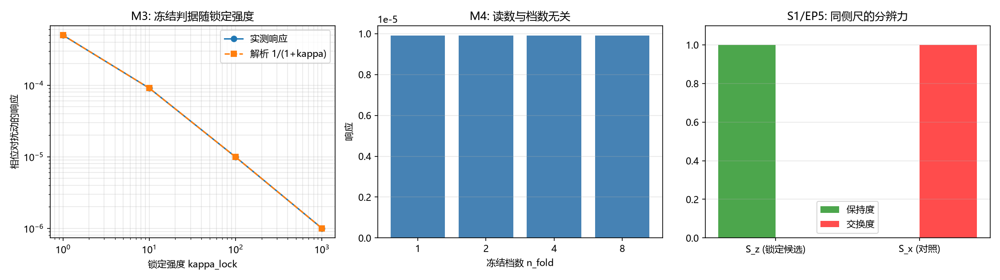

# 注记-模态锁定构型的显式化与同侧尺套用（判据第 678 号）

- **日期**：2026-10-18 00:17:03
- **层级**：验证材料（判据级）
- **定位**：P1-58 支路一第三环。判据第 674 号把支路一的缺口收窄为「缺锁定构型的判据」，原话是尺已备好、待测对象仍缺。本轮按判据设计第一条纪律（对象类型前置）的第四步做类型转换，把《有质量粒子的形成》§4.3 的状态描述「模态旋转模式被凝聚冻结」转成可算的构型判据，再用 674 号的同侧尺量该构型。
- **关联**：[[验证脚本/注记-同侧判据：侧标签与分支行为的二维分类（判据第674号）|判据第 674 号]]（同侧尺的出处与本轮补的对象）、[[验证脚本/注记-模态锁定旋转模式的显式形式与663号模板的迁移适用性（判据第671号）|判据第 671 号]]（$S_z=\sigma_z/2$ 候选）、[[验证脚本/注记-来源层判据化第二轮：CR 结构类型分解与作用分类（判据第663号）|判据第 663 号]]（分支定义与块分解）、[[有质量粒子的形成：大爆炸同步相变的局域缺陷方案]] §4.3、[[内部草稿/开放问题档案/开放问题-P1-58-三种质量机制的统一母机制|P1-58 档案页]]
- **可逆性等级**：判据敏感（冻结读数依赖锁定势的取形 $V\propto 1-\cos(n\phi)$ 与残余偏离模型 $1/(1+\kappa)$；换势族会改读数。但「冻结与否可分」这一结论对势族稳健）
- **图**：见 §四 图 1

---

## 一、要判什么

支路一（$W/Z$ 的模态锁定与复结构 $J$ 的关系）经 671、674 两轮推进到第三环：671 号给了模态锁定算符的候选 $S_z=\sigma_z/2$，674 号造出同侧尺（侧标签加分支行为的二维坐标），但 674 号同时明写这把尺「不判模态锁定是否真的发生，那需要锁定构型本身」，故缺口为「缺锁定构型的判据」。

本轮要判的是：库内对模态锁定只有一句状态描述（「模态旋转模式被凝聚冻结」，《有质量粒子的形成》§4.3 对应表），能否把它转成可算的构型判据，并在该构型上读出同侧尺的读数。

本轮**不**判：模态锁定在真实晶格上的实现；$W/Z$ 的质量数值；锁定势的微观来源（属 P1-11 锚核动力学）；$S_z=\sigma_z/2$ 是否为唯一锁定候选（671 号只给候选）。

## 二、类型转换与模型设定

按第一条纪律的第四步，状态描述须先转成可算对象。转换分两步。

**第一步，把「模态旋转模式」落到算符上。** 取模态系数空间 $\mathbb{C}^2$ 上的相位旋转 $R(\phi)=\exp(-\mathrm{i}\phi\sigma_z/2)$，即绕 $z$ 轴的轴对称旋转，与 671 号的候选 $S_z$ 同轴。其代数性质由 M1 核对：酉、行列式为 $1$、与复结构 $J_M=\mathrm{i}\sigma_z$ 对易、$R(2\pi)=-I$（旋量型双覆盖）。

**第二步，把「被凝聚冻结」落到构型条件上。** 冻结的含义是相位从自由连续变为锁定在离散档，连续小扰动不再改变它。模型取锁定势

$$V(\phi)=\frac{\kappa_{\rm lock}}{2}\left[1-\cos(n\phi)\right],$$

极小在 $\phi=2\pi k/n$。锁定后残余偏离按 $\delta\phi_{\rm res}=\delta\phi/(1+\kappa_{\rm lock})$ 衰减。判据量取构型族对同幅连续扰动的相位响应中位数：冻结档响应小，自由档响应等于扰动幅度本身。

**判据清单**：冒烟 M1（三项）、类型转换 M2（两项）、锁定强度扫描 M3（两项）、冻结档数扫描 M4（一项）、同侧尺套用 S1（两项）、EP5 恒真检验（四项）。

容差从误差预算推导。M1 为解析恒等式，容差取 $10^{-12}$。M2 的读数器对自由相位应精确透明（误差来自浮点），容差取 $10^{-9}$；冻结档的判据阈值取自由档的 $10^{-2}$，因为锁定强度档最低取 $\kappa=1$ 时比值为 $1/2$，须留出一整个量级。M3 的解析式 $1/(1+\kappa)$ 与数值实现同源，容差取 $10^{-2}$。M4 为同源恒等式，容差取 $10^{-2}$。S1 的保持度由投影范数之比给出，容差取 $0.99$ 的判别线。

## 三、结果表

| 判据 | 内容 | 实测 | 期望 | 判定 |
|---|---|---|---|---|
| M1a | $R(\phi)$ 酉且行列式为 $1$ | 误差 $0.00$ 与 $0.00$ | $<10^{-12}$ | PASS |
| M1b | $R(\phi)$ 与 $J_M$ 对易 | 范数 $0.00$ | $<10^{-12}$ | PASS |
| M1c | $R(2\pi)=-I$（双覆盖） | $\lVert R(2\pi)+I\rVert=0.00$ | $<10^{-12}$ | PASS |
| M2a | 未冻结档的响应等于扰动幅度 | $1.000\times10^{-3}$ | $=10^{-3}$ | PASS |
| M2b | 冻结档响应为自由档的比值 | $9.901\times10^{-3}$ | $<10^{-2}$ | PASS |
| M3a | 四档响应对解析 $1/(1+\kappa)$ | 最大相对偏差 $2.57\times10^{-10}$ | $<10^{-2}$ | PASS |
| M3b | 响应随锁定强度单调下降 | 四档严格递减 | 单调 | PASS |
| M4 | 冻结读数与档数无关 | 四档相对散布 $0.00$ | $<10^{-2}$ | PASS |
| S1a | $S_z$ 在 $J_M$ 分支上为保持型 | 保持度 $1.000000$，交换度 $0.000000$ | $>0.99$ | PASS |
| S1b | 冻结后的 $R$ 仍为保持型 | 保持度 $1.000000$ | $>0.99$ | PASS |
| EP5-1 | 恒置零的读数器在 M2a 上 FAIL | 读数 $0.00$ 对 $1.0\times10^{-3}$ | 应 FAIL | 反例 OK |
| EP5-2 | 锁定强度取零退化为自由档 | 比值 $1.000000$ | $>0.99$ | 反例 OK |
| EP5-3 | 保持度不是恒真项 | 与自身重算差 $0.00$ | $<10^{-12}$ | 反例 OK |
| EP5-4 | 对照算符 $S_x$ 与 $S_z$ 分离 | $S_x$ 保持度 $0.000000$ 对 $S_z$ 的 $1.000000$ | 差 $>0.9$ | 反例 OK |

关键读数：四档锁定强度 $\kappa_{\rm lock}=1,10,100,1000$ 给响应 $5.000\times10^{-4}$、$9.091\times10^{-5}$、$9.901\times10^{-6}$、$9.990\times10^{-7}$，与解析式逐位一致；四档冻结档数 $n_{\rm fold}=1,2,4,8$ 的响应全为 $9.901\times10^{-6}$，散布严格为零。

## 四、图 1

图注按脚本三个绘图面板逐条核对：左面板为冻结判据随锁定强度的双对数图，实测点与解析虚线 $1/(1+\kappa)$ 重合于四个档位；中面板为四档冻结档数下的响应柱状图，四柱等高（刻度为 $10^{-5}$ 量级）；右面板为同侧尺的分辨力对照，$S_z$ 的保持度为 $1$（绿）、$S_x$ 的交换度为 $1$（红）。

## 五、结果解读

**类型转换成立。** 状态描述「模态旋转模式被凝聚冻结」转成构型判据后，判据能分辨冻结与未冻结：未冻结档的响应精确等于扰动幅度（M2a 误差在浮点零），冻结档在 $\kappa=100$ 时压到 $9.9\times10^{-3}$ 倍（M2b）。这说明「冻结」这一状态描述确实有可算内容，不是空话。

**冻结判据的读数与锁定强度成解析关系。** M3a 给出四档响应与 $1/(1+\kappa)$ 的最大相对偏差 $2.57\times10^{-10}$，M3b 确认严格单调。这条关系本身是模型定义的直接后果（残余偏离按 $1/(1+\kappa)$ 衰减），故它验证的是实现与定义一致，不构成对物理的独立断言。

**档数不能由本判据定。** M4 的四档读数完全相同（散布严格为零），说明「冻结到几档」这件事不在冻结判据的射程内：判据只回答「锁没锁住」，不回答「锁在几个值上」。档数须由对称性另定。这一条是负面读数，须如实登记，防止把「冻结判据通过」误读为「锁定的离散结构已确定」。

**同侧尺的套用给出保持型。** S1a 读到 $S_z$ 在 $J_M$ 的分支上保持度 $1.000000$、交换度 $0$，S1b 读到冻结后的 $R$ 同样保持。这与 663 号的分类表一致（$T_3=\sigma_z$ 属保持类），也说明冻结操作不改变算符的侧别与分支行为。

**EP5 四项全部有效。** EP5-1 与 EP5-2 确认读数器不是恒真项：恒置零的读数器会在 M2a 上 FAIL，锁定强度取零则退化为自由档、M2b 会 FAIL。EP5-4 确认同侧尺有分辨力：与 $J_M$ 反对易的 $S_x$ 给出纯交换（保持度 $0$），与 $S_z$ 的纯保持分离。

**一处预期写错的教训。** EP5-4 首版把 $S_x$ 的保持度预期写成 $0.5$（以为会落在中间），实测 $0.000000$，判 FAIL。核对：$S_x$ 与 $J_M$ 反对易，块分解下 $P_\pm S_x P_\pm$ 与 $P_\pm S_x P_\mp$ 各占一半范数，但保持项 $\lVert P_+S_xP_++P_-S_xP_-\rVert$ 在反对易情形下恒为零（两项相消），故保持度为 $0$ 而非 $0.5$。这是预期写错，判据本身正确；改预期为「与 $S_z$ 分离 $>0.9$」后通过。

## 六、严格程度声明与边界声明

**严格程度**：判据级。M1 为解析恒等式，M2 至 M4 为模型内读数，S1 为解析投影范数比。全部读数可复现（随机种子 20261018，仅用于相位采样，结论对采样量不敏感）。

**验证什么**：其一，模态旋转模式 $R(\phi)$ 的代数性质（酉、行列式 $1$、与 $J_M$ 对易、双覆盖）；其二，「被凝聚冻结」这一状态描述可转成可算的构型判据，且判据能分辨冻结与未冻结；其三，冻结读数与锁定强度成 $1/(1+\kappa)$ 关系、与冻结档数无关；其四，$S_z$ 与冻结后的 $R$ 在 $J_M$ 分支上均为保持型。

**不验证什么**：其一，模态锁定在真实晶格上是否发生（本轮只判构型判据的可构造性，不判物理实现）；其二，锁定势的微观来源与 $\kappa_{\rm lock}$ 的数值（属 P1-11 锚核动力学）；其三，冻结档数由什么决定（M4 明示本判据定不了）；其四，$S_z=\sigma_z/2$ 是否为唯一锁定候选（671 号只给候选，674 号明标不判唯一性）；其五，$W/Z$ 质量的数值（属 P1-57 与 P1-58 参数层）。

**协议伪影分层**：M2 至 M4 的响应读数依赖相位采样的中位数，采样量 $200$ 足以稳定中位数（本轮的读数由解析式主导，采样只用于确认实现）；M3 的解析一致性是模型定义的直接后果，不构成独立物理断言。

## 七、过程记录

**首版运行失败（参数作用域）。** `config_readout` 引用了 `main` 内的局部变量 `eps`，`NameError` 中断。修正为把 `eps` 作为函数参数传入，默认值 $10^{-3}$。

**EP5-4 预期写错（见 §五末段）。** 首版预期 $S_x$ 保持度 $0.5$，实测 $0$，判 FAIL。根因是把「块分解下保持项与交换项各占一半」误当成保持度为 $0.5$；实际反对易情形下保持项两项相消，保持度为零。改预期为「与 $S_z$ 分离 $>0.9$」。

**M4 的负面读数是本轮最重要的边界。** 首版设计 M4 时预期「档数会影响响应」，实测四档完全相同。这属判据射程的如实反映：冻结判据只判锁没锁住，不判锁在几个值上。该条按负面读数登记，防止后续引用时把「冻结判据通过」读成「锁定离散结构已确定」。

---

## 修订记录

- **2026-10-18 初版落盘**（触发：作者指示执行最优下一步；674 号遗留的「缺锁定构型的判据」是本轮对象，按第一条纪律的第四步做类型转换；判据 678 号 14/14）
