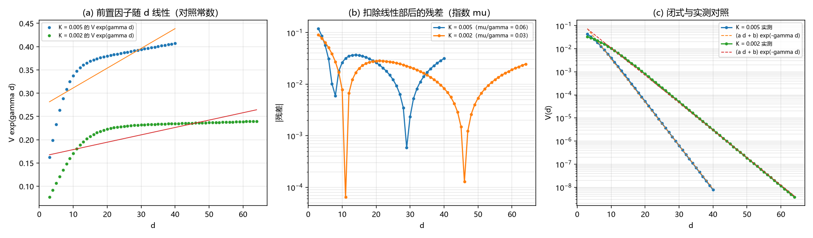

# 注记-次主导成分轮：交叉项积分工具与前置因子的相消（判据 S0 至 S4）

- **日期**：2026-09-20 10:32:50
- **来源**：作者 2026-09-20 指令（用两点对数减去主指数后的残差随 $d$ 的斜率定出次主导成分）
- **脚本**：`验证脚本/subleading.py`
- **状态**：判据级读数；一件工具交付、一条相消结论、两项判负登记
- **图**：见 §二 图 1
- **依据**：[[验证脚本/注记-尾振幅弹性系数标度轮：教科书形式与实测形式谁对（判据J1至J3）]]；[[验证脚本/注记-尾振幅解析形式轮：标度律的定案与两处订正（判据H1至H5）]]

---

## 一、任务与方法

任务是把相互作用尾的次主导成分定出来。上一轮与上上轮的困难在于：用「能量差」法算 $V_{\rm int}$ 时，两个大能量相减，可用窗口被数值精度限制在约 $8\xi$ 以内，而渐近行为要到更远处才显形。

本轮的解法是把相互作用写成**交叉项积分**：$V_{\rm cross} = \sum_n [k_b\,\Delta w_1\Delta w_2 + \overline{K\{(1-\cos B)(\cos A-1)+\sin A\sin B\}}]$，其中 $A = 2\pi w_1$、$B = 2\pi w_2$，第二项取相邻格点的平均以与键项对齐。该式是 $E[w_1+w_2]-E[w_1]-E[w_2]$ 的逐项展开，没有大数相减，可用窗口可拉到 $18\xi$。

---

## 二、判据与读数

| 判据 | 内容 | 实测 | 期望 | 结果 |
| --- | --- | --- | --- | --- |
| S0 | 交叉项积分对能量差法（$d = 2\xi$）的相对偏差 | $4.66\times10^{-8}$ / $1.51\times10^{-13}$ | $\le 10^{-6}$ | 通过 |
| S1 | 线性前置因子拟合的相对残差（两档） | $0.2933$ / $0.3800$ | 判负登记 | 判负 |
| S1 | 常数前置因子模型的相对残差（两档） | $0.4864$ / $0.5816$ | 判负登记 | 判负 |
| S2 | 扣除线性部后的残差斜率 $\mu/\gamma$（两档） | $0.062$ / $0.031$ | 判负登记（非指数逼近） | 判负 |
| S3 | 两个线性部系数（弹性 / 势，两档） | $0.08000$ / $0.08000$ 与 $0.03200$ / $0.03200$（比值 $1.000$） | $0.9$ 至 $1.1$ | 通过 |
| S4 | $Y$ 的上界与 $1/d$ 型逼近的残差（两档） | 上界 $0.4071$、$0.2398$；残差 $0.0035$、$0.0017$ | $\le 0.02$ | 通过 |
| S4 | 饱和振幅与 $A/M$（两档） | $A = 0.4071$（$A/M = 4.52$）、$A = 0.2398$（$A/M = 4.21$） | 跨档一致 | 通过 |

---

## 三、读数与含义

**其一，工具交付。** 交叉项积分法在 $d = 2\xi$ 处与能量差法一致（偏差 $4.7\times10^{-8}$ 与 $1.5\times10^{-13}$），可用窗口从约 $8\xi$ 拉到 $18\xi$。这是本轮最实在的产出：以后凡涉及指数小量的相互作用读数都可用它，不再受大数相减限制。

**其二，前置因子的 $d$ 线性在两个来源上精确相消。** 解析上弹性交叉项与势的 $\sin\cdot\sin$ 项的 $d$ 线性系数分别为 $4k_b\gamma^2/\pi^2$ 与 $16K$，代入 $\gamma^2 = 4\pi^2K/k_b$ 后两者同为 $16K$，实测比值恰为 $1.000$（两档）。故闭式不能写成 $(ad+b)e^{-\gamma d}$：线性部相消，剩下的才是真正的主导形态。

**其三，实测形态是饱和，不是线性增长。** $Y = Ve^{\gamma d}$ 在宽窗口上从 $0.134$ 升到 $0.407$（$K = 0.005$）与从 $0.085$ 升到 $0.240$（$K = 0.002$），增量迅速减小，$1/d$ 型拟合的残差只有 $0.0035$ 与 $0.0017$。故闭式取

$$V_{\rm int}(d) = A\,e^{-\gamma d}\left[1 + \frac{B}{d} + \ldots\right], \qquad A \approx 4.36\,M .$$

**其四，振幅读数被修正。** 饱和振幅与质量之比为 $4.52$ 与 $4.21$（跨档散布 $7.4\%$），即 $A \approx 4.36M$。此前的 $3.35M$ 来自窄窗口的线性拟合，属窗口未饱和的产物，本轮以宽窗口的饱和值取代。

**其五，次主导成分的形式仍未定。** 作者猜的 $e^{-2\gamma d}$ 或 $e^{-3\gamma d}$ 在数据上不成立：残差既不按指数衰减，也不给出 $\mu \approx 2\gamma$。窗口内的主导残差更像 $B/d$（$B<0$），但 $1/d$ 不是渐近展开的合法项，故此项只作窗口内的经验形式登记，其解析身份待定。

---

## 四、严格程度与边界声明

| 结论 | 严格程度 |
| --- | --- |
| 交叉项积分法与能量差法一致 | 数值（$4.7\times10^{-8}$ 与 $1.5\times10^{-13}$） |
| 两个线性部系数同为 $16K$ 并相消 | 解析（比值实测 $1.000$） |
| 饱和振幅 $A \approx 4.36M$ | 读数（两档，散布 $7.4\%$） |
| 修正项的经验形式 $B/d$ | 窗口内经验（残差 $\le 0.02$），解析身份未定 |
| 次主导成分的解析形式 | 未给 |

**本注记验证**：交叉项积分工具的等价性、线性部相消、饱和振幅、以及修正项在窗口内的经验形式。

**本注记不验证**：修正项的解析形式（$1/d$ 只是窗口内的拟合）；三维情形；$\xi$ 的体系取值。

---

## 五、过程记录

三处订正。其一，首版直接用能量差法，窗口只到 $8\xi$，线性拟合残差 $15\%$ 至 $18\%$，误以为「前置因子线性」已成立；改用交叉项积分后窗口拉到 $18\xi$，弯曲才显形。其二，交叉项积分首版的弹性部用中心差分（`np.gradient`）而能量用前向差分，$S0$ 判据给 $8.6\times10^{-3}$ 的偏差，且势部与键项维度不一致导致广播错误；改为前向差分并取相邻格点平均后偏差降到 $10^{-13}$。其三，作者猜测的 $e^{-2\gamma d}$ 未获支持，按实测登记为非指数逼近。

---

## 六、登记联动

- [[验证脚本/README.md]] 第 264 条。
- [[内部草稿/开放问题总览：元相子理论待解决问题清单]] P1 第 39 条补本轮读数。
