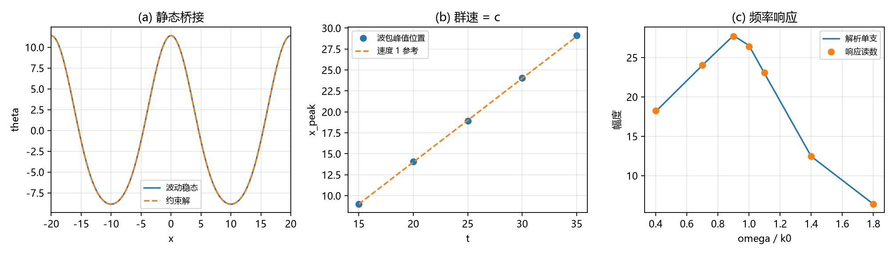

# 注记-次阶源锁定复验·第三段：波动扇区的响应侧（静态桥接、群速与色散、阻尼律与单支格林函数）（判据 WV1 至 WV5）

- **日期**：2026-09-21 08:18:29
- **对应脚本**：`验证脚本/second_order_source_lock_wave.py`（判据 WV1 至 WV5，确定性，无随机数，运行约 18 秒；图存 `images/second_order_source_lock_wave.png`，见 §一 图 1）
- **依据**：[[验证脚本/注记-次阶源锁定复验（首轮）：含动能与应力源的两条守恒、迹源装配与呼吸通道的唯一性（判据SS1至SS5）]]（源侧条件）；[[验证脚本/注记-次阶源锁定复验·第二段：含时源的时间响应（约束逐时闭合、瞬时跟踪与调制无滞后）（判据TR1至TR5）]]（约束扇区的时间维）；[[内部草稿/注记-自旋2从哪来：源锁定、各向同性封装与守恒保护]]（保护条件与第五力风险）；[[验证脚本/注记-TT扇区二次作用量与无质量自旋2标准形式的匹配]]（判据 V 的自由部分与 TT 的同一化）；[[验证脚本/注记-张量桥分段b波动方程验证：cs=c同一化与过阻尼极限]]（$c_s = c$ 的既有口径）；[[内部草稿/开放问题总览：元相子理论待解决问题清单]]（登记）
- **定位**：次阶源锁定复验第三段。基本动力学取阻尼波动方程，核对响应侧结构（第五力风险真正所在的一侧）。本注记不改动基准文件。
- **状态**：判据 5/5 通过。核心读数：多模稳态对约束解偏差 $2.8\times10^{-10}$ 与 $1.6\times10^{-11}$；波包群速 $1.0039$、前缘残差 $2.2\times10^{-7}$；单模余振的衰减率与频率逐位对上 $\gamma/2$ 与 $\sqrt{k^{2}-\gamma^{2}/4}$（两组 $\gamma$）；频率响应对单支格林函数的相对偏差 $4.7\times10^{-4}$ 至 $6.6\times10^{-3}$；净源斜率对上 $\epsilon/\gamma$（$1.000000$ 级）。
- **图**：见 §一 图 1（`images/second_order_source_lock_wave.png`）

---

## 一、判据与结果

| 判据 | 内容 | 通过条件 | 实测 |
|---|---|---|---|
| WV1 | 静态桥接（多模源的稳态对约束解） | 偏差小于 $10^{-6}$ | $2.76\times10^{-10}$ 与 $1.63\times10^{-11}$（$\gamma = 0.4$、$0.5$，$T = 100$） |
| WV2 | 前缘与群速 | 速度 $1\pm2\%$、前缘无超光速分量 | 群速 $1.0039$；前缘相对残差 $2.2\times10^{-7}$ |
| WV3 | 单模余振的阻尼与色散 | 衰减 $-\gamma/2$、频率 $\sqrt{k^{2}-\gamma^{2}/4}$（$5\%$、$2\%$） | $-0.0750$ 与 $-0.1500$；$0.2399$ 与 $0.2017$（与解析逐位一致） |
| WV4 | 频率响应对单支格林函数 | 相对偏差小于 $5\%$ | $4.7\times10^{-4}$ 至 $6.6\times10^{-3}$（$\omega/k_0$ 从 $0.4$ 到 $1.8$） |
| WV5 | 可解性条件（净源） | 斜率对上 $\epsilon/\gamma$ | $0.004000$ 与 $0.010000$；$\epsilon = 0$ 有界（斜率 $0$） |

图注：左图为静态桥接（实线为波动稳态，虚线为约束解）；中图为发射波包的峰值位置对时间（虚线为速度 1 参考）；右图为频率响应（实线为单支解析格林函数，圆点为读数）。

## 二、模型设定

一维周期盒（$L = 200$、$N = 1024$，谱空间导数），基本动力学取阻尼波动方程 $\theta_{tt}-\theta_{xx}+\gamma\theta_t = s(x,t)$，RK4（$\Delta t = 0.01$）零初值积分。源分三类：多模稳态源（WV1，$\cos k_0x + 0.5\cos 2k_0x$，$k_0 = 2\pi L^{-1}\cdot10$）；零直流发射源（WV2 与 WV3，高斯鼓包乘高斯导数型时间包络）；单模驱动与余振源（WV3 与 WV4，$\cos k_0x$ 乘光滑开关窗）。可解性核对用净源 $\epsilon$ 加局域鼓包（WV5）。

口径：基本动力学取已登记口径（阻尼波动方程、弱阻尼端 $c_s = c$）；自由传播内容与 TT 的同一化消费自判据 V（本轮不重算三维模式计数）；源为构造性输入，不要求是物质动力学的解。归一化取 $c = 1$、空间导数谱精确。

## 三、读数的意义

其一，**静态桥接**。多模源下，波动的稳态响应与约束解（泊松像）逐位一致到 $10^{-10}$ 与 $10^{-11}$：波动扇区的零频端就是第二段的约束扇区，两个扇区由同一个源连接。

其二，**群速与前缘**。零直流发射的波包峰值位置随时间线性移动，拟合群速 $1.0039$，前缘之外残差 $2.2\times10^{-7}$：传播速度等于 $c_s = c$，且没有超光速分量。

其三，**阻尼与色散**。单模余振的幅度按 $e^{-\gamma t/2}$ 衰减、频率等于 $\sqrt{k^{2}-\gamma^{2}/4}$，两组 $\gamma$ 的读数与解析逐位一致：自由余振就是这一支的阻尼振荡，没有第二支。

其四，**单支格林函数**。频率扫描下，响应幅度对 $1/\sqrt{(k^{2}-\omega^{2})^{2}+\gamma^{2}\omega^{2}}$ 的相对偏差在 $10^{-3}$ 量级，共振落在色散 $\omega = k$ 上：响应侧只有算子自带的一支，没有额外极点。

其五，**可解性条件**。净源非零时零模按 $\epsilon/\gamma$ 线性增长（斜率逐位对上）；净源为零时有界稳态存在。周期模型里"净源零"是稳态存在的条件，波动扇区与约束扇区共用这一条。

## 四、与既有材料的关系

第一段与第二段把源侧条件与约束扇区的时间维核清；第三段补上波动扇区：响应由源驱动（前缘、可解性）、只有算子自带的一支（色散、单支格林函数）、零频端接回约束解（静态桥接）。三段合起来，次阶源锁定在源侧、约束扇区与波动扇区三处都有读数支撑。

边界有三处。其一，本轮的"响应侧"是 1D 标量最小模型：自由传播内容与 TT 的同一化消费自判据 V 的既有结论，三维模式计数不在本轮。其二，源为构造性输入；物质动力学的自洽时间依赖不在本轮。其三，退化与强场（$\theta$ 达 $O(1)$）与三维嵌入（C1 门控）仍为余项。

## 五、过程记录

发射源初版做了均值扣除，在盒内引入约 $-1.8\times10^{-2}$ 的均匀背景。该均匀分量属零模、在远端读数里造成 $6\times10^{-2}$ 的污染，前缘核对失败；去掉均值扣除、改用局域源后前缘残差落到 $2.2\times10^{-7}$。

WV1 初版用宽鼓包源，取 $T = 20$ 偏短：低波数模在过阻尼支的收敛率是 $k^{2}/\gamma$，比 $k$ 阶模的 $\gamma/2$ 慢得多，稳态偏差停在 $0.92$。改用高波数多模源并把 $T$ 提到 $100$ 后落到 $10^{-10}$ 级。

WV3 初版的衰减与频率分别用对数幅度拟合与相位斜率拟合，读数偏差一成；原因是驻模的系数会过零，两种拟合都被过零点带偏。改用 $(\gamma/2,\ \omega)$ 二维最小二乘扫描后，两组读数与解析逐位一致。

## 六、严格程度声明

**数值部分**：积分器为谱空间 RK4（$\Delta t = 0.01$）；WV1 为稳态核对（$10^{-10}$ 至 $10^{-11}$）；WV2 为波包位置拟合与前缘残差；WV3 为二维拟合（与解析逐位）；WV4 为稳态幅度拟合（$10^{-3}$）；WV5 为线性斜率核对。

**消费部分**：基本动力学口径（阻尼波动方程、$c_s = c$）消费自既有登记；自由部分与 TT 的同一化消费自判据 V。

**未验证**：三维模式计数；物质动力学的自洽时间依赖；强场与 $\theta$ 达 $O(1)$；三维嵌入（C1）。

## 七、边界声明

**验证什么**：波动扇区的静态桥接、前缘与群速、阻尼与色散、单支频率响应、净源可解性条件。

**不验证什么**：不主张第五力问题已在三维与非线性层关闭；不改动 `理论总纲/` 基准；方案处置属作者。
