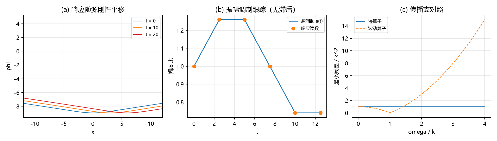

# 注记-次阶源锁定复验·第二段：含时源的时间响应（约束逐时闭合、瞬时跟踪与调制无滞后）（判据 TR1 至 TR5）

- **日期**：2026-09-21 08:06:08
- **对应脚本**：`验证脚本/second_order_source_lock_time.py`（判据 TR1 至 TR5，确定性，无随机数，运行约 1.4 秒；图存 `images/second_order_source_lock_time.png`，见 §一 图 1）
- **依据**：[[验证脚本/注记-次阶源锁定复验（首轮）：含动能与应力源的两条守恒、迹源装配与呼吸通道的唯一性（判据SS1至SS5）]]（第一段的源侧条件）；[[内部草稿/注记-自旋2从哪来：源锁定、各向同性封装与守恒保护]]（保护条件与第五力风险）；[[验证脚本/注记-TT投影微观来源的最小验证：约束结构自动给出]]（判据 U 的约束结构）；[[验证脚本/注记-G1b第八轮：四维组装：三扇区读数与3+1约束（判据G1b8-1至G1b8-5）]]（3+1 约束口径）；[[内部草稿/开放问题总览：元相子理论待解决问题清单]]（登记）
- **定位**：次阶源锁定复验第二段。把约束结构推到时间维：源含时（刚性移动、位置调制、振幅调制）时，核对约束的时间响应结构。本注记不改动基准文件。
- **状态**：判据 5/5 通过。核心读数：五个时刻的闭合残差 $2.0$ 至 $2.7\times10^{-12}$、守恒残差至 $2.0\times10^{-12}$；移位跟踪偏差 $8\times10^{-16}$ 至 $1.0\times10^{-15}$；时间导数两路偏差 $6.0\times10^{-13}$；振幅与位置调制偏差 $3$ 至 $9\times10^{-16}$；零模恒零、呼吸型扰动非解、对照波动算子有零。
- **图**：见 §一 图 1（`images/second_order_source_lock_time.png`）

---

## 一、判据与结果

| 判据 | 内容 | 通过条件 | 实测 |
|---|---|---|---|
| TR1 | 五个时刻的约束闭合与两条守恒律 | 残差小于 $10^{-8}$ | 闭合 $2.0$ 至 $2.7\times10^{-12}$；守恒 $3.5\times10^{-13}$ 与 $2.0\times10^{-12}$ |
| TR2 | 瞬时跟踪（移位恒等） | 谱移位逐位一致 | $9.9\times10^{-16}$ 与 $7.9\times10^{-16}$ |
| TR3 | 时间导数恒等（两条路线） | 机器级一致 | $6.0\times10^{-13}$ |
| TR4 | 调制跟踪（位置与振幅） | 等于瞬时像、无滞后 | 振幅 $6.7\times10^{-16}$、读数对 $a(t)$ 偏差 $3.3\times10^{-16}$；位置 $8$ 至 $9\times10^{-16}$ |
| TR5 | 齐次自由度与传播支对照 | 核仅空间常数 | 零模残差 $0$；呼吸型扰动对解析残差偏差 $6.5\times10^{-13}$；轨迹算子无零对波动算子 $\omega = k$ 归零 |

图注：左图为三个时刻的响应曲线（随源刚性平移）；中图为振幅调制的跟踪（实线为源调制，圆点为响应读数）；右图为传播支对照（轨迹算子的最小残差恒为正，波动算子在 $\omega = k$ 归零）。

## 二、模型设定

沿用第一段的模型与口径：正弦-Gordon 墙解析解 $\theta = \frac{2}{\pi}\arctan\exp(M\gamma(x-vt))$，$M = 2\pi\sqrt{K}$，取 $K = 0.005$、$k = 1$、$L = 400$、$N = 4096$；绕数周期化、稳定势闭式与核心区掩膜同第一段。响应由约束解出，归一化取 $\nabla^{2}\varphi = S$（泊松算子作用在响应上等于源），源取 $S = T^{00}+T^{i}{}_{i}$。

时间序列取 $t = 0$ 至 $20$；位置调制取 $\xi(t) = 2\sin(2\pi t/20)$，振幅调制取 $a(t) = 1+0.3\sin(2\pi t/15)$。两处调制属构造性时间依赖（不要求是物质动力学的解），用于检验约束的时间响应结构。守恒律核对与第一段同式。

## 三、读数的意义

其一，**约束逐时闭合、守恒逐时保持**。五个时刻的闭合残差与守恒残差都在 $10^{-12}$ 量级：源含时时，迹通道的约束没有出现时间维的额外项。

其二，**响应瞬时、无延迟**。源移位后响应随之平移，谱移位核对到 $10^{-15}$ 量级：轨迹上没有相位滞后与传播延迟，与波动算子的传播支形成对照（见 TR5）。

其三，**时间导数恒等**。$\partial_t\varphi$ 的两条路线（响应求导与源求导后解约束）一致到 $6.0\times10^{-13}$：约束对时间的微分成立，轨迹的时间演化完全由源继承。

其四，**调制无滞后、无余振**。振幅调制时响应读数对 $a(t)$ 的偏差 $3.3\times10^{-16}$，位置调制时响应对瞬时位置的偏差在 $10^{-15}$ 量级。含义是：度规迹的呼吸内容等于源的呼吸内容，源停止调制，响应即停止变化。这是呼吸模不独立在时间维的直接读数。

其五，**齐次自由度只剩空间常数零模**。逐时刻核对：空间常数（含时间依赖的常数）在核内、残差恒零；任何非平凡的呼吸型扰动不是解（对解析残差的偏差 $6.5\times10^{-13}$）。传播支对照：轨迹算子的最小残差在 $\omega$ 扫描下无零，波动算子在 $\omega = k$ 归零。

## 四、与既有材料的关系

第一段把源侧条件（守恒、装配、算子结构、注入灵敏度）核清；第二段把同一结构推到时间维：约束逐时闭合、响应瞬时跟随、时间导数恒等、齐次自由度只剩零模。两段合起来，次阶源锁定在源侧与时间响应两侧都有读数支撑。

三处边界须写清。其一，本轮在约束扇区（稳态与过阻尼口径）内，基本动力学（阻尼波动方程）下的响应侧是另一层问题。其二，两处调制为构造性输入，不构成物质动力学的主张。其三，三维嵌入（C1 门控）与 $\theta$ 达 $O(1)$ 的非线性区不在本轮。

## 五、过程记录

口径沿用第一段的三处订正（绕数周期化、稳定势闭式、核心区掩膜），本轮无同类问题。

振幅读数首版用响应峰值比源峰值（两个不同量的比值），与 $a(t)$ 的定义脱节；订正为响应峰值比基态响应峰值，读数对 $a(t)$ 的偏差 $3.3\times10^{-16}$，该偏差已并入判据。

## 六、严格程度声明

**数值部分**：TR1 为泊松求解与谱导数核对（$10^{-12}$）；TR2 与 TR4 为谱移位核对（$10^{-15}$ 至 $10^{-16}$）；TR3 为两条独立路线的核对（$10^{-13}$）；TR5 为线性算子核对（恒零、解析残差与 $\omega$ 扫描对照）。

**消费部分**：源的三段张量口径与迹源组合消费自第一段与 (d) 材料；3+1 约束语境消费自 G1b 第八轮。

**未验证**：基本动力学（阻尼波动方程）下的时间响应；物质动力学的自洽时间依赖；$\theta$ 达 $O(1)$ 的非线性区；三维嵌入（C1）。

## 七、边界声明

**验证什么**：含时源下约束的逐时闭合与守恒；响应的瞬时跟踪、时间导数恒等与调制无滞后；齐次自由度与传播支结构。

**不验证什么**：不主张完整动力学层的时间演化已核对；不改动 `理论总纲/` 基准；方案处置属作者。
