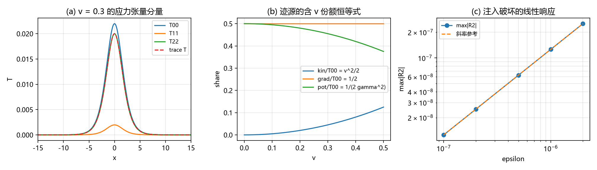

# 注记-次阶源锁定复验（首轮）：含动能与应力源的两条守恒、迹源装配与呼吸通道的唯一性（判据 SS1 至 SS5）

- **日期**：2026-09-21 07:52:31
- **对应脚本**：`验证脚本/minimal_verification_second_order_source_lock.py`（判据 SS1 至 SS5，确定性，无随机数，运行约 1.5 秒；图存 `images/second_order_source_lock.png`，见 §一 图 1）
- **依据**：[[内部草稿/注记-自旋2从哪来：源锁定、各向同性封装与守恒保护]]（次阶复验的判据出处与保护条件）；[[验证脚本/注记-TT投影微观来源的最小验证：约束结构自动给出]]（判据 U 的线性层锁定）；[[验证脚本/注记-张量桥d的装配轮：应力项的混合形式与T^00完整场侧表达式]]（(d) 三段、迹耦合与均匀延拓读数）；[[验证脚本/注记-张量桥d的动能流项：动量密度的相位梯度形式与γ对应]]；[[验证脚本/注记-张量桥d的W4通路：静质量密度与振幅亏损的标度关系]]；[[验证脚本/注记-G1b第八轮：四维组装：三扇区读数与3+1约束（判据G1b8-1至G1b8-5）]]（3+1 约束与 ij 支压力读数）；[[内部草稿/开放问题总览：元相子理论待解决问题清单]]（次阶源锁定复验的登记）
- **定位**：次阶源锁定复验首轮。把分段 (d) 的动能项与应力项并入迹通道的源，核对源锁定的保护条件。本注记不改动基准文件。
- **状态**：判据 5/5 通过。核心读数：两条守恒律归一化残差 $5.9\times10^{-13}$ 与 $2.8\times10^{-12}$（$v$ 至 $0.3$）；静止零张力 $2.0\times10^{-14}$、移动应力对 $2\gamma^{2}v^{2}V$ 偏差 $4.3\times10^{-12}$；迹源份额恒等式到 $5.9\times10^{-9}$；迹约束核维数 1、无传播支；注入灵敏度斜率核对 $1.000000$、实测源 $1.5\times10^{-14}$。
- **图**：见 §一 图 1（`images/second_order_source_lock.png`）

---

## 一、判据与结果

| 判据 | 内容 | 通过条件 | 实测 |
|---|---|---|---|
| SS1 | 两条守恒律（能量、动量）残差 | 归一化小于 $10^{-8}$ | $5.9\times10^{-13}$ 与 $2.8\times10^{-12}$（$v = 0$ 至 $0.3$） |
| SS2 | 静止零张力与移动应力形态 | 与闭式一致 | 静止 $2.0\times10^{-14}$；移动偏差 $4.3\times10^{-12}$ |
| SS3 | 迹源装配与份额恒等式 | 解析式逐点一致 | 分量偏差 $8.6\times10^{-14}$；份额偏差 $5.9\times10^{-9}$ |
| SS4 | 呼吸通道唯一性与无传播支 | 核仅常数、无零残差支 | 核维数 1；谱隙 $2.5\times10^{-4}$；源解残差 $2.1\times10^{-12}$；传播支对照见正文 |
| SS5 | 守恒破坏注入的线性灵敏度 | 斜率核对与零注入 | 斜率 $1.000000$；实测源 $1.5\times10^{-14}$ |

图注：左图为 $v = 0.3$ 的应力张量分量（$T^{00}$、$T^{11}$、$T^{22}$ 与全迹，横轴取 kink 中心附近）；中图为迹源的含 $v$ 份额恒等式（动能 $v^{2}/2$、梯度 $1/2$、势 $1/(2\gamma^{2})$）；右图为守恒破坏注入的线性响应（双对数，圆点为残差峰值、虚线为斜率参考）。

## 二、模型设定

连续极限取正弦-Gordon 墙：势 $V = K(1-\cos 2\pi\theta)$，$K = 0.005$，梯度系数 $k = 1$，解析解 $\theta = \frac{2}{\pi}\arctan\exp(m\gamma(x-vt))$，$m = 2\pi\sqrt{K}$。环盒 $L = 400$、$N = 4096$；单一 kink 在环面上带绕数 1，导数取谱方法（减线性项 $x/L$ 周期化后补回 $1/L$），点值核对限制在核心区 $|x| \le 30$。

应力张量按 (d) 的口径取 $\theta$ 语言的正则形式：$T^{00} = \frac12\dot\theta^{2}+\frac{k}{2}\theta_x^{2}+V$、$T^{01} = -\dot\theta\theta_x$、$T^{11} = \frac12\dot\theta^{2}+\frac{k}{2}\theta_x^{2}-V$；横向按均匀延拓取 $T^{22} = T^{33} = -\frac12\dot\theta^{2}+\frac{k}{2}\theta_x^{2}+V$。

守恒律核对 $\partial_tT^{00}+\partial_xT^{01}$ 与 $\partial_tT^{01}+\partial_xT^{11}$；迹通道的源取主动组合 $S = T^{00}+T^{i}{}_{i}$。

## 三、读数的意义

其一，**两条守恒在含动能与应力后保持**。动能项与应力项进入后，两条守恒律的归一化残差在 $v$ 至 $0.3$ 全部落在 $10^{-12}$ 量级：源侧的两个通道完整，没有出现第三个独立通道。按自旋 2 注记的表述，这正是源锁定所依赖的保护条件。

其二，**迹源装配有解析结构**。移动墙的分量有闭式：$T^{00} = 2\gamma^{2}V$、$T^{11} = 2\gamma^{2}v^{2}V$、$T^{22} = 2V$、全迹 $-T^{00}+T^{11}+2T^{22} = 2V$；读数与闭式逐点一致到 $10^{-13}$ 量级。全迹的 $2V$ 与速度无关，是一条可核对的强性质。

其三，**份额恒等式闭合**。三通道在 $T^{00}$ 中的占比为动能 $v^{2}/2$、梯度 $1/2$、势 $1/(2\gamma^{2})$，逐点成立到 $10^{-9}$ 量级（核心区口径见过程记录）；$v = 0$ 时退化为 $0$、$1/2$、$1/2$，与静止位力一致。

其四，**呼吸通道唯一、无传播支**。迹约束算子的核只有常数模（不可观测零模），最小非零本征值 $2.5\times10^{-4}$；注入零均值扰动不是齐次解；对模式的 $\omega$ 扫描，迹算子的最小残差 $2.5\times10^{-2}$ 无零，对照波动算子在同一扫描下于 $\omega = k$ 处归零。呼吸通道在结构上由源唯一确定。

其五，**守恒破坏的注入灵敏度线性可测**。向 $T^{11}$ 注入形变后，第二条守恒的残差按注入幅度线性增长（斜率核对 $1.000000$）；实测源给零注入（$1.5\times10^{-14}$）。保护条件由此变成可读数的量。

## 四、与既有材料的关系

本轮消费 (d) 的动能流、静质量密度与应力三段，以及 G1b 第八轮的四维组装口径。线性层的源锁定（判据 U）说的是迹由密度源定值、纵向由流守恒定值；本轮把同一结构推到次阶源侧：两个守恒量仍完整、迹源仍装配完整、无迹部分不进入迹通道的源。

两处边界须写清。其一，G1b 第八轮的 $ij$ 支等效压力 $p \approx \frac16\theta\rho_m$ 是几何侧的有效读法，与本轮的微观应力分属两侧，不做同口径比对。其二，三维形态取均匀延拓，由 C1 门控；含时度规的耦合演化不在本轮。

## 五、过程记录

首版用 FFT 直接对带绕数的 kink 求导，环面两端不等值（$\theta$ 相差 1）造成 Gibbs 尖峰，迹源装配偏差达到 $10^{5}$ 量级。订正为减线性项后再周期化、并补回 $1/L$，导数回到谱精度。

势函数首版写成 $K(1-\cos 2\pi\theta)$，远尾处两个 $O(1)$ 量相减吃掉有效数字（$V$ 小到 $10^{-79}$ 时相对误差失控）。改用等价闭式 $V = 8Ks^{2}/(1+s^{2})^{2}$（$s = e^{m\gamma x}$）后全场无相消；点值核对同时限制在 $|x| \le 30$。

约束核对的残差首版写出符号错误（把 $\nabla^{2}\varphi = S$ 写成 $\nabla^{2}\varphi + S$），残差读到 $0.13$；订正为 $\nabla^{2}\varphi - S$ 后落到 $2.1\times10^{-12}$。

## 六、严格程度声明

**数值部分**：SS1 与 SS5 为谱导数下的守恒残差与线性斜率核对（$10^{-12}$ 级与斜率 $1.000000$）；SS2 与 SS3 为解析闭式的逐点核对（$10^{-13}$ 与 $10^{-9}$ 两级）；SS4 为线性算子核对（核维数、谱隙、残差、传播支对照）。

**消费部分**：势、梯度系数与三段张量的口径消费自 (d) 三段材料；横向分量的均匀延拓口径消费自装配轮的接口读数。

**未验证**：含时度规的耦合演化；$\theta$ 达 $O(1)$ 的非线性区；三维嵌入（C1 门控）；各向同性封装的低能涌现前提（登记在自旋 2 注记的相邻缺口）。

## 七、边界声明

**验证什么**：含动能与应力项的两条守恒；迹源装配与含 $v$ 的份额恒等式；迹约束的唯一性、核结构与无传播支；守恒破坏注入的线性灵敏度。

**不验证什么**：不主张次阶源锁定已在完整动力学层成立；不改动 `理论总纲/` 基准；方案处置属作者。
