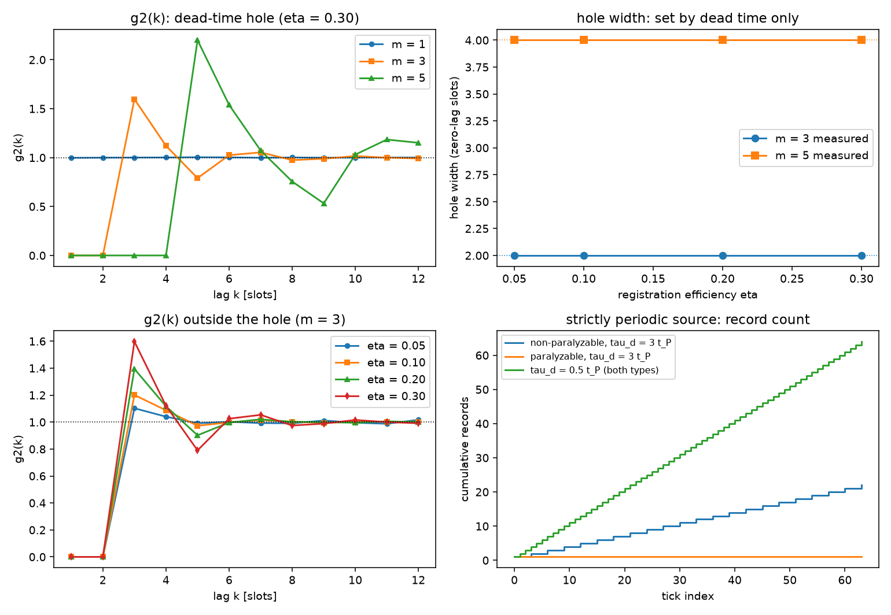

# 注记-死时间关联效应轮的最小验证：洞宽定死时间，凹陷深度定效率

- **日期**：2026-09-18
- **对应脚本**：`验证脚本/minimal_verification_deadtime_correlation.py`（判据 K1 至 K6 共 7 项，7/7 通过；确定性，种子 20260918；运行约 1.3 秒；图存 `images/deadtime_correlation.png`，见 §一 图 1）
- **依据**：[[验证脚本/注记-探测器死时间与关联轮的最小验证：两种亏欠同向，标度可分]]（第 130 条，标度分离）；[[验证脚本/注记-碰撞即写入轮的最小验证：写入时刻等于折返时刻，本底等于碰撞率，稀释统计为 Q = -eta]]（记录流模型与 $Q = -\eta$）；[[内部草稿/开放问题总览：元相子理论待解决问题清单]] P3-12
- **状态**：判据 7/7 通过。核心读数：$m = 1$ 时 $g^{(2)}(k) = 1$（四档效率最大偏差 $2.09\%$）；$1 \le k < m$ 时 $g^{(2)}(k)$ 严格为零（残值 $0.00\times10^{0}$），洞宽为 $m - 1$ 且四档效率读数相同；洞缘超射 $g^{(2)}(m)$ 随效率从 $1.10$ 升到 $1.60$（$m = 3$）、从 $1.14$ 升到 $1.54$（$m = 5$）；$k = 12$ 处偏离 1 为 $0.86\%$ 与 $0.04\%$；严格周期源下 $\tau_d = 3t_P$ 时非瘫痪式 $64$ 刻度给 $22$ 笔、瘫痪式给 $1$ 笔。

---

## 一、判据与结果

| 判据 | 内容 | 通过条件 | 实测 |
|---|---|---|---|
| K1 | 稀释不写记忆（$m = 1$） | 偏差 $< 3\%$ | $2.09\%$（四档效率） |
| K2 | 死区挖空（$1 \le k < m$） | 严格为零 | $0$（残值 $0.00\times10^{0}$） |
| K2 附 | 两种采样实现一致 | 差 $< 0.05$ | $0.0201$ |
| K3 | 洞宽定死时间 | $= m - 1$ 且与 $\eta$ 无关 | $[2,2,2,2]$ 与 $[4,4,4,4]$ |
| K4 | 洞外偏离衰减 | $k = 12$ 时 $< 0.15$ | $0.0086$（$\eta = 0.3$）、$0.0004$（$\eta = 0.2$） |
| K5 | 探测器类型分野 | 倍增对锁死 | $64$ 刻度：$22$ 笔对 $1$ 笔 |
| K5 附 | $\tau_d < t_P$ 无差别 | 两类型同额 | $64$ 对 $64$ |
| K6 | 口径登记 | 见 §三 | 登记 |

图注：左上为 $g^{(2)}(k)$ 的洞结构（$\eta = 0.30$；$m = 1$ 无洞、$m = 3$ 与 $m = 5$ 给出宽 $2$ 与宽 $4$ 的零洞，虚线为 1）；右上为洞宽随效率的读数（$m = 3$ 恒为 $2$、$m = 5$ 恒为 $4$，与效率无关）；左下为洞外恢复（$m = 3$，四档效率的洞缘超射随效率升高而抬升，$k = 12$ 处全部回落到 1 附近）；右下为严格周期源的累计记录数（非瘫痪式给斜率 $1/(3t_P)$ 的阶梯、瘫痪式在首笔之后锁死、$\tau_d < t_P$ 时两类都与刻度同步）。

## 二、模型设定

记录流为严格周期刻度（间隔 $t_P$），按登记效率 $\eta$ 二项稀释，随后过非瘫痪式死时间：相邻计数的间隔不得小于 $m$ 个刻度（$m = 1$ 表示无死时间，$m = 3$ 表示屏蔽两个刻度）。该贪婪滤波与间隔独立同分布的更新过程（$\mathrm{gap} = m + \mathrm{Geom}(\eta)$）等价，脚本内对两套实现做了对照。二阶关联取槽网格估计 $g^{(2)}(k) = \frac{\sum_n I_n I_{n+k}}{(N - k)\bar I^{2}}$，记录长 $3\times10^{6}$ 槽，滞后 $k$ 取到 $12$，四档效率。瘫痪式对照取严格周期源（$\eta = 1$），死时间内的任何到达都延长死时间。

## 三、读数的意义

第 130 条已核稀释与死时间在 $Q$ 上同向、标度不同，本轮把两者的分工读到底：稀释只动凹陷深度，死时间只动洞宽。$m = 1$（无死时间）时 $k \ge 1$ 的 $g^{(2)}$ 全为 1，二项稀释不写任何记忆；$m \ge 2$ 时 $1 \le k < m$ 的 $g^{(2)}$ 严格为零，且这组零与效率无关（K1 至 K3）。两个手柄正交，故洞宽可以直接当死时间的读数，凹陷与超射的幅度当效率的读数。

洞缘第一个位置出现超射，幅度随效率增大：$m = 3$ 时 $g^{(2)}(3)$ 从 $\eta = 0.05$ 的 $1.10$ 升到 $\eta = 0.30$ 的 $1.60$，$m = 5$ 时同类位置从 $1.14$ 升到 $1.54$。物理读法清楚：刚走出死区的那个刻度是第二个计数最可能的落点。远距离（$k = 12$）回落到 1 附近（偏差 $0.86\%$ 与 $0.04\%$），说明这种规则化的记忆长度有限。

槽网格上每个槽的占据数只取 0 或 1，故零延迟位置的 $g^{(2)}(0)$ 恒为零，与死时间无关。按 Mandel 关系 $Q = \langle I \rangle (g^{(2)}(0) - 1)$，以槽为分箱口径即得 $Q = -\eta$，正是第 130 条与碰撞即写入轮那条关系。这条等价把两轮读数接到一起：$Q = -\eta$ 的内容是一个时钟槽至多写一笔记录，死时间不参与这条关系，只把凹陷从零延迟展宽到 $k < m$。

泊松本底对一切 $k \ge 1$ 有 $g^{(2)}(k) = 1$，任何位置都不出现零洞。周期刻度本底在死时间作用下给出宽度 $m - 1$ 的零洞，宽度由死时间以刻度为单位确定，效率掉到 $5\%$ 也不改变（K3）。因此洞宽是搜索本底周期性最硬的可分离签名：它把周期刻度加死时间与泊松本底直接分开，与计数率、效率、死时间标定的绝对精度都无关。

严格周期源下两类探测器分野干净。$\tau_d = 3t_P$ 时非瘫痪式给周期倍增（$64$ 个刻度留 $22$ 笔，读数仍严格周期），瘫痪式在首笔之后完全锁死（$64$ 个刻度只留 $1$ 笔，本底消失）；$\tau_d < t_P$ 时两类无差别（都是 $64$ 笔）。故读本底周期性这条路线对探测器类型敏感，瘫痪式探测器下本底连续性不可读，须用非瘫痪式或把死时间压到一个刻度以下。

**口径登记。** 引用 $Q = -\eta$ 或讨论本底时间结构时，须写明探测器条件（类型、死时间与刻度之比、计数率）；分离两项亏欠的硬办法是读 $g^{(2)}$ 的洞宽，它对效率不敏感。

## 四、过程记录

判据设计：K1 的容差按最低效率档的抽样误差量级定。槽占用率 $\bar I = \eta = 0.05$、记录长 $3\times10^{6}$ 槽时，$g^{(2)}$ 的相对误差约 $1/\sqrt{N\bar I^{2}} \approx 2\%$，故容差取 $3\%$；实测最大偏差 $2.09\%$，与估计一致，该档读数不参与结论引用。

采样实现：模型有两套等价实现（逐刻度贪婪滤波与更新过程间隔采样），脚本内做了对照，$m = 3$、$\eta = 0.30$ 下两套的 $g^{(2)}(1..6)$ 最大差 $0.0201$，量级即抽样误差。

与前一轮的关系：第 130 条的 J5 只核到间隔量化为 $t_P$ 整数倍与一个 KS 距离，关联结构未读数；本轮把它做成 $g^{(2)}$ 的洞结构。旧脚本 docstring 中与实现不符的 J5 陈述已一并订正（见该脚本与对应注记的过程记录补条）。

效率记录：脚本约 $1.3$ 秒，无字体问题。
