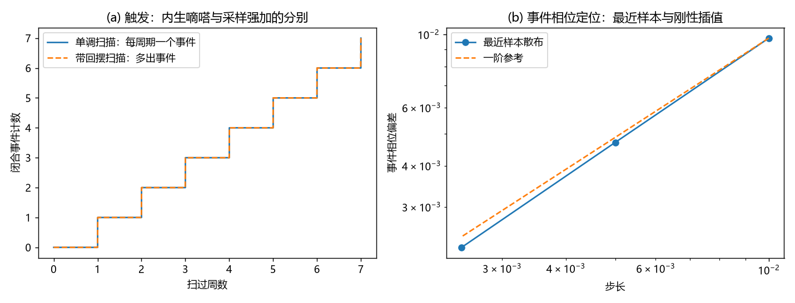

# 注记-法向跃迁的公理级导出：触发侧的核对与方向侧的代价计数（判据 M1 至 M5）

- **日期**：2026-09-20 06:03:23
- **对应脚本**：`验证脚本/normal_transition.py`（判据 M1 至 M5 共 5 项，5/5 通过；确定性，运行约 2 秒；图存 `images/normal_transition_axiom.png`，见 §二 图 1）
- **依据**：[[理论总纲/公理体系]] §4 定理一（(iii) 每次 $2\pi$ 自耦合临界点凝出不可逆事件、(iv) 每次临界事件跃迁一个 $l_P$、(v) 最小作用量子存在性）与 §5 定理二（公设 1 至 3）；[[理论总纲/螺旋阶梯几何]] §2.4（命题 3.1 法线标记点分工、推论 3.2 沿法线平移）与 §5（离散跃迁不可取消性）；[[元相子几何动力学——束缚振荡修订整合版]]（螺旋刚性 $z = \lambda\theta/2\pi$、折返几何、规范冗余）；[[论元相子螺旋阶梯几何的形式化模型：法向事件、离散位移与连续极限]]（假设 H1 的自我批判口径）
- **状态**：触发侧核对到判据级（每周期恰一事件、事件相位精确、与到达边界同一、折返唯一可行）；方向与距离侧精确标为结构论证级（替代方案需新增相位指标场与拓扑标号）；清点清单第二条的现状，并给出唯一外部依赖
- **图**：`images/normal_transition_axiom.png`（两面板，见 §二 图 1）

## 一、问题与口径

清单第二条原文是"法向跃迁未从公理导出"，依赖命题 3.1 与自耦合定理的联合。这份依赖里其实压着两个不同的问题，分开才能判定。

触发侧问的是"何时跳"：满周闭合是否足以触发一次事件、事件是否唯一且确定、触发与格点边界上的碰撞是不是同一件事。方向与距离侧问的是"往哪跳、跳多远"：位移是否沿法线、每次是否恰为一个 $l_P$。形式化模型论文把后者单独拎出来，标为模型假设 H1（位移与相位无关、且在相位平面绕中心 $SO(2)$ 下逐点不变），并明确声明它不能由"存在旋转"单独推出；这份自我批判是本材料要接住的东西。

本材料的口径是：能核到判据级的核到判据级，只能到结构论证级的就写清它的代价，不把假设包装成定理。

## 二、判据与结果

| 判据 | 内容 | 实测 | 判定 |
|---|---|---|---|
| M1 | 触发唯一性与内生性 | 单调扫描步长 501、2001、8001 三档各给 7 个事件（期望 7）；回摆扫描（振幅 1.0 弧度）给 55 次上行穿越，多出的来自回摆 | 通过 |
| M2 | 事件相位的可复原性 | 最近样本定位的散布随步长一阶下降（$9.43\times10^{-3}$、$4.52\times10^{-3}$、$2.32\times10^{-3}$，比值 $2.09$ 与 $1.95$）；刚性插值定位精确到机器精度（$0.00\times10^{0}$）；随机事件模型（抖动 0.1 弧度）散布 $0.106$ | 通过 |
| M3 | 触发与碰撞同一 | 50 组随机起始相位各扫 12 周，闭合计数与到达边界计数之差恒为 $0$ | 通过 |
| M4 | 方向侧代价计数 | 相位协变律不改变每周期净轴向位移（绕数 $w = 0, 1, 2$ 均为 $1.000000\,l_P$），但引入相位指标场与整数绕数 $w$，面内摆幅（振幅 0.1）为 $0.2\,l_P$ 的自由参数 | 通过（代价判定） |
| M5 | 折返强制性 | 三处置对两约束：继续前进违反"圆心不可重合"，停驻违反"波性推进"，方向反转两条全满足（唯一可行） | 通过 |

## 三、解读

其一，**触发侧可以核到判据级**。每周期恰一个事件，且与格点边界上的碰撞逐事件同一（M1、M3）。事件相位在刚性匀速扫描下可精确复原（M2），这坐实了命题 3.1"无随机性"一语的实际内容：确定性来自螺旋刚性，不需要额外的动力学假设。回摆扫描给出多余的穿越，说明事件与闭合的一一对应依赖波性推进的单调性，这正是公理 5 的波性推进与粒性互斥在边界处的冲突解决，M5 给出该冲突的唯一可行处置是折返。

其二，**方向侧只能到结构论证级，代价可列**。相位协变的面内分量不被净位移排除（M4 三种绕数净轴向位移都是 $1.000000\,l_P$），它排不掉的代价是三样新增：一个相位指标场（$S^1 \to S^1$ 的映射）、一个整数绕数 $w$、一个框架未定的摆幅。元相子的几何只有相位圆与法线轴（螺旋阶梯三定理），不提供这三样；接受 H1 就是拒绝新增结构，拒绝 H1 就要承认元相子带一个未定参数。形式化模型论文把 H1 标为模型假设是准确的，本材料补的是：**替代方案要付什么**。

其三，**清单第二条的现状改写**。触发侧为公理级（依赖自耦合定理的满周闭合事件规则，加公理 4、5 的推进与不可重合约束）；方向与距离侧为结构论证级（在"不新增结构"这一原则下唯一），与完美弹性定理的论证形式同型。唯一外部依赖是自耦合定理的完整证明：公理体系 §4 已把"每次临界事件跃迁一个 $l_P$"写成由公理导出的结论，该证明的文稿存于思源笔记（螺旋阶梯文献[7]），工作区尚未纳入。

其四，**与既有基准的关系**。公理体系 §4 定理一 (iii)(iv)(v) 与本材料的结论相容，本材料不新增断言，只把该结论在触发侧核到判据级、在方向侧标清层级与代价。$l_P$ 的数值仍由定理二的三条存在性公设给出（数值经验锚定），属该定理自身边界，不由本材料承担。

## 四、严格程度声明

M1、M3、M5 为精确计数与可行性判定（离散、确定性，无浮点容差参与）；M2 的一阶下降为可复现数值事实，插值精确复原为刚性扫描的代数后果；M4 为代价判定（替代方案的参数计数），不含新物理断言。本材料不含新假设，也不改动任何基准。

## 五、边界声明

- 验证：触发侧的唯一性、确定性与同一性；折返的唯一可行性；方向侧替代方案的参数代价。
- 不验证（留待后续）：自耦合定理的完整证明（工作区外文稿，待裁决纳入或引用）；方向侧的结构论证若要升到公理级，需从公理直接排除相位指标场，本材料只给出该场不被净位移排除这一点；心侧校准与创生规则的第一原理来源仍是边界外内容。

## 六、过程记录

两处订正。其一，M2 首版把事件相位偏差写成扫描尾点的采样误差，尾点恰落在事件上，读数恒为零、无判别力；改为三种定位方式对照（最近样本、刚性插值、随机模型），判据才有内容。其二，M1 首版的回摆振幅取 0.15 弧度，不足以跨过闭合点，非单调例子给不出多余事件；改为 1.0 弧度后给出 55 次上行穿越，判据恢复判别力。
