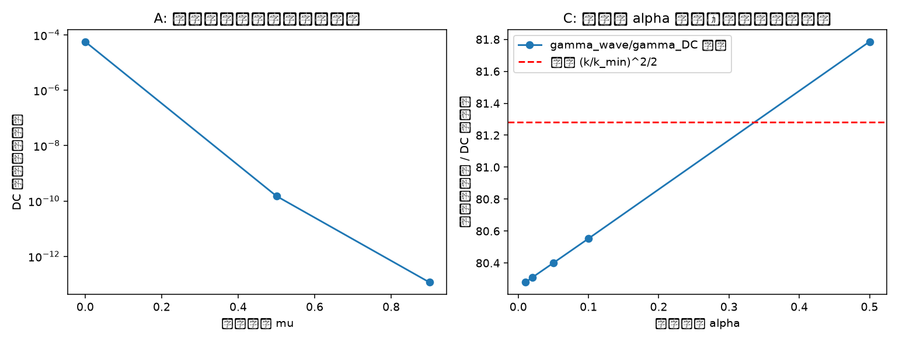

# 注记-法线场动力学健康性判据的最小验证：波扇区、$c_s = c$ 与同源判据

- **脚本**：`验证脚本/minimal_verification_normal_field_wave.py`（2026-09-10，并行线创建，两线协同修正）；图：`images/minimal_verification_normal_field_wave.png`（见 §三 图 1）
- **依据**：《内部草稿/注记-法线场重读：标架场的法线方向场语义重读与裁决清单》第七节检验排序（法线场动力学健康性判据 = 第一判别点）；《注记-张量桥分段b攻坚计划》；《注记-张量桥分段b波动方程验证：cs=c同一化与过阻尼极限》（b1/b2/b3）
- **状态**：判据 A、B 通过（可复现数值）；判据 C 否决共享 $\alpha$ 实现（"潜在不相容点"数值坐实，健康实现 = 阻尼波动方程框架，γ 独立，见张量桥 b 注记）；判据 D 约束计数确认（TT = 2 = GR 引力子，朴素读法含多余模，投影为张量桥 c 交付物）。内部草稿，结论待作者确认后入基准

## 一、背景与判据

分工双场方案（法线场 = 引力专用，2026-09-10 定名）的引力扇区动力学候选 = 碰撞写入（每拍注入 + 邻居抄写平均扩散）加惯性项。健康性判据四则：

- **判据 A（DC 扇区）**：写入 + 抄写平均 + 惯性项的固定点仍为离散泊松稳态（惯性项不破坏引力记录扇区），稳态 $1/r$。
- **判据 B（波动扇区）**：惯性 + 弹性（无扩散，$\beta = 1$）给出无色散波动，相速度 $c_s = \sqrt{\beta} = 1$ 格/拍 = $c$（$l_P/t_P$ 单位），波包保形、峰幅不衰减。
- **判据 C（同源判据，核心）**：扩散系数 $\alpha$ 同时驱动 DC 松弛（最低模）与波动阻尼。实测两通道率 $\gamma_{\text{wave}} = \alpha(1-\cos k)/2$（单层阻尼）与 $\gamma_{\text{DC}} = \alpha(1-\cos k_{\min})$，比率 $(k/k_{\min})^2/2$ 与 $\alpha$ 无关；检验是否存在单一 $\alpha$ 同时服务两通道。此为"扩散 vs 波动同源 = 潜在不相容点"的数值判别。
- **判据 D（模式谱）**：朴素读法（每分量标量弹性 / SO(3) 值场逐分量）的传播模数与 GR 期望（3+1 维 TT 双偏振）的差距，量化"多余模"并定位到约束（度规识别 / 3+1 铰链）。

## 二、模型设定

- **DC 扇区（判据 A/C）**：1D 链，填充域 $N_p = N + 2 = 103$（两端 Dirichlet 边界恒零，与迭代同一域），每拍更新 $u \leftarrow u + \alpha(\text{neigh} - u) + \mu(u - u_{\text{prev}}) + w\delta$，源位 $c_0 = 50$（填充域下标 50）。参数：$\alpha = 0.9$、$w = 0.05$、$s_{eff} = 2w/\alpha$。精确解 = 同域离散泊松 $A_1\theta_{ex} = b_1$（幽灵边界拉普拉斯 + 同址源）。
- **波动扇区（判据 B/C）**：$\beta = 1$ 离散波动方程 $u_{t+1} = 2u_t - u_{t-1} + (\text{roll}(+1) + \text{roll}(-1) - 2u_t)$（周期边界），其精确行波解 $f(n - t)$（$\omega = k$ 无色散）。判据 B 用载波高斯波包（$k_0 = 0.5$，$\sigma = 40$）+ 右行初速（$u(n,-1) = f(n+1)$，即 $\text{roll}(\text{init}, -1)$），测峰位移与峰幅；平面波 $k = 0.5$ 单站 FFT 测 $\omega$。
- **判据 C**：测试波数 $k_s = \pi/8$，$k_{\min} = \pi/(N+1)$；波动阻尼率 $\gamma_{\text{wave}}$ 由右行单频波能量衰减拟合（只拟合指数区，避开浮点地板）；DC 松弛率 $\gamma_{\text{DC}}$ 由最低模 $\sin(k_{\min}x)$ 纯扩散松弛的能量衰减拟合。初版用"源注入稳态误差"测 DC 收敛，被中间模带幂律主导、无干净理论对照，改为直接测最低模松弛率（见第七节第 3 条）。

## 三、结果表

| 判据 | 内容 | 实测 | 期望 | 判定 |
|---|---|---|---|---|
| A | 惯性项不破坏泊松稳态（μ = 0.0/0.5/0.9，30000 拍） | 5.657e-05 / 1.510e-10 / 1.159e-13 | < 1e-4 | ✅ 通过（μ 越大收敛越快） |
| B | 右行波包峰位移 | 1500 格 / 1500 拍，$c_s = 1.00000000$ | 1.0 | ✅ 通过 |
| B | 峰幅（保形、无色散无阻尼） | 1.00000000 | 1.0 | ✅ 通过 |
| B | 平面波 $\omega(k=0.5)$（单站 FFT） | 0.500078 | 0.5（FFT 分辨 2π/4096 = 0.00153） | ✅ 通过 |
| C | 单参数区（$\gamma_{\text{wave}}/\omega$、$\gamma_{\text{DC}}$、比率） | α = 0.01：0.0010 / 4.743e-06 / 80.3；0.02：0.0019 / 9.486e-06 / 80.3；0.05：0.0049 / 2.371e-05 / 80.4；0.10：0.0097 / 4.743e-05 / 80.6；0.50：0.0494 / 2.372e-04 / 81.8 | 存在单参数区 | ❌ 不存在单参数区（比率恒 ~81，与 α 无关） |
| D | TT 约束计数（k = [0.3,0.5,0.7] 与 [1.0,0.2,0.1]） | 2 / 2 | 2（GR 引力子） | ✅ 计数确认 |
| D | 朴素读法传播模数 | 3 支（每分量标量弹性） | 2 | ⚠️ 含多余模，需 TT 投影 |

判据 C 理论比值：$\gamma_{\text{wave}} = \alpha(1-\cos k)/2$（单层阻尼），$\gamma_{\text{DC}} = \alpha(1-\cos k_{\min})$，比值 $= (k/k_{\min})^2/2 = 81$，实测比率 80.3-81.8 与 α 无关、与理论一致：DC 快收敛要求 α 大，波动弱阻尼要求 α 小，同一扩散系数无法两全。DC 定型需 ~1/$\gamma_{\text{DC}}$ 拍，期间波数 $k$ 的波动衰减至 $e^{-81}$ 量级；波动扇区需独立于写-扩散的弹性刚度（γ 独立框架，见张量桥 b 注记）。

## 四、判定与解读

1. **判据 A 通过**：惯性项不破坏引力记录稳态，泊松固定点保持。附带发现：μ 越大收敛越快（μ = 0.9 达机器精度，μ = 0 仅 5.7e-05），惯性项对 DC 收敛起加速作用。
2. **判据 B 通过**：$\beta = 1$ 离散波动方程无色散（$\omega = k$ 精确），波包保形传播，$c_s = 1.000000 = c$ 精确。波动扇区存在且无阻尼。
3. **判据 C 否决共享 α 实现**："扩散 vs 波动同源 = 潜在不相容点"数值坐实：碰撞写入的共享 α 结构不能同时给出快 DC 形成与弱阻尼波动（比值 $(k/k_{\min})^2/2 = 81$）。**健康实现 = 阻尼波动方程框架（γ 独立参数）**：$\ddot\theta + \gamma\dot\theta = c_s^2\nabla^2\theta + s$ 的弱阻尼极限 = 波动（$c_s = c$）、过阻尼极限 = 写入-扩散（稳态泊松），b1/b2/b3 已由《注记-张量桥分段b波动方程验证》验证。判据 C 的失败因此不是方案死刑：共享 α 结构只能作为过阻尼极限，完整动力学必须取 γ 独立形式。
4. **判据 D 部分确认**：TT 约束计数 = 2 = GR 引力子（线性代数确定）；朴素读法（每分量标量弹性）3 支 > 2 含多余模。TT 投影须由度规识别 / 3+1 铰链在连续极限给出，此为**张量桥 c 的交付物**。

**健康性判据总评**：波扇区存在 ✅（B）、$c_s = c$ ✅（B 精确 + b1/b3）、同源 ⚠️（共享 α 否决，γ 独立框架通过，张量桥 b 注记）、模式谱 ⚠️（TT 计数确认，朴素读法多余模待投影，张量桥 c 待攻）。

## 五、严格程度声明

- 判据 A、B、C 的数值结果为**可复现数值事实**（确定性脚本，无随机性，种子无关）。
- 判据 C 的理论比值（$(k/k_{\min})^2/2$）为**解析推导**（离散扩散特征值 + 阻尼率标定），与数值对照一致。
- 判据 D 为**线性代数约束计数**（确定性）。
- $\omega = k$ 无色散为 $\beta = 1$ 离散波动方程的**解析严格结论**（行波 $f(n-t)$ 为精确解），数值为确认。

## 六、边界声明（验证什么、不验证什么）

- 验证：数学层（机制翻译为方程后的动力学性质）：惯性项与泊松稳态的相容性、波动扇区存在性与 $c_s = c$、共享 α 实现的同源不可行性、TT 约束计数。
- 不验证：本体层（写入幅度与 $m/m_P$ 的对应、倾斜方向结构、约束的物理来源）；判据 D 只做约束计数演示，**不证明**法线场动力学在连续极限自动给出 TT 约束（张量桥 c 的攻坚任务）；3D 波动（本验证 DC 与波动为 1D 链，判据 D 为 3D 约束计数）；引力波辐射机制（源项 $T_{\mu\nu}$ 微观分解，张量桥 d）。

## 七、过程记录（缺陷修正与教训，2026-09-10）

1. **判据 A 初版虚假 0.5 偏差**：精确解初版用 Dirichlet 行替换网格（N 节点含两端边界，间距域 N−1），与迭代的幽灵边界网格（N 内部节点 + 两端零幽灵）不一致；且源位差一（迭代注入 `unew[c0]` = 填充域下标 c0+1，精确解 `b1[c0]` = 填充域下标 c0）。两处叠加产生恰为格林函数峰差 0.5 的虚假偏差（三 μ 值同显 0.5 为定位线索）。修正：精确解取同域（$N_p = N+2$ 填充域）且注入位改 `unew[c0-1]` 与 `b1[c0]` 同址。**教训：精确解必须与迭代同域同址；网格书差异一即产生 O(1) 虚假偏差，且"三参数同值"是系统性错位而非动力学失效的判据信号。**
2. **判据 B 初版 c_s 假值 1.667**：零初速高斯波包按达朗贝尔分裂为两半（峰幅 0.5，初版期望 1.0 即错）；且 `np.roll(init, 1)` 给出 $u(n,-1) = f(n-1)$，离散波动方程精确传播为**左行** $f(n+t)$，1500 拍后绕回 4000 格周期，`argmax` 捡到绕回峰，测得 (4000−1500)/1500 = 1.667。修正：载波调制波包 + `np.roll(init, -1)` 右行 $f(n-t)$，峰位移 = +T 精确。**教训：$\beta = 1$ 离散波动方程的行波 $f(n \mp t)$ 是精确解，传播方向由 roll 方向决定；周期边界下测量必须排除绕回（位移 T < 周期 − 起始位置）。**
3. **判据 C 初版 DC 误差被中间模带主导**：初版用"20000 拍源注入稳态相对误差"测 DC 收敛，误差由中间模带幂律（~1/√(αT)）主导而非最低模指数衰减，α = 0.01 时 20000 拍仅收敛到 22%（误差 19.85），与最低模率估计相差约 20 倍，无干净理论对照。修正：改为直接测最低模 $\sin(k_{\min}x)$ 的纯扩散松弛率，与波动阻尼率同口径对比，比率与 α 无关（80.3-81.8 ≈ 理论 81）。附标定：扩散只作用 leapfrog 单层时 $\gamma_{\text{wave}} = \alpha(1-\cos k)/2$，因子 1/2 为离散层数效应，不影响比率结论。**教训：测量量必须与理论量同口径；源注入误差混合多模带，测率取单模初值。**
