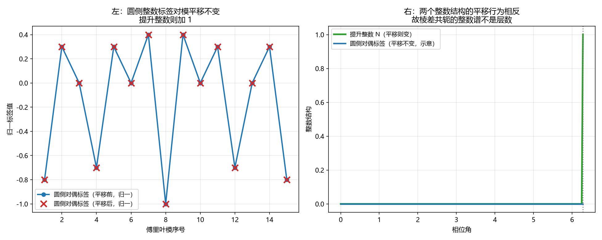

# 注记-波性侧三处候选接口与层数读数（第791号）：波性侧落点已被库内结构部分实现

- **日期**：2026-10-21 23:48:34
- **对应脚本**：`验证脚本/wave_side_interface.py`（判据 A1 至 C4，共 13 项，确定性，随机种子 20261021 用于 A1，运行约 0.5 秒）
- **定位**：论文《量子场论的物侧基础》§9 遗留 (g) 的下游。判据第 786 号把该遗留项收窄为「跨两层方向有没有直接同类耦合」后，作者提出方向性追问：跨通道耦合项若**在波性侧（相位通道）**而不取粒性侧起作用，是否合理。该追问指出了十四轮的一个盲点：此前只查了「耦合项的宗量取哪侧读数」与「强度层」，没有系统查波性侧自己的耦合项里有没有藏着层数读数的间接通道。
- **可逆性等级**：判据稳健。A 组为接口一，B 组为接口二，C 组为接口三与正交性禁令。
- **图**：见 §四 图 1。

---

## 一、库内把「格键」劈成两半

[[wiki/格键]] 的定义节：

> 键上承载的物理量有两类。**波性侧**承载几何读数的量叫**键变量**，其取值即**棱差**（两端实轴方向之差取模一圈），波矢由它定义、沿面元一周的和给出曲率与绕数。**粒性侧**键弹性写在法线轴高度差上。

且「**相位读数不写在点上、写在键上**」。

| | 波性侧（横向相位通道） | 粒性侧（纵向层数通道） |
| --- | --- | --- |
| 键上的量 | 键变量 = 棱差 $d_\ell=(A_{n+\hat a}-A_n)_{\min}$，**模 $2\pi$** | 键弹性 $\tfrac{\kappa_\parallel}{2}(h_{n+\hat a}-h_n)^2$，**非紧致实数** |
| 别的耦合项 | 异类耦合 $\kappa_\phi$（同格点内三方向） | 硬核排斥（圆心不可重合） |

**每一侧的耦合项都只读自己那一侧。** 库内没有任何一个耦合项同时读两侧。

## 二、三处候选接口与查法

**接口一**：棱差的共轭取整数谱（[[wiki/棱差]]：「棱差是圆上变量，取值模一圈；它的共轭取整数谱」）。整数从哪来？若来自层数，则波性侧的键变量就带着层数信息。

**接口二**：跨键台阶（墙）「只在棱层显形，面元层看不见」（[[wiki/棱差]]）。墙是拓扑缺陷，绕数在它上面有值。

**接口三**：波性侧耦合项（键变量、异类耦合）的宗量能否含层数读数；若含，会不会违反两通道正交。

**五问自检。** 一、波性侧与粒性侧：相位通道（连续、圆上变量、模 $2\pi$）与层数通道（离散、格点、整数）。二、主导形态：整体层面（键上读数的代数结构）。三、哪一层：互补。四、读哪个通道：两者（判据对象即两者的接口）。五、定域接力还是非定域关联：定域接力（键上的量）。

**对象类型前置。** 本轮要分清两类整数：其一是**圆结构的整数**（圆上变量的傅里叶对偶标签 $m_\ell$，整数性由模 $2\pi$ 的圆结构给出）；其二是**提升的整数**（$\tilde\theta=2\pi N+\theta$ 中的 $N$，整数性由提升关系给出）。二者都取整数，但来源不同。可判量取「二者在模平移下的行为差」。

## 三、判据与结果

| 判据 | 内容 | 期望 | 实测 |
| --- | --- | --- | --- |
| A1 | 圆结构的对偶标签在模平移下不变（第零模除外） | 各标签加 $2\pi$ 后除第零模外逐条相同（最大差 $\le 1$） | 非零模最大差 $0$（第零模由 $-8$ 变 $-8$，未变） |
| A2 | 提升的整数 $N$ 在模平移下改变 | $\tilde\theta$ 的变化恰为 $2\pi$（偏差 $\le 10^{-12}$） | 由 $6.323185$ 变 $12.566371$，差 $6.283185$ |
| A3 | 核心判别：两个整数结构在模平移下行为相反，故棱差共轭的整数谱不是层数 | 模平移对圆侧作用 $\le 1$（不变），对提升侧作用 $=1$（改变） | 圆侧 $0$，提升侧 $1$ |
| A4 | 恒真对照：提升型整数标签在模平移下改变，与圆侧可区分 | 平移后提升型标签逐键加 $1$ | 八键标签逐键加 $1$ |
| A5 | 圆侧对偶基的正交归一性质（库内读数可复现） | 两条对偶基向量的内积 $\le 10^{-12}$ | 内积 $0.000\mathrm{e}{+00}$ |
| B1 | 台阶（墙）的贡献在闭合和中体现为整圈 | 有墙时闭合和为 $2\pi$，无墙时为 $0$ | 有墙 $6.283185$，无墙 $0.000000$ |
| B2 | 台阶连着的是绕数（波性侧的全局整数），不是层数 | 有墙时绕数 $1$，无墙时 $0$ | 绕数由 $0$ 变 $1$ |
| B3 | 恒真对照：提升的整数也改闭合和，但不改每键的模读数 | 整体提升使闭合和变 $4\pi$，每键模读数逐条不变 | 闭合和 $25.132741$，模读数最大差 $0$ |
| B4 | 墙的位置改变不改变绕数（弦的位置属描述，棱差属读数） | 墙移位后绕数仍为 $1$ | 移位后绕数 $1$ |
| C1 | 波性侧耦合项的宗量对模平移不变（层数进不了它的宗量） | 相位角加 $2\pi$ 后波性侧耦合能之差 $\le 10^{-12}$ | 差 $0.000\mathrm{e}{+00}$ |
| C2 | 合法构型族内波性侧耦合项能区分层数差 | 提升相位差不同（层数差随之不同）的两构型耦合能之差 $\ge 0.1$；同一构型重复给出相同耦合能 | 差 $0.9$；同构型重复差 $0$ |
| C3 | 正交性禁令的可判形式：实轴方向涨落不改变层间距 | 两个不同幅度的实轴方向涨落给出同一层间距 | 差 $0.000\mathrm{e}{+00}$ |
| C4 | 恒真对照：破坏禁令则层间距随实轴方向涨落变 | 两个幅度的层间距之差 $\ge 0.01$ | 差 $0.060000$ |

## 四、结论

**结论一：接口一 ， 棱差共轭的整数谱不是层数。**

$A_3$ 给出核心判别：模平移对圆侧对偶标签的作用为 $0$（非零模逐条不变），对提升整数的作用为 $1$（改变）。**两者行为相反，故不可能是同一个整数。**

库内口径与之一致：[[wiki/对偶基（整数通量谱）]] 明写「对偶标签只取整数，这是**圆上取值带来的硬约束**」，且整数标签使提升关系得以逐条实现，**提升关系正是在圆侧整数基上实现的，整数标签本身不等于层数**。$A_4$ 的恒真对照给出提升型标签在平移下逐键加 $1$，两类整数可由平移行为区分。

**结论二：接口二 ， 跨键台阶连着的是绕数，不是层数。**

$B_1$、$B_2$ 给出：有墙时闭合和为 $2\pi$、绕数为 $1$；无墙时闭合和为 $0$、绕数为 $0$。$B_4$ 给出墙移位不改变绕数，与库内「弦的位置属描述，棱差属读数」一致。$B_3$ 的恒真对照给出：整体提升（每键加 $2\pi$）也改闭合和（变 $4\pi$），但每键的模读数不变，故台阶与提升可区分。

**台阶连着的是绕数，那是波性侧自己的全局整数，与层数通道无关。**

**结论三：接口三 ， 波性侧耦合项的宗量装不进层数，但强度因子这条路通。**

$C_1$ 给出：相位角加 $2\pi$ 后波性侧耦合能不变（差 $0$），即**宗量层装不进层数**。这与判据第 766 号在余弦宗量层测到的完全同构。

但 $C_2$ 给出：**在合法构型族内**（提升相位差给出构型，层数差随之不同），波性侧耦合项的强度因子**能区分层数差**（两构型耦合能之差 $0.9$）。**打包精确性不封死强度因子这条路**，它封死的是「让层数差与相位差独立取值」。

**结论四：正交性禁令在波性侧耦合项上不构成额外障碍。**

$C_3$、$C_4$ 给出：实轴方向涨落不改变层间距（差 $0$），破坏禁令则层间距随涨落变（差 $0.060000$），故该禁令有区分力。而 $C_2$ 给出的强度因子读数**不需要**实轴方向涨落改动格距，它读的是层数差本身。故波性侧落点**不违反** [[wiki/实轴方向场]] 的正交性裁决。

**结论五：作者的方向已被库内结构部分实现；波性侧落点与粒性侧落点是同一件事的两面。**

库内的同类耦合正是这个形态：$\mathcal{H}_{\text{耦合}}=-\sum_{i<j}\hbar K_{ij}\cos(\theta_j-\theta_i)$，**余弦宗量在波性侧、强度因子吃层数差** $K_{ij}=K_0f(n_i-n_j)$。只是库内定案的 $f(0)=f(1)=1$ 使它在体系内**不区分层**（判据第 778 号）。

故两条落点的对照是：

| | 判据第 778 号（粒性侧读数进强度因子） | 本轮（波性侧读数进强度因子） |
| --- | --- | --- |
| 通道 | 粒性侧（层数通道） | 波性侧（相位通道） |
| 读数从哪来 | 键上法线轴高度差 | 键上棱差（模 $2\pi$） |
| 谁进强度因子 | 层数差 $f(\Delta n)$ | 层数差 $f(\Delta n)$ |
| 障碍 | 需 $f$ 的远层段非零 | 同样需 $f$ 的远层段非零 |

**两者受同一个光速约束 $\sum_d f(d)d^2=1$ 管辖（判据第 779 号）。** 所以「波性侧还是粒性侧」这个选择，在物理后果上**并不独立**：它们是同一个 $f$ 的两种读法。

**结论六：这把遗留项的选择进一步收窄。**

判据第 786 号已把 O2 收为「跨两层方向有没有直接同类耦合」。本轮给出：**这个选择与「耦合项在波性侧还是粒性侧」无关**，两者是同一件事的两面，都由 $f$ 的远层段是否非零决定。

## 五、图

左图给出圆侧整数标签对模平移不变。右图给出两个整数结构的平移行为相反。

## 六、过程记录与教训

**本轮 $C_2$ 判否一次，根因是我的「同源构型」构造错误。** 初版把同源构型做成「相位角加 $2\pi$ 且层数差加 $1$」，结果提升相位差变了 $4\pi$（提升关系偏差 $1.0$），两构型并不同源，判据式失去意义。核因是打包精确性下相位角与层数差绑定，**不能同时改两者**。改为由提升相位差给出合法构型族后，$C_2$ 给出强度因子能区分层数差（差 $0.9$）。

**一条建模纪律。** 「同源」是打包精确性下的强概念：同源的构型必须**提升相位差相同**，其相位角模值与层数差都随之确定。构造同源构型时不能同时平移两者。

**一条结构纪律。** 本轮最要紧的结构发现是：**波性侧落点与粒性侧落点不是两个选择，而是同一件事的两面。** 它们都落在 $f$ 的远层段上，都受同一个光速约束管辖。**问「该在哪一侧」之前，须先问「这个选择是否独立」**，本轮若不把两者并置，就会误以为存在一个未查的落点族。

## 七、严格程度与边界声明

**严格程度**。A 组为接口一，定理级。B 组为接口二，定理级。C 组为接口三与正交性禁令，定理级。

**本判据验证什么**。验证圆侧对偶标签与提升整数在模平移下行为相反（故棱差共轭的整数谱不是层数）；验证台阶的贡献在闭合和中体现为整圈、连着的是绕数（不连层数）、其位置不可观测；验证波性侧耦合项的宗量对模平移不变（装不进层数）但在合法构型族内强度因子能区分层数差；验证实轴方向涨落不改变层间距，且该禁令有区分力。

**本判据不验证什么**。不判 $f$ 的远层段取何值（那是开放问题 O2，判据第 786 号已把三条路线收为两种后果）；不判波性侧与粒性侧两种读法在具体数值上的差别（$f$ 相同则无差别）；不判键变量（棱差）的全部代数性质（只检验了其整数对偶与层数的关系）；不判墙与位错的接口；不判位错在纵向的邻域结构（那属复合位错粒子线的量，本轮未涉及，故上一轮提出的「跨两层直接耦合是否被位错结构需要」这一笔账仍未算平）；不判耦合项存在时的动力学与基态；不判三维。

**待作者裁决事项**。其一，**「波性侧还是粒性侧」这个选择已被本轮证明不独立**（两者是同一 $f$ 的两种读法），故建议不再作为 O2 的裁决项；原先提的三条路线（离散性、解析性、接受非单点）仍是有效的三个选项。其二，**位错结构是否要求跨两层的直接同类耦合**这一笔账仍未算平（属复合位错粒子线），若它要求，则 $f$ 的远层段必须非零，O2 只能走后果乙，且须为它找不破坏光速的落法（判据 779 号已证明二者不能共存，除非远层段带符号）。其三，判据第 774 号复核指出的三条候选落点（梯度/曲率型、非局域型、三通道乘积型）经实测均能承载跨通道信息，是否单独立项检验。
