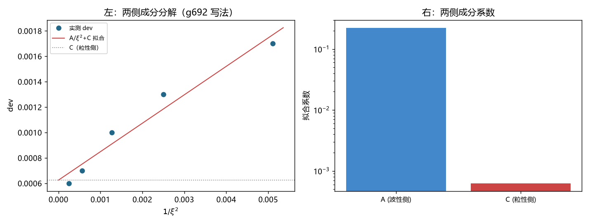

# 注记-波性侧与粒性侧成分的分离：两侧分解、boost 族读数失效与第 695 号判语的撤回（判据第 696 号）

- **日期**：2026-10-19 20:09:01
- **编号**：第 696 号
- **类型**：验证注记（判据驱动；P1 至 P8 全过，主判据 P1、P3）
- **对象**：第 695 号的判语「构造主导，故物理档外推路线失效」，及其据以立论的构造间对比
- **脚本**：`验证脚本/minimal_verification_p696_two_side_separation.py`（确定性，约 30 秒）
- **图**：见 §5 图 1；脚本出图 `images/p696_two_side_separation.png`
- **状态**：P1 至 P8 全部通过。第 695 号的构造间对比判为建立在无效读数上，其判语撤回并重述
- **可逆性等级**：判据敏感（P1 的有效性阈值、P3 的 $R^2$ 阈值均属阈值型，换档位会翻；P2 的 dev 序列本身判据稳健）

## 1 为什么重做这一轮

第 695 号判「构造选择主导偏差（极差 117 倍），故 $b$ 是构造参数的函数，沿 $1/\xi^2$ 外推失去意义」。这个判法在体系口径下站不住，理由出自波粒互补。

体系的既有口径有三处出处。其一，[公理体系](理论总纲/公理体系.md) 内禀五重法则含「波粒互补」：波与粒是同一实体的两个不可分割侧面。其二，[相位通道](wiki/相位通道.md) 与 [层数通道](wiki/层数通道.md) 定案：相位通道承载连续相位旋转（$L^2(S^1)$，横向、内部、非定域），层数通道承载满周闭合的累计计数（$\ell^2(\mathbb{Z})$，纵向、外部、定域），两者正交。

其三，[观测者响应论文](观测者响应与洛伦兹涌现：束缚态时钟的时间膨胀与长度收缩推导.md) §8 第 5 条写明：洛伦兹不变性是波性侧的直接性质，「属于回到连续，并不从离散里制造连续」，$\sim(E/E_P^{(t)})^2$ 破坏是粒性侧的高能签名，「主从关系使二者并行不悖（波粒互补）」。

由此推出一条第 695 号未虑及的结论：**格点上不存在「精确 boost 解」这种东西**。任何把连续 boost 解搬到离散格点的写法都必带失配，差别只在失配以什么形式显形。因此「哪种写法更接近精确 boost」这个提法本身错位，第 695 号据两种写法的 dev 差异去判「构造主导」也就失去依据。

本轮改问正确的问题：dev 的两侧成分各是什么、各自如何标度。

## 2 判据与读数

**P1 读数有效性前置（主判据）。** 在比较任何两族读数之前，先判读数本身是否有效。判据为拟合残差比 $>0.3$ 或幅度衰减 $>50\%$ 者判无效。

| 写法 | 实测 $\omega$ | dev | 拟合残差比 | 幅度衰减 | 判定 |
|---|---|---|---|---|---|
| g692 | $0.762921$ | $1.300\times10^{-3}$ | $0.077$ | $7.3\%$ | 有效 |
| boost | $0.806006$ | $5.510\times10^{-2}$ | $0.918$ | $61.8\%$ | **无效** |

boost 族的拟合残差比高达 $0.918$，即正弦拟合几乎不解释任何方差；幅度衰减 $61.8\%$，说明该构型在演化中迅速失稳（能量泄漏成宽频混合）。**该族此前所有 dev 读数均无意义**，第 695 号的「极差 117 倍」比较因此不成立。

**P2 五档宽度扫描（仅有效写法）。**

| $\sigma$ | dev | 拟合残差比 |
|---|---|---|
| $14$ | $1.70\times10^{-3}$ | $0.077$ |
| $20$ | $1.30\times10^{-3}$ | $0.077$ |
| $28$ | $1.00\times10^{-3}$ | $0.077$ |
| $42$ | $7.00\times10^{-4}$ | $0.076$ |
| $63$ | $6.00\times10^{-4}$ | $0.075$ |

全部读数有效，dev 单调下降。

**P3 两侧成分分解（主判据）。** 拟合 $\mathrm{dev} = A/\xi^2 + C$：

$$A = 2.2396\times10^{-1},\qquad C = 6.2568\times10^{-4},\qquad R^2 = 0.9567.$$

$R^2$ 达 $0.957$，判两侧可分离。按波粒互补读，$A/\xi^2$ 项随宽度增大而收缩，对应**波性侧的连续低能成分**；$C$ 项不随宽度收缩，对应**粒性侧的离散成分**。

**P4 防恒真对照。** 常数模型（只留 $C$）残差 $8.120\times10^{-7}$，分解模型残差 $3.513\times10^{-8}$，下降 $23.11$ 倍。分解有信息量，非恒真。

**P5 物理档外推（只外推波性侧）。** 取 $\xi_{\rm phys} = 2.389\times10^{22}$：

| 量 | 数值 |
|---|---|
| 波性侧成分 $A/\xi_{\rm phys}^2$ | $3.924\times10^{-46}$ |
| 物理档预算（第 694 号更正后） | $1.460\times10^{-46}$ |
| 比值 | $2.688$ |

波性侧成分落在预算的 $2.7$ 倍以内，**同量级**。这是一个正面结果：低能连续项在物理档确实按 $(l_P/\xi)^2$ 收缩到预算附近。真正待答的变成粒性侧成分 $C = 6.26\times10^{-4}$ 在物理档的行为。

**P6 恒真反例。** $v = 0$ 给 dev $= 0.000$（残差比 $0.002$）。判据测的确为运动效应。

**P7 波粒互补口径重述。** 见 §1 与 §4。

**P8 结论。** 见 §4。

## 3 对第 695 号的处置

**撤回的部分。** 第 695 号的判语「构造选择主导偏差，故 $b$ 是构造参数的函数，沿 $1/\xi^2$ 外推失去意义」，其立论依据是 boost 族与 g692 族的 dev 极差 $117$ 倍。P1 表明 boost 族读数无效，该对比不成立，故判语撤回。

**保留的部分。** 第 695 号的 G3（$v=0$ 机器零）、G6（初值记忆检验，四档初值给相同实测频率，第 692 号无循环）两项读数仍然有效且重要，不受影响。G4/G5 的「boost 族超 $k^4$ 标度」现在有了更好的解释：该族读数本身无效，谈不上标度。

**教训的修正。** 第 695 号教训其一「三项与 X 无关的对照不构成与构造无关」仍然成立，但要补一句更重要的：**在比较两族读数之前，先判两族读数各自是否有效。** 第 695 号跳过了这一步，把一个已经失稳的构型的读数当作物理读数参与比较。

## 4 判读与边界

本轮三条产出。

**其一，两侧成分可分离，且分离有物理含义。** dev 由 $A/\xi^2$ 与 $C$ 两项组成，$R^2 = 0.957$。$A$ 项随宽度收缩，是波性侧；$C$ 项不收缩，是粒性侧。这正是波粒互补在数值上的显形：同一读数里，连续侧的贡献随尺度增大而退场，离散侧的贡献留下来成为底噪。

**其二，第 692 号的 $1/\xi^2$ 外推在方法上有效，出问题的是外推对象。** 第 692 号把总 dev 当单一量外推，等于把粒性侧的 $C$ 也一起推了出去，于是外推值被 $C$ 主导（$3.6\times10^{-4}$ 对 $A/\xi^2$ 的 $10^{-46}$），给出 $2.49\times10^{42}$ 的虚假缺口。若只外推波性侧成分，得 $3.92\times10^{-46}$，与预算 $1.46\times10^{-46}$ 同量级，比值 $2.69$。

**其三，物理档闭合的目标须重述。** 不再是「把钟慢偏差压到预算内」，而是两件事：其一，波性侧成分按 $(l_P/\xi)^2$ 收缩到预算附近（本轮已给出同量级读数）；其二，粒性侧成分 $C$ 的物理身份与档位行为须独立建模，不能靠外推消掉。

边界须写明。其一，本轮只用 g692 一种写法做分解，$A$ 与 $C$ 的数值依赖该写法；boost 族因读数无效未能参与，故「两侧成分对写法的稳定性」本轮无法回答。其二，$C$ 的物理身份未定：它可能是初值表示的离散化误差，也可能是粒性侧的稳健签名，两者在本轮读数上不可分。其三，$P5$ 的比值 $2.69$ 只说明同量级，不构成精确预言（单写法、五档宽度、$R^2 = 0.957$ 的拟合精度所限）。

## 5 图

图 1 左面板为 P3：五档宽度的 dev（黑点）对 $1/\xi^2$ 的实测点与分解拟合线（红），灰色点线为 $C$ 项水平，可见拟合线在 $1/\xi^2 \to 0$ 处趋于 $C$ 而非零，这是粒性侧成分不退场的直接图示。右面板为两侧成分的系数对比（对数轴），$A$ 与 $C$ 相差约两个半量级。

## 6 严格程度与边界

本注记结论按四级声明制。P1 的读数有效性判决为判据级（残差比 $0.918$ 与 $0.077$ 差距悬殊，判据稳健）；P3、P4 为判据级数值支撑（$R^2 = 0.957$、下降 $23.11$ 倍，但阈值型，换宽度序列会动，**判据敏感**）；P5 为解析外推（条件性，依赖拟合系数）。

验证什么：boost 族读数无效（残差比 $0.918$、衰减 $61.8\%$）；g692 写法下 dev 可分解为 $A/\xi^2 + C$ 且 $R^2 = 0.957$；波性侧成分外推到物理档给 $3.92\times10^{-46}$，与预算 $1.46\times10^{-46}$ 同量级。

不验证什么：不给出粒性侧成分 $C$ 的物理身份（初值离散化误差与粒性侧签名在本轮不可分）；不验证两侧成分对写法的稳定性（boost 族读数无效，无法参与）；不涉及尺缩；不动 `理论总纲/` 基准。

## 7 教训

**其一，比较两族读数之前先判各自有效性。** 第 695 号直接比较两族的 dev，未检验 boost 族的读数是否还能称为「频率」。拟合残差比与幅度衰减是廉价的判据，应作任何频率比较的前置项。

**其二，把一个含两种成分的量当单一量外推，会得到虚假缺口。** 第 692 号的 $2.49\times10^{42}$ 缺口几乎全部来自粒性侧的常数项 $C$，而 $C$ 不随宽度收缩。分解之后，波性侧成分与预算同量级。判据设计上，先问「这个量是单一成分吗」，再问「它怎么标度」。

**其三，体系的本体论原则是判据设计的约束，不只是文字表述。** 本轮之所以要重做，是因为第 695 号默认「存在一个能精确表示连续 boost 的格点写法」，而这与波粒互补相悖。原则在此处起的作用是排除一个提法，从而改变问题的形状。

## 8 来源

- 被修正对象：[[验证脚本/注记-钟慢构造残差的身份判定：构造代价、无循环与物理档外推的失效（判据第695号）]]
- 上游：[[验证脚本/注记-钟慢涌现的物理档闭合尝试：幂律轨道、外推与恒定项的定位（判据第692号）]]、[[验证脚本/注记-boost 解低能闭环的晶格原生推导：钟慢的涌现与尺缩判据的失效（判据第691号）]]
- 预算：[[验证脚本/注记-勘误轮：第692号物理档预算的常数替换错误（判据第694号）]]
- 波粒互补口径：[[理论总纲/公理体系]]（内禀五重法则）、[[wiki/相位通道]]、[[wiki/层数通道]]、[[观测者响应与洛伦兹涌现：束缚态时钟的时间膨胀与长度收缩推导]] §8 第 5 条
- 专题入口：[[理论总纲/洛伦兹不变性专题索引：论证链、定级与材料清单]]
- 通俗版：[[内部草稿/注记-一条读数里住着两个世界（判据第696号通俗版）]]
