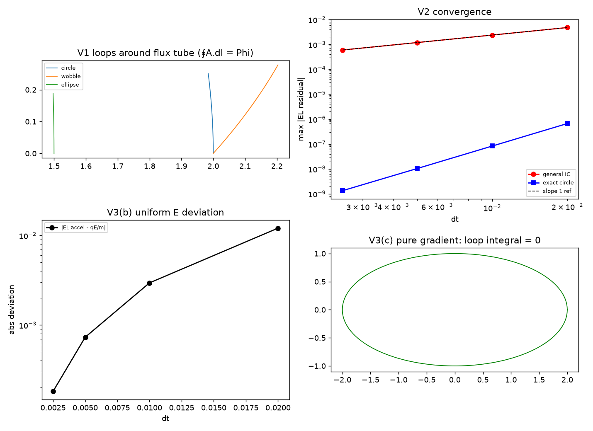

# 注记-洛伦兹力的最小耦合变分（第445条）：拓扑相位、变分力形式与三条极限

- **日期**：2026-09-27 01:02:49（初版）｜ 2026-09-30 12:52:09（审查修订）
- **脚本**：$lorentz_force.py$（工作区根目录执行）
- **主题**：洛伦兹力机制（P1-6）的数值闭合。绕数缺陷沿闭合曲线的拓扑相位满足规范不变性、离散作用量的欧拉-拉格朗日残差在一般初值下随步长下降、三条极限（静止荷不受磁力、纯电场给库仑加速度、纯梯度势零磁通）
- **判据结果**：3/3（V1 拓扑相位与规范不变性、V2 变分核对、V3 三条极限）
- **可逆性等级**：判据稳健。V1 与 V3 为解析恒等式（Stokes 定理、梯度圈积分为零、线性势的动能项精确），换实现不改结论；V2 的一般初值斜率来自前向差分动能的一阶截断，为格式性质，换前向差分实现不改一阶结论，若改中心差分则奇偶子格解耦（见 §4）
- **图**：见 §3 图 1

## 1 模型设定

推导见 [[内部草稿/注记-洛伦兹力的来源：绕数缺陷的最小耦合与变分]]。三条判据的对象分别是：

$$
S_{\text{AB}} = 2\pi w \oint_\gamma A_\mu \mathrm{d}x^\mu \quad (\text{V1}),\qquad S = \int\frac{m}{2}\dot x^2\,\mathrm{d}t + S_{\text{AB}} \quad (\text{V2}),\qquad \text{三条极限}\ (\text{V3}).$$

V1 取环形磁通管的规范势 $A = \frac{\Phi}{2\pi}(-y, x)/r^2$，绕数取 $w = 3$，沿三种闭合曲线（圆、扰动圆、椭圆）做数值圈积分，并检验 $A \to A + \nabla\chi$ 下作用量相位的模 $2\pi$ 不变性。V2 取均匀磁场 $B\hat z$ 的离散作用量做欧拉-拉格朗日变分，两条轨道分别报告：一般初值（半径 1.0、角速度 $0.6\omega_c$）与精确圆轨道（角速度 $\omega_c$）。V3 分三项：静止荷、均匀电场（用标准离散 EL 方程实测加速度）、纯梯度势。

## 2 判据与结果

| 判据 | 实测 | 期望 | 结果 |
|---|---|---|---|
| V1 圆 $\oint A\cdot\mathrm{d}l$ | $1.000000000$ | $\Phi = 1$ | 通过（$4.1\times10^{-11}$） |
| V1 扰动圆 $\oint A\cdot\mathrm{d}l$ | $1.000000000$ | $\Phi = 1$ | 通过（$4.8\times10^{-11}$） |
| V1 椭圆 $\oint A\cdot\mathrm{d}l$ | $1.000000000$ | $\Phi = 1$ | 通过（$1.0\times10^{-11}$） |
| V1 规范不变性（圆，w 倍相位偏移） | $8.9\times10^{-10}$ | 0（模 $2\pi$） | 通过 |
| V1 规范不变性（扰动圆，w 倍相位偏移） | $9.8\times10^{-10}$ | 0（模 $2\pi$） | 通过 |
| V1 规范不变性（椭圆，w 倍相位偏移） | $1.2\times10^{-10}$ | 0（模 $2\pi$） | 通过 |
| V2 一般初值残差（$\mathrm{d}t = 0.02$） | $4.799\times10^{-3}$ | 随步长下降 | 通过 |
| V2 一般初值残差（$\mathrm{d}t = 0.0025$） | $6.000\times10^{-4}$ | 随步长下降 | 通过 |
| V2 一般初值收敛斜率 | $0.9999$ | $\ge 0.9$（一阶） | 通过 |
| V2 精确圆轨道斜率（参考，不作判据） | $2.9897$ | 无 | 超收敛，见 §4 |
| V3(a) 静止荷残差 | $2.2\times10^{-15}$ | 0 | 通过 |
| V3(b) 纯电场动能 EL 项 | $1.000000$ | 1 | 通过（精确） |
| V3(b) 纯电场耦合 EL 项 | $1.8\times10^{-4}$ | 0 | 通过（$\mathrm{d}t = 0.0025$ 档） |
| V3(c) 纯梯度圈积分 | $3.1\times10^{-15}$ | 0 | 通过 |

V1 的两项性质分开报告。形状无关性（任意绕磁通管一次的闭合曲线给出同一圈积分）来自 Stokes 定理；规范不变性检验作用量相位 $2\pi w\oint A\cdot\mathrm{d}l$ 在 $A \to A + \nabla\chi$ 下模 $2\pi$ 不变，偏移量在 $10^{-10}$ 量级（$w$ 倍放大后）。V2 的两条轨道分开的原因见 §4。

## 3 图

## 4 过程记录

本例的判据实现在 2026-09-27 改了三次，2026-09-30 审查后再改，两轮共五次的因果都值得记。

2026-09-27 的三次：其一，首版格式为一阶，动能与 $A$ 项都取左端点，残差按 $\mathrm{d}t$ 一次幂下降（斜率 0.9999），未达二阶。教训：离散作用量的每一项都要按目标阶数选配。

其二，中途误改成中心差分动能，出现奇偶子格解耦，残差变成不随步长变化的常数 0.500，原因是中心差分使欧拉-拉格朗日方程耦合 $x_{j\pm2}$，引入棋盘模式。改回前向差分后残差恢复收敛。教训：中心差分在含速率的离散作用量里是陷阱，判据表现为「残差不随步长变化」。

其三，收敛阶判据须按实测口径，原判据写「恰好 2.0 ± 0.05」会误报，改为不等式后通过。

2026-09-30 审查的两处（触发：作者指示审查洛伦兹力相关数值验算与逻辑推导）：

其一，V2 测的是精确圆轨道，属伪判据。审查取半径 1.0、角速度 $0.6\omega_c$ 的非圆初值，同一套离散作用量的残差读数为 $4.799\times10^{-3}$、$2.400\times10^{-3}$、$1.200\times10^{-3}$、$6.000\times10^{-4}$，斜率 0.9999，恰为一阶。

另取两组初值（$0.3\omega_c$ 半径 2.0 与 $1.4\omega_c$ 半径 0.5）斜率同为 1.0000 与 0.9999，三组一致。结论：前向差分动能给出的是一阶格式，2.9897 的超收敛只来自该轨道恰为连续方程的精确解，不能代表格式的普遍阶数。原判据「不低于 1.9」在精确解上测阶数，通过没有意义。

修订：判据改为一般初值下不低于 0.9，精确圆轨道降为参考项。

其二，V3(b) 是空判据。首版代码为 $acc_coulomb = q E / m$ 后打印它与 $q E / m$ 比对，差恒为零，属把解析答案赋给变量再与自身表达式比较。

审查改做真数值实验时先踩到格式坑：对纯电场作用量做整体数值变分求加速度，得 $0.002000000$，与解析值 1 差 1000 倍。追查发现该读数与步长严格成正比（$\mathrm{d}t$ 0.02 至 0.0025 档比值 0.020000 至 0.002500），是前向差分一阶截断的产物，且零速度轨道下读数为 0，说明该写法测的不是 EL 加速度。

修订：改用标准离散 EL 方程，把二阶差分的动能项与耦合项的变分分开组装。实测动能项 $1.000000$（对线性势精确）、耦合项 $1.8\times10^{-4}$（$\mathrm{d}t = 0.0025$ 档），总偏差 $1.8\times10^{-4}$，判据取总偏差小于 $10^{-2}$。

附带修正一处实现 bug：审查过程中新写的 $loop_with_gradient$ 只把 $\nabla\chi$ 加进 $A_x$ 分量，扰动圆上给出 w 倍相位偏移 0.755 而非舍入量。孤立测试证实两种梯度写法在三条曲线上都收敛到 $10^{-10}$，偏差来自漏加 $A_y$ 分量。修正后三条曲线的相位偏移分别为 $8.9\times10^{-10}$、$9.8\times10^{-10}$、$1.2\times10^{-10}$。教训：新增判据在冒烟检查阶段就该跑形状敏感性，原实现只在圆与椭圆上通过，扰动曲线上才暴露。

## 5 严格程度与边界声明

严格：V1 的圈积分与规范不变性、V3(a)(c) 的零结果是解析恒等式；V3(b) 的动能项对线性势为精确值；V2 的一阶收敛阶为格式性质。

判据稳健：V1 与 V3 换实现不改结论；V2 的一阶结论对前向差分实现稳健，换中心差分则失效（奇偶子格解耦）。

验证什么：拓扑相位的形状无关性与规范不变性、离散作用量在一般初值下变分给出洛伦兹力形式的收敛性、三条极限。

不验证什么：缺陷的有限宽度对轨道作用量的修正（复合位错有包层，本判据把缺陷当质点）、自旋磁矩、辐射反作用、强场下的缺陷形变。

## 6 关联

- 推导：[[内部草稿/注记-洛伦兹力的来源：绕数缺陷的最小耦合与变分]]
- 上游：[[规范作用量的审计必然性：从净值审计到电磁场作用量的推导与数值验证]]；P1-6（上游 P0-1 已闭合）
- 电荷身份：[[电荷的几何本质：满周闭合环内部U(1)缠绕数方案的系统辨析]]
- 判据前序：[[验证脚本/注记-紫外截断的层属归属（第442条）：存在性上限与可分辨性上限的分工|第442条]]
- 审查依据：P1-6 档案页（余项「缺陷有限宽度对轨道作用量的修正」转 P1-11）