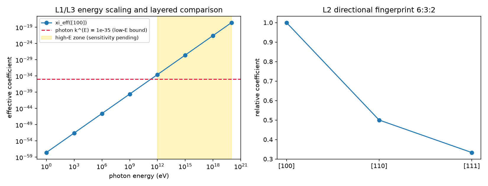

# 注记-洛伦兹破坏高能预言的定量与观测灵敏度对照（第 476 条）：能量依赖、方向指纹与分层对照

- **日期**：2026-09-27 12:16:56
- **脚本**：`验证脚本/minimal_verification_liv_forecast.py`
- **依据**：[[元相子振荡晶格的色散关系：低能光速涌现与洛伦兹破坏首阶项]] §5（能量依赖与方向指纹）；[[验证脚本/注记-首阶洛伦兹破坏的几何来源与方向指纹（判据D1至D5）]]（四阶系数、方向比 $6:3:2$ 与两种能标约定）；[[验证脚本/注记-边际通道的实验上界对照协议：三通道映射、权威来源与待填项]]（上界抄录值与两步协议）；[[内部草稿/开放问题总览：元相子理论待解决问题清单]] P1-9 与 P4-29
- **状态**：判据 4/4 通过（L1 至 L4）。核心读数：能量依赖表八档（$1$ eV 档 $\xi_{\rm eff} = 2.795\times10^{-58}$，与论文登记 $3\times10^{-58}$ 一致；$30$ EeV 档 $2.795\times10^{-18}$）；方向指纹 $[100]:[110]:[111] = 1:0.5:1/3$（清分母 $6:3:2$）；低能段与各上界之比低于 $10^{-5}$ 至 $10^{-47}$；高能段（PeV 至 EeV）效应进入 $10^{-28}$ 至 $10^{-18}$ 区间；该能区对照已于 2026-10-18 由判据第 679 号补齐（体系 $d=6$ 等效能标对 LHAASO 二次界余量 $7.7$ 至 $8.2$ 个数量级，相容但当前不可检验）
- **可逆性等级**：判据稳健（L1 与 L2 为代数与结构事实；L3 为引用工作区抄录值的量级对照；口径警示为定义层事实）
- **图**：见 §3 图 1

## 1 判据与设定

**任务**。P1-9 问「洛伦兹破坏的高能预言能否定量」；P4-29 第四项问「紫外洛伦兹破坏项与极高能伽马射线观测累积灵敏度如何量化」。两者是同一件事的两侧，本注记一次处理。

**设定**。体系侧取首阶结果：$\delta c/c = \xi_{\rm eff}(E)$，其中 $\xi_{\rm eff}(E) = \frac{1}{24}(E/E_P^{(t)})^2$（$[100]$ 为最不利方向），方向依赖为立方四阶不变量给出的 $6:3:2$。观测侧只用工作区[[验证脚本/注记-边际通道的实验上界对照协议：三通道映射、权威来源与待填项|上界注记]]已抄录的值（光子 $k^{(E)} = 10^{-35}$、$\kappa_{tr} = 10^{-20}$；引力 $\bar s = 10^{-11}$），不新引入外部来源。

**判据**。L1 能量依赖表（八档，含与论文登记值的自检）。L2 方向指纹的精确有理比。L3 分层对照：低能段（eV 至 GeV）与已抄录上界逐项比；高能段（PeV 至 EeV）本轮未作对照，并给出误用低能上界的后果（该段对照后由判据第 679 号补齐，按能标对能标口径）。L4 结论与检验靶。

## 2 结果

| 判据 | 内容 | 实测 | 期望 |
|---|---|---|---|
| L1 | $1$ eV 档 $\xi_{\rm eff}$ | $2.795\times10^{-58}$ | 与论文 $3\times10^{-58}$ 一致 |
| L1 | $30$ EeV 档 $\xi_{\rm eff}$ | $2.795\times10^{-18}$ | $\frac{1}{24}(E/E_P^{(t)})^2$ |
| L2 | 方向比 | $1:0.5:0.333333$ | $6:3:2$（精确有理比） |
| L3a | $1$ eV 与光子 $k^{(E)}$ 之比 | $2.8\times10^{-23}$ | 远低于上界 |
| L3a | $1$ GeV 与光子 $k^{(E)}$ 之比 | $2.8\times10^{-5}$ | 仍低于上界 |
| L3b | $30$ EeV 与光子 $k^{(E)}$ 之比 | $2.8\times10^{+17}$ | 该比值不构成物理结论（口径误用） |

## 3 图

## 4 结论

**其一，低能端不可及。** eV 至 GeV 段的体系效应比已抄录上界低 $5$ 至 $47$ 个数量级，当前实验无法触及。

**其二，高能端进入可比区间，对照条件当时未齐（2026-10-18 已补齐）。** PeV 至 EeV 段的效应升至 $10^{-28}$ 至 $10^{-18}$，落在宇宙线 LIV 搜索的关注区间。完成对照所需的两项（该能区灵敏度、两侧系数的量纲换算口径）已由判据第 679 号给出：体系项属 $d = 6$，等效能标 $E_{QG,2} = E_P\sqrt{24/S}$（相位）或 $E_P\sqrt{8/S}$（群速度），六组读数对 LHAASO 二次界 $6\times10^{-8}E_{Pl}$ 的余量为 $7.7$ 至 $8.2$ 个数量级，结论为相容但当前不可检验。

**其三，口径警示（本轮最实质的一条）。** 把高能档的效应与低能常数上界直接相比会读出「超界」的虚假排除，例如 $30$ EeV 档与 $10^{-35}$ 之比为 $2.8\times10^{17}$，$1$ TeV 档与 $10^{-35}$ 之比为 $2.8\times10^{1}$。这两组比值没有物理意义：上界来自低能测量、对应低能灵敏度，而体系的破坏随能量增长。误用的根源是两侧算符维数不同（$d = 6$ 随能量平方增长，$d = 4$ 与能量无关），本条把它显式登记，防止后续被当作排除证据。（2026-10-18 补：换算口径已由判据第 679 号建立，跨维并列的四条规则见判据第 683 号；本条警示继续有效。）

**其四，方向指纹待方向分辨观测。** $6:3:2$ 是体系独有的结构预言，现役装置的多数结果按方向平均给出，检出它需要方向分辨的数据。

## 5 严格程度声明

L1 为解析换算式（代数事实），自检与论文登记值一致；L2 为立方四阶不变量的精确有理比（结构判定）；L3a 为量级对照，被比较的两侧口径不同层（体系的能量依赖系数与观测的常数上界），故只报量级差不作排除结论；口径警示为定义层事实。可逆性等级：判据稳健。

## 6 边界声明

**验证什么**：体系首阶破坏的能量依赖表、方向指纹的精确比、与已抄录上界的低能段量级差，以及高能段对照所缺的条件。

**不验证什么**：其一，不重推色散关系本身（引用既有判据 D1 至 D5）；其二，不新引入外部观测数据，高能段灵敏度抄录属后续；其三，不主张任何排除结论；其四，不改动基准文件。

## 7 过程记录

**首版对照方式错误并修正**：初版把八档能量一律与低能常数上界相比，得出「TeV 以上超界」的读数。复核发现该比较混淆了能量档（上界对应低能灵敏度），改为分层对照并把误用后果写成口径警示。教训：不同能量档的灵敏度不可互换，对照必须先对齐口径。

**绘图参数修正**：`axhline` 的颜色与线型需分参数传递。

## 8 来源

- 能量依赖与方向指纹：[[元相子振荡晶格的色散关系：低能光速涌现与洛伦兹破坏首阶项]] §5；[[验证脚本/注记-首阶洛伦兹破坏的几何来源与方向指纹（判据D1至D5）]]
- 上界抄录：[[验证脚本/注记-边际通道的实验上界对照协议：三通道映射、权威来源与待填项]]
- 脚本：`验证脚本/minimal_verification_liv_forecast.py`（确定性，约 1 秒）
- 图：`images/liv_high_energy_forecast.png`
