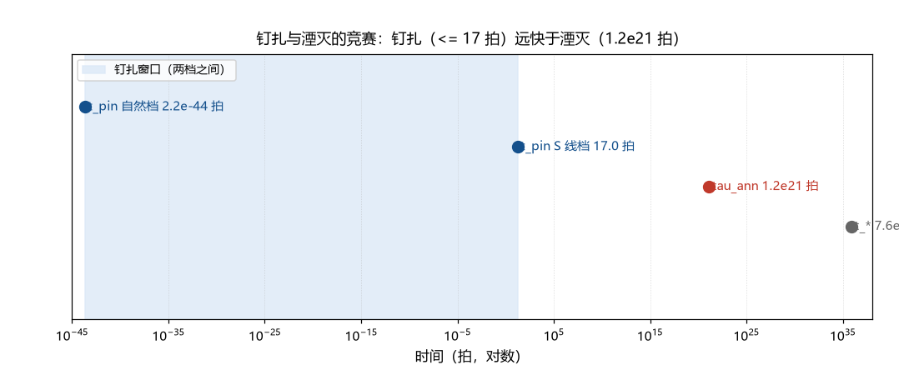

# 注记-湮灭因子 A 的动力学（第411条）：钉扎与湮灭的竞赛

- **日期**：2026-09-25 06:52:39
- **类型**：判定轮（f 线判句二）
- **脚本**：`验证脚本/minimal_verification_annihilation_factor.py`（第 411 条）
- **图**：见 §3 图 1（`images/annihilation_factor.png`）
- **依据**：[[验证脚本/注记-f 线首轮（第398条）：Kibble 链条四环清点与 f 的口径表]]（判句二移交）；[[验证脚本/注记-钉扎密度的门槛（第386条）：位错间距窗口与自然候选的距离]]（捕获截面口径与密度档）；[[粒子与时空的同生：凝固波前的缺陷形成机制]] §3.4（位错钉扎机制）
- **状态**：判定完成。A = 1 从边界假设升格为结构性结论（钉扎远快于湮灭，gap 20 至 65 个数量级）；判句二关闭
- **可逆性等级**：判据稳健（A ≈ 1 的结论由巨大数量级余量保障，换档、换口径不翻；gap 的具体数字随档移动）

## 1 判据与设定

第 398 条把湮灭因子 $A$ 列为判句二。本轮建立「钉扎与湮灭的竞赛」最小模型：缺陷刚形成时同时面对两个过程，与反缺陷相遇（湮灭）和与位错相遇（钉扎）；比较两者的率（Z1、Z2），算钉扎窗口内的湮灭概率（Z3），做门槛反向与综合（Z4）。截面取同款口径（$\sigma = \pi w_{\rm def}^2$，与第 386 条一致），相对速度取光速档 $v = 1$ 格每拍。

## 2 结果

Z1（湮灭）：缺陷刚形成时的密度为 $n_{\rm def} = w_{\rm def}^{-3} = 1.8224\times10^{-65}\,l_P^{-3}$；湮灭率 $\Gamma_{\rm ann} = \sigma v n_{\rm def} = 8.267\times10^{-22}$ 每拍；湮灭时间 $\tau_{\rm ann} = 1.21\times10^{21}$ 拍 $= 6.52\times10^{-23}$ 秒。

Z2（钉扎）：自然档（每格一位错）给 $\Gamma_{\rm pin} = 4.5365\times10^{43}$ 每拍、$t_{\rm pin} = 2.20\times10^{-44}$ 拍；朗道-齐纳窗口档（$n_{\rm pin} = 1.298\times10^{-45}$）给 $\Gamma_{\rm pin} = 0.0589$ 每拍、$t_{\rm pin} = 16.98$ 拍（即第 386 条捕获率窗口的逆读）。

Z3（窗口内湮灭概率）：$\Gamma_{\rm ann} t_{\rm pin}$ 为 $1.82\times10^{-65}$（自然档）与 $1.40\times10^{-20}$（窗口档），即 $A = 1 - O(10^{-20})$ 以内。

Z4（门槛与时间线）：湮灭赶上钉扎要求 $n_{\rm pin} \le n_{\rm def} = 1.82\times10^{-65}\,l_P^{-3}$，该门槛比「每宇宙一位错」（$2.6\times10^{-148}$）仍稀 $7\times10^{82}$ 倍，非物理。时间线为 $t_{\rm pin}$（1 至 17 拍）$\ll \tau_{\rm ann}$（$1.2\times10^{21}$ 拍）$\ll t_*$（$7.6\times10^{35}$ 拍）。

## 3 图

## 4 结论与判句移交

判句二关闭，结论为：**$A = 1$ 从边界假设升格为结构性结论**。依据是钉扎与湮灭的时标差（20 至 65 个数量级，随位错密度档），该差值远超任何不确定度；湮灭要赶上钉扎需要位错密度低于「每宇宙一位错」的 $10^{82}$ 分之一，非物理。

附带读数两条。其一，时间线自洽：钉扎（1 至 17 拍）在相变时标（$7.6\times10^{35}$ 拍）之内完成，湮灭窗口的概率可忽略。其二，钉扎动力学的三个未建模环节（钉扎势深度、脱钉条件、复合体稳定性）不进入本判定，因为 $A$ 的判定只需要「钉扎发生」，不需要「钉扎牢固」。

判句移交：f 线三件判句已关闭两件（本轮的 $A$ 与第 408 至 410 条的判句一）；剩余判句三（两口径命名统一）为半轮小活。

## 5 严格程度与边界声明

严格程度：Z1 至 Z3 为定义加代数的估计（换算级与判据级）；Z4 的门槛反向为算术，综合结论（升格为结构性）由数量级余量支撑（判据级）。

边界：不建立钉扎势模型；截面取同款口径（若缺陷-位错截面与缺陷-反缺陷截面相差悬殊，结论按新口径重算，但其数量级余量足以吸收常见差异）；相对速度取光速档（更慢的速度只放大钉扎先行的余量）；不改第 386、398 条的登记值。

## 6 过程记录

触发：第 398 条判句二移交后开工；第 410 条（超扩散清点）与本条同日的顺序为先 410 后 411（跨线缺口的登记不阻塞本判句）。判定路径：把「湮灭与否」化为两个碰撞率的比较；先算湮灭（用刚形成的缺陷密度），再算钉扎（两个密度档），最后做门槛反向（发现要求非物理）。附带核对：窗口档的钉扎时间 $16.98$ 拍与第 386 条捕获率窗口的逆读一致，两轮口径自洽。
