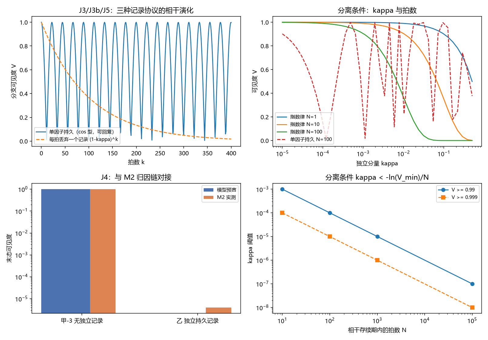

# 注记-滚动记录与持久记录可分性的最小验证：无独立因子条件、两种累积律与重写实现的影响

- **日期**：2026-09-24 02:48:55
- **层级**：验证注记（对应 `验证脚本/minimal_verification_record_separation.py`，`验证脚本/README.md` 第 372 条）
- **图**：见 §三 图 1
- **定位**：执行 [[研究方向-滚动记录与持久记录的可分性判据：退相干率为零的条件与失效标度（判据草案）]] 的首轮读数，判据 J1 至 J6。给出 [[测量的三层判据：从相互作用分层到单次测量机器]] §2.3 与 §6.4 其二所要求的条件，即滚动记录退相干率为零的判据与其失效标度。
- **依据**：[[研究方向-滚动记录与持久记录的可分性判据：退相干率为零的条件与失效标度（判据草案）]]；[[测量的三层判据：从相互作用分层到单次测量机器]]（§2.3 记录的技术定义、§3.2 归因链）；[[注记-相互作用分层判据的最小验证：两协议可见度与生死闸门]]（甲-3 与乙的读数）
- **关联**：[[开放问题总览：元相子理论待解决问题清单]]（测量塌缩的元相子机制）；[[理论攻坚/测量问题攻坚纲领：三条承重墙的闭合]]（裁决点 2 的限制三）
- **状态**：模型内判据级；条件式已给出，$\kappa$ 的场侧取值属 P4-10，本注记未裁定。

---

## 一、模型与协议

模型取两比特：分支空间 $\{|A\rangle, |B\rangle\}$（质心两瓣，振幅各 $1/\sqrt{2}$）与记录空间 $\{|0\rangle, |1\rangle\}$。每拍相互作用取

$$U = |A\rangle\langle A| \otimes I + |B\rangle\langle B| \otimes R_y(\theta),$$

即分支 $A$ 把记录留在 $|0\rangle$，分支 $B$ 把记录转到 $\cos(\theta/2)|0\rangle + \sin(\theta/2)|1\rangle$，两侧记录态重叠 $c = \cos(\theta/2) = 1 - \kappa$。三种协议：从属（记录为源构型的泛函，无可分因子）、单因子持久（同一记录自由度逐拍累积）、每拍新增独立因子或重写。可见度取分支约化态的 $V = 2|\rho_{AB}|/(\rho_{AA}+\rho_{BB})$。

## 二、判据结果

| 判据 | 判据量 | 实测 | 期望 | 结论 |
| --- | --- | --- | --- | --- |
| J1 从属记录 | 表针通道可见度 / 分支边缘纯度 | $1$ / $1$ | $1$ / $1$ | 通过 |
| J2 独立持久记录 | 可见度 | $6.12\times10^{-17}$ | $0$ | 通过 |
| J2 熵量 | 分支熵 / 记录熵 / 互信息（bit） | $1$ / $1$ / $2$ | $1$ / $1$ / $2$ | 通过 |
| J3 单因子持久 | 可见度对 $|\cos(k\theta/2)|$ 最大偏差 | $1.10\times10^{-15}$ | $10^{-12}$ | 通过 |
| J3 回复 | 单因子持久的最小可见度（$k \le 400$） | $0.0051$ | 读数 | 读数 |
| J3b 每拍新增独立因子 | 可见度对 $(1-\kappa)^k$ 最大偏差 | $1.11\times10^{-16}$ | $10^{-12}$ | 通过 |
| J5 后选择式重写 | $k = 100$ 时分支布居 $p_B$ 偏差 | $-0.3819$ | 读数 | 读数 |
| J5 两种重写之差 | 后选择式与迹保持式的可见度差（$k = 100$） | $0.2795$ | 读数 | 读数 |
| J6 冗余拷贝 | 强行张量分解并追踪后的可见度 | $0$ | 读数 | 读数 |
| J4 对接 M2 | 模型预言的甲-3 / 乙 末态可见度 | $1$ / $0$ | $0.999999$ / $4\times10^{-6}$ | 通过 |

## 三、图 1

四面板与脚本绘图面板逐条对应：左上为 J3、J3b、J5 的可见度演化，右上为 $\kappa$ 扫描，左下为 J4 的对接柱状对照，右下为分离条件的阈值反解。

## 四、读数分解

两个极端先被钉住。从属记录的联合对象是单因子纯态，分支边缘的纯度与表针通道可见度同为 $1$，没有可用的混合化。独立持久记录的正交情形给出可见度 $6.1\times10^{-17}$，分支熵与记录熵各 $1$ bit、互信息 $2$ bit，与纯联合态两侧最大混合的期望一致。

两种累积律的差别是实质性的。同一记录自由度逐拍累积时，可见度取 $|\cos(k\theta/2)|$（五档最大偏差 $1.1\times10^{-15}$），在 $k \le 400$ 内最低降到 $0.0051$ 后回升，属有限环境的可回复振荡。每拍关联一个记录后将其丢弃或重置时，可见度严格按 $(1-\kappa)^k$ 单调衰减（最大偏差 $1.1\times10^{-16}$），不可回复。

重写的实现方式进入结论。若把重写实现为投影回记录初态并重新归一（后选择），$k = 100$ 时分支布居被偏置到 $p_B$ 偏离 $0.5$ 达 $0.3819$；与迹保持式重写的可见度相差 $0.2795$。故"每拍重写"既不是保护措施，其自身实现还有额外代价。

与既有归因链的对接成立：甲-3（阻尼无探测器）对应无独立记录，模型给 $1$ 对实测 $0.999999$；乙（同阻尼加探测器阵列）对应独立持久记录，模型给 $0$ 对实测 $4\times10^{-6}$。两组唯一差异为独立记录是否接入，与 M2 的归因链同构。

## 五、结论与对限制三的答复

限制三要求给出滚动记录退相干率为零或可忽略的条件，条件由此写死。退相干率为零当且仅当 $\kappa = 0$，即记录是源构型的泛函、不存在可分因子，此时追踪操作不合法；可忽略当且仅当 $\kappa\,N_{\text{拍}} \ll 1$。阈值表：$N_{\text{拍}} = 10,\,100,\,1000,\,10^{5}$ 时，$V \ge 0.99$ 要求 $\kappa \le 1.0\times10^{-3},\,1.0\times10^{-4},\,1.0\times10^{-5},\,1.0\times10^{-7}$。

一句话概括"属于系统而非环境"的数学内容：**保护来自不存在可分因子，重写本身不提供保护。** 判据 J5 与 J6 把这个分辨钉住了：独立记录无论是否重写都按指数律消耗相干；把从属记录强行当作独立因子并追踪，会把相干杀到 $0$，说明关键在分解是否存在，不在记录的内容。

限制三的自评刃口（若分离失败则碰撞写入升格为普朗克尺度退相干源、判据需修订）在本轮不触发：条件的存在性已给出，且与 M2 的两组读数相容。仍未裁定的是 $\kappa$ 的场侧取值，即真实滚动记录有无独立分量，属 P4-10，本注记不预设。

## 六、严格程度声明

| 结论 | 档位 |
| --- | --- |
| 从属记录的可见度与纯度（J1） | 代数结论（模型内） |
| 独立持久记录的可见度与熵量（J2） | 代数结论（模型内） |
| 两种累积律（J3、J3b） | 代数结论（模型内），实测 $10^{-15}$ |
| 重写两种实现的差异（J5） | 代数结论（模型内） |
| 与 M2 归因链的对接（J4） | 模型级对接，非独立复算 |
| 分离条件 $\kappa \ll 1/N_{\text{拍}}$ | 条件性命题，依赖不可分性前提 |
| $\kappa$ 的场侧取值 | 未做，归 P4-10 |

## 七、边界声明

**验证什么**：两比特模型内，滚动记录保相干的充分必要条件（不可分性）、两种累积律的定量差别、重写两种实现的影响、与本线既有归因链的相容性。

**不验证什么**：真实滚动记录的 $\kappa$ 取值；退相干速率的绝对值与观测对照；三维与缺陷构型；$\kappa$ 与背景相位噪声 $\sigma_\phi$ 的关系。本注记不改动 [[理论总纲/子理论索引]] 与任何基准文档，方案定案由作者裁决。

## 八、过程记录

首版实现有两处错并已纠正。其一，部分迹写成 `np.einsum("aibj->ab", ...)`，把记录指标的两个组合全部求和，使 J2、J3、J3b 首跑读数误为 $1$；改为 `aibi->ab` 后三项全过（$6.1\times10^{-17}$、$1.1\times10^{-15}$、$1.1\times10^{-16}$）。教训：部分迹的下标必须让被追踪的指标配对求和，落盘后须用小例独立核对。其二，J5 首版判据量取"重写档对持久档的可见度比"，该量随拍数振荡、无一致优劣，属设计不当；改为分开两条实现（后选择式与迹保持式）后获得可判定内容。
