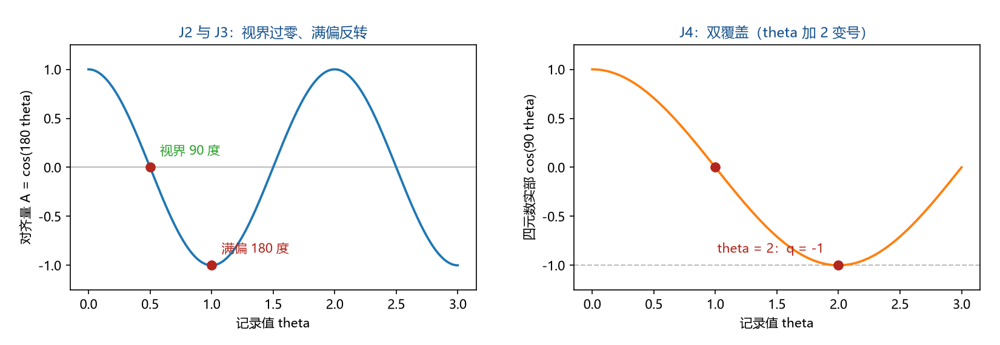

# 注记-满偏角的极限地位：机制失义边界、视界过零与双覆盖锚（J1 至 J5）

## 元数据

- **日期**：2026-09-19 02:38:07
- **依据**：[[内部草稿/注记-记录场读数的角度映射审查：满偏与视界角的三套候选读法]]（三套候选与作者 2026-09-15 几何图像）；[[内部草稿/注记-普朗克质量的角色：引力响应的满量程标度，非空间实体质量]]（满量程标度与开放问题③）；[[内部草稿/注记-GV7：h00的导出链、f的指定与迹型组合的归一化口径]]（角度口径段）；[[验证脚本/注记-T1b-2标架联络扇区的空间拓扑荷：整值绕数在SO3层不可见]]（双覆盖 $Z_2$）；[[内部草稿/开放问题总览：元相子理论待解决问题清单]]（P1-36）
- **定位**：验证材料。把"满偏角极限地位的进一步严格化"（收束总结 §五 遗留项之一）推进为结构判定：极限落在机制有效域的边界上，映射本身没有上限；并给出视界过零与双覆盖锚两条读数。
- **状态**：判据 J1 至 J5 全过。本注记不改动基准文件。

---

## 一、问题

现行裁定（作者 2026-09-15）：倾角到几何角的映射为线性 $\alpha = 180^\circ\times\theta$，视界对应 $90^\circ$（$\theta = 1/2$），满偏对应 $180^\circ$（$\theta = 1$，彻底反转与晶格破坏）。遗留的表述是"满偏角的极限地位待进一步严格化"。

待澄清的歧义有三：其一，"极限"指值域上限（映射在 $\theta = 1$ 饱和）还是机制边界；其二，$\theta > 1$ 的记录是否仍有意义，与"取值空间 $\mathbb{R}$ 非紧致"的裁定是否冲突；其三，该角是否留下可检验的群论指纹。

## 二、模型与判据

模型：取向向量 $o(\theta) = \cos\alpha\,n + \sin\alpha\,e$（$n$ 为法线方向，$e$ 为横向单位向量），对齐量 $A(\theta) = o\cdot n = \cos\alpha$；标架侧取转角 $\alpha$ 的旋转 $R$ 与其 SU(2) 提升 $q(\theta) = (\cos(90^\circ\theta), \sin(90^\circ\theta)\,k)$。

判据与结果（脚本 `验证脚本/minimal_verification_full_deflection_angle.py`，复现命令 `python 验证脚本/minimal_verification_full_deflection_angle.py`）：

| 判据 | 内容 | 期望 | 实测 |
| --- | --- | --- | --- |
| J1a 共轴可加性 | $R(\theta_1)R(\theta_2) = R(\theta_1+\theta_2)$，三组轴 | $\le 10^{-12}$ | $9.99\times10^{-16}$ |
| J1b 增益恒常 | 角复原偏差，$\theta$ 覆盖 $0.02$ 至 $0.98$ | $\le 10^{-9}$ 度 | $5.68\times10^{-14}$ 度 |
| J1c 异轴换序 | 60 度异轴换序偏差（诚实边界） | $O(\alpha^2)$ | $0.750$ |
| J2 视界过零 | $A(1/2)$；$A(0.49)$ 与 $A(0.51)$ | $0$；异号 | $6.1\times10^{-17}$；$+0.0314$ 与 $-0.0314$ |
| J3 满偏反转 | $A(1)$；特征值；$R(1)^2$ | $-1$；$(-1,-1,1)$；恒等 | 全过，偏差 $\le 2.4\times10^{-16}$ |
| J4 双覆盖锚 | $q(1)^2$；$q(1)^4$；$q(2)$；$\vert q(\theta+2)+q(\theta)\vert$ | $-1$；$+1$；$-1$；$0$ | 全过，偏差 $\le 3.3\times10^{-16}$ |
| J5 非紧致相容 | $\theta = 1.5,\, 2,\, 3.7,\, 10,\, 100$ 映射良定 | 周期重复 | 全过 |

严格程度：J1a、J1b、J2、J3、J4 为机器精度级（解析事实的数值复核），J1c 与 J5 为口径级登记。

## 三、结果解读

**极限落在机制边界上。** J1b 的增益恒常说明映射在 $\theta = 1$ 处没有饱和：线性延伸在 $\theta > 1$ 依然良定（J5）。"满偏"标出的是取向完全反向这一构型事件。它与"取值空间 $\mathbb{R}$ 非紧致"的裁定相容：非紧致说的是读数可以取任意实数值，机制域说的是哪些读数对应可运行的晶格构型。

**视界：对齐量过零。** J2 给出 $A(1/2) = 0$，且在两侧异号。这与审查注记 §九 的几何图像一致：越过 $90^\circ$ 后取向转向背侧，观察者读不到。数字 $1/2$ 是弱场坐标系的投影，承载物理的是零点本身（同审查注记 §十）。

**满偏：$180^\circ$ 元素的阶分歧。** J3 给出 $A(1) = -1$，且该旋转是 SO(3) 的二阶元（$R^2 = 1$）。

J4 给出其 SU(2) 提升为四阶元（$q^2 = -1$，$q^4 = +1$），并给出周期覆盖 $q(\theta+2) = -q(\theta)$。满偏角恰落在 SO(3) 与 SU(2) 阶数分歧的那个角度上：几何层面"彻底反转"两次可回到恒等，旋量层面它留下 $-1$，要绕满两圈（$\theta = 2$，即 $360^\circ$）才回到 $+1$。这与 T1b-2 轮给出的双覆盖 $Z_2$ 结构直接衔接。

**非紧致相容。** J5 的采样显示 $\theta$ 取 $10$、$100$ 时读数按周期重复，映射始终良定；机制失义发生在 $\theta = 1$，此后的读数描述的是已破坏构型的形式延伸。故"满量程标度"的准确含义是机制的有效量程，与读数值域的紧致性无关。

## 四、诚实边界

其一，本验证证明的是"映射取线性时，满偏角的几何身份"；线性本身来自作者 2026-09-15 的几何图像裁定，不在本脚本的证明范围。

其二，本脚本不模拟格点动力学：晶格破坏与跃迁无法完成是机制层的既有结论，本轮未重算。

其三，异轴情形的字面可加性不成立（J1c 给出 $O(\alpha^2)$ 量级），框架内角度挂在同一法线轴上，取共轴支；若未来引入异轴复合（例如多轴缠绕的缺陷），该项须重做。

其四，双覆盖锚的物理实现（费米子侧）由既有材料承担，本轮只给群论读数。

## 五、过程记录

两处实现订正，均属几何取错产生的假读数：对齐量一度取"轴向量自身"（轴在旋转下不动，读数恒为 $+1$），改为横向取向分量；周期检验一度写成四元数乘积（恒不为零），改为直接核对 $q(\theta+2) + q(\theta)$。教训是对齐量必须取在会动的那个量上。

## 六、登记衔接

其一，`验证脚本/README.md` 第 141 条（本材料）。其二，开放问题总览 P1-36 关联子项补状态：满偏角的极限地位由本注记给出结构判定。其三，[[内部草稿/注记-普朗克质量的角色：引力响应的满量程标度，非空间实体质量]] §五 ③ 补状态：极限地位（边界性质）已获判定，写规则 $\delta\theta = m/m_P$ 的地位不变。其四，本注记不改动基准文件；若作者裁决固化，落点建议为时空观 §7 的角度口径段。
