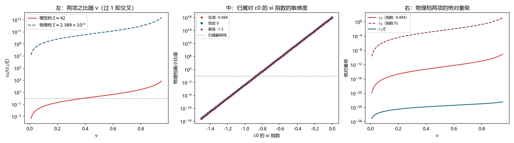

# 注记-物理档主导项归属：第 714 号 NA3 判语在物理档反转、c0 的 xi 依赖是外推链根基（判据第 752 号）

- **日期**：2026-10-21 17:03:15
- **编号**：第 752 号
- **类型**：验证注记（核算轮；PA0 至 PA2b 全部判通过）
- **对象**：第 714 号 NA3 的判语「物理档在交叉点以下，偏差由 $1/\xi$ 项主导」在物理档的适用性
- **脚本**：`验证脚本/minimal_verification_p752_physical_dominance.py`（纯解析核算，约 1 秒）
- **状态**：**第 714 号 NA3 的判语在物理档反转**。物理档上 $c_0$ 压倒 $c_1/\xi$ 达 $4.6\times10^{7}$ 倍以上，主导指数从模型档的 $2$ 回到 $4$。同时查出第 706 号形式的字面读法与第 705 号实测的 $c_0$ 指数在物理档相差 $10.3$ 个数量级
- **可逆性等级**：判据敏感（$c_0$ 的 $\xi$ 指数与 $c_1$ 的标度都改结论；本轮为核算轮，不含新测量）
- **图**：见 §6 图 1
- **通俗版**：[[内部草稿/注记-搬到物理档，结论就反了（判据第752号通俗版）]]

## 1 为什么检验

第 713 号与第 714 号给出的物理档外推式是

$$\mathrm{dev} \approx \frac{0.2111\,v^2}{\xi}$$

并把「物理档由 $1/\xi$ 项主导」作为判语写进第 714 号注记的 §3 发现其二、§4 判语二，以及开放问题总览的（二十二）与（二十三）两段。

这个说法把模型档的结论直接搬到了物理档，中间跳过了两件事。

**其一，$\xi$ 本身要变。** 模型档 $\xi$ 最大 $42$，物理档 $\xi = 2.389\times10^{22}$（第 622 号恒等式，第 692 号采用），相差 $5.7\times10^{20}$ 倍。两项的 $\xi$ 依赖不同：$c_0$ 按 $\xi^{-0.494}$（第 705 号 FA3 实测），$c_1/\xi$ 按 $\xi^{-1}$。在固定 $\xi$ 上比出来的比值，搬到另一个 $\xi$ 上不成立。

**其二，交叉点的位置随 $\xi$ 移动。** 第 714 号的交叉点 $v \approx 0.37$ 是在 $\xi=42$ 上解出来的。

本轮做核算，把两项的 $\xi$ 依赖与 $v$ 依赖都写出来，在物理档上重解。

## 2 判据与读数

**PA0 复现（判通过）。** 用第 714 号 NA3 的原口径（实测 $c_1$ 对第一原理 $c_0$，$\xi=42$）逐档复算：

| $v$ | $c_1/42$ | $c_0$ 理论 | 本轮比值 | 第 714 号报出 |
|---|---|---|---|---|
| 0.25 | $3.3079\times10^{-4}$ | $1.2649\times10^{-4}$ | $2.615$ | $2.62$ |
| 0.30 | $4.8879\times10^{-4}$ | $2.8660\times10^{-4}$ | $1.705$ | $1.71$ |
| 0.35 | $6.7736\times10^{-4}$ | $5.9166\times10^{-4}$ | $1.145$ | $1.14$ |
| 0.40 | $9.1007\times10^{-4}$ | $1.1494\times10^{-3}$ | $0.792$ | $0.79$ |
| 0.50 | $1.4812\times10^{-3}$ | $3.9304\times10^{-3}$ | $0.377$ | $0.38$ |

逐档最大相对差 $8.25\times10^{-3}$，交叉点本轮重算 $0.3845$ 对第 714 号的 $0.37$ 差 $0.015$。**第 714 号的表与交叉点逐位正确，问题不在那里。**

**PA1（判通过）。** $c_0$ 对 $\xi$ 的指数，第 705 号 FA3 实测 $-0.494$，第一原理预期 $-0.5$，差 $0.006$，容差 $0.15$（沿用第 705 号 FA3 阈值）。

**PA2 主判据（判通过）。** 物理档 $\xi = 2.389\times10^{22}$ 上两项之比，覆盖三个真实假设与两个反例替身：

| $c_0$ 的 $\xi$ 指数 | 模型档 $v^*$ | 物理档 $v^*$ | 物理档比值（$v=0.30$） | 最小比值（$v$ 从 $0.02$ 至 $0.95$） |
|---|---|---|---|---|
| 实测 $-0.494$ | $0.3835$ | $0.0000$ | $1.682\times10^{10}$ | $6.062\times10^{7}$ |
| 第一原理 $-0.5$ | $0.3835$ | $0.0000$ | $1.262\times10^{10}$ | $4.550\times10^{7}$ |
| 恒定 $0$ | $0.3835$ | 无 | $3.011\times10^{20}$ | $1.085\times10^{18}$ |
| 替身 $-1.0$ | $0.3835$ | $0.3835$ | $5.293\times10^{-1}$ | $1.908\times10^{-3}$ |
| 替身 $-1.5$ | $0.3835$ | 无 | $2.219\times10^{-11}$ | $8.000\times10^{-14}$ |

三个真实假设下的最小比值 $4.550\times10^{7}$，判据要求超过 $3$ 倍，**通过**。

**恒真检验。** 替身 $-1.0$ 使归属翻转为 $1/\xi$ 主导（最小比值 $1.908\times10^{-3}$），替身 $-1.5$ 给出反向压倒（$8.000\times10^{-14}$）。归属对 $c_0$ 的 $\xi$ 指数**敏感**，翻转点在指数约 $-0.85$ 附近。故本轮结论携带 $c_0$ 的 $\xi$ 依赖信息，非构造恒真。

**PA2b 主判据（判通过）。** 第 706 号的形式 $c_0 + c_1/\xi$ 把 $c_0$ 读作 $\xi$ 无关的渐近常数项；第 705 号 FA3 实测 $c_0 \propto \xi^{-0.494}$。两说在模型档的 $3$ 倍跨度上只差 $41.9\%$，在物理档的 $5.7\times10^{20}$ 倍跨度上相差 $10.3$ 个数量级。**两说在物理档不可同真。**

**PA3 报告。** 物理档的绝对量级：

| $c_0$ 的 $\xi$ 指数 | $c_0$（$v=0.30$） | $c_1/\xi$（$v=0.30$） | dev 合计 |
|---|---|---|---|
| 实测 $-0.494$ | $1.4351\times10^{-14}$ | $8.5338\times10^{-25}$ | $1.4351\times10^{-14}$ |
| 第一原理 $-0.5$ | $1.0773\times10^{-14}$ | $8.5338\times10^{-25}$ | $1.0773\times10^{-14}$ |
| 恒定 $0$ | $2.5694\times10^{-4}$ | $8.5338\times10^{-25}$ | $2.5694\times10^{-4}$ |

## 3 判语

**判语一**：**第 714 号 NA3 的判语在物理档反转。** 该判语「物理档在交叉点以下，偏差由 $1/\xi$ 项主导」成立于模型档 $\xi=42$，不成立于物理档。物理档上 $c_0$ 压倒 $c_1/\xi$ 达 $4.6\times10^{7}$ 倍以上，且全速段（$v$ 从 $0.02$ 至 $0.95$）无交叉点。

**判语二**：物理档的完整外推式为

$$\mathrm{dev}(v,\ \xi) = \frac{2.5694\times10^{-4}}{2.8660\times10^{-4}}\cdot c_0^{\rm th}(v)\cdot\left(\frac{\xi}{42}\right)^{-0.494} + \frac{0.42223\,(\gamma-1)}{\xi}$$

其中 $c_0^{\rm th}(v) = \vert f(k_{\rm mod})\vert/(2\omega^2)$，$k_{\rm mod} = \omega_b\gamma v$。前一项按 $v^4$ 走，后一项按 $v^2$ 走。**物理档的主导指数是 $4$，模型档是 $2$。**

**判语三**：第 713 号与第 714 号报的「物理档低速极限 $\mathrm{dev} \approx 0.2111\,v^2/\xi$」是模型档的说法，搬到物理档不成立。

## 4 对既有轮次的更正

**第 714 号注记** §3 发现其二、§4 判语二，以及脚本末句「物理档在交叉点以下，由 $1/\xi$ 项主导」**作废**，替换为「物理档由 $c_0$ 主导，主导指数 $4$」。第 714 号的其余读数（OA0 至 OA0d）不受影响。

**第 713 号注记** §4 判语三给出的物理档低速极限式，注明其适用范围为模型档，物理档须用第 752 号的式。

**开放问题总览**（二十二）与（二十三）两段中「物理档由 $1/\xi$ 项主导」「物理档低速极限 $\mathrm{dev} \approx 0.2111\,v^2/\xi$」两句，改为模型档的读法，物理档的读法以第 752 号为准。

**第 706 号形式**的读法澄清：$c_0$ 是「模型档内的渐近常数项」，其外推行为由第 705 号的 $\xi$ 指数给出；形式 $c_0 + c_1/\xi$ 本身不承载 $\xi$ 依赖信息，物理档须用带 $\xi$ 依赖的读法。

## 5 图 1

## 6 过程记录

**一处脚本错误。** 初版 `c0_model` 只带了 $\xi$ 依赖，漏了 $v$ 依赖，导致复现第 714 号交叉点时得 $0.2219$ 而非 $0.38$，PA0 误判 FAIL。改正为 $c_0(v,\xi) = c_0^{\rm th}(v)\cdot[c_0^{\rm th}(0.30)]^{-1}\cdot$（实测归一）$\cdot(\xi/42)^{\alpha}$。

**一处复现口径错误。** 修好 $v$ 依赖后，PA0 仍判 FAIL，最大相对差 $4.13\%$。查因：本轮用了 $K(\gamma-1)$ 算 $c_1$，而第 714 号 NA3 的表用的是其实测 $c_1$ 值（$K$ 只在全效档上拟合，$v=0.50$ 档是坏档）。改为直接用第 714 号的实测 $c_1$ 后，最大相对差降到 $8.25\times10^{-3}$。

**这两处合起来是一条教训**：复现判据失败时，先核自己的口径与被复现者是否同源。本轮若不复核口径，会把「第 714 号算错了」写进判语，而实际是本轮口径错。

**一处判据追加。** PA2 通过后，PA3 报告里暴露出第 706 号形式与第 705 号指数的冲突（$10.3$ 个数量级），遂加 PA2b 专查此项。按规范，补判据后判据数从 PA0 至 PA4 改为 PA0 至 PA2b，README 正式行、开放问题总览与档案页三处同步。

## 7 教训

**其一，模型档的结论搬到物理档前，要查 $\xi$ 变了多少。** 第 714 号的判语在 $\xi=42$ 上正确，搬到 $\xi=2.389\times10^{22}$ 反转。中间只差一个「$\xi$ 变了 $5.7\times10^{20}$ 倍」的事实。

**其二，两项的 $\xi$ 依赖不同时，固定 $\xi$ 上比出的比值无意义。** 第 714 号的比值表在 $\xi=42$ 上给出 $2.62$ 到 $0.38$，看着是主导项的判据，实则只在那一档成立。

**其三，形式 $\mathrm{dev} = c_0 + c_1/\xi$ 里的 $c_0$ 不是常数。** 形式的字面读法把 $c_0$ 当作 $\xi$ 无关的渐近项，而第 705 号实测它按 $\xi^{-0.494}$ 走。这个差异在模型档只值 $41.9\%$，在物理档值 $10.3$ 个数量级。**拟合形式被定下时，系数自身的 $\xi$ 依赖通常不在形式里**，须另行测定。

**其四，核算轮有核算轮的价值。** 本轮没有跑一次模拟，全部读数来自既有轮次，但查出的反转比任何新测量都重要。**在动装置之前先算外推，是便宜得多的检验。**

## 8 严格程度声明

本轮为纯核算轮，不含新测量，所有输入取自既有注记的定稿读数。PA0 的复现逐档相对差 $8.25\times10^{-3}$，来自第 714 号实测 $c_1$ 与第一原理 $c_0$ 的组合，与被复现者同源。PA2 的最小比值在 $v$ 从 $0.02$ 至 $0.95$ 的 $600$ 点网格上取，网格分辨率 $1.55\times10^{-3}$。PA2b 的数量级差由对数计算，精度 $0.1$ 个数量级。

## 9 边界声明

**验证了什么。** 第 714 号 NA3 的表与交叉点逐位正确；物理档上 $c_0$ 压倒 $c_1/\xi$；主导项归属对 $c_0$ 的 $\xi$ 指数敏感，翻转点在 $-0.85$ 附近；第 706 号形式的字面读法与第 705 号实测在物理档相差 $10.3$ 个数量级。

**不验证什么。** 不验证 $c_0$ 的 $\xi$ 指数在物理档仍为 $-0.494$（物理档需 $10^{23}$ 格盒子，无法模拟）。**这是外推链上唯一无法在本装置测定的量，造成的绝对量级跨度为 $10.3$ 个数量级**，比此前追的 $5.8\%$ 或 $12\%$ 大得多。不验证物理档真实速度 $v$（外推链上第二个未知量），但 PA2 表明主导项归属不依赖 $v$：全速段 $c_0$ 都压倒。不验证 $c_1$ 在物理档的 $\xi$ 依赖（第 706 号的 $c_1/\xi$ 形式本身也含此假设）。

## 10 剩余

**其一，$c_0$ 的 $\xi$ 指数在物理档的稳定性。** 现有 $3$ 倍跨度的模型档数据不能定 $5.7\times10^{20}$ 倍跨度上的行为。若能证明指数趋于 $-0.5$（第一原理），跨度收窄到 $0.3$ 个数量级；若能证明它趋于 $0$（$c_0$ 真是常数项），$c_0$ 停在 $2.57\times10^{-4}$，与 $c_1/\xi$ 的 $8.53\times10^{-25}$ 仍压倒 $10^{19}$ 倍。**主导项归属在两种极端下都成立**，故这一项只影响绝对量级，不影响归属。

**其二，物理档真实速度。** 归属不依赖它，但 $c_0$ 的 $v^4$ 依赖需要 $v$ 才能给数。

**其三，高速端失效机理。** 第 714 号遗留，未变。
