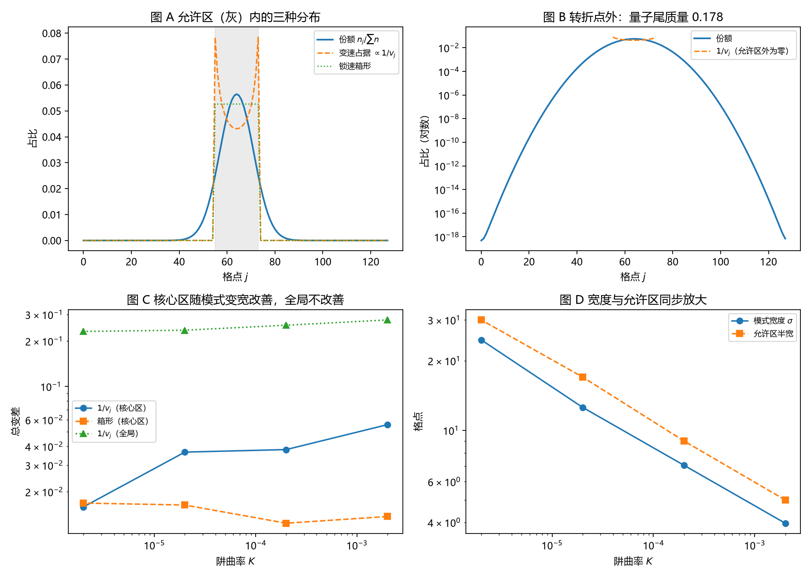

# 注记-独立载子经典占据的最小验证：经典占据给不出份额

- **日期**：2026-09-18 05:33:09
- **对应脚本**：`验证脚本/minimal_verification_carrier_occupancy_wkb.py`（判据 J1 至 J6，7/7 通过；确定性；运行约 11 秒；图存 `images/carrier_occupancy_wkb.png`，见 §一 图 1）
- **依据**：[[注记-载子身份与呼吸模式的最小验证：计数跟时间平均份额走]]（第四轮）；[[注记-载子钟与激发数的最小验证：率口径给不出份额]]（第三轮）；[[研究方向-碰撞动力学的抽样机制：三个候选模型与优选]]；[[序参量份额定理：Born规则、归一化与幺正性的系综推导]] §4.1、§7.1；[[内部草稿/开放问题总览：元相子理论待解决问题清单]] P3-12
- **定位**：第五轮机制面执行，也是"独立载子动力学"这一环的首轮。检验载子的经典时间占据能否给出份额 $n_j/\sum n$，即份额是否只是"慢处待得久"的经典效应。本注记不改动基准文件。
- **状态**：判据 7/7 通过，结论为否定：经典占据给不出份额。核心读数：核心区变速占据 $1/v_j$ 与份额的相关系数 $-0.999$（反相关）；核心区两种经典占据的总变差都 $<0.06$（箱形 $0.0137$ 至 $0.0168$，变速 $0.0159$ 至 $0.0557$）；全局总变差 $0.2316$ 至 $0.2760$，对阱曲率的斜率 $0.026$（不随模式变宽收敛）；量子尾质量 $0.164$ 至 $0.219$（斜率 $-0.033$）。

---

## 一、判据与结果

| 判据 | 内容 | 通过条件 | 实测 |
|---|---|---|---|
| J1 | 核心区经典占据与份额的关系 | 反相关（$r < -0.99$） | $-0.9995$ 至 $-0.9983$ |
| J2a | 核心区两种经典占据同量级 | 都 $< 0.06$ | 箱形 $0.0124$ 至 $0.0168$；变速 $0.0159$ 至 $0.0557$ |
| J2b | 全局总变差 | $> 0.2$ | $0.2316$ 至 $0.2760$ |
| J3 | 量子尾质量 | $> 0.15$ 且平缓 | $0.164$ 至 $0.219$（斜率 $-0.033$） |
| J4 | 全局失败的结构性 | 斜率绝对值 $< 0.3$ | $0.026$ |
| J5 | 归一化 | $< 10^{-12}$ | $2.22\times10^{-16}$ |
| J6 | 偏差三区分解 | 尾区贡献 $> 0.25$ | 核心 $0.069$ 至 $0.202$、过渡约 $0.46$ 至 $0.50$、尾区 $0.298$ 至 $0.472$ |

图注：左上为份额、变速占据与锁速箱形在允许区（灰色）内的对照；右上为对数坐标下的量子尾（转折点外份额不为零，经典占据为零）；左下为三种总变差随阱曲率的变化（核心区两条随宽度改善，全局一条不改善）；右下为模式宽度与允许区半宽随阱曲率同步放大。

## 二、模型设定

一维闭链 $L = 128$，$l_P = t_P = 1$，包络场取标准符号（带底在 $q = 0$，对应低能长波模式）

$$i\dot A_j = -\kappa\,\Delta A_j + V_j A_j,\qquad V_j = \tfrac12 K (j-j_c)^2,\quad \kappa = 1,$$

基态由虚时梯度流求得，本征值 $E_0$ 取站点相位推进率的均值。经典占据的两种候选：变速占据由能量守恒给出局域动量 $x_j = (E_0 - V_j)/(4\kappa)$、群速 $v_j = 4\kappa\sqrt{x_j(1-x_j)}$，占据 $\propto 1/v_j$；锁速箱形取允许区内均匀。允许区由 $0 < x_j < 1$ 定义，核心区取 $|j-j_c| \le$ 允许区半宽的一半，份额取 $n_j = |A_j|^2$ 归一化。

## 三、读数的意义

**经典占据给不出份额。** 核心区里变速占据与份额是反相关的（$r = -0.999$）：经典粒子在两端慢、待得久，于是占据在靠近折返点处最高；份额是模式密度，在中间最高、向两端衰减。两者形状相反，这一条把"份额来自经典时间占据"的设想直接排除。

全局差距不因模式变宽而消失。全局总变差在四档阱曲率下为 $0.2316$ 至 $0.2760$，对阱曲率的双对数斜率是 $0.026$（J4），即没有任何收敛趋势。量子尾质量稳定在 $0.164$ 至 $0.219$（J3），转折点之外份额不消失，经典占据在那里为零。

偏差的来源是三段。三区分解给出核心区贡献 $0.069$ 至 $0.202$、过渡区约 $0.46$ 至 $0.50$、尾区 $0.298$ 至 $0.472$（J6）。过渡区（转折点附近）占了一半，说明失败源自分布形状整体错位，与单端边界效应无关。

**这一环的结论。** 载子的经典轨迹只提供"允许区"这个舞台，不提供分布形状。份额的形状必须来自波性侧，也就是模式自身的相干结构。这条读数与体系"波主粒从"的立场一致，也把上一轮"载子 = 激发量子"的身份进一步收紧：激发量的分布属集体侧量，与经典占据量分属两类。

## 四、与原预期的关系

原设定预期"占据 $\propto 1/v_j$ 在核心区给出份额（WKB 极限）"，实测被推翻，原因有两层。其一，这里的份额是**基态型模式密度**，它属波对象：半经典对应属于高激发态，基态本身没有经典对应，其密度与经典占据形状相反。其二，转折点之外的隧穿尾在经典占据里没有对应物，且质量稳定在两成上下，不随模式变宽消失。

因此本轮登记的是一条边界：经典占据律（含 WKB 变速律与锁速箱形）在份额问题上的适用范围为零，除非把份额换成经典振子的时间分布。份额与经典时间占据的差别属对象性质之别，非修正量级之别。

## 五、严格程度声明

J1、J2、J6 是分布比较的数值读数（总变差、相关系数、三区分解）；J3、J4 是标度读数（对阱曲率的双对数斜率）；J5 属机器精度核对。模型本身（标准符号的紧束缚包络方程、平方型阱、两种经典占据候选）属最小模型假设，结论只能在"若采用该模型"的条件下引用。

## 六、边界声明

本验证只做：一维闭链、基态型束缚模式、两种经典占据候选与份额的对照、随模式宽度的标度。

本验证不做：载子之间的碰撞与相互作用；高激发态模式（半经典对应真正适用的区域）；三维与缺陷构型；开链边界；测量耦合；把占据分布与计数口径连成一条完整链条（第三、四轮已给出计数口径，本轮只判定占据形状）。

## 七、过程记录

判据先写错三处，全部由实测推翻后订正。其一，原以"核心区正相关 $>0.99$"为判据，实测为 $-0.9995$，订正为反相关判据（这条同时推翻了"经典占据给出份额"的原设想）。其二，原以"偏差集中在转折点之外（尾区贡献 $>0.8$）"为判据，实测尾区只占 $0.30$ 至 $0.47$，订正为三区分解读数。其三，原以"核心区变速占据优于锁速箱形"为判据，实测四档中箱形三档更优且差异无系统性，订正为"两者同量级"。

效率记录：脚本约 11 秒，无字体问题。本轮起模型改用标准符号（带底在 $q=0$），与第三、四轮的带边模式区别在注记 §二 写明。
