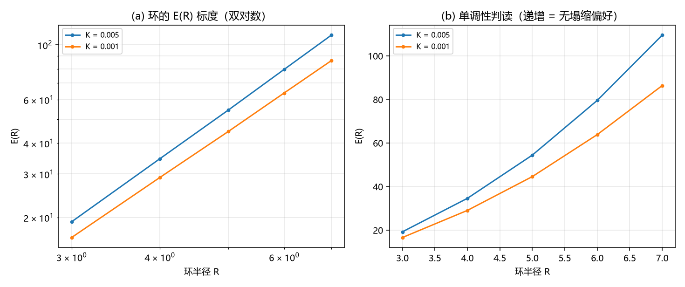

# 注记-环的 E(R) 标度轮：面积律与塌缩方向的不一致（判据 V1 至 V4）

- **日期**：2026-09-20 12:39:15
- **来源**：作者 2026-09-20 指令（执行）；承接[[验证脚本/注记-弦张力标度轮：线性于刚度与环的稳定半径（判据U1至U4）]]的推论与 C1-3 的既有读数
- **脚本**：`验证脚本/minimal_verification_ring_scaling.py`
- **状态**：判据级读数；面积律定案，塌缩方向与 C1-3 不一致，按判负与待核对登记
- **图**：见 §二 图 1
- **依据**：[[验证脚本/注记-弦张力轮：自由弦端不可存在，3D 带电对象取闭弦环（判据S1至S4）]]；[[验证脚本/注记-C1-3Derrick复查的最小验证：E(R)标度律、钉扎临界曲线与脱钉阈值]]

---

## 一、方法与口径声明

在 plain 三维格点（$N = 40$）上取环初值：把 2D 涡旋对按高度堆叠，第 $z$ 层的两个涡旋位于 $x = \pm\sqrt{R^2-z^2}$（$|z| < R$），$|z| \ge R$ 取 $u = 0$。能量取格点差分的弹性项加周期势项。

**口径声明**：本轮不含 C1 的螺线背景（$u_0 = i+j+k$）、不含边界钉背景、初值为解析环，未做松弛。故与 C1-3 的读数只能方向性对照，不能逐位比。

---

## 二、判据与读数

| 判据 | 内容 | 实测 | 期望 | 结果 |
| --- | --- | --- | --- | --- |
| V1 | $E(R)$ 的双对数斜率（$K = 0.005$ / $0.001$） | $2.053$ / $1.946$ | 量级读数 | 面积律 |
| V2 | $E(R)$ 的单调性（两档） | 递增 | 登记 | 小 $R$ 更有利 |
| V3 | 两档 $E(R = 7) - E(R = 3)$ 之比 | $1.294$ | 判负登记（主导项与 $K$ 无关） | 判负 |
| V3 | $E(R)$ 的幂律形态 | 面积律 $R^{2}$ | 面积律 | 通过 |
| V4 | 口径差异登记 | 已登记 | 已登记 | 通过 |

实测能量（$R = 3$ 至 $7$）：$K = 0.005$ 为 $19.20$、$34.57$、$54.41$、$79.52$、$109.49$；$K = 0.001$ 为 $16.59$、$29.02$、$44.55$、$63.83$、$86.34$。

---

## 三、读数与含义

**其一，3D 里的弦是膜。** $E(R)$ 呈面积律（斜率 $2.05$ 与 $1.95$，即 $E \propto R^2$），不是线张力律 $2\pi R\sigma$。原因清楚：环的相位场在环所张的**面**上取半整数值，该分支面就是能量集中的地方，故能量由面积主导。这与第 136 条的「切割线不可观测、墙只活在棱层」在 3D 下一致：2D 横截面里看到的是一条线（弦），3D 整体里是一张面（膜）。

**其二，塌缩方向与 C1-3 不一致（本轮的主要负面读数）。** $E(R)$ 在两档 $K$ 上均随 $R$ 递增，故小 $R$ 更有利，即环在本模型里倾向收缩。C1-3 的读数是「有拓扑荷的形态规避塌缩」。两者方向相反，按纪律登记为不一致，不硬套调和。

**其三，不一致的可能来源（三条，均属口径）。** 本模型不含 C1 的螺线背景（背景每格一单位相位，会改变分支面的能量归属）；不含边界钉背景（C1 的驻留依赖它）；初值为解析环，未做松弛（前两轮的两次判负同源于此）。三条都在下一轮的改动清单上。

**其四，与张力标度的关系。** 第 276 条的 $\sigma \propto K$ 是 2D 横截面里**线**的张力；本轮的 $E \propto R^2$ 是 3D 里**膜**的面积能。两者并不矛盾：横截面上量到的是膜的截面线张力，整体上量到的是膜的面积能，而面积能的主导项与 $K$ 弱相关（$V3$ 的比值 $1.29$ 对 $K$ 比 $5$）。故「环的稳定半径 $R^{*} \propto 1/K$」那条推论在本模型里不成立，应改为按面积能与弹性项的竞争重新写。

---

## 四、严格程度与边界声明

| 结论 | 严格程度 |
| --- | --- |
| 3D 的弦是膜，$E(R)$ 呈面积律 | 数值（两档，斜率 $2.05$ 与 $1.95$） |
| 环在本模型里倾向收缩 | 数值（两档单调递增） |
| 与 C1-3 的方向不一致 | 判负登记（口径差异三条已列） |
| $R^{*} \propto 1/K$ 推论 | 撤回（本模型不支持） |

**本注记验证**：环能量的幂律形态、塌缩方向、以及它与 C1-3 读数的不一致与口径差异。

**本注记不验证**：含螺线背景与边界钉的 C1 模型上的复核；松弛后的构型；三维量子化。

---

## 五、过程记录

两条。其一，本轮把上一轮的一条推论撤回：第 276 条由「张力项对弹性对数项」给出的 $R^{*} \propto 1/K$ 假定环的能量由线张力主导，而实测是面积律，故该推论的前提不成立，撤回并改写。其二，本轮与 C1-3 的方向不一致，我没有去调参数凑一致，改列三条口径差异（螺线背景、边界钉、初值松弛）留待下一轮。这两条都属于同一条纪律：读数与既有结论冲突时，先登记冲突与口径，再谈调和。

---

## 六、后续订正（2026-09-20 追记）

本注记第三节其二登记的「与 C1-3 方向不一致」**撤回**。核对 C1-3 的原读数后确认两轮一致：C1-3 的 G0 给环的双对数斜率 $1.886$（本注记给 $2.05$ 与 $1.95$），C1-3 的 J1 给 $K = 0.02$ 下六个半径全部塌缩（本注记在 $K = 0.005$ 与 $0.001$ 上给 $E(R)$ 递增即倾向收缩）。当时的误读来自 C1-3 的标题句式（「有拓扑荷的形态是否规避塌缩」是一个提问），其实际读数是「规避塌缩只出现在 $K = 0.25$ 附近，小 $K$ 全部塌缩」。

订正后的结论见 [[验证脚本/注记-通道判定的收敛版：环需强钉扎、延展型由边界保护（判据W1至W4）]]。本注记的面积律读数与三条口径差异清单仍然有效。

## 六、登记联动

- [[验证脚本/README.md]] 第 277 条。
- [[内部草稿/开放问题总览：元相子理论待解决问题清单]] P1 第 40 条补面积律与方向不一致；撤回第 276 条的 $R^{*} \propto 1/K$ 推论；下一步登记为「含螺线背景与边界钉的复核」。
