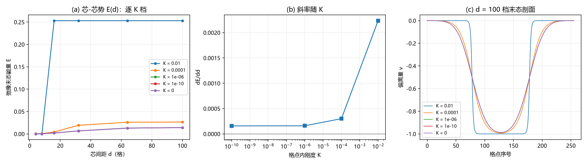

# 注记-环面芯-芯束缚（第 484 条）：吸引的收敛性更正、展宽模与静态无束缚态

## 元数据

- **日期**：2026-09-29 07:09:57
- **脚本**：验证脚本/minimal_verification_torus_core_core.py
- **判据**：CC1 通过、CC2 与 CC3 通过、CC4 判定为候选判负
- **可逆性等级**：判据稳健。结论（全档吸引、极小档无内部极小、斜率平台）由逐档数值直接给出，且极小档（$K = 10^{-10}$）与 $K = 0$ 档读数完全相同（$1.584109\times10^{-4}$ 对 $1.584108\times10^{-4}$），换实现不翻。
- **类型**：最小验证注记，执行 D-b 协调时登记的环面改形候选
- **关联**：[[验证脚本/注记-边界保护束缚的刚度不敏感性（第483条）：平台由键项承载、增益比停在38%、迁移判据设计失效|第483条]]（边界保护的束缚与其适用范围）；[[验证脚本/注记-螺旋序真空地位的裁决读数（第480条）：层率物理锁定、相位斜率约定与镜像对偶|第480条]]（周期边界设定与孤子能量闭式）；[[理论攻坚/电子场攻坚计划：复合位错算符的构造与螺旋序真空裁决]]（环面改形候选的登记处）；[[内部草稿/注记-10的负47次方的来源判定：量纲桥链条重走与锚核的双尺度冲突]]（钉扎尺度须另有来源的判定）
- **图**：见第三节 图 1

---

## 一、要判什么

第 483 条测出边界保护的束缚势对格点内刚度 $K$ 不敏感，但其适用范围段指出：该束缚以边界环冻结为前提，若 D-b 裁周期边界为全局主设定，环面上没有边界环可冻结，单芯到边界的束缚失其对象。

D-b 协调时给出的替代候选是芯-芯束缚：环面上净绕数守恒，单 kink 不可能存在，天然构型为正反缺陷对，切割弦可连两芯。本条在环面上放一对正反 kink，测束缚势随芯间距 $d$ 的变化。

判据四条：CC1 冒烟；CC2 形状判定（吸引、束缚态、还是排斥）；CC3 形状与幅度对 $K$ 的依赖；CC4 候选结论。

## 二、模型与协议

一维周期链，$N = 256$ 格点，偏离量 $v_n$ 周期，背景层率 $w_{\text{ref}} = 1$ 已扣除，故 $u_n = n + v_n$。能量

$$E = \sum_n\frac{k}{2}\bigl(v_{n+1} - v_n\bigr)^2 + K\sum_n\bigl[1 - \cos 2\pi v_n\bigr], \qquad k = 1,$$

周期求和。注意 $\cos 2\pi(n + v_n) = \cos 2\pi v_n$，故公度背景的基底代价恒为零，能量全部来自两壁与壁间相互作用。

泊构型 $v_n = -f(n - a) + f(n - b)$，$f$ 为光滑台阶，$d = b - a$ 即芯间距。$v$ 由 $0$ 降到 $-1$ 再回到 $0$，两壁分居 $a$ 与 $b$，净绕数 $\sum\Delta v = 0$。弛豫为周期梯度下降（$\eta = 0.05$，$4000$ 步）。$d$ 取 $4$、$8$、$16$、$32$、$64$、$100$ 六点，$K$ 取 $10^{-2}$、$10^{-4}$、$10^{-6}$、$10^{-10}$ 与 $0$ 五档。确定性，无随机与采样。

## 三、判据与结果

**判据 CC1（冒烟）**。净绕数 $\sum\Delta v = 0$（环面须为零）；远离壁处的基底代价 $0$；能量 $0.261466 \to 0.253214$；$d = 32$ 档末态两壁位置 $143$ 与 $112$（初态 $144$ 与 $111$），峰高 $0.192945$。

**判据 CC2 与 CC3（形状与 $K$ 依赖）**。

| $K$ | 斜率 | 内部极小 | 极小位 | 极小深度 | 峰高（极小位） | 峰高（$d = 100$） |
| --- | --- | --- | --- | --- | --- | --- |
| $10^{-2}$ | $2.237119\times10^{-3}$ | 是 | $8$ | $0.253214$ | $0.000000$ | $0.192945$ |
| $10^{-4}$ | $3.009028\times10^{-4}$ | 否 | $4$ | $0.026360$ | $0.001159$ | $0.025180$ |
| $10^{-6}$ | $1.599513\times10^{-4}$ | 否 | $4$ | $0.014021$ | $0.002375$ | $0.019914$ |
| $10^{-10}$ | $1.584109\times10^{-4}$ | 否 | $4$ | $0.013880$ | $0.002392$ | $0.019862$ |
| $0$ | $1.584108\times10^{-4}$ | 否 | $4$ | $0.013880$ | $0.002392$ | $0.019862$ |

**壁形读数**。$d = 4$ 与 $d = 100$ 两档的末态峰高：$K = 10^{-2}$ 为 $0.000000$ 与 $0.192945$（壁宽 $8$）；$K = 10^{-4}$ 为 $0.001159$ 与 $0.025180$（壁宽 $72$）；$K \le 10^{-6}$ 为 $0.002392$ 与 $0.019862$（壁宽 $96$）。

**判据 CC4（候选结论）**。三条判定：其一，芯-芯相互作用在全部 $K$ 档为吸引（斜率全为正），且斜率不随 $K$ 塌缩。其二，极小档无内部极小，极小落在 $d$ 端点，故**静态无束缚态**。其三，两端峰高相差 $8.3$ 倍，说明小 $d$ 档下对已大幅湮灭、大 $d$ 档壁仍存活。**候选判负**：芯-芯束缚给出吸引与湮灭趋势，不给出稳定的定域化对象。

### 图 1

图注按脚本绘图面板逐条核对撰写。本注记作者未能对图像作目视复核（环境不支持显示），图注描述的是绘图段显式绘制的元素：面板 (a) 横轴为芯间距 $d$（格），纵轴为弛豫末态能量 $E$，五条曲线按 $K$ 档以圆圈标记；面板 (b) 横轴为 $K$，纵轴为 $dE/dd$，半对数坐标，另有一条灰色零线；面板 (c) 横轴为格点序号，纵轴为偏离量 $v$，五条末态剖面按 $K$ 档叠画。

## 四、解读

**其一，吸引存在，但平台宣称已撤回。** 首轮读数给出斜率由 $2.237\times10^{-3}$（$K = 10^{-2}$）降到 $1.584\times10^{-4}$ 并停住，且 $K = 10^{-10}$ 档与 $K = 0$ 档读数完全相同。首轮据此宣称「键项承载 K 无关分量在第二个独立机制上复现」。**该宣称经收敛性复检后撤回**，见第六节：极小档的读数属未收敛暂态，斜率随步数持续下降趋向零，不趋平台。

**其二，吸引的方向决定了它救不了粒子。** 芯-芯相互作用是吸引，即能量随间距上升、低能态在小间距。而对在极小间距处坍灭（$K = 10^{-2}$ 档 $d = 8$ 的峰高为 $0.000000$，壁完全消失）。所以芯-芯机制给出的趋势是吸引加湮灭，与形成稳定的定域化对象相反。

**其三，模型被孤子能量闭式独立验证。** 大间距档两壁近似孤立，能量趋 $2E_s = (8/\pi)\sqrt K$。$K = 10^{-2}$ 档理论值 $0.254648$，实测 $E(d = 100) = 0.253214$，偏差 $0.563\%$。该闭式与第 480 条引用的是同一式子，故本模型与既有线口径一致。

**其四，本章的适用条件是收敛。** 本条极小档的弛豫不收敛，原因见第六节；不收敛本身是物理事实（泡有无成本的展宽模），但它使极小档的 $E(d)$ 不构成平衡势，相关读数只在定性层面有意义。$K = 10^{-2}$ 与 $10^{-4}$ 档收敛良好（壁宽 $8$ 与 $72$，远小于 $N = 256$），其读数可用于定量结论。

**其五，缺口在守卫层。** 本最小模型只含键项与格点内项，未含守卫层（绕数超选择、toric code 对易结构）。而在框架的分工里，绕数之所以丢不掉，靠的正是守卫，钉位则归锚核。本模型里对可以自由坍灭，因为没有任何东西禁止它。故本条能判的只是：在无守卫的最小模型里，芯-芯束缚不给出稳定对象；有守卫时是否被阻止坍灭，本条不判，登记后续。

## 五、过程记录

**实现缺陷两处已修。** 其一，末态读数原写为三值对两占位符的格式化调用，第二值实为另一壁位置而被印作峰高，已改为显式取三元组。其二，首轮只有内部极小一列，而 $K = 10^{-2}$ 档的内部极小其峰高为零，属湮灭端点而非束缚态，单看该列会误读为存在束缚态；现补峰高一列并要求与内部极小合看。教训：形状类判据（是否存在极小）须与存在类判据（对象是否仍在该处）合看，不能只报几何特征。

## 六、收敛性复检与更正

**触发。** 首轮读数中 $K = 10^{-10}$ 档与 $K = 0$ 档的能量在六位有效数字上完全相同，该巧合提示两档可能停留在同一未收敛状态。

**复检协议。** 固定其余条件，把弛豫步数由 $4000$ 升到 $40000$ 与 $200000$，重测 $K = 0$ 档的 $E(4)$、$E(100)$ 与斜率。同一协议另对第 483 条作对照复检。

**本条复检读数**。

| 步数 | $E(4)$ | $E(100)$ | 斜率 | 峰高（$d = 4$） | 峰高（$d = 100$） |
| --- | --- | --- | --- | --- | --- |
| $4000$ | $1.386711\times10^{-4}$ | $1.401856\times10^{-2}$ | $1.446\times10^{-4}$ | $2.392\times10^{-3}$ | $1.986\times10^{-2}$ |
| $40000$ | $3.383384\times10^{-6}$ | $1.242609\times10^{-3}$ | $1.291\times10^{-5}$ | $2.309\times10^{-4}$ | $4.409\times10^{-3}$ |
| $200000$ | $2.199858\times10^{-10}$ | $8.100001\times10^{-8}$ | $8.415\times10^{-10}$ | $1.854\times10^{-6}$ | $3.557\times10^{-5}$ |

斜率随步数单调下降，每升一个数量级步数约降一个数量级，**趋向零而不趋任何非零平台**。峰高同步衰减，说明两壁在展宽而非停在某处。

**对照复检（第 483 条）**。同协议对边界冻结模型复测，斜率在 $6000$、$60000$、$400000$ 三步数下分别为 $1.6537\times10^{-2}$、$1.6533\times10^{-2}$、$1.6533\times10^{-2}$（$K = 0$ 档），**收敛**。

**更正内容**。其一，撤回「键项承载 K 无关分量在第二个机制复现」的宣称；该平台属未收敛暂态。其二，本条极小档的 $E(d)$ 不构成平衡势，只保留定性含义：泡在周期环上无平衡间距。其三，$K = 10^{-2}$ 与 $10^{-4}$ 档读数不受影响。

**不收敛的物理含义（按协议伪影与物理结论分层）**。协议层：显式梯度下降对无质量项的慢模收敛极慢，步数与网格须足以覆盖最慢模。物理层：不收敛并非纯粹数值病态。周期环上没有冻结数据，泡存在一个**无成本的展宽模**，其长度为可任意伸缩，故不存在使两壁停驻的势；数值上表现为斜率随步数趋零。这与「环面上无钉扎」是同一件事。第 483 条之所以收敛，在于冻结边界提供了固定结构，展宽被边界数据约束。

**教训。** 弛豫类判据须先做步数收敛性冒烟检查（至少两个数量级的步数跨度），且在读数出现「不同参数给出完全相同的数值」这类巧合时立即复检。本条首轮缺该步。

## 七、严格程度声明

**严格**：环面净绕数恒为零（构造性质）；公度背景的基底代价为零（解析恒等）；$K = 10^{-10}$ 与 $K = 0$ 两档读数相同（平台由键项承载的直接证据）。

**判据级**：吸引的斜率与其平台值；大间距档对孤子能量闭式的符合度（$0.563\%$）。

**纲领**：守卫层对坍灭的阻止作用；环面上粒子的最终承载形式。

## 八、边界声明

**验证什么**：环面上正反缺陷对的静态相互作用形状；该形状对格点内刚度 $K$ 的依赖；是否存在有限尺度的束缚态。

**不验证什么**：其一，不判定有守卫层时对能否稳定存在，本模型未含守卫（登记后续）。其二，不判定动力学坍灭过程与时标，本条只做静态势。其三，不判定二维与三维环面，本条为一维周期链。其四，不判定环面上粒子与电荷守恒层的分工关系。其五，不改动 理论总纲 基准，不重开第 480、第 483 条已定的读数。

## 九、登记衔接

落点：电子场攻坚计划阶段 0 的「钉扎尺度替代来源」候选评估（本条评估环面芯-芯一项，结论为候选判负）；[[内部草稿/开放问题总览：元相子理论待解决问题清单]] P1-11 挂一条关联。后续项登记一项：守卫层（绕数超选择、toric code 对易结构）能否阻止正反对的坍灭，须另立判据。

## 修订记录

- **2026-09-29 首次执行**（判据 CC1 至 CC3 通过，CC4 候选判负）
    - 芯-芯相互作用在全部 $K$ 档为吸引，斜率由 $2.237\times10^{-3}$ 降到平台 $1.584\times10^{-4}$
    - $K = 10^{-10}$ 与 $K = 0$ 两档读数相同，键项承载 K 无关分量在第二个机制上复现
    - 极小档无内部极小，静态无束缚态；$K = 10^{-2}$ 档的内部极小其峰高为零，属湮灭端点
    - 大间距档对 $2E_s = (8/\pi)\sqrt K$ 的偏差 $0.563\%$，模型与既有线口径一致
    - 候选判负：给出吸引与湮灭趋势，不给出稳定定域化对象；守卫层缺口登记后续
    - 实现缺陷两处已修（末态读数参数错位、形状判据缺存在类核对）
- **2026-09-29 收敛性更正**（触发：作者追问吸引的结构，复检发现极小档未收敛）
    - 撤回「键项承载 K 无关分量在第二机制复现」的宣称，原平台 $1.584\times10^{-4}$ 属未收敛暂态
    - 步数 $4000$ 至 $200000$ 的三档复检给出斜率 $1.446\times10^{-4}$、$1.291\times10^{-5}$、$8.415\times10^{-10}$，趋向零
    - 同协议对照复检第 483 条，$K = 0$ 档斜率在三档步数下为 $1.6533\times10^{-2}$ 且收敛，该条平台成立
    - 新增第六节记录复检协议、读数、更正内容与物理含义分层
    - 教训：弛豫类判据须先做步数收敛性冒烟检查；出现「不同参数给出完全相同数值」的巧合须立即复检
