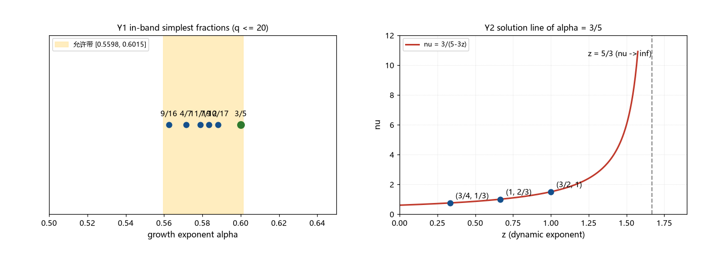

# 注记-生长指数三分之五的来源判识（第414条）：KZ 解空间、最简分数与上端紧配合

- **日期**：2026-09-26 01:29:25
- **类型**：判识轮（P0-5 候选机制二轮；生长指数 $3/5$ 来源首轮判识）
- **脚本**：`验证脚本/minimal_verification_growth_exponent_audit.py`（第 414 条）
- **图**：见 §3 图 1（`images/growth_exponent_audit.png`）
- **依据**：[[验证脚本/注记-ξ 生长律族的联立判定（第413条）：从单参数曲线到三分之五候选]]（允许带与 $3/5$ 候选的移交）；[[内部草稿/注记-Kibble机制：标准内容、体系内对接与适用性审查]]（$\nu$、$z$ 未给出的判定）；[[验证脚本/注记-A 路宽度来源三路审查（第380条）：校准扩散与势曲率判负、KZ 冻结活口与淬火时标窗口]]（KZ 指数移交）；[[元相子振荡晶格的色散关系：低能光速涌现与洛伦兹破坏首阶项]]（球面平均 $3/5$ 的既有出现）
- **状态**：判定完成（首轮）。三条支撑路线与一条待建路线判明；机制未闭合
- **可逆性等级**：判据稳健（枚举与代数不随实现与口径翻：带内最小分母、紧配合闭式、KZ 解线均为算术；「机制未闭合」为阴性陈述）

## 1 判据与设定

第 413 条给允许带 $[0.5598, 0.6015]$ 与 $\alpha = 3/5$ 候选，移交「为何恰是 $3/5$」。本轮做首轮判识：带内最简分数枚举（Y1）、KZ 指数解空间（Y2）、上端紧配合闭式（Y3）、理想 $f$（Y4）、交叉恒等（Y5）、分数形式清点（Y6）。

设定与第 413 条一致：可见物质档 $f = 2.12\times10^{-105}$，$w_{\rm def} = 3.80\times10^{21}$ 格，$t_{\rm eq} = 2.745\times10^{55}$ 拍，$z_{\rm eq} = 3400$，$C = 2.2895\times10^{31}$。

## 2 结果

Y1（带内最简分数，分母不超过 $20$）：$3/5$（分母 $5$）、$4/7$（$7$）、$7/12$（$12$）、$9/16$（$16$）、$10/17$（$17$）、$11/19$（$19$）。最小分母者为 $3/5$，次者为 $4/7$。

Y2（KZ 解空间）：$\alpha = \nu/(1+\nu z) = 3/5$ 等价于 $\nu = 3/(5-3z)$。解线过 $(2/3, 1/6)$、$(3/4, 1/3)$、$(6/7, 1/2)$、$(1, 2/3)$、$(6/5, 5/6)$、$(3/2, 1)$、$(2, 7/6)$、$(3, 4/3)$、$(6, 3/2)$；最小分母组合为 $(\nu, z) = (3/2, 1)$。$z \to 5/3$ 时 $\nu \to \infty$（解线极点），极限线上 $\alpha = 1/z$（纯标度，KT 类候选）。

Y3（上端紧配合闭式）：记 $A = \ln(t_{\rm eq}/C^2) = -16.765$、$L = \ln w_{\rm def} = 49.689$，则 $\alpha_{\max} = L/(A+2L)$。$A/L = -0.33740$，与 $-1/3$ 相对差 $1.22\%$；$3/5 = 1/(2-1/3)$ 对应 $A/L = -1/3$ 的理想化。偏差量 $\delta = A + L/3 = -0.2019$（$e^{\delta} = 0.817$）。

Y4（理想 $f$）：使 $\alpha_{\max} = 3/5$ 精确成立的 $f^* = 2.8698\times10^{-105}$（闭式 $C^* = \sqrt{t_{\rm eq}\, w_{\rm def}^{1/3}} = 2.0697\times10^{31}$；复算 $\alpha_{\max}(f^*) = 0.60000000$）。$f^*/f_{\rm obs} = 1.354$，$f_{\rm obs}/f^* = 0.739$。

Y5（交叉恒等）：$2\alpha - 1 = 1/5$ 与球面平均的四阶矩 $\langle n_x^4 \rangle = 1/(D+2) = 1/5$（$D = 3$）数值相同，属算术恒等；$t_* = D_{\rm req}^{1/(2\alpha-1)} = D_{\rm req}^5 = 2.5393\times10^{36}$ 拍（与第 413 条一致）。

Y6（形式清点）：$D/(D+2)$ 与 $D/(2D-1)$ 在 $D = 3$ 均给 $3/5$；$D/(2D-1)$ 族在带内只有 $D = 3$ 与 $D = 4$ 两项（$3/5$、$4/7$），$D/(D+2)$ 族只有 $D = 3$（$D = 2$ 给 $1/2$，$D = 4$ 给 $2/3$）。

## 3 图

## 4 结论与移交

判定：$3/5$ 的机制来源首轮未闭合，三条支撑成立。其一，最简分数（选择原则级）：$3/5$ 是带内分母最小的分数，次者 $4/7$；若生长指数由小分母分数生成，$3/5$ 是首选。

其二，上端紧配合（判据级算术）：$\alpha_{\max}$ 有闭式 $1/(2+A/L)$，$3/5 = 1/(2-1/3)$ 对应 $A/L = -1/3$ 的理想化，实际 $A/L$ 低 $1.22\%$；换算成密度口径即 $f^* = 2.87\times10^{-105}$ 对观测 $2.12\times10^{-105}$（比 $1.35$）。

其三，KZ 判识（未闭合）：解线与最小组合已出，框架尚无 $\nu$、$z$ 的独立值（[[内部草稿/注记-Kibble机制：标准内容、体系内对接与适用性审查]]与第 380 条移交均如此判定）。

登记两条。其一，交叉恒等 $2\alpha - 1 = 1/5 = \langle n_x^4 \rangle$ 为算术巧合候选，机制未建立，不展开。其二，形式族与 $D = 3$ 的对应（$D/(D+2)$、$D/(2D-1)$）属形式清点，不构成推导。

移交三条。其一，KT 路线：论证结晶扩张相变是否具有 $\nu \to \infty$ 的性质，并给 $z = 5/3$ 的动力学来源（极点线是现成的形式入口）。其二，相变对称性分析：给 $(\nu, z)$ 的显式值，闭合 KZ 判识。其三，形式清点的机制判识：两种生成形式（$D/(D+2)$ 与 $D/(2D-1)$）哪一属机制，或均判负。

## 5 严格程度与边界声明

严格程度：Y1 为枚举算术；Y2 为定义加代数；Y3 与 Y4 为代数与闭式（换算级与判据级）；Y5 为算术恒等；判定「机制未闭合」为阴性陈述，不声称穷尽。全轮为判识级，不含动力学推导。

边界（本脚本不验证的内容）：其一，不裁相变类型（KT 类只列为候选路线）；其二，不代入 $\nu$、$z$ 的物理值（框架尚无）；其三，紧配合的「理想化」不声称是机制，反向读法（带端点结构只允许小分数）同样相容；其四，不含 $f$ 档位裁决（沿用第 413 条的可见物质档）；其五，形式清点不构成推导。

## 6 过程记录

其一，Y6 初版把 $(D+1)/(2D+1)$ 的演示标签写错（用 $D = 3$ 算出 $4/7$ 却标 $D = 2$），修正为「$D = 2$ 给 $3/5$，$D = 3$ 给 $4/7$」，并补两条族枚举读数。

其二，Y1 的带端沿用第 413 条的 4 位小数 $[0.5598, 0.6015]$；用脚本内更高精度端点复算，分数清单不变（最近处为 $3/5$ 距上端 $0.25\%$，不触及）。

其三，Y2 极点位置由 $5-3z = 0$ 直接给出；检查 $z$ 略小于 $5/3$ 时 $\nu$ 为正、更大时为负（非物理分支），扫描须在极点截断。
