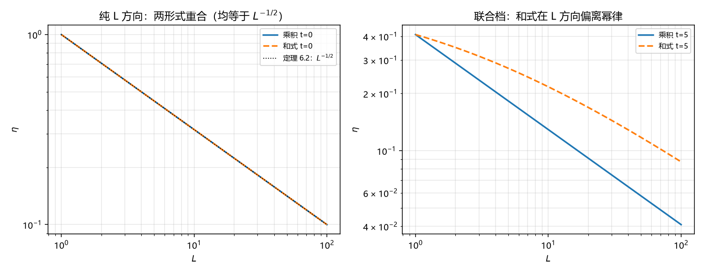

# 注记-用复合律仲裁两个二选一：份额语言与可分离类（判据第690号）

- **日期**：2026-10-19 01:23:11
- **对应脚本**：`验证脚本/minimal_verification_p690_arbitration.py`（判据 5/5；纯代数，确定性）
- **定位**：η 缺口的裁决轮。路线乙三轮把缺口收敛成两个二选一（第 688、689 号），本轮不用偏好裁决，改用库内的严格定理（定理 6.1 复合律）作仲裁者，对两项分别给出判定与理由。
- **可逆性等级**：K1、K2、K3、K5 判据稳健（代数结论与内蕴性判定）；K4、K7 读数；K6 恒真对照。
- **图**：见 §四 图 1。

---

## 一、为什么要仲裁，以及用什么仲裁

第 688 号留下 Q1（真空块数取份额语言还是空间语言），第 689 号留下 Q2（两方向耦合取可分离类还是并联类）。两项都是二选一，都无法靠数值验证单独判定，因为它们都是形式选择而非参数取值。

但库内有一个此前未被用于此处的仲裁者：定理 6.1（复合律）。它有三个适合仲裁的性质。其一，它是严格定理，不是候选或约定。其二，它本身就是「两块合一」的运算规则，直接规定了合并怎么算。其三，它给出的是份额平方加权求和，不是相乘，这个结构对「合并操作该取什么形式」有直接约束。

## 二、判据与结果

| 判据 | 内容 | 期望 | 实测 |
| --- | --- | --- | --- |
| K1 | 复合律等份额两块给 $\vert\eta\vert^2 = 1/2$ | 偏差 $\le 10^{-12}$ | $0.500000000000000$ |
| K2 | 复合律迭代 $L$ 块给 $1/L$ | 偏差 $\le 10^{-12}$ | 六档全过 |
| K3 | Q1：空间语言下份额分布欠定、份额语言下由定义唯一 | 同块数不同份额分布给不同读数 | $L=8$：$0.1250$ 对 $0.3438$；$L=16$：$0.0625$ 对 $0.2969$ |
| K5 | Q2：乘积的 $L$ 指数恒为 $-1/2$、和式随 $t$ 单调偏离 | 乘积常数、和式单调、大 $t$ 档 $\ge 0.1$ | 乘积五档恒 $-0.500$；和式 $-0.478$ 至 $-0.348$，差 $0.022$ 至 $0.152$ |
| K6 | 恒真反例（和式替身为乘积后 K5 判否） | gaps 全零、单调性假 | 全零，单调性 False |
| K4 | 结合律（读数） | 无判据 | 两形式正逆序差均 $\le 3.3\times10^{-16}$ |

## 三、裁决与理由

### Q1：取份额语言

**判定**：$L = 1/p_{\rm vac}$。

**理由一，内蕴性。** 复合律的输入参数是份额 $p_i$，输出是 $|\eta|^2$。在份额语言下，块数就是份额量子的个数，$p = 1/L$ 由定义直接给出，没有自由度。在空间语言下，块数是 $(R/l_P)^3$，而复合律需要的是份额，两者之间没有代数联系，必须额外假定「一个块胞的份额等于 $1/$块数」。

K3 把这个差别做成读数：同一块数（$L=8$），取等份额给 $0.1250$，取非等份额给 $0.3438$，复合律都成立（只要份额和为 1），但读数差 2.75 倍。也就是说空间语言下份额分布是自由的，读数因此不唯一；份额语言下 $p$ 被块数唯一确定。

**理由二，与定理 6.2 的衔接。** 定理 6.2 的推导里 $p' = 1/b$ 是前提，这个前提在份额语言里是定义，在空间语言里是假定。取份额语言，定理 6.2 就是复合律的直接迭代（K2 逐档验证）；取空间语言，定理 6.2 需要补一条假定。

**理由三，与第 688 号的重合锚点一致。** 第 688 号已证：$p_{\rm vac} = (l_P/R)^3$ 时两种语言精确重合。这个锚点的存在说明两语言可以相容，其中份额语言更基本：空间语言在特定条件下是它的特例。

**边界**：这条判定是「形式选择」，不是「物理发现」。若将来定出 $p_{\rm vac}$ 恰等于 $(l_P/R)^3$，两者等价，此判定退化为无关紧要。

### Q2：取可分离类（乘积）

**判定**：$\eta(t,L) = \eta_L(L)\cdot\eta_t(t)$。

**理由一，与定理 6.2 的相容性。** 乘积形式在 $L$ 方向的幂律指数恒为 $-1/2$（因为 $\eta_L = L^{-1/2}$ 且 $\eta_t$ 与 $L$ 无关），五档 $t$ 扫描全为 $-0.500$，与定理 6.2 的 $1/L$ 精确相容。

和式形式则不然：它在 $L$ 方向的指数随 $t$ 变化，$t = 0.5$ 时 $-0.478$，$t = 10$ 时 $-0.348$，偏离定理 6.2 的 $-0.5$ 且随 $t$ 单调增大。若取和式，定理 6.2 的 $1/L$ 只在 $t \to 0$ 极限成立，一般情形下 $L$ 方向的幂律不再是 $1/L$。这与定理 6.2 的表述（无 $t$ 条件）冲突。

**理由二，结合律不能分辨（K4 读数）。** 两形式都满足合并顺序无关（正逆序差 $10^{-16}$ 量级），所以结合律不是判别依据。这一点须写明，避免后来者误用。

**理由三，物理图像上可分离类与体系的独立稀释图像一致。** 定理 6.2 的推导里，每步粗粒化只重标份额、不涉及时间；第 520 条的推导里，时间演化只涉及相位扩散、不涉及块数。两者的前提互不交叉，乘积形式是这种独立性的自然表达。

**边界**：这条判定的强度低于 Q1。和式在 $t$ 小时的偏离只有 $0.022$，属弱判别；只有在 $t \gtrsim 5$ 时才明显（$0.109$）。若实验只在小 $t$ 区工作，两种形式难以分辨。

## 四、图

左图三条线完全重合，说明纯 $L$ 方向无法分辨两形式。右图在 $t=5$ 时分开，乘积保持 $L^{-1/2}$ 斜率、和式变平，这是判别的来源。

## 五、结论

**结论一：Q1 取份额语言，理由强。** 份额是复合律的内蕴参数，空间块数不是；取份额语言后定理 6.2 无需补假定。

**结论二：Q2 取可分离类，理由中等。** 与定理 6.2 的相容性支持乘积形式，但判别力集中在 $t \gtrsim 5$ 区，小 $t$ 区两形式难分。

**结论三：$\eta$ 缺口至此可写成完整的 $\eta(t,L) = L^{-1/2}(1+2\Gamma_{\rm coh}t)^{-1/2}$，其中 $L = 1/p_{\rm vac}$。** 这是路线乙三轮的直接产物。须标明其严格程度：$L$ 的取法为形式判定（判据稳健），耦合形式为相容性判定（判别力依赖 $t$ 档），两者都不是实验裁决。

**结论四：这条复合形式仍不是「$\eta$ 动力学方程」的完整答案。** 它给出的是「给定块数与时间，$\eta$ 是多少」的静态复合，不含 $\eta$ 自己的演化方程（即 $\dot\eta$ 由什么定）。后者仍需份额转移的微观动力学，属 P4-45 的剩余核心。

## 六、过程记录与教训

**一处判据设计弱点（K5 首版）。** 首版固定 $t = 2$ 单档判「和式偏离」，斜率差只有 $0.063$，接近阈值 $0.05$ 至 $0.1$ 的边界，结论依赖取点。改为五档扫描并检验单调性后，$t = 0.5$ 至 $10$ 的差从 $0.022$ 单调升到 $0.152$，判别力与 $t$ 的关系被显式化。

教训：凡阈值型判据，若被测量随某个未扫参数单调变化，单档取点会把「参数选择」伪装成「结论」。这与 AGENTS.md 已列的「多档扫描」纪律一致，本轮是又一次实证。

**一处变量类型错误。** 改多档后 K6 仍用标量变量格式化数组，报 TypeError。修正时顺带把 K6 的判否条件写全（gaps 全零 + 单调性假 + 大 $t$ 档不达标）。

## 七、严格程度与边界声明

**判据级**：复合律的等份额与迭代读数（K1、K2，严格代数）；份额语言的内蕴性（K3）；乘积形式的 $L$ 指数恒定性（K5）。

**形式判定（非物理发现）**：Q1 取份额语言、Q2 取可分离类。两条都是「在现有定理体系内更少假定」的选择，不是实验裁决。

**未验证**：$\eta$ 自身的演化方程（$\dot\eta$ 的来源）；$p_{\rm vac}$ 的具体数值；和式在 $t \lesssim 1$ 区与乘积的区分（差 $0.02$ 至 $0.04$，低于多数实验精度）。

**边界**：本轮不改定理 6.1、6.2 与第 520 条的任何陈述，不改 P4-45 的条目状态。本轮给出的是缺口的形式判定与复合表达式，属「口径确定」层，不是「机制闭合」。

## 八、登记衔接

- `验证脚本/README.md` 第 690 条由占位改写为正式行。
- P4-45 档案页与总览卡登记本轮（两个二选一的形式判定结果与复合表达式）。
- 通俗注记见 [[内部草稿/注记-两把尺子选哪把，两条路走哪条（判据第690号通俗版）|第 690 号通俗版]]。
