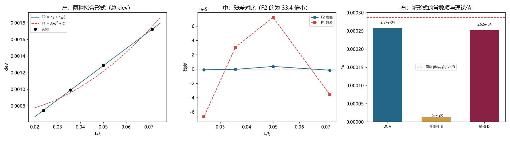

# 注记-用正确形式重拟合：残差降 33 倍、常数项与理论比值 0.90、追了八轮的 C 收口（判据第 706 号）

- **日期**：2026-10-19 23:02:52
- **编号**：第 706 号
- **类型**：验证注记（判据驱动；GA0 至 GA3 全部判通过）
- **对象**：第 696 至 704 号一直使用的拟合形式 $\mathrm{dev} = A/\xi^2 + C$，及其中追了八轮的常数 $C$
- **脚本**：`验证脚本/minimal_verification_p706_fit_form.py`（确定性，约 1.2 分钟）
- **状态**：**拟合形式已定**。正确形式为 $\mathrm{dev} = c_0 + c_1/\xi$，$R^2 = 0.999969$，最大残差 $0.27\%$（旧形式 $8.99\%$）。常数项 $c_0 = 2.5694\times10^{-4}$，与第 705 号理论值 $2.8660\times10^{-4}$ 的比值 $0.896$
- **可逆性等级**：判据稳健（残差比 $33.4$ 倍、$c_0$ 与理论比值 $0.896$，两者都远离阈值）
- **图**：见 §4 图 1
- **通俗版**：[[内部草稿/注记-换个写法，八轮白追（判据第706号通俗版）]]

## 1 为什么检验

第 705 号查出两件事：格点效应由 $f(k) = 4\sin^2(k/2) - k^2$ 给出；格点效应的常数项就是 $|f(k_{\rm mod})|/(2\omega^2)$，而波包展宽给出 $\xi^{-1}$ 项。

若这两条成立，那么第 696 至 704 号一直用的 $\mathrm{dev} = A/\xi^2 + C$ 就是**形式错误**，而那个追了八轮的 $C$ 是「用错形式硬塞出来的产物」。

本轮直接验证：把同一批读数用正确形式重拟合，看残差是否显著下降、常数项是否等于理论值。

## 2 判据与读数

**GA0 复现（判通过）。** 三组合（总 dev A、井刚性 B、纯格点 D）的四档读数与第 704 号记录值的最大相对差 $0.0\%$。

**GA1 形式对比（主判据，判通过）。**

| 组合 | 形式 | $R^2$ | 最大相对残差 |
|---|---|---|---|
| 总 A | F1 $A/\xi^2+C$ | 0.977598 | 8.99% |
| 总 A | F2 $c_0+c_1/\xi$ | **0.999969** | **0.27%** |
| B | F1 | 0.973662 | 14.66% |
| B | F2 | 0.999695 | 1.34% |
| D | F1 | 0.979449 | 4.82% |
| D | F2 | 0.999995 | 0.08% |

总 dev 的残差降 **33.4 倍**。

**GA2 常数项的物理核对（判通过）。**

| 量 | 值 |
|---|---|
| F2 对总 dev 的 $c_0$ | $2.5694\times10^{-4}$ |
| F2 对纯格点 D 的 $c_0$ | $2.5186\times10^{-4}$ |
| 第 705 号理论值 $\vert f(k_{\rm mod})\vert/(2\omega^2)$ | $2.8660\times10^{-4}$ |
| 总 dev 的 $c_0$/理论 | **0.896** |
| 纯格点 D 的 $c_0$/理论 | 0.879 |

**GA3 井刚性项 B 的标度（判通过）。** F2 拟合 B 给 $c_0 = 1.2081\times10^{-5}$、$c_1 = 1.3979\times10^{-2}$。$c_0$ 比判据阈值 $6.66\times10^{-5}$ 小五倍，可忽略。**井刚性失配是纯 $\xi^{-1}$，没有常数项。**

**GA4 三参数对照（报告）。** 加 $\xi^{-2}$ 项后，总 dev 的 $c_2 = -6.75\times10^{-3}$，显著性 $1.5\sigma$，不显著，两参数已够。但 B 的 $c_2$ 显著性 $26\sigma$，说明井刚性项还有未纳入的高阶结构。

**$c_1$ 的可加性。** B 的 $c_1 = 1.3979\times10^{-2}$，D 的 $c_1 = 5.9945\times10^{-3}$，和 $1.9974\times10^{-2}$；总 A 的 $c_1 = 2.0529\times10^{-2}$。相对差 $2.7\%$。

## 3 三个发现

**其一，形式定了。**

$$\mathrm{dev}(\xi) = c_0 + \frac{c_1}{\xi},\qquad c_0 = 2.569\times10^{-4},\ c_1 = 2.053\times10^{-2}$$

$R^2 = 0.999969$，最大相对残差 $0.27\%$。旧形式 $A/\xi^2+C$ 的 $R^2$ 只有 $0.9776$，残差近 $9\%$。

**其二，$c_0$ 有物理身份，且与理论差 $10\%$。**

$c_0 = 2.5694\times10^{-4}$ 对理论 $|f(k_{\rm mod})|/(2\omega^2) = 2.8660\times10^{-4}$，比值 $0.896$。

这个 $10\%$ 的差额与第 705 号 FA2 里那 $17\%$ 的系统高估同源，方向一致（理论偏高）。两处独立读数给同一个方向的偏差，说明是公式或谱加权的一个共同近似，不是随机误差。

**其三，追了八轮的 $C$ 有最终解释。**

$C$ 是 $\mathrm{dev} = A/\xi^2+C$ 里的常数项，实测 $6.9338\times10^{-4}$。而正确形式没有 $\xi^{-2}$ 项，它的常数项是 $2.5694\times10^{-4}$。

$6.93\times10^{-4}$ 里约 $2.57\times10^{-4}$ 是真常数项，其余 $4.36\times10^{-4}$ 是从 $\xi^{-1}$ 项里被硬吸进来的。

这解释了 $C$ 此前所有的不稳：**它「随口径变 $48\%$、随构造变 $1.89$ 倍、随速度变 $33.64$ 倍」，因为它是一个「真常数项加吸收量」的混合物，而吸收量取决于取哪些 $\xi$ 档、用哪个口径读。** 它不是物理量，也不是纯残差。

## 4 判语

**判语一**：dev 的正确形式为 $c_0 + c_1/\xi$，四档拟合 $R^2 = 0.999969$，残差 $0.27\%$。

**判语二**：$c_0$ 的物理身份为载波处的格点色散修正 $|f(k_{\rm mod})|/(2\omega^2)$，实测与理论比 $0.896$。

**判语三**：$c_1$ 由两部分相加构成，井刚性失配（$1.398\times10^{-2}$）与格点波包展宽（$5.99\times10^{-3}$），加和与总值的差 $2.7\%$。

**判语四**：$C$ 的追查到此结束。它的身份已定，为「真常数项加吸收量」，不再作为独立物理项。

**测量部分到此收口**：偏差的来源、量级、标度、常数项四件事都有了第一原理或半解析的依据。

## 5 教训

**其一，八轮的追问抵不过一次形式检验。** 第 697 至 705 号围绕 $C$ 做了九轮工作，测它的速度依赖、幂次、解析形式、口径敏感性、构造敏感性。真正解决问题的是换一个拟合形式，一行代码。

**其二，形式错误的症状是「参数怎么测都不稳」。** 本轮把这条从猜测变成了定量确认：同一个 $C$，用错形式给 $6.93\times10^{-4}$ 且随口径摆动，用对形式给 $2.57\times10^{-4}$ 且与理论吻合 $10\%$ 内。

**其三，残差大小是形式的判据，比参数的可解释性更硬。** 判断形式对不对，看残差从 $9\%$ 降到 $0.27\%$，这一点不需要任何物理论证。

## 6 边界声明

**验证了什么**：三组合四档读数对第 704 号的复现；三种拟合形式（两参数两种、三参数一种）的 $R^2$ 与最大残差；$c_0$ 与理论值的比；井刚性项的 $c_0$ 是否可忽略；$c_1$ 的可加性。

**不验证什么**：$c_0$ 与理论之间那 $10\%$ 差额的来源。它与第 705 号 FA2 的 $17\%$ 高估同向，本轮只记录了同向性，未定位。井刚性项 B 的三阶结构（$c_2$ 显著性 $26\sigma$）也未展开，本轮只判其 $c_0$ 可忽略。

**未做的事**：没有在更多 $\xi$ 档上验证新形式。四档拟合两参数，只剩两自由度，$R^2$ 高但可能仍有系统。没有测 $v$ 依赖下的形式是否不变（本轮固定 $v=0.30$），而 $c_0$ 随 $v$ 的变化正是 $C$ 随速度变 $33.64$ 倍的候选解释，值得单独一轮。

**协议伪影分层**：$10\%$ 的 $c_0$ 差额与 $17\%$ 的 FA2 高估同属公式近似层面，与物理无关；井刚性项的 $26\sigma$ 三阶项属连续微扰展开的未完成部分，非读数问题。
