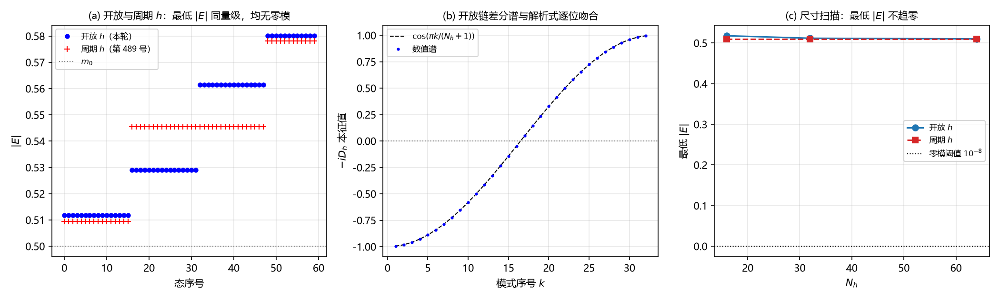

# 注记-电子算符骨架的非紧致边界复核：$h$ 方向取开放（判据第 660 号）

## 元数据

- **日期**：2026-10-16 22:25:03（初版）
- **脚本**：`验证脚本/dirac_skeleton_open.py`
- **判据**：冒烟 1 至 2，N1 至 N6，另附两条反例
- **可逆性等级**：判据稳健（反周期半整数动量、谱对称、镜像式恒等、差分谱解析对照均为解析恒等式或构造决定，数值为零差量级）；最低 $|E|$ 的尺寸收敛属读数层
- **类型**：狄拉克线阶段 2 复核轮（载体的边界归属）
- **所属计划**：[[理论攻坚/电子场攻坚计划：复合位错算符的构造与螺旋序真空裁决]]（阶段 2）；承接 [[验证脚本/注记-电子算符Dirac骨架（第489条）：S¹×ℝ反周期谱结构、D2连续极限与D1甲乙首测|第 489 号]]
- **关联**：[[内部草稿/总结注记-手征问题攻坚全面总结：定理射程、逐轮清点与接口缺口（2026-10-16）]] §二（两个对象必须分开）与 §八 第二优先（定理对 $S^1\times\mathbb{R}$ 载体是否成立）；[[固定普朗克时空晶格理论的多重困境：从相对论冲突到宇宙学不相容]]（定理的四条件陈述）
- **图**：见 §四 图 1

---

## 一、要判什么

第 489 号在 $S^1\times\mathbb{R}$ 上交付 $\hat D$ 的离散骨架，关键读数之一是"反周期半整数动量无零模"。该轮的 $\theta$ 方向取反周期环，而 $h$ 方向实现为**周期环**（D-b 主设定）。

但体系声明的载体是 $S^1\times\mathbb{R}$，其中 $\mathbb{R}$ 方向非紧（层数通道是物理空间的生成方向，非紧致；作者 2026-10-16 指正）。实现取周期环与声明不符，这正是总结注记 §二 所说的"两个对象必须分开"处。

本轮把 $h$ 方向改成开放链（非周期），复核骨架的零模排除与谱结构是否依赖 $h$ 的紧致性。这一问是"定理对体系声明的载体是否成立"的基础读数：若骨架的判否依赖 $h$ 的紧致，则声明与实现的分歧有实质后果。

## 二、模型设定

与第 489 号相同的 2 分量（2+1 维）离散 Dirac 算符

$$H=\sigma_x\otimes(-\mathrm{i}c_\theta D_\theta\otimes I)+\sigma_z\otimes(I\otimes(-\mathrm{i}c_h D_h))+\sigma_y\otimes(I\otimes\operatorname{diag}(m)),$$

$N_\theta=32$、$c_\theta=c_h=1$、$m_0=0.5$。$\theta$ 方向反周期（$\pi$ 扭转，接缝带 $-1$），$h$ 方向本轮取**开放链**（$S_h$ 无周期回卷），对照档取周期环。绕数背景 $w=\pm1$ 以 $\theta$ 移位算符的规范相位 $e^{\mp\mathrm{i}2\pi w/N_\theta}$ 实现。

**本轮修正了一处实现缺陷。** 第 489 号原脚本把规范相位 $e^{-\mathrm{i}\,gauge}$ 赋给实数数组，虚部被丢弃（ComplexWarning），差分算符随之取 $S^{\mathsf T}$ 而非 $S^\dagger$。本轮改用复数数组与 $D_\theta=(S_\theta-S_\theta^\dagger)/2$，使 $-\mathrm{i}D_\theta$ 严格厄米。

## 三、判据与结果

| 判据 | 内容 | 期望 | 实测 | 判定 |
| --- | --- | --- | --- | --- |
| 冒烟1 | $H$ 厄米 | $0$ | $0.000\times10^{0}$ | 通过 |
| 冒烟2 | 开放链 $-\mathrm{i}D_h$ 本征值对 $\cos(\pi k/(N_h+1))$ | 吻合 | 最大差 $7.216\times10^{-16}$ | 通过 |
| N1 | $\theta$ 动量半整数（反周期生效） | 偏差 $<10^{-10}$ | $8.88\times10^{-16}$ | 通过 |
| N2 | 开放 $h$：无零模 | $0$ 个 | $0$ 个；最低 $\lvert E\rvert=0.511734$ | 通过 |
| N3 | 谱关于 $E=0$ 对称 | $<10^{-10}$ | $1.62\times10^{-14}$ | 通过 |
| N4 | $w=\pm1$ 谱恒等 | $<10^{-10}$ | $2.24\times10^{-14}$ | 通过 |
| N5 | $N_h$ 扫描（16、32、64）：最低 $\lvert E\rvert$ | 不趋零 | $0.517804\to0.511734\to0.510089$ | 通过 |
| N6 | 开放与周期档对照 | 同量级 | 开放 $0.511734$ 对周期 $0.509517$ | 通过 |
| 反例1 | $\theta$ 周期 $+m_0=0$ | 出现零模 | $8$ 个零模 | 通过（区分力） |
| 反例2 | $\theta$ 周期 $+m_0=0.5$ | $0$ | $0$ | 通过 |
| 读数 | $\theta$ 反周期 $+m_0=0$ | $0$ | $0$ | 读数 |

## 四、结果解读

**$h$ 的边界条件不改变骨架读数。** 开放链下零模计数为零、最低 $|E|=0.511734$，与周期档的 $0.509517$ 同量级；$N_h$ 从 16 增到 64，最低 $|E|$ 单调收敛（$0.517804$ 到 $0.510089$），不趋零。反周期半整数动量、谱对称、$\pm w$ 镜像式三项恒等式在开放链下全部成立。

**零模排除的原因在 $\theta$ 方向的反周期，不在 $h$ 的紧致性。** 反例给出了区分：$\theta$ 取周期且 $m_0=0$ 时出现 $8$ 个零模；只要 $\theta$ 保持反周期，即使 $m_0=0$ 也一个零模都没有。所以"$\pi$ 扭转排除零模"是 $\theta$ 方向拓扑的结果，与 $h$ 是否接成环无关。

**第 489 号 SK4 的结论在正确实现下仍成立。** 本轮修掉规范相位的虚部截断后，$\pm w$ 谱差为 $2.24\times10^{-14}$（数值精度级），镜像式依旧成立。所以那处实现缺陷不影响 SK4 的结论（解析上 $w$ 平移动量集合、反周期半整数格在 $\pm w$ 下不变），但缺陷本身应在原脚本中一并修掉。

### 图 1

图注按脚本绘图面板逐条核对撰写。

## 五、结论与登记

**声明与实现的分歧在这条读数上没有实质后果。** 骨架的零模排除与谱结构不依赖 $h$ 的紧致性，把 $h$ 从环改成开放不改变任何判据。所以第 489 号用周期环做实现，在它自己问的那几个问题上（反周期零模排除、连续极限、镜像式）不影响结论。

**但"定理对载体是否成立"这一问在本骨架内不能回答。** 本骨架是 2 分量（2+1 维），而 2+1 维没有手征算符（第 490 号已判 $2$ 分量下宇称算符不存在，第 637 号判 $\Gamma_5$ 是奇维体积元）。手征性的载体需要 4 分量（3+1 维）。所以定理射程的审计必须在 4 分量实现上做，登记为后续轮。

**一处勘误。** 第 489 号脚本的规范耦合存在虚部截断（实数数组收复数相位），本轮修正后 SK4 结论不变。建议原脚本同步修正，以免后续轮沿用同一写法。

## 六、严格程度声明与边界声明

**严格层**：冒烟1 的厄米性；冒烟2 的开放链差分谱解析对照；N1 的半整数动量；N3 的谱对称；N4 的镜像式恒等；反例1 的 $8$ 个零模。

**读数层**：最低 $|E|$ 的尺寸收敛（依赖 $k$ 量子化与链长）；开放与周期档最低 $|E|$ 的差值（$0.0022$）。

**可逆性等级**：判据稳健（恒等式与构造决定，换实现或换口径不翻）。

**边界声明**：本轮只做 2 分量（2+1 维）骨架，不判 4 分量（3+1 维）的手征性与定理射程；不判质量项形式（第 501 号遗留）；不判与费米子通道（第 652、653、659 号）的合并；不改动 `理论总纲/` 基准。

## 修订记录

- **2026-10-16 初版**（触发：作者指正层数通道非紧致，本轮把骨架的 $h$ 方向从周期环改为开放链复核）
    - 冒烟 1 至 2、N1 至 N6 与两条反例全部通过；关键读数：开放链下零模计数为零、最低 $|E|=0.511734$（周期档 $0.509517$），$N_h$ 扫描单调收敛不趋零
    - 结论：骨架读数不依赖 $h$ 的紧致性；零模排除来自 $\theta$ 方向反周期；"定理对载体是否成立"须在 4 分量下问
    - 过程记录（一处实现缺陷与一处勘误）：首版沿用第 489 号的规范耦合写法，把复数相位赋给实数数组（ComplexWarning，虚部丢弃），且差分算符取 $S^{\mathsf T}$ 而非 $S^\dagger$；改用复数数组与 $S^\dagger$ 后 $-\mathrm{i}D_\theta$ 严格厄米，$\pm w$ 谱差 $2.24\times10^{-14}$，SK4 结论不变
