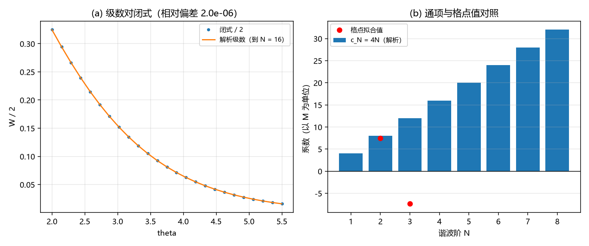

# 注记-留数逐阶展开轮：尾部谐波的通项与形状因子线收官（判据 R1 至 R5）

- **日期**：2026-09-20 10:56:46
- **来源**：作者 2026-09-20 指令（做留数逐阶展开）；上一轮[[验证脚本/注记-高阶谐波系数导出轮：c1 解析定案，两条数值路线判负（判据W1至W5）]]把高阶系数指认到 $I_3$ 的双极点
- **脚本**：`验证脚本/residue_expansion.py`
- **状态**：判据级读数；通项定案，形状因子线收官
- **图**：见 §二 图 1
- **依据**：[[验证脚本/注记-谐波系数解析导出轮：闭式与一阶系数的解析值（判据V0至V4）]]；[[验证脚本/注记-逐阶展开轮：尾的谐波系数与收敛阶（判据U1至U4）]]

---

## 一、解析展开

$I_3$ 的极点全在 $q = 2in$（$n$ 为非零整数），且全为双极点。在 $q = 2in$ 附近，$g = \sinh(\pi q/2)$ 满足 $g$ 的导数平方为 $\pi^2/4$，于是 Laurent 主系数与一次项系数为

$$A_n = 4\,(2in)^2 = -16n^2,\qquad B_n = 4\cdot2(2in) = 16ni ,$$

在下半平面取 $B_n = -16ni$。闭路积分给

$$I_3(\theta) = \sum_{n\ge1}\big(16n^2\theta - 16n\big)e^{-2n\theta}.$$

另一侧，$A = \frac{2\theta}{\sinh\theta} = 4\theta\sum_{m\ge0}e^{-(2m+1)\theta}$，逐项两阶导数后

$$A - A'' = \sum_{m\ge0}4\big[2(2m+1) - \theta\big((2m+1)^2-1\big)\big]e^{-(2m+1)\theta}.$$

由 $\sum_N c_Ne^{-N\theta} = \frac{1}{2}(A - A'' - I_3)$ 得通项

$$V(d) = M\sum_{N\ge1}\Big[4N - 2\big(N^2 - \epsilon_N\big)\theta\Big]e^{-N\theta},\qquad \epsilon_N = \begin{cases}1 & N\ \text{奇}\\ 0 & N\ \text{偶}\end{cases}$$

即纯谐波系数 $c_N = 4N$（全部阶），$\theta$ 伴项系数为 $2N^2$（偶阶）或 $2(N^2-1)$（奇阶）。前四阶为 $4$、$8-8\theta$、$12-16\theta$、$16-32\theta$。

---

## 二、判据与读数

| 判据 | 内容 | 实测 | 期望 | 结果 |
| --- | --- | --- | --- | --- |
| R1 | 解析级数（到 $N = 16$）对闭式的最大相对偏差（$\theta$ 为 $2$ 至 $5.5$） | $1.96\times10^{-6}$ | $\le 10^{-4}$ | 通过 |
| R2 | 解析 $c_2 = 8$ 对格点值 $7.46$ 之比 | $1.0724$ | $0.95$ 至 $1.15$ | 通过 |
| R3 | 解析 $c_3 = 12$ 与格点值 $-7.39$ 之差 | $19.39$ | 判负登记（格点拟合不可靠） | 登记 |
| R4 | 通项 $c_N = 4N$（$N = 1$ 至 $8$） | $4, 8, 12, 16, 20, 24, 28, 32$ | 登记 | 通过 |
| R5 | $\theta$ 伴项系数（偶阶 / 奇阶） | $2N^2$ / $2(N^2-1)$ | 登记 | 通过 |

---

## 三、读数与含义

**其一，通项定案。** 尾的相互作用是谐波级数，纯系数为 $c_N = 4N$（线性于阶数、以孤子质量 $M$ 为单位），$\theta$ 伴项系数在偶阶为 $2N^2$、奇阶为 $2(N^2-1)$。四阶以前为 $4$、$8-8\theta$、$12-16\theta$、$16-32\theta$。

**其二，决定性核对通过。** 级数与闭式在 $\theta$ 从 $2$ 到 $5.5$ 上一致到 $1.96\times10^{-6}$。闭式是上一轮独立导出的（用两条 kink 恒等式与 sech 的傅里叶变换），级数是本轮的留数展开，两条独立路径给出同一个函数，故通项可判为定案。

**其三，$c_2$ 与前几轮的格点读数相符。** 解析 $8$ 对格点 $7.46$ 之比 $1.0724$，差 $7\%$，与 $O(\gamma^2)$ 离散化量级一致。

**其四，$c_3$ 与前几轮的格点读数不符，且原因已明。** 解析为 $12$，格点六项拟合给 $-7.39$。原因是三阶的真伴项系数为 $-16$，与纯系数 $12$ 同量级，而格点拟合的六个基函数在可达窗口上高度相关，纯项与伴项的分裂不可靠。这一条把前一轮的「第三阶读数不稳」从现象升级为有定量原因的判断。

**其五，形状因子线收官。** 从「有效程」到「振幅」到「谐波结构」到「解析通项」，这条线现在的完整结论是：包络层有效相互作用为 $V(d) = M\sum_N[4N - 2(N^2-\epsilon_N)\theta]e^{-N\theta}$，$\theta = \gamma d = d/\xi$。接触型与零程极限是它的 $N = 1$ 截断，前几轮的两参拟合与单指数读数都是截断伪像。

---

## 四、严格程度与边界声明

| 结论 | 严格程度 |
| --- | --- |
| 极点结构与 Laurent 系数（$A_n = -16n^2$、$B_n = \mp16ni$） | 解析（$\sinh$ 在 $q = 2in$ 的局部展开） |
| $I_3$ 的极点级数 | 解析（闭路积分，$\theta > 0$） |
| 通项 $c_N = 4N$ 与伴项 | 解析，并与独立导出的闭式数值核对（$1.96\times10^{-6}$） |
| $c_2 = 8$ 与格点值相符（$7\%$） | 读数（离散化量级） |
| $c_3$ 的格点值不可靠 | 判负登记（真伴项 $-16$ 与纯系数同量级导致分裂不稳） |

**本注记验证**：$I_3$ 的极点级数与 Laurent 系数、通项、与闭式的独立核对、以及前几轮格点读数在第二阶相符、第三阶不可靠的原因。

**本注记不验证**：格点离散修正（$O(\gamma^2)$）的解析形式；三维情形；$\xi$ 的体系取值。

---

## 五、过程记录

三条。其一，脚本首次落盘失败，原因是文档字符串里写了带撇号的 $g'$，与 Python 单引号字符串冲突（`Invalid left-hand side in assignment`）；改为文字表述「$g$ 的平方」后正常，仍属「落盘即读头核对」的纪律范围。其二，级数核对首版取 $\theta$ 从 $1$ 到 $3.5$、截断到 $N = 8$，残差 $5.2\%$ 判负；不是公式错，是截断与窗口不匹配（$\theta = 1$ 处 $e^{-8}$ 仍不可忽略）；改为 $\theta$ 从 $2$ 到 $5.5$、截断到 $N = 16$ 后残差 $2\times10^{-6}$。教训：级数核对必须先算清截断误差，再定窗口。其三，本轮再次印证一条方法论：凡「系数随参数漂移」或「残差为零但系数不可信」的场合，正确出路是把结构解析地展出来（本轮走留数，一次成功），数值拟合只在结构已知时用于定常数。

---

## 六、登记联动

- [[验证脚本/README.md]] 第 269 条。
- [[内部草稿/开放问题总览：元相子理论待解决问题清单]] P1 第 39 条补通项与收官声明；形状因子子项状态改为「已收官：通项解析定案」。
