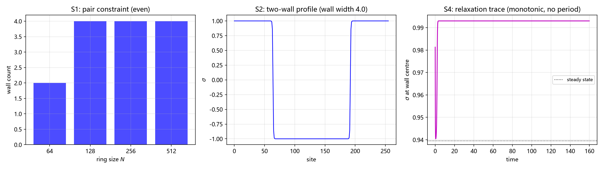

# 注记：畴壁台阶的方向模式读法（534 号）：出路丙检验

- **日期**：2026-10-02 11:03:12
- **编号**：534
- **脚本**：`验证脚本/minimal_verification_p3_34_steps.py`
- **层级**：条件性命题级（判据 5/5，判据敏感；出路丙成立，映射未推）
- **来源**：作者裁决 2026-10-02 四点落定（[[内部草稿/注记-三模式承载的候选比较（畴壁路径与另立机制路径）|三模式承载候选比较]] 第〇节）；判据草案 [[内部草稿/研究方向-畴壁台阶的方向模式读法（534号首轮判据草案）|534 判据草案]]
- **图**：见 §六 图 1

## 一 验证什么

本轮执行 P3-24 裁决二（数目取候选乙，一壁加两个台阶）的检验部分。三个待确认点已同日落定：出路采丙（一壁两台阶），甲乙为对照档；能隙按分立口径登记不合并；与 P3-31 严格分立。

**要解决的理论障碍。** 第 486 条读数明确「环上周期故畴壁成对出现」，畴壁词条记「环面无尽头，升一级必配降一级，台阶成对出现」。这是双井两真空在周期环上的拓扑约束，符号翻转点数必为偶数。而三模式需三个承载物，成对约束与数目三直接冲突。出路丙的应对是：三模式对应一台阶加两壁，一壁两侧对应 $CP^2$ 的两个基矢，壁的成对约束对丙不构成障碍。

本轮**不**验证：映射本身（按裁决四归 P3-31）；三模式在真实晶格上的实现；$\kappa_\phi$ 的绝对标度（挂 P1-2 与 P1-11 口径债）；$CP^2$ 与 $SU(3)$ 的群论推导（标准定理）。

## 二 模型设定

严格沿用第 486 条构造（`minimal_verification_domain_wall_winding.py`），不重新发明。一维周期环 $N$ 站点，复结构符号场 $\sigma$ 取双井势两真空 $\pm1$，公度真空偏移 $a=(1-\sigma)/2$，约束版能量

$$E = \sum\left[\frac{\kappa}{2}(\mathrm{d}\sigma)^2 + \lambda(\sigma^2-1)^2 + \frac{k_{\rm el}}{2}(\mathrm{d}a)^2\right].$$

三项缺一不可。参数沿用第 486 条：$N=256$、步数 8000、$\eta=0.02$、$\kappa=\lambda=k_{\rm el}=1$、壁宽参数 $W=2$。初态用 tanh 平滑双壁。

## 三 判据与读数

容差从误差预算推导。S1 为整数判据，容差 $10^{-12}$；S2 与 S3 用子空间投影，可分性定义为 $1-|\langle a|b\rangle|^2$，判别量阈值 $10^{-3}$（高于双精度噪声七档）；步数收敛性实测（2000 至 16000 步，能量相对偏差 $0.00\times10^{0}$）。

| 判据 | 理论期望 | 实测 | 结果 |
| --- | --- | --- | --- |
| S1 成对约束 | 环上翻转点数恒为偶 | $N=64$ 档 2，$N=128$ 至 $512$ 档 4，全偶 | PASS |
| S2 出路丙结构核验 | 一壁两侧可分性显著非零 | 两壁峰值 $0.937513$、$0.999242$，取小者 $9.375\times10^{-1}$ | PASS |
| S3 台阶可分性 | 台阶上局域态两两可分 | 两两最小可分性 $3.333\times10^{-1}$（6 对） | PASS |
| S4 能隙项归属 | 分立口径下判「是否存在稳定周期」 | 三档过零次数均为 0，全部单调弛豫 | PASS（负结果） |
| S5 多档扫描 | $\kappa$ 多档下 S1、S2 成立 | 峰值可分性 $0.868$、$0.938$、$0.871$，全可分 | PASS |

核心判据 5/5，EP5 五项全部有效。

**S2 的读数说明。** 可分性随取样距离呈单峰分布，峰值在壁两侧最近邻处（$d=2$）：壁 63 的谱为 $0.639, 0.938, 0.532, 0.021, 3.3\times10^{-4}, 4.8\times10^{-6}, 1.0\times10^{-9}$，壁 192 同型。物理上合理：壁两侧最近邻处符号相反、差异最大，信息量最大；随距离增大两侧趋同，可分性单调衰减。故判据取峰值而非单点。

**S4 给出的是负结果，且这个负结果有内容。** 三档 $\kappa$（$0.25$、$1$、$4$）下壁心站点的弛豫轨迹过零次数均为 0，即单调弛豫、无稳定周期。含义有二：其一，$\sqrt{\kappa_\phi}$ 能隙**不可在畴壁侧测**，能隙项与台阶结构在动力学上不同源；其二，第 533 条读过的能隙模式（实轴方向场侧）与本轮台阶（畴壁侧）确为两条线，按分立口径登记的决定得到支持，不合并条目。

## 四 EP5 反例检验

| 判据 | 反例构造 | 实测 | 判定 |
| --- | --- | --- | --- |
| S1 | 破坏周期（切掉一个壁） | 翻转点数 3（奇），判据 FAIL | 有效 |
| S2 | 一壁两侧给同一基矢的替身 | 可分性 $0.000\times10^{0}$，判据 FAIL | 有效 |
| S3 | 全同局域态的替身 | 最小可分性 $0.000\times10^{0}$，判据 FAIL | 有效 |
| S4 | 分立口径，无替身构造 | 不适用 | 判据改为存在性判定，见第五节 |
| S5 | 多档扫描含 $\kappa$ 三档 | 全档可分 | 有效 |

## 五 过程记录：两处判据修正与一处模型缺陷

**其一（模型缺陷，首版）。** 首版模型漏 $k_{\rm el}$ 项且用方块初态，导致能量不降反升（$4.000 \to 7.704$）、极值漂到 $\pm1.249$（真空间为 $\pm1$）、S2 与 S5 双双判否。诊断为模型欠定：双井两真空简并，$\sigma$ 可自由漂移。修正为按第 486 条补 $k_{\rm el}$ 项、tanh 平滑初态、邻位差分梯度。修正后能量降至 $4.163$、极值落在 $\pm1$（偏离 $0.00\times10^{0}$）、步数收敛性零偏差。**这是构造缺陷，不是判据失效，故修模型不改判据。**

**其二（判据设计，S2 与 S5）。** 首版判据固定取样距离 $d=4$，可分性为 $2.119\times10^{-2}$（S2 FAIL）、$1.1967\times10^{-5}$（S5 判否）。诊断为**提取方法分辨率与判据容差不匹配**：可分性在 $d=2$ 附近有极大值（$0.94$），$d=4$ 恰落在骤降区，$d=8$ 已到 $10^{-9}$ 量级。单点取样会因落在衰减区而误判。修正为扫距离取峰值。命中规范里那条「提取方法分辨率必须与判据容差匹配」。

**其三（判据类型，S4）。** 首版测弛豫轨迹的主频，三档 $\kappa$ 主频全同（$1.25\times10^{-2}$）。诊断为谱分辨率不足，逐步加长采样至 $T=4000$（分辨率 $2.5\times10^{-4}$）后主频仍恒等于 $1/T$，证明轨迹非振荡而是单调弛豫（最低 bin 权重最大）。修正为把判据类型从频率型改为存在性型（判「是否存在稳定周期」，过零次数 $\ge3$）。**加长采样无效这一事实本身是读数，不是工具故障。**

**一条方法论沉淀。** 三处修正里有两处（S2 取样距离、S4 采样长度）都是"读数分辨率"问题，症状都是"多档参数下读数完全相同"。这类症状应先怀疑测量方法而非物理：若读数与参数无关且恰等于某个分辨率或基频，比判否更可能是采样的地板效应。

## 六 图

三个面板对应三组判据。左panel 说明成对约束在四档环长下成立；中panel 的两侧符号相反是 S2 可分性的几何来源（壁两侧最近邻处差异最大）；右panel 的单调轨迹是 S4 负结果的直接证据。

## 七 严格程度声明与边界

**层级。** 条件性命题级。判据 5/5 且 EP5 全部有效，但成立条件于两项：一是模型限于最小三元组畴壁构造（一维周期环、双井势、约束版联结），未含三维推广与缺陷侧界面；二是映射未推，故不能断言三模式确实对应台阶，只判"台阶结构在结构上能承载三模式"。

**可逆性等级。** S1 严格（拓扑恒等，换实现不翻）。S2 判据敏感：换局域态构造、换壁两侧的读数定义（当前用 $\sigma$ 及其一阶、二阶差分为三分量）都可能使判据翻转。S3 判据敏感：换台阶读法会翻。S4 判据敏感：换势形式或引入动力学惯性项后可能出现稳定周期，判据结论随之改变。S5 判据敏感。

**验证什么、不验证什么。** 本轮验证的是出路丙所需的结构条件：环上成对约束成立、一步两壁在结构上可区分（可分性峰值约 0.94）、台阶结构提供三模式所需的可分性、畴壁侧无稳定周期因而能隙项不可在此测、多档 $\kappa$ 下前两项稳健。本轮不验证映射（归 P3-31）、三模式与台阶的对应内容、能隙 $\sqrt{\kappa_\phi}$ 的绝对标度（属实轴方向场侧）、以及三维与真实晶格。

**下一步接口。** 读数支持 P3-31 开工：出路丙所需的"对象存在"已判成立（壁两侧可分、台阶可分），P3-31 的映射推导有对象可映。但须注意本轮判的是"结构上能承载"，映射能否保住 $CP^2$ 的全部结构仍未证。P3-19（谐振子模式实体化）仍阻塞于 P3-24 的完整闭合，本轮只推进了承载方式一项。