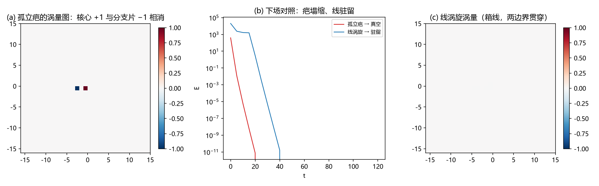

# 注记-疤的裁决实验：单值场孤立疤不可构造与载体判定

- **日期**：2026-09-06
- **层级**：验证脚本/（理论验证材料，未确认）
- **定位**：绕数承载层问题的第一轮直接实验。环的裁决实验否定光滑场环的自稳定后，候选载体转向格点内离散缺陷（"疤"）。本实验在裸单值场中构造最小离散绕数载体（单胞涡旋），结果为定案级否定：**单值场中孤立疤不可构造**：涡量图显示核心 +1 与分支切割片 −1 精确相消（总涡量恒 0），下降塌缩到真空。与线涡旋对照（开放盒溶解、周期盒受保护但为箱线）合并为三联裁决：裸单值场没有粒子载体，载体必须进入三元组格点内离散结构
- **关联**：《注记-环的裁决实验：裸模型无亚稳与绕数承载层问题》（前案：环无亚稳无垒）；《注记-裁决实验四件套复跑》（窄区静态碗与判决性检验建议，下一实验对象）；质量机制定案（缺陷 = 格点内异类）；《内部草稿/注记-边缘创生律》与术语提案"有限增长晶格"行（疤 = 晶格自身离散性的缺陷）；P1-33
- **脚本**：`验证脚本/minimal_verification_scar_protection.py`（N = 32，J = 1，κ = 0.6，φ = 0 垫片开放边界，确定性无随机数）；图：`images/minimal_verification_scar_protection.png`（见 §三 图 1）
- **状态**：验证完成。三联裁决：光滑场环死（前案）+ 孤立疤不可构造（本案 [D1]）+ 线涡旋非粒子（本案 [D2]）；下一实验 = 体系哈密顿量窄区静态碗的判决性下降

---

## 一、背景与判据

绕数承载层问题：光滑场实现无保护已定案后，"疤"（格点内/单胞尺度离散绕数）成为候选载体。本实验在裸单值场中检验其构造可能性。判据：其一，环带构造（φ = atan2(ỹ, x̃)·g，g 在胞内为 1、r ≥ 2.5 为 0）的涡量图与总涡量；其二，过阻尼下降的下场；其三，对照构型（连边界线涡旋）以钉死保护来源。

## 二、过程教训（三轮构造迭代）

其一，四角直接赋大相位（0/π/2/π/3π/2）会在 π 角对零背景邻居处生成人工反涡旋片（总涡量读 −2，核心位置漂向原点）。其二，索引/坐标混用：构造中心用"格点索引 + 0.5"而相位场用坐标（site − N/2），疤被建到盒外角上被垫片裁剪（构造校验当场抓住，未污染结论）。其三（最终版）：环带构造修正中心后涡量图干净显现。三轮教训与《环的裁决实验》的两轮同族：构造校验先行是本类实验的生命线。

## 三、结果

### 孤立疤的涡量解剖（判据 [D1]）

| 涡量图（z = 0 平面） | 读数 |
|---|---|
| 核心 plaquette（胞中心） | +1.000 |
| 分支切割片（−x 方向 2 格距处） | −1.000 |
| 总涡量 | 0.000（精确） |

环带构造的单胞绕数必然伴随一根分支切割：切割两侧相位差 = 2π·g(r)，g < 1 处为可见不连续（涡量片）。核心与切片互相吸引（间隔 2 格距），下降 $E = 400 \to 0$ 精确真空（对湮灭）。**判据 [D1] 成立：单值场中孤立疤不可构造：任何局域绕数必然自带反绕数对，总涡量守恒迫其对湮灭。**

### 线涡旋对照（判据 [D2]）

连边界的线涡旋（分支切割展开到盒边界，derrick_3d [2a] 式）在开放盒中沿 z 滑出溶解（E = 20406 → 0，W → 0）；[2a] 的周期盒线涡旋稳定源于盒的环绕拓扑（贯穿 BC）。两种盒中线都非粒子：周期盒线是箱线（贯穿整个盒子），开放盒线直接溶解。**保护来自盒的 BC 环绕，非任何局域性质。**

### 三联裁决

光滑场环死（前案）+ 孤立疤不可构造（本案 [D1]）+ 线涡旋非粒子（本案 [D2]）⇒ **裸单值场没有粒子载体**。结论落在结构层面，超出任何一次构造的偶然：单值场的局域绕数必带对偶反绕数（分支切割），守恒律强制对湮灭；只有边界贯穿（箱线）逃过此律，而箱线尺度 = 盒子尺度。

## 四、理论含义

1. **载体判定**：粒子载体必须携带超出单值相场的自由度：三元组格点内离散结构（κ_φ 格点内耦合，质量机制定案"缺陷 = 格点内异类"）是体系内唯一现成候选。载体问题与质量机制在此完全合流：不是两个问题，是同一个格点内结构的两个侧面（绑定能 = 质量、绕数 = 电荷）。
2. **宽度设计窗口仍然有效**：《环的裁决实验》的宽度趋势（ℓ ≥ 2 格距保洛伦兹色散）对疤的 dressing 形态给出定量约束：保护由离散结构承担，色散由 ≥ 2 格距的有效宽度承担，两者分工而非兼得。
3. **插入再锚定判据的地位**：载体定为格点内结构后，离散镶嵌插入的再锚定检验（插入后构型保持）从旁支判据升级为主判据之一。

## 五、边界

其一，裸模型（XY + on-site κ）裁定；体系三元组哈密顿量的格点内结构未在本脚本实现（下一步实验）。其二，"格点内离散保护"是候选方向：格点内相对相位同为连续角，其构造性保护需要 σ 锁定机制的数值实现确认，本注记不预设其成立。其三，盒子仅开放边界一种（周期盒线涡旋的稳定性引自 derrick_3d [2a]）。

## 六、严格程度声明

第三节为可复现计算事实（脚本存档、确定性、涡量图直接可视化）。第四节为体系解读（第 1 条有质量机制定案支撑，第 2、3 条为设计约束与判据升级）。构造教训全部入档（第二节）。未确认前不入理论总纲。

---

## 说明

本注记为疤的裁决实验记录（2026-09-06）。下一实验 = 体系哈密顿量窄区静态碗的判决性下降（并行复跑遗留）+ 格点内离散保护的数值实现。登记见开放问题总览 P1-33。未确认前不入理论总纲基准。
