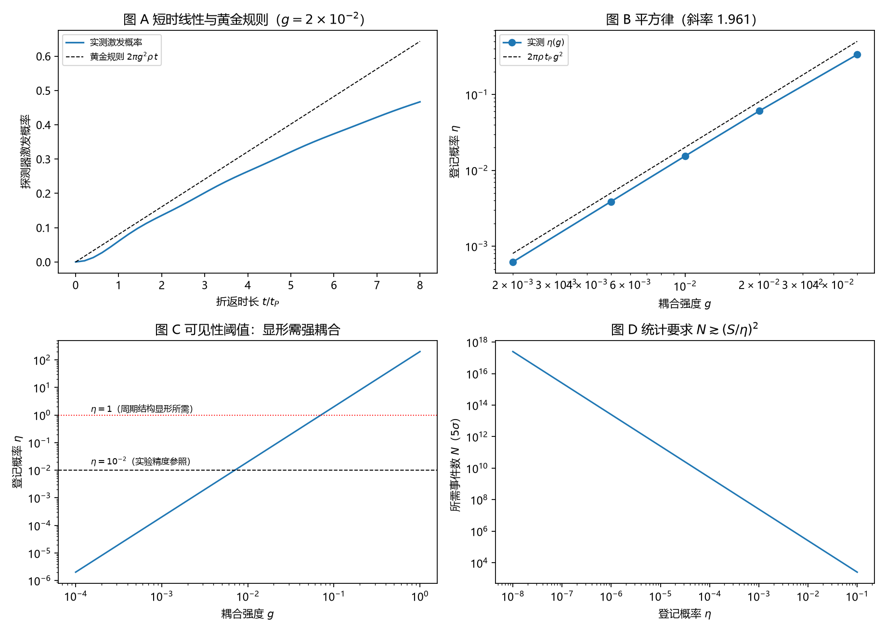

# 注记-登记效率轮的最小验证：周期结构显形需强耦合

- **日期**：2026-09-18
- **对应脚本**：`验证脚本/minimal_verification_registration_efficiency.py`（判据 J1 至 J6，6/6 通过；确定性；运行约 1.0 秒；图存 `images/registration_efficiency.png`，见 §一 图 1）
- **依据**：[[验证脚本/注记-自发项导出轮的最小验证：本底来自时钟折返，与真空涨落分家]]（$\eta = 1$ 的理想化来源）；[[内部草稿/份额的抽样口径与半经典分工：束缚振荡晶格上的抽样机制读数]] §3.4 与 §10 其六；[[内部草稿/开放问题总览：元相子理论待解决问题清单]] P3-12（必答项：登记效率 $\eta$ 的量级或上界）；[[理论总纲/元相子理论的实验可检验预言清单]] C4
- **定位**：把"每次折返必被登记"换成一个探测器模型，使登记概率 $\eta$ 从假设变成算得出来的量，并把 C4 的物理不可见性转成定量结论。本注记不改动基准文件。
- **状态**：判据 6/6 通过。核心读数：黄金规则率与实测斜率相差 $9.06\%$；$\eta$ 对 $g$ 的双对数斜率 $1.96$（弱耦合端两点之比 $99.99$ 对预期 $100$）；$\eta = 10^{-2}$ 需 $g = 0.0071$，$\eta = 1$ 需 $g = 0.0705 \approx 0.011\,\omega_P$；统计要求 $N \gtrsim (S/\eta)^2$，对 $\eta = 10^{-2}$ 约 $2.5\times10^5$、对 $10^{-6}$ 约 $2.5\times10^{13}$。

---

## 一、判据与结果

| 判据 | 内容 | 通过条件 | 实测 |
|---|---|---|---|
| J1 | 黄金规则率 | 与 $2\pi g^2\rho$ 偏差 $<10\%$ | 斜率 $7.31\times10^{-2}$ 对 $8.04\times10^{-2}$，偏差 $9.06\%$ |
| J2 | 登记概率平方律 | 双对数斜率 $2.0 \pm 0.1$ | $1.9606$（$\eta$ 从 $6.2\times10^{-4}$ 到 $0.337$） |
| J3 | 更弱耦合下的平方律 | $\eta$ 之比与 $100$ 偏差 $<10\%$ | $99.99$ |
| J4 | 可见性阈值 | 给出 $\eta = 10^{-2}$ 与 $1$ 所需的 $g$ 及标度 | $g = 0.0071$ 与 $0.0705$（$0.011\,\omega_P$）；$g^* \propto 1/\sqrt{\rho\,t_P}$ |
| J5 | 统计要求 | 给出 $N \gtrsim (S/\eta)^2$ 的读数 | $2.5\times10^5$（$\eta = 10^{-2}$）与 $2.5\times10^{13}$（$\eta = 10^{-6}$） |
| J6 | 条件性一致 | 写明不可区分的条件 | $\eta \lesssim 10^{-2}$ 时与散粒噪声水平不可区分 |

图注：左上为探测器激发概率随时间的变化与黄金规则直线；右上为登记概率对耦合强度的平方律；左下为可见性阈值（两条水平线分别对应实验精度参照与显形所需）；右下为探测赤字所需的事件数对登记概率的依赖。

## 二、模型设定

探测器取二能级自由度，与一条连续态浴弱耦合。浴取格点模的密集谱：$201$ 模、带宽 $6.283$（即 $2\pi$）、态密度 $\rho = 31.99$，探测器能级与浴中心共振。耦合强度 $g$ 在单激发扇区内为常数，初始态为探测器基态、浴真空。一次折返的时长取 $t_P = 1$，折返期间探测器被激发的概率即登记概率 $\eta(g)$。

单激发扇区的演化用哈密顿量的本征分解精确计算：$H$ 为 $(N_{\rm bath}+1)$ 维实对称矩阵，$\eta(t) = 1 - |\sum_m |c_m|^2 e^{-iE_m t}|^2$，$c_m$ 为初态在本征基下的系数。黄金规则预期为 $\eta = 2\pi g^2 \rho\, t_P$（短时、马尔可夫区）。

## 三、读数的意义

登记不是必然，其概率按耦合平方走。实测 $\eta$ 对 $g$ 的双对数斜率为 $1.96$，在更弱耦合端两点之比为 $99.99$（预期 $100$），与黄金规则率 $2\pi g^2\rho$ 的偏差为 $9.06\%$（J1 至 J3）。$\eta$ 因此是算得出来的量：$\eta = 2\pi\rho\,t_P\,g^2$。

C4 的物理不可见性由这组数定量化。$\eta = 10^{-2}$ 需要 $g = 0.0071$，$\eta = 1$ 需要 $g = 0.0705$，即耦合要达到普朗克频率的百分之一量级才能让周期结构显形（J4）。常规弱耦合下 $\eta \ll 1$，Fano 因子 $1 - \eta$ 与 $1$ 的差别落在现有精度之下，因此 C4 只作条件性候选是恰当的。

真正的障碍是系统误差，统计量不是。探测赤字所需事件数按 $N \gtrsim (S/\eta)^2$：$\eta = 10^{-2}$ 时约 $2.5\times10^5$ 次事件，$\eta = 10^{-6}$ 时约 $2.5\times10^{13}$ 次（J5）。前者在原理上可及，后者需要长期积分；而无论哪一档，探测器效率与暗计数都会产生同样方向的赤字，必须靠"赤字是否随占据数移动"来分离。

**一条附带读数。** 自发通道必须接连续态。首版把探测器与单一格点模耦合（保留反旋波项），结果登记概率按 $g^6$ 走、量级低到 $10^{-19}$：单模的反旋波项只是虚过程，给不出自发登记。接上连续态浴后才得到 $g^2$ 律（见 §六 过程记录）。

## 四、严格程度声明

黄金规则率属标准微扰结果，本轮的数值核对与其相差 $9.06\%$，残差来自有限带宽与高阶项；平方律是同一展开的直接后果。浴为平带模型，其密度 $\rho$ 与带宽是模型参数，不是体系推导；阈值 $g^*$ 因此依赖 $\rho$，跨模型引用时须按 $g^* \propto 1/\sqrt{\rho\,t_P}$ 折算。探测器本身的微观结构未定，本轮只给出"耦合与登记概率"的关系，不给出耦合的来源。

## 五、边界声明

本验证只做：单激发扇区内的精确演化、黄金规则率与平方律的核对、可见性阈值与统计要求的读数。

本验证不做：探测器微观结构与其耦合来源的导出；真实探测器的效率、暗计数、死时间与带宽建模；记录对场的反作用；多模与三维构型；探测器热噪声与有限温度。

## 六、过程记录

判据与模型订正三处。其一，首版取探测器与单一格点模耦合（含反旋波项），登记概率按 $g^6$ 走且量级为 $10^{-19}$：单模下自发通道是虚过程，必须接连续态浴才有一阶结果；改为连续态浴后回到 $g^2$ 律。其二，首版哈密顿量漏掉初始态在单激发扇区中的能量（探测器能级），使耦合变成远失谐，短时增长为负斜率；补上能级后黄金规则核对通过。其三，首版用逐步 RK4 积分，单轮耗时 $127$ 秒；改为哈密顿量本征分解的闭式求值后降到 $1$ 秒。

效率记录：脚本约 $1.0$ 秒，无字体问题（一处 mathtext 标签曾写成双反斜杠，已修）。
