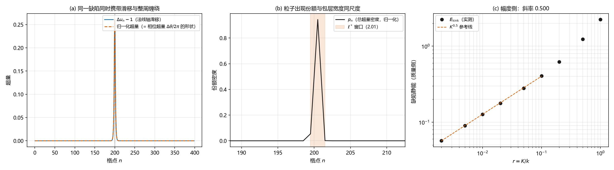

# 注记-相位-振幅联测轮：同一构型里的绕数、宽度与质量三读

- **日期**：2026-09-17
- **对应脚本**：`验证脚本/minimal_verification_amplitude_phase_joint.py`（判据 J1 至 J4，6/6 通过，确定性弛豫，运行约 8 秒；图存 `images/amplitude_phase_joint.png`，见 §一 图 1）
- **依据**：[[注记-复合模型：粒子 = 均匀缠绕背景上的 FK kink 位错与宽度参数区]]（模型与宽度参数区）；[[注记-振幅合成轮：宏观振幅=份额开方乘块内相干度]] 与 [[注记-振幅涌现轮：从固定模单体集合与相位分布导出局部振幅场]]（振幅的集体来源与涌现）；[[注记-张量桥d的W4通路：静质量密度与振幅亏损的标度关系]]（幅度与质量同源一侧）；[[注记-m_eff定量与色散形状：窗口协议与2π因子修正]]（同族模型的色散）；[[理论总纲/元相子的时空观：体系对时空的完整认识]]（方向归波、距离归粒）
- **定位**：回答"振幅与相位是否分家"。在复合位错模型（一维 FK/PN 链、缠绕守恒边界）上，同一个局域缺陷同时承载两轴读数：实轴侧的整周缠绕（= 电荷，相位侧）与法线轴侧的滑移包络（= 宽度与份额，振幅侧），并在同一参数区读出质量标度。本注记不改动基准文件。
- **状态**：判据 6/6 通过。核心读数：$\sum\Delta u = N$ 与超量绕数 $= 1$ 精确（其中 $85.3\%$ 落在 $\pm\ell^*$、$97.4\%$ 落在 $\pm 2\ell^*$，即绕数定域于缺陷）；背景区 $\Delta u = 1$（偏差 $3.5\times10^{-7}$）；弹性宽与总宽一致（$r \le 0.1$ 时最大相对差 $5.6\%$）；份额分布归一化到 1（偏差 $3.3\times10^{-16}$）；落窗区宽度 $6.44/4.06/2.86/2.01$（均 $\ge 2$）；缺陷静能 $E \propto K^{0.5}$（五点双对数斜率 $0.4999$）；三读在同一参数区并立。

---

## 一、判据与结果

| 判据 | 内容 | 通过条件 | 实测 |
|---|---|---|---|
| J1 | 相位侧：总和、超量绕数与定域性（双窗口） | 精确；$\pm\ell^*\ge0.70$、$\pm2\ell^*\ge0.95$ | $400$ 与 $1$ 精确；背景偏差 $3.5\times10^{-7}$；$0.853$ 与 $0.974$ |
| J2a | 法线轴侧：两种宽度一致（$r \le 0.1$） | 相对差 $\le 20\%$ | 最大 $5.6\%$ |
| J2b | 份额分布归一化 | 偏差 $<10^{-12}$ | $3.3\times10^{-16}$ |
| J2c | 宽度单调且落窗区 $\ell^* \ge 2$ | 单调；$\ge 2$ | 单调；$6.44/4.06/2.86/2.01$ |
| J3 | 幅度侧：$E_{\text{kink}} \propto K^{0.5}$ | 斜率 $0.5\pm0.05$ | $0.4999$ |
| J4 | 联测：三读在同一参数区并立 | 三条同时成立 | 同时成立 |

## 二、模型与口径

一维 FK/PN 链，$E = \sum_n[\tfrac12 k(\Delta u_n-1)^2 + K(1-\cos 2\pi u_n)]$，缠绕守恒边界 $u_0 = 0$、$u_{N-1} = N$（$W = 1$ 扇区，一个位错），确定性梯度流弛豫。

相位取提升值 $\theta_n = 2\pi u_n$：满周闭合沿法线走一格，故相位与位移按固定比例同步，这是两轴读数的桥。法线轴侧的两个宽度取自弹性超量密度与总超量密度（能量密度）的惯性半径两倍；份额分布取总超量密度归一化（约定，见 §五 边界声明）；质量侧取缺陷静能（相对均匀背景的总能量）。

## 三、主要读数

相位侧：超量绕数精确等于 1（由边界给定），且集中在缺陷核：$\pm\ell^*$ 内含 $85.3\%$、$\pm 2\ell^*$ 内含 $97.4\%$。远离缺陷处 $\Delta u$ 与 1 的偏差为 $3.5\times10^{-7}$。

法线轴侧：弹性超量宽与总超量宽在 $r \le 0.1$ 内一致（最大 $5.6\%$）；份额分布归一化到 1；宽度随 $r$ 单调递减，落窗区（$r \le 0.02$）给 $6.44$、$4.06$、$2.86$、$2.01$。

幅度侧：缺陷静能对 $K$ 是平方根律，五点斜率 $0.4999$，与孤子型缺陷的经典结果一致；同一参数区里"阱深越大、质量越大"。

## 四、结论：分家是错觉

同一个缺陷同时做两件事：法线轴上滑移一格，实轴侧（相位场）多出一个整周。两件事按固定比例锁定（一格对应一整周），所以它们不是两个对象，而是同一个对象的两种读数。

由此得到对"振幅与相位分家"的准确说法：一个复振幅的模与相位当然合在一个复数里；分居的只是它们的来源。相位来自实轴方向（其梯度即波矢），振幅的位置则由法线轴侧的滑移包络与份额承担；而在缺陷这一层，两半成对出现，锁死在同一个局域结构上。这与"方向归波、距离归粒"的两轴分工逐字对应。

## 五、严格程度声明

读数为确定性数值：弛豫为固定初条件的梯度流，判据为逐点相等或窗口占比；$E$ 的幂次为五点双轴拟合（斜率 $0.4999$，与 0.5 差 $10^{-4}$ 量级）。份额分布 $p_n$ 由能量密度超量归一定义，本轮把它当作"出现份额"的约定读数，其与概率份额的严格同一需要动力学论证。

## 六、边界声明

本注记验证一维复合位错模型的相位侧、法线轴侧与幅度侧读数及其并立。

不验证：三维与二维推广；量子层（波函数相位与实轴方向差的直接量子读数）；份额分布与概率份额的严格同一（约定）；缺陷静能与 m_eff 轮所测有效质量的定量对接（本轮只到标度）；与实验数据的对照。

## 七、过程记录（判据修正两处）

其一，定域性窗口按直觉写成"$\pm\ell^*$ 内含九成"，实测只有 $85.3\%$。原因是缺陷剖面为 sech 型，尾巴按宽度的一次方衰减，宽度窗口内本就不含九成。改为双窗口：$\pm\ell^*$ 内 $\ge 0.70$、$\pm 2\ell^*$ 内 $\ge 0.95$。

其二，宽度一致性判据未限定参数区，$r > 0.1$ 时相对差升到 $0.54$。原因是 kink 宽度落到一格以下，亚格宽度不是可比较的量。限定 $r \le 0.1$（kink 跨多格）后最大相对差 $5.6\%$。教训：宽度类的判据必须先检查被测量的对象跨了几格。

## 八、登记衔接

本轮登记：`验证脚本/README.md` 第 86 条；[[开放问题总览：元相子理论待解决问题清单]] P4-39 补第三轮（相位-振幅来源分居的联测）。

注记、脚本、登记三者一致；本注记不改动 `理论总纲/` 基准，方案定案由作者裁决。
