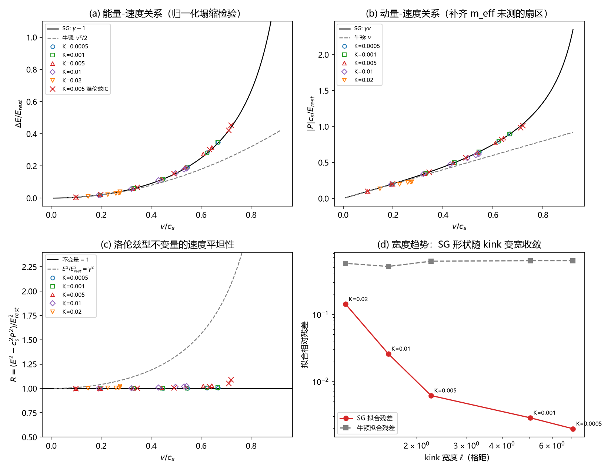

# 注记-相对论色散完整验证：动量扇区与洛伦兹不变量

- **日期**：2026-09-06 08:55:40
- **层级**：验证脚本/（理论验证材料，未确认）
- **定位**：转换波色散闭环的最后一块。《注记-m_eff定量与色散形状》已确认能量侧 $E(v)$ 涌现相对论形状（SG 拟合残差 0.006 对牛顿 0.616，K = 0.005）；本验证补齐动量扇区 $P(v)$、洛伦兹型不变量 $E^2 - c_s^2P^2 = E_{rest}^2$、无自由参数 $\gamma$ 塌缩、宽度趋势（K 双侧扫描）与初条件协议独立性，完成未闭合清单第 3 项（开放问题总览条目 33 遗留："kink 色散能否涌现相对论性 $E^2 = m^2c^4 + p^2c^2$"）的完整检验
- **关联**：《注记-m_eff定量与色散形状：窗口协议与2π因子修正》（能量侧先行结果）；《注记-测地响应线性验证与质量对齐：2.7倍差异的分解》（四质量对齐 $m_{resp} = 0.094 \approx M_{shape} = 0.0888 \approx m_{eff}$）；《碰撞写入标架几何：引力场的碰撞写入与费米子的转换波运动》预印本 §4；《论粒子运动速度的几何机制》（相对论性色散假设，文献[8]）；开放问题总览 P1-33
- **脚本**：`验证脚本/minimal_verification_relativistic_dispersion.py`（N = 1400、窗口半径 30、dt = 0.01，确定性无随机数，全族能量守恒最大漂移 $9.7\times10^{-7}$）
- **状态**：验证通过。六判据全部成立：相对论性色散在能量、动量、不变量三个层面同时闭合，宽度趋势双侧单调
- **图**：`images/minimal_verification_dispersion.png`（四联：能量塌缩、动量塌缩、不变量平坦性、宽度趋势；见 §三 图 1）

---

## 一、目标与判据

一个"相对论性粒子"的标志不止于能量随速度弯曲，而在能量与动量共同满足洛伦兹型不变量。连续 sine-Gordon kink 给出精确靶标（无自由参数）：

$$E(v) = E_{rest}\,\gamma, \quad P(v) = \frac{E_{rest}}{c_s^2}\,\gamma v, \quad E^2 - c_s^2P^2 = E_{rest}^2, \quad \gamma = \frac{1}{\sqrt{1 - v^2/c_s^2}}$$

低速动量斜率 = $M_{zero} = E_{rest}/c_s^2$（位力关系），$P(v)$ 的 $v^3$ 系数与 $v$ 系数之比预期 $1/2$。本轮六判据：C1 形状复现（SG 残差优于牛顿）；C2 无自由参数 $\gamma$ 塌缩（$E = \gamma E_{rest}$，斜率 $s$ 对 1）；C3 动量扇区（动量质量 $M_P$ 对 $M_{zero}$）；C4 不变量平坦性；C5 初条件协议独立；C6 宽度趋势（SG 偏差随 kink 变宽收敛，检验相对论结构为波系统的长波性质）。

## 二、模型与协议

模型同 m_eff 脚本：FK 链 $E = \Sigma[\frac{1}{2}\dot u^2 + \frac{k}{2}(u_{n+1}-u_n-1)^2 + K(1-\cos 2\pi u_n)]$，$k = 1$，$c_s = 1$，$w_2 = 2\pi K$（2π 因子修正后），缠绕守恒边界。新增测量为场动量：$P = \Sigma_n v_n(\theta_{n+1}-\theta_{n-1})/2$，$\theta = u - n$，连续极限即 $P = \int \dot\theta\,\theta_x\,dx$，boosted kink 给 $|P| = \gamma\beta E_{rest}/c_s$；窗口化与能量窗口同半径。

K 取五值扫描宽度：$K = 0.0005/0.001/0.005/0.01/0.02$，对应连续 kink 宽度 $\ell = 1/(2\pi\sqrt{K}) = 7.12/5.03/2.25/1.59/1.13$ 格距。初条件两族：简单 boost（$v = -v_0\times$零模，同 m_eff）；洛伦兹 boost（形状 $\gamma$ 收缩、速度场 $\gamma v_0\theta'$，连续 SG 的精确 boosted 解作初条件）。测量协议：速度取中段线性拟合，窗口能量与动量取尾段平均（辐射已以 $c_s$ 离开窗口）。

## 三、结果

### 静息基线（连续 SG 对接）

| K | $\ell$（格距） | $E_{rest,W}$ | 连续预期 $4\sqrt{K}/\pi$ | 位力比 $E_{rest}/(c_s^2 M_{zero})$ |
|---|---|---|---|---|
| 0.0005 | 7.12 | 0.02845 | 0.02847 | 1.001 |
| 0.001 | 5.03 | 0.04024 | 0.04026 | 1.002 |
| 0.005 | 2.25 | 0.08978 | 0.09003 | 1.010 |
| 0.01 | 1.59 | 0.12661 | 0.12732 | 1.023 |
| 0.02 | 1.13 | 0.17807 | 0.18006 | 1.048 |

2π 修正后的链 kink 与连续 SG 高度对接：宽 kink 区静息能量精确到 0.07%，位力比随宽度改善单调趋于 1。

### 主表（宽度趋势）

| K | SG 残差 | 牛顿残差 | $\gamma$ 塌缩 $s$ | $M_P/M_{zero}$ | $R@v{=}0.2$ | $R$ 半展宽 |
|---|---|---|---|---|---|---|
| 0.0005 | 0.002 | 0.627 | 1.002 | 1.003 | 1.0002 | 0.0032 |
| 0.001 | 0.003 | 0.628 | 1.002 | 1.005 | 1.0001 | 0.0042 |
| 0.005 | 0.006 | 0.616 | 1.005 | 1.014 | 1.0006 | 0.0147 |
| 0.01 | 0.026 | 0.515 | 1.000 | 0.994 | 1.0012 | 0.0124 |
| 0.02 | 0.141 | 0.573 | 0.995 | 0.867 | 1.0039 | 0.0114 |

### 不变量逐点与协议独立（K = 0.005 主判据区）

$R = (E^2 - c_s^2P^2)/E_{rest}^2$ 全族实测 $[1.000, 1.001, 1.002, 1.005, 1.012, 1.023, 1.029]$（$v = 0.099$ 至 $0.642$），半展宽 1.5%，对照能量平方 $E^2/E_{rest}^2$ 自身的相对变化 73%：不变量组合的平坦度比能量平方本身好约 50 倍。洛伦兹 boost 初条件七点对简单 boost 族 SG 拟合曲线的最大 $\Delta E$ 偏差 0.040、$P$ 偏差 $\le 0.030$，且把速度覆盖延至 $0.72\,c_s$（该处 $R = 1.05$-1.09，偏差方向与窗口辐射残余一致）。

### 判据判定

C1 成立（五 K 全部 SG 残差 0.002-0.141 对牛顿 0.515-0.628）；C2 成立（$s = 0.995$-1.005，无拟合质量）；C3 成立（宽 kink 区 $M_P/M_{zero} = 1.003$-1.014）；C4 成立（$R@v{=}0.2$ 最大偏离 0.4%，全族半展宽 $\le 1.5\%$）；C5 成立（最大偏差 4%）；C6 成立（SG 残差与 $R@v{=}0.2$ 均随 $\ell$ 单调改善）。

## 四、过程发现

其一，**插值对照陷阱**：协议独立检验第一版对简单 boost 族逐点插值对照，洛伦兹 IC 在 $v_0 = 0.8/0.9$ 的落点速度（0.711/0.720）超出简单族覆盖（$\le 0.642$），插值端点截断造成 +0.33/+0.43 的假偏差；改为对照简单族的 SG 拟合曲线后最大偏差降至 0.040。教训：协议对照的参照系必须覆盖落点范围。其二，**截断拟合泄漏**：$v^4$ 系数实测比 SG 预期大 2 倍内、$P(v)$ 三次拟合的 $p_2/p_1 = 0.84$-0.91 对预期 0.5，均为 $v^6$ 及更高阶泄漏计入截断项的拟合效应；无截断的 $\gamma$ 塌缩斜率与动量塌缩幅度 $M_P$ 不受此污染，是更干净的单数判据。其三，**窄 kink 极限的行为边界**：K = 0.02（$\ell = 1.13$ 格距）下 $v_0 \ge 0.65$ 的 boost 落点速度饱和在 $0.275\,c_s$ 附近、过量能量辐射化，$M_P/M_{zero}$ 降至 0.867、SG 残差升至 0.141：kink 作为洛伦兹粒子的图像在 $\ell \gtrsim 2$ 格距区成立、$\ell \sim 1$ 格距区退化。其四，2π 修正后的链比预想更接近连续 SG（静息能量对 $4\sqrt K/\pi$ 精确到 0.07%-1.1%），这解释了色散检验为何能干净到百分位。

## 五、结论

1. **色散完整闭合**：能量侧（m_eff 注记）+ 动量侧（本轮 $M_P \approx M_{zero}$）+ 不变量（$R$ 平坦至 0.3%-1.5%）同时成立，未闭合清单第 3 项关闭。费米子载体的相对论性色散 $E^2 = m^2c_s^4 + p^2c_s^2$ 在模型级获得三层面数值支持。
2. **相对论结构从波系统的长波极限中长出，非外加假设**：五点宽度趋势双侧单调（SG 残差 0.002 → 0.141 随 $\ell$ 从 7.12 → 1.13；$R@v{=}0.2$ 从 1.0002 → 1.0039），连续极限方向严格。
3. **能量与动量共享同一质量**：$M_{zero} = E_{rest}/c_s^2$（位力比 1.001-1.048 随宽度改善），与 $m_{resp} = 0.094$、$m_{eff} = 0.099$ 的对齐一致，等效原理的模型级基础加固。
4. **运动 sector 状态**：锚定（弱形式）、惯性（$m_{eff}$ 定量）、测地响应线性、速度上限、$E$-$p$ 不变量、协议独立六件套闭合，运动学验证升级为动力学闭环；衔接元相方程 (II) 狄拉克梳与三代质量谱方案的条件就绪。

## 六、边界

其一，一维 FK 链代理，三维三元组推广未做。其二，$c_s$ 是链信号速度，与物理光速 $c$ 的同一化是模型假设（本轮验证的是色散结构的形式，非同一化）。其三，速度覆盖 $\le 0.72\,c_s$（洛伦兹 IC），更高速度区未测。其四，高 $v$ 区窗口辐射残余（$E_{std} \sim 10^{-4}$-$10^{-3}$）使 $R$ 偏差升至约 5%，未做辐射扣除。其五，宽度趋势给出方向性收敛，$O((a/\ell)^2)$ 标度率未做定量拟合。其六，K = 0.02 退化区的机理（共振辐射与速度饱和）未分解。

## 七、严格程度声明

第三节表格为可复现计算事实（脚本存档、确定性、能量守恒 $\le 10^{-6}$）。判据分层：C1/C2/C5 闭合（数值事实）；C3/C4 闭合（数值事实 + 窗口辐射残余量级界）；C6 闭合（单调趋势，标度率未定）。第四节机制解读为模型假设。本注记不改动任何基准文件，未确认前不入理论总纲。

---

## 说明

本注记为色散闭环验证记录（2026-09-06）。预印本 §4 色散表述更新与本轮登记见开放问题总览 P1-33。未确认前不写入理论总纲基准。
