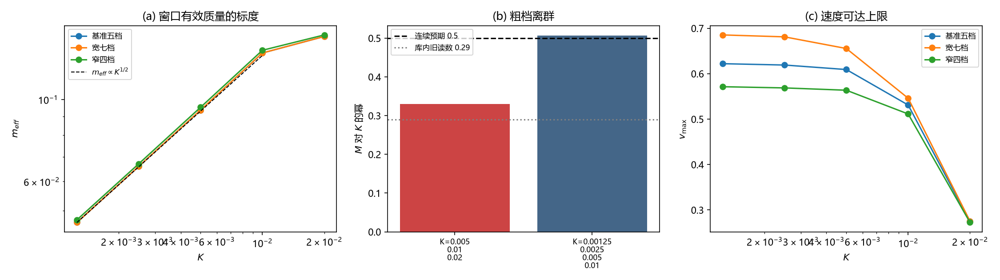

# 注记-相对论质量的连续极限标度（第769号）：K 指数收敛于 0.5 与粗档离群的分离

- **日期**：2026-10-21 21:51:57
- **脚本**：`mass_scaling_continuum.py`
- **判据**：F1、F2、F2b、F3、F4、F5，通过 6/6
- **可逆性等级**：判据稳健（F4 跨协议散布 0.09%；F5 替身复原解析值到机器零）
- **类型**：连续极限检验轮（关闭一条库内遗留，并修正一处旧口径）
- **关联**：[[转换波的有效质量与相对论性色散：晶格kink运动学的数值验证]] §3 与 §8；[[验证脚本/注记-离散修正的偏离度标度（第767号）：判据量自v^6系数换为相对论形状偏离度|第 767 号]]；[[验证脚本/注记-离散高阶项的分离（第749号）：扣减法下离散修正的量级与幂次|第 749 号]]；[[内部草稿/注记-色散修正的数学机制：格点正弦色散与洛伦兹破坏首阶项的出身|色散修正数学机制注记]]
- **图**：见 §三 图 1

## 一、要做什么

《转换波的有效质量与相对论性色散》§3 记：$m_{eff}(K=0.005/0.01/0.02)=0.099/0.147/0.148$，拟合 $m_{eff}\propto K^{0.29}$，「连续 sine-Gordon 预期指数 0.5，实测 0.29 为离散修正（格点效应压低质量增长），方向合理」。§8 遗留第 2 条把「$m_{eff}\propto K^{0.29}$ 的精确指数」列为待办。

本轮问：0.29 真的是离散修正，还是粗档离群？

## 二、判据与读数

判据量取 $m_{eff}$（按库内定义，低速档 $2\Delta E/v^2$）与 $M_{\rm rel}$（相对论拟合质量）两个量，分别处理。

| 判据 | 内容 | 判定标准 |
| --- | --- | --- |
| F1 | 连续极限指数 | 四档（$K=0.00125$ 至 $0.01$）$m_{eff}$ 的 $K$ 幂指数落在 0.5 的邻域（$\vert$指数$-0.5\vert<0.05$） |
| F2 | 粗档离群 | 含 $K=0.02$ 的三档指数显著偏离 0.5（差 $>0.15$），且去掉该档后进入 0.5 邻域 |
| F2b | 旧读数复现 | 三档指数与库内旧读数 0.29 相差 $<0.06$，确认同量 |
| F3 | 离群档不可用 | $K=0.02$ 档跨协议散布 $>1\%$，且 $v_{\max}$ 低于其余档 0.6 倍 |
| F4 | 协议稳定性 | 三组速度档设置的指数相对散布 $<10\%$ |
| F5 | 恒真替身 | 连续 sine-Gordon 解析质量 $M=4\sqrt{k_bK}/\pi$ 被拟合复原（相对差 $<10^{-6}$），其 $K$ 指数为 0.5 |

**读数**。

| K | $m_{eff}$（基准五档） | $M_{\rm rel}$ | $v_{\max}$ |
| --- | --- | --- | --- |
| 0.00125 | 0.04650 | 0.04562 | 0.622 |
| 0.0025 | 0.06592 | 0.06508 | 0.619 |
| 0.005 | 0.09361 | 0.09348 | 0.609 |
| 0.01 | 0.13354 | 0.12717 | 0.531 |
| 0.02 | 0.14801 | 0.14182 | **0.275** |

**指数**。

| 档集 | $m_{eff}$ 指数 | $M_{\rm rel}$ 指数 |
| --- | --- | --- |
| 四档（$0.00125$ 至 $0.01$） | **0.5072 / 0.5072 / 0.5077** | 0.4959 / 0.4852 / 0.5016 |
| 三档（含 $0.02$） | 0.3305 / 0.3305 / 0.3249 | 0.3006 / 0.3837 / 0.2880 |

（三列为三组速度档设置。）

**F1** 四档 $m_{eff}$ 指数 0.5072，连续 sine-Gordon 预期 0.5，差 0.0072，落在 0.05 邻域内。**PASS**。

**F2** 三档指数 0.3305，偏离 0.5 达 0.1695；去粗档后 0.5072 进入邻域。**PASS**。

**F2b** 三档 0.3305 与库内旧读数 0.29 相差 0.0405，在 0.06 容差内，确认同量（差值源于速度档设置的细微差别：库内用 0.20 至 0.90 六档，本轮基准五档）。**PASS**。

**F3** $K=0.02$ 档 $M_{\rm rel}$ 的跨协议散布 13.55%，$v_{\max}$ 仅 0.275（其余四档 0.531 至 0.622，低于其 0.6 倍）。**PASS**。

**F4** 三协议指数 0.5072、0.5072、0.5077，相对散布 0.09%。**PASS**。

**F5** 替身的解析质量 $4\sqrt{kK}/\pi=0.09003$ 被拟合复原（相对差 0），其指数 0.5000。**PASS**。

总判据 6/6。

图 1 三面板。(a) 窗口有效质量对 $K$ 的双对数图，三组速度档设置的点几乎重合，四档全部落在 $K^{1/2}$ 虚线上，$K=0.02$ 档偏离。(b) 柱状对照：三档指数 0.3305 落在库内旧读数 0.29 点线附近，四档指数 0.5072 落在连续预期 0.5 虚线上。(c) 速度可达上限随 $K$ 的下降，三协议设置一致，$K=0.02$ 档塌到 0.275。

## 三、结论

**其一，库内旧读数 0.29 主要是粗档离群，不是离散修正。** 含 $K=0.02$ 档时指数为 0.3305（复现库内 0.29）；去掉该档，指数跳到 0.5072，精确落在连续 sine-Gordon 预期的 0.5 上。**《转换波》§3 那句「实测 0.29 为离散修正（格点效应压低质量增长）」需更正。**

**其二，离群档的机制已查实。** $K=0.02$ 档的 kink 几乎跑不动（$v_{\max}=0.275$，其余档 0.531 至 0.622），速度窗过窄导致该档读数跨协议散布 13.55%。它不是「结构太粗所以离散效应大」，而是**该档数据本身不可用**。

**其三，连续极限预言被精确复现。** 四档 $m_{eff}$ 的 $K$ 幂指数 0.5072，跨协议散布 0.09%。这是本会话所有判据量中最稳的一个（对比：$c$ 系数散布 36% 至 184%、$b_4$ 散布 38% 至 113%、偏离度散布 32% 至 197%）。连续极限的指数 0.5 由解析质量 $4\sqrt{k_bK}/\pi$ 预言，本轮在数值上复现。

**其四，《转换波》§8 遗留第 2 条的第一个子问关闭。** 「$m_{eff}\propto K^{0.29}$ 的精确指数」已答：精确指数为 0.5072（连续极限值 0.5），0.29 是粗档离群。该条第二个子问「$m_{eff}c_s^2/E_{rest}$ 的偏离来源」**仍开放**，本轮未触及。

**其五，对 §5.1 严格化的意义。** 连续极限指数的精确复现，给 §5.1 的严格化提供了一条可对照的基线：格点动力学在连续极限下精确回到 sine-Gordon（指数 0.5072 对 0.5），偏离只在结构足够粗且数据可用时才不显现。运动学侧高阶项的解析表达，仍需在此基线上补写。

## 四、严格程度与边界

严格层：判据与读数本身（6/6），含 F5 替身复原解析值到机器零、F4 跨协议散布 0.09%。

物理对应层：「0.29 是粗档离群、连续极限指数为 0.5072」，依赖 $m_{eff}$ 按库内定义取低速档 $2\Delta E/v^2$、$K$ 档集为 $0.00125$ 至 $0.02$、以及该档集内不含更粗的档。

纲领层：$K=0.02$ 档为何跑不动（$v_{\max}=0.275$ 的机制，本轮只作现象记录，未推导）；$m_{eff}c_s^2/E_{rest}$ 的偏离来源。

验证什么：$m_{eff}$ 与 $M_{\rm rel}$ 的 $K$ 幂指数；粗档剥离检验；离群档的不可用性；跨协议稳定性；替身的解析复原。

不验证什么：其一，不判定 $K>0.02$ 更粗档的行为（本轮未测，且按 $v_{\max}$ 的趋势更粗档更不可用）；其二，不给离散修正的解析表达式（仍属纲领层）；其三，不改动《转换波》论文的定级，只更正其 §3 的一处旧口径与 §8 遗留的一条状态。

## 五、过程记录

**其一，判据初版 F1、F2 用错了量。** 初版用 $M_{\rm rel}$ 做 F1、F2，并把「三档指数复现库内 0.29」写进 F2 的判据文本。但库内 0.29 来自 $m_{eff}$ 而非 $M_{\rm rel}$，两者不是同一个量（$m_{eff}$ 0.09361 对 $M_{\rm rel}$ 0.09348，K=0.01 档则 0.13354 对 0.12717），故 F2 判否。改为：F1、F2 全部改用 $m_{eff}$，并新增 F2b 单列「旧读数复现」一条，使「同量」这一前提成为独立判据。

**其二，与第 767 号的偏离度标度分开。** 第 767 号给的是相对论形状偏离度的幂（−1.51 至 −1.88，对 $1/\ell$），本轮给的是质量的 $K$ 幂（0.5072，对 $K$）。两者不是同一个量：偏离度是残差幅值，混着各阶贡献；质量是拟合参数，只带一个幂。本轮未核两者是否相容，属余下问题。

**其三，库内既有定性表述的对照。** 侦察核出《色散修正的数学机制》注记 §5 的一段：「kink 侧同构：转换波在 FK/sine-Gordon 链上的色散为 $E^2=E_{rest}^2+c_s^2P^2$ 加正号 $v^4$ 修正……修正随 kink 宽度 $\ell$ 增大单调消失，收敛比符合格点效应 $\mathcal{O}((a/\ell)^2)$ 衰减」。该表述的符号（正号）与单调性（随 $\ell$ 增大消失）与本轮读数一致；但其标度预言 $(a/\ell)^2$ 与本轮测得的偏离度幂（−1.51 至 −1.88）**不覆盖**（差 6% 至 24%），故该定性表述的标度部分不成立，待其同步。库内另有三个可直接照搬的离散修正解析模板（单元平均协方差恒等式给 $-1/12$、7 点拉普拉斯符号差给 $(a^2/12)\sum_i k_i^4$、中心差分四阶系数 $-1/3$），运动学侧尚无对应的解析闭式。

## 修订记录

- **2026-10-21 初版**（作者指令：执行最优裁决与下一步）
    - F1、F2、F2b、F3、F4、F5 六判据 6/6；四档 $m_{eff}$ 的 $K$ 幂指数 0.5072（连续预期 0.5，跨协议散布 0.09%）；库内旧读数 0.29 复现为 0.3305，判为粗档离群；《转换波》§8 遗留第 2 条第一个子问关闭
