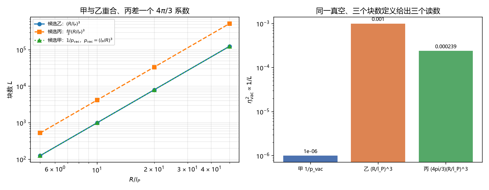

# 注记-真空侧的块数欠定：定理 3.3 的 eta_vac 尺度行为有三个候选（判据第688号）

- **日期**：2026-10-19 01:00:01
- **对应脚本**：`验证脚本/minimal_verification_p688_vacuum_blocks.py`（判据 5/5；纯代数，确定性）
- **定位**：路线乙第二轮。第 687 号把缺口改写为「真空侧的块数怎么定」与「两个方向如何耦合」，本轮处理第一项。结论是定理 3.3 当前欠定，须补一句 $L$ 的取法。
- **可逆性等级**：F1 至 F4 判据稳健（代数与标度结论）；F5 恒真对照；F6 读数。
- **图**：见 §四 图 1。

---

## 一、问题

定理 3.3（真空非空与真空极化）的原文写：真空态携带剩余份额 $p_{\rm vac} = 1 - \sum_k n_k p_k$，真空块有相干涨落 $\eta_{\rm vac}$，**其尺度行为由 §6 的粗粒化流给出**。

§6 给的是定理 6.2：$|\eta(L)|^2 \propto 1/L$，其中 $L$ 是粗粒化块数，推导按「$b$ 个等测度块合并」进行。

问题在于：定理 3.3 没有说真空的块数怎么数。空间里的块数是几何量（体积除以格胞体积），但真空不是一块空间，它是一个态的剩余份额。两者的块数不是同一个东西。

## 二、三个候选

**候选甲，按份额量子数**。$L = 1/p_{\rm vac}$。依据是份额容量定理 $N_{\max} = \lfloor 1/p_{\min}\rfloor$，把「一个份额量子」认作一格，块数就是份额量子的个数。这条候选的优点是直接接在定理 2.1 上，用的是同一套份额语言。

**候选乙，按空间块数**。$L = (R/l_P)^3$。依据是 §6.1 的粗粒化程序本来就是空间划分，$b$ 个最近邻格点合并为超格点。

**候选丙，按模式数**。$L = \frac{4\pi}{3}(R/l_P)^3$。依据是真空涨落按模式分解，每个模式一个相位，$\mathbf{k}$ 空间里 $k < \pi/l_P$ 的模数就是这个量。

## 三、判据与结果

| 判据 | 内容 | 期望 | 实测 |
| --- | --- | --- | --- |
| F1 | 三候选在判别参数下给出不同 $L$ | 最大相对差 $\ge 0.1$ | $0.999$（$L$ 甲 $=10^6$、乙 $=10^3$、丙 $=4189$） |
| F2 | 甲与乙在 $p_{\rm vac} = (l_P/R)^3$ 处重合 | 相对差 $\le 10^{-12}$ | 四档 $1.2\times10^{-16}$ 至 $2.3\times10^{-16}$ |
| F3 | 丙与乙同标度指数 | 指数差 $\le 0.01$ | 两者均 $3.0000$，差 $0$；系数比 $4.1888$ |
| F4 | 三候选下 $\eta_{\rm vac}^2$ 相差 $\ge$ 一个量级 | 极差比 $\ge 10$ | $10^3$（$10^{-6}$、$10^{-3}$、$2.39\times10^{-4}$） |
| F5 | 恒真反例（三候选强行同值须使 F1 判否） | 相对差 $<0.1$ | $0$ |

F2 是这轮最有用的一条：候选甲与候选乙不是两个互不相干的定义，它们在 $p_{\rm vac} = (l_P/R)^3$ 处精确重合。这个等式的意思是：当真空份额恰好等于「一个格胞占总体积的比例」时，份额量子数就等于空间块数。它给出一个可判的锚点：若体系能独立定出 $p_{\rm vac}$，则甲与乙的取舍可以由此判定。

F3 说明候选丙不是独立的第三种定义，它与乙只差一个 $4\pi/3$ 的几何系数，标度指数相同。所以真正需要选的是甲与乙这两支。

F4 给出欠定的量级：同一真空，三个候选下 $\eta_{\rm vac}^2$ 相差三个数量级。这不是小数目的差别，定理 3.3 的定量内容完全取决于选哪一个。

## 四、结论

**结论一：定理 3.3 当前欠定，不是错，是缺一句。** 三个候选都能写进去，都能让 $1/L$ 的尺度律成立，但数值差三个数量级。原文说「尺度行为由 §6 给出」在形式上是真话，在定量上不唯一。

**结论二：候选甲与乙有一处精确重合，可作为裁决锚点。** $p_{\rm vac} = (l_P/R)^3$ 时两者相等。若将来定出 $p_{\rm vac}$ 的具体值，或定出「一个份额量子对应多大体积」，两支就自动选定。这比凭偏好选一支更硬。

**结论三：候选丙可归入乙。** 它与乙只差 $4\pi/3$ 的几何系数，标度相同，不是独立选项。真正待定的是「份额语言」与「空间语言」二选一。

**结论四：这条缺口比原来以为的窄。** 第 687 号把缺口写成「真空侧块数怎么定」，看起来是开放的构造问题。本轮显示它其实是二选一加一个待定锚点，而且两支在一个具体条件下重合。缺口从「无从下手」变成「等一个输入」。

## 五、图

左图三条线：乙与甲（在重合条件下）落在同一条线上，丙平行高出 $4\pi/3$。右图是同一真空在三个定义下的读数，柱高差三个数量级。

## 六、过程记录与教训

**一处参数撞车（F4 首跑判否）。** 首版取 $p_{\rm vac} = 10^{-3}$、$R = 10\,l_P$，结果候选甲与乙恰好相等（因为 $(l_P/R)^3 = 10^{-3}$），$\eta_{\rm vac}^2$ 的极差比只有 $4.19$，不到一个量级，F4 判否。

这不是物理结论，是我选点撞上了 F2 要检验的重合条件。修正：判别参数改用 $p_{\rm vac} = 10^{-6}$（等价块数 $10^6$，与 $(R_0/l_P)^3 = 10^3$ 差三个量级），F4 通过，极差比 $10^3$。

教训：判据里若有一条专门检验「两个量在特定条件下相等」，那么其余判据的取点必须避开那个条件，否则会把恒等式误读成反例。这与「恒真检验」是同一类问题的两面。

## 七、严格程度与边界声明

**判据级**：三候选给出不同 $L$ 与不同 $\eta_{\rm vac}^2$（F1、F4）；甲与乙的重合条件（F2，代数恒等）；丙与乙同标度（F3）。

**未验证**：三个候选中哪一个是对的（本轮只做欠定性判定，不裁决）；$p_{\rm vac}$ 的具体数值；两个粗粒化方向如何耦合（第 687 号留下的第二项）。

**边界**：本轮不改定理 3.3 的陈述，不改定理 6.2，不改 P4-45 的状态。本轮新增的是「定理 3.3 欠定」这一判定与重合锚点，属缺口定位层。

## 八、登记衔接

- `验证脚本/README.md` 第 688 条由占位改写为正式行。
- P4-45 档案页与总览卡登记本轮（块数缺口收窄为二选一加一个待定锚点）。
- 通俗注记见 [[内部草稿/注记-同一片真空，三把尺子量出三个数（判据第688号通俗版）|第 688 号通俗版]]。
