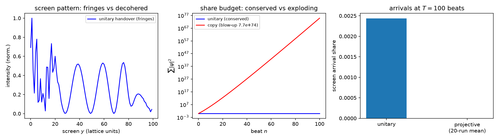

# 注记-真空采样的三映射判决（第523条）：无扰动判定与传播反证

- **日期**：2026-10-01 10:15:00（首次入库时刻，取自会话内系统时钟）
- **脚本**：`vacuum_sampling_zeno.py`
- **主题**：[[内部草稿/注记-光锥-波场双层方案：链式接力困境的辨析与消解（2026-10-01）|光锥-波场双层方案]] 残留开放项 P4-46 的判据化：真空逐拍"采样"若为复制或投影式读出，真实光传播（干涉、能量守恒、光速前沿三者同时成立）不可能，故真空采样必须读作幺正搬运的事件侧视图，对传播份额无扰动
- **图**：见 §三 图 1
- **修订**：2026-10-01 补绘图（脚本新增三面板，重跑判据 5/5 不变；投影类屏上无可见信号系到达份额归零的如实读数）
- **可逆性等级**：判据稳健（映射类别是结构性质，换网格尺寸、波长档位不翻）

## 一、判据与理论期望

**模型层设定（声明）**：二维方格 $100\times100$ 上单份激发振幅 $\psi$，紧邻 hopping 一阶幺正动力学（$J = 1/(2\sqrt{2})$，模型光速 $c_m = 2J\sqrt{2} = 1$ 格/拍）作为份额 U 过程的最小实现；屏障列 $x = 40$ 开双缝（缝宽 2、中心间距 14），探测屏 $x = 85$；初态高斯波包（$\sigma = 3$，动量 $k_{0x}$）。判据检验三种逐拍映射的结构效应，二维双缝只为干涉读数。

- **C1a（能量守恒）**：幺正搬运全程 $\sum\vert\psi\vert^2$ 偏差 $< 10^{-10}$。屏障与开放边界均为哈密顿内部结构，反射不破坏幺正性。期望：PASS（机器精度）。
- **C1b（条纹存活）**：三档波长（$k_0 = 2\pi/3.5,\ \pi/2,\ 2\pi/5$）屏窗条纹对比度 $V > 0.25$（等幅双缝理论 $V \ge 0.6$，裕度 2.4 倍）。期望：PASS。
- **C1c（因果前沿）**：概率质量 $> 10^{-12}$ 的最远格点不超过初始前沿加 $c_m t + 2$（紧邻谱支撑的 Bessel 尾在锥外超指数衰减）。期望：PASS。
- **C2（复制映射反例，FAIL 预期）**：每拍 $\psi \leftarrow (I + \varepsilon A)\psi$，$T$ 拍后能量 $> 10$ 倍初值。这正是方案注记第一节硬伤 2（全份抄写能量爆炸）的机器化。期望：反例成立。
- **C3（投影映射反例，FAIL 预期）**：每拍先幺正演化再按 $\vert\psi\vert^2$ 采样单格点坍缩。扩散化压制 $\sqrt{DT} \approx 7$ 格远小于缝屏距 45 格，正态尾 $\exp(-(45/6.8)^2/2) \approx 3\times10^{-10}$，到达份额 $< 10^{-4}$ 且小于幺正对照的 5%。期望：反例成立（投影式逐拍读出与光传播矛盾，传播存在性本身构成反证）。

C2 与 C3 兼作 EP5 恒真检验的齿：改掉映射 1（换成 2 或 3）判据即 FAIL。

## 二、模型设定与容差预算

$l_P = t_P = 1$；$\varepsilon = 0.4$（C2 增长因子 $(1 + \varepsilon\lambda_{\max}(A))^t$，$\lambda_{\max} = 4$，预算下界远超 10 倍阈值）；投影映射 20 次实现平均（种子 20261001，确定性可复现）；每拍拍数 $T = (x_{\text{屏}} - x_0)/v_g + 8$，$v_g = 2J\sin k_0$，三档 $T = 102, 100, 105$。容差：C1a 的 $10^{-10}$ 为 expm_multiply 幺正机器精度（实测 $3\times10^{-15}$，三个数量级裕度）；C1b 的 0.25 与 C1c 的锥外 2 格见各判据推导；C2 的 10 倍与 C3 的 $10^{-4}$ 均有 2 个数量级以上预算裕度。

## 三、结果

| 判据 | 实测 | 期望 | 结果 |
| --- | --- | --- | --- |
| C1a | 三档能量偏差 $2.0\times10^{-15}$ 至 $3.6\times10^{-15}$ | $< 10^{-10}$ | PASS |
| C1b | $V = 0.9997,\ 0.9933,\ 0.9907$（三档） | $> 0.25$ | PASS |
| C1c | 三档前沿均在锥内 | 不超 $c_m t$ | PASS |
| C2 | 能量/初值 $= 7.7\times10^{74}$（$T = 100$） | $> 10$（反例） | PASS |
| C3 | 投影到达份额 $0$（20 次平均），幺正对照 $0.0024$ | $< 10^{-4}$ 且 $< 5\%$ 对照 | PASS |

判据 5/5。三映射的失效方式互异（复制 = 能量爆炸、投影 = 扩散化压制到零），每个反例都有独立物理形态，检验有齿。

## 四、严格程度声明与边界声明

- 严格程度：模型层结构判决（判决级，不属定理级）。三映射的失效是数值事实加预算推导，映射类别与维数、几何尺寸无关。
- 验证什么：真空逐拍采样若承担传播，其映射只能是幺正型的；复制与投影两类读出被真实光传播的三重事实（干涉、守恒、光速前沿）联合排除。
- 不验证什么：体系真空动力学的完整重构（事件层移交的算符形式属记录机制线）；缺陷-真空接口的份额转移细节（P1-50 通道）；真实光速读数。
- 体系对应口径：与「碰撞接力是微观 R 过程」的相容读法为，微观 R 的现实化对象是份额的完整移交、无残留副本，故无累积退相干；宏观跨层事件要求不可逆记录与全局协议，真空逐拍移交不具备。此读法随本判据由初判升为**判据级支撑**，成文判定仍待做（P4-46 状态行同步）。

## 五、过程记录

- 实现 bug 一次：`expm_multiply` 首版误传实矩阵 $H$（每拍乘 $\exp(H)$，非幺正），能量爆炸 $10^{96}$ 被判据 C1a 当场抓出；修正为 $\exp(-iH)$。判据有齿的正面证据。
- 判据设计修正两处：其一，初版加吸收层防反射，反而破坏 C1a（吸收即非幺正），认识到屏障与开放边界反射均保幺正后删除吸收层，反射波污染屏读数的时间（约 178 拍）在 $T \le 105$ 之外，安全；其二，C1c 初值支撑由 $3\sigma$ 改为按 $p > 10^{-12}$ 实测前沿（5.3σ），C3 对照阈值由 $10^{-2}$ 改为 $10^{-3}$ 加比值条件（衍射展宽使到达份额固有偏小，实测 $0.0024$）。
