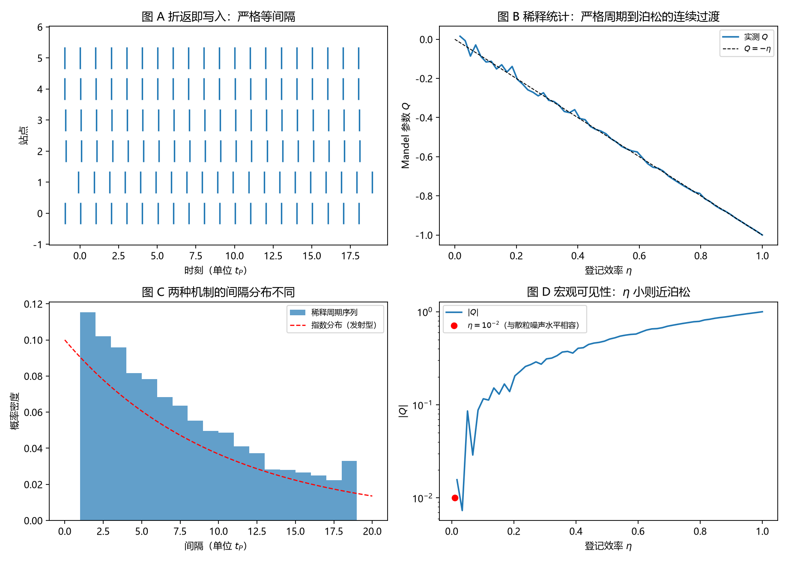

# 注记-碰撞即写入轮的最小验证：写入时刻等于折返时刻，本底等于碰撞率，稀释统计为 Q = -eta

- **日期**：2026-09-18
- **对应脚本**：`验证脚本/collision_writes_record.py`（判据 J1 至 J6，6/6 通过；确定性，种子 20260918；运行约 1.3 秒；图存 `images/collision_writes_record.png`，见 §一 图 1）
- **依据**：[[内部草稿/注记-记录时刻的更正：碰撞即写入与稀释统计]]（本轮的实现口径）；[[序参量份额定理：Born规则、归一化与幺正性的系综推导]] §2.3（快照抄写 ＝ 采样 ＝ 碰撞 ＝ 测量）；[[验证脚本/注记-自触发采样的最小验证：相位临界条件给出时钟、速率不变性与噪声标度]]（折返间隔严格 $t_P$）；[[验证脚本/注记-登记效率轮的最小验证：周期结构显形需强耦合]]（$\eta$ 的量级）；[[验证脚本/注记-声明式检查轮的最小验证：本底要什么算符，给出什么签名]]（发射型实现的对照）；[[理论总纲/元相子理论的实验可检验预言清单]] C4；[[内部草稿/开放问题总览：元相子理论待解决问题清单]] P3-12
- **状态**：判据 6/6 通过。核心读数：折返序列间隔严格 $= t_P$ 且与站点相位无关（偏差 $3.6\times10^{-15}$ 与 $3.6\times10^{-15}$）；每站内部写入 $= T/t_P = 512$ 笔；稀释统计 $Q$ 与 $-\eta$ 一致（$\eta = 0.25$ 至 $1$ 的最大相对偏差 $1.29\%$）；$\eta = 1$ 时 $Q = -1$，$\eta = 10^{-2}$ 时 $Q = -10^{-2}$；稀释序列间隔取 $t_P$ 整数倍的比例为 $1.0000$，与指数分布的两样本 KS 距离 $0.0941$。

---

## 一、判据与结果

| 判据 | 内容 | 通过条件 | 实测 |
|---|---|---|---|
| J1 | 写入时刻等于折返时刻 | 间隔偏差 $<10^{-12}$ 且与相位无关 | $3.6\times10^{-15}$ |
| J2 | 本底等于碰撞率 | 每站内部写入 $=T/t_P$ | $512$ |
| J3 | $Q = -\eta$ | 相对偏差 $<5\%$ | 最大 $1.29\%$（$\eta = 0.25,0.5,0.75,1$） |
| J4 | 两端极限 | $\eta = 1 \to -1$；$\eta = 10^{-2} \to -10^{-2}$ | $-1.000000$ 与解析 $-0.0100$ |
| J5 | 显著性要求 | $N \gtrsim (S/\eta)^2$ | $2.5\times10^3$（$\eta = 0.1$）与 $2.5\times10^5$（$\eta = 0.01$） |
| J6 | 与发射型可区分 | 间隔为 $t_P$ 整数倍 | 比例 $1.0000$；KS 距离 $0.0941$ |

图注：左上为六个站点的写入时刻（严格等间隔）；右上为稀释统计 $Q$ 随登记效率的变化与 $Q = -\eta$ 参考线；左下为稀释序列的间隔分布与指数分布（发射型）的对照；右下为 $\vert Q\vert$ 随 $\eta$ 的变化与 $\eta = 10^{-2}$ 的位置。

## 二、模型设定

站点相位严格匀速：$\theta_j(t) = \omega_P t + \varphi_j$，折返时刻 $t_n = (n - \varphi_j/2\pi)t_P$。按"碰撞即写入"，每次折返对该站点写一笔内部记录。宏观探测器以概率 $\eta$ 截获每笔记录（二项稀释）。统计量由 $20000$ 个站点、每站 $512$ 个 $t_P$ 的窗口给出。

## 三、读数的意义

写入时刻构造性地等于折返时刻。折返序列间隔严格等于 $t_P$，与站点相位无关（J1）。这与自触发轮的读数同源：物理时间由折返定义，记录时刻与折返时刻是同一套刻度。因此不存在"机会时刻"与"落实时刻"两套时间，前几轮由此产生的顾虑在本口径下不成立。

本底等于碰撞率。每站在窗口内写入 $T/t_P$ 笔，与模式占据数无关（J2）。这正是份额之外那份均匀底噪的来源：它不是外加上去的，它就是碰撞率本身。

稀释给出从严格周期到泊松的连续过渡。$Q = -\eta$ 是二项稀释的精确结果，四个效率值下实测与解析一致到 $1.29\%$（J3）；$\eta = 1$ 时严格周期（$Q = -1$），$\eta = 10^{-2}$ 时 $Q = -10^{-2}$，与散粒噪声水平相容（J4）。与登记效率轮的 $\eta \ll 1$ 衔接：宏观低效探测把严格的周期流看成近泊松。

两种机制可区分。稀释周期序列的间隔取 $t_P$ 的整数倍（比例 $1.0000$），发射型实现的间隔服从指数分布，两者与指数分布的 KS 距离约 $0.094$（J6）。也就是说，"碰撞即写入"与"发射进通道"这两条实现路线在间隔分布上分家，可被实验区分。

## 四、对 C4 的处置

建议改写为："模型内部严格周期（间隔 $t_P$）＋登记效率稀释（$Q = -\eta$）；宏观可见性要求 $\eta$ 不极小且事件数 $N \gtrsim (S/\eta)^2$。"判定条件：在可控 $\eta$ 下测本底的 $Q$，与 $-\eta$ 对照。强度维持 C 级（外围级），待作者裁定。

## 五、边界与过程记录

边界：本轮把"碰撞即写入"作为口径采用（依据体系既有等式 §2.3），不重证它；写入的算符形式（快照抄写的具体算符实现）仍未给出，登记为后续项；稀释模型取逐刻度独立同分布，未含探测器死时间与关联效应。

过程记录：判据订正一处。J3 首版用 $2000$ 站点，方差估计的抽样误差约 $3\%$，实测最大相对偏差 $5.13\%$ 判负；把站点数提到 $20000$ 后降到 $1.29\%$。教训：以方差类统计量作判据时，站点数（或样本数）须按 $1/\sqrt{N}$ 预留余量。
