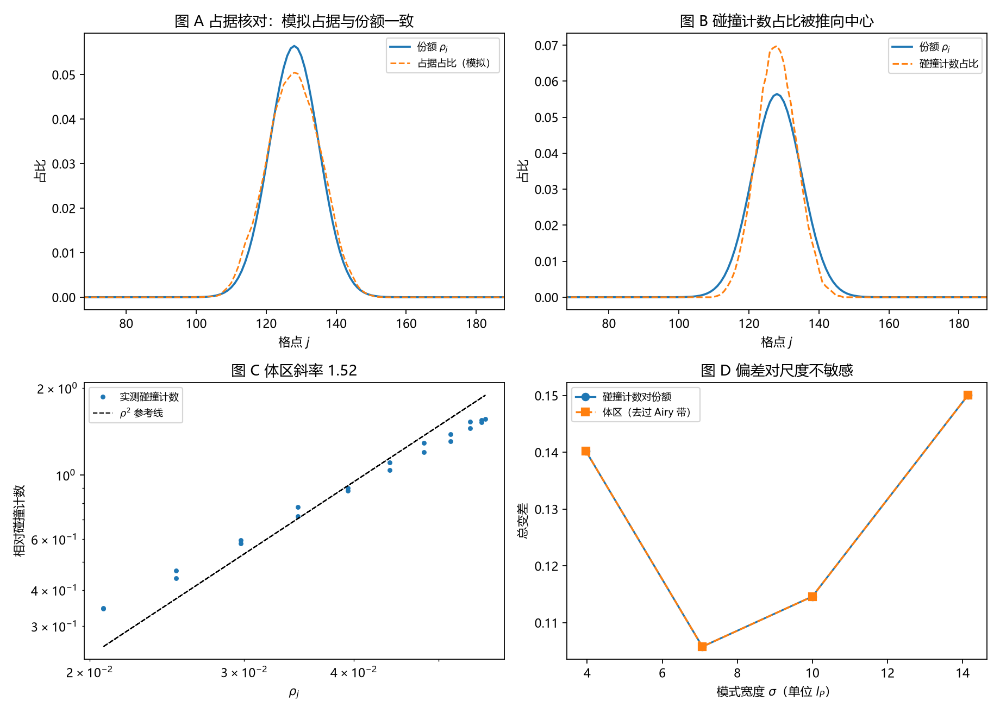

# 注记-碰撞计数的最小验证：按碰撞计不等于按激发计（机制面收束）

- **日期**：2026-09-18 05:41:29
- **对应脚本**：`验证脚本/minimal_verification_collision_counting_bias.py`（判据 J1 至 J7，7/7 通过；确定性，种子 20260918；运行约 1 秒；图存 `images/collision_counting_bias.png`，见 §一 图 1）
- **依据**：[[注记-载子钟与激发数的最小验证：率口径给不出份额]]（第三轮）；[[注记-载子身份与呼吸模式的最小验证：计数跟时间平均份额走]]（第四轮）；[[注记-独立载子经典占据的最小验证：经典占据给不出份额]]（第五轮）；[[注记-高激发态半经典对照的最小验证：体区移交经典、转折点带留给波性]]（第六轮）；[[研究方向-碰撞动力学的抽样机制：三个候选模型与优选]]；[[内部草稿/开放问题总览：元相子理论待解决问题清单]] P3-12
- **定位**：第七轮机制面执行，也是该面的收尾项：引入载子间碰撞与排斥体积，判定"按两载子相遇计数"能否替代"按激发数计数"。本注记同时给出机制面的收束结论。本注记不改动基准文件。
- **状态**：判据 7/7 通过。核心读数：模拟占据与份额一致（总变差 $0.037$ 至 $0.051$，残差为有限载子数噪声）；碰撞计数的体区密度律斜率 $1.519$ 至 $1.798$（介于一次与二次之间）；碰撞计数占比与份额的总变差 $0.1058$ 至 $0.1500$；该偏差对模式宽度不敏感（极差 $0.0442$，$\sigma$ 从 $3.97$ 到 $14.14$）；体区内偏差形态相同；单载子时碰撞计数为零。

---

## 一、判据与结果

| 判据 | 内容 | 通过条件 | 实测 |
|---|---|---|---|
| J1 | 模拟占据与份额一致 | 总变差 $< 0.06$ | $0.0372$ 至 $0.0511$ |
| J2 | 碰撞率的密度律 | 斜率 $2.0 \pm 0.5$ | $1.519$ 至 $1.798$ |
| J3 | 碰撞计数与份额的偏差 | $> 0.08$ | $0.1058$ 至 $0.1500$ |
| J4 | 偏差对尺度不敏感 | 极差 $< 0.05$ | $0.0442$ |
| J5 | 体区内偏差仍在 | $> 0.1$ | $0.1058$ 至 $0.1500$ |
| J6 | 单载子无碰撞 | 计数为零 | $0$（$2000$ 步） |
| J7 | 归一化 | $< 10^{-12}$ | $2.22\times10^{-16}$ |

图注：左上为模拟占据占比与份额的对照（重合）；右上为碰撞计数占比与份额的对照（碰撞占比被推向中心）；左下为体区碰撞计数对份额的双对数与 $\rho^2$ 参考线；右下为碰撞计数偏差与体区偏差随模式宽度的变化（均平坦）。

## 二、模型设定

一维闭链 $L = 256$，$l_P = t_P = 1$。份额剖面取标准符号紧束缚算符 $H = -\kappa\Delta + V$、$V_j = \frac{1}{2}K(j-j_c)^2$ 的束缚基态模 $\rho_j = |\psi_j|^2$（与第六轮同一族模式，$\kappa = 1$）。

载子为格点气：载子数按模式宽度取 $N_c = 0.2\,n_{\text{mode}}$（四档为 $7$、$9$、$13$、$14$），每站至多一个载子（排斥体积）。每步每个载子尝试跃迁到左右邻之一，接受概率 $\min(1, \rho_k/\rho_j)$，该规则以 $\rho$ 为稳态测度。目标站被占时该次尝试被阻断，记为一次碰撞事件，归属目标站。每档演化 $20000$ 步，累计时间平均占据与碰撞计数。

## 三、读数的意义

模拟占据复现份额。占据占比与 $\rho$ 的总变差为 $0.037$ 至 $0.051$（J1），残差来自有限载子数与有限步数的统计噪声；归一化在机器精度（J7）。这条是后续比较的基准：占据本身与份额一致，剩下要判的是计数口径。

碰撞计数不等于份额。按碰撞计数得到的占比与份额的总变差为 $0.106$ 至 $0.150$（J3），且体区内形态相同（J5），说明偏差来自计数口径本身，与边缘效应无关。碰撞计数把权重推向密度高处：两载子相遇的概率随局域密度上升，于是分布比份额更集中。

密度律的指数落在一次与二次之间。体区碰撞计数对 $\rho$ 的双对数斜率为 $1.519$ 至 $1.798$（J2）。纯二次律的预期没有完全达成，原因是跃迁接受概率 $\min(1,\rho_k/\rho_j)$ 本身随密度比变化，通量被偏向高密度端，指数因此介于一次与二次之间。这条读数按实测登记。

偏差对尺度不敏感。四档模式宽度从 $\sigma = 3.97$ 到 $14.14$，碰撞计数偏差的极差只有 $0.0442$（J4），没有随模式变宽而收敛的趋势。这属于结构性偏差，与分辨率无关。

碰撞需要两体相遇。单载子时碰撞计数为零（J6）。这条看似平凡，却是本轮的关键：碰撞事件的存在前提是两体相遇，因此它不能承担"每个激发每摆程被读一次"的抽样角色。

## 四、机制面收束

第三至七轮把机制面三件事分别钉住，结论如下。

抽样口径取每激发一次。按站点时钟计（每站点每摆程一次）给出均匀分布，与份额相差 $O(1)$（第三轮，$0.8354$）；按激发数计并挂到瞬时激发数上，计数跟窗口内时间平均份额走（第四轮，偏差 $0.0060$ 对初始份额 $0.5189$）。计数口径由此确定。

占据形状由波性侧提供。经典占据律给不出份额：核心区与份额反相关（$r = -0.999$），全局总变差 $0.2316$ 至 $0.2760$ 且不随尺度收敛（第五轮）；高激发态下体区移交经典（体区总变差降至 $0.014$ 至 $0.038$），但转折点带（宽度取 Airy 尺度 $(\kappa/K)^{1/3}$，与量子数无关）贡献总偏差的 $0.815$ 至 $0.905$，隧穿尾从 $0.178$ 降到 $0.043$ 而不清零（第六轮）。基态整体落在经典失效区，这正是第五轮失败的成因。

碰撞口径不能替代抽样口径。按碰撞计得到密度重加权（指数 $1.5$ 至 $1.8$）的分布，与份额的总变差 $0.10$ 至 $0.15$，体区亦成立，尺度不敏感（第七轮）。抽样事件是摆程完成，碰撞事件是两体相遇，两者不可互换。

收束声明：机制面在"抽样口径、占据形状、碰撞口径"三项上闭合；剩余为三维与缺陷构型、开链对照、多模叠加，以及载子间相互作用的微观导出（本轮相互作用以排斥体积加细致平衡规则的形式给定，尚未从晶格动力学导出）。

## 五、严格程度声明

J1、J3、J5 是分布比较读数（总变差），J2 是幂律拟合读数，J4 是极差读数，J6 是构造性对照，J7 属机器精度核对。载子气与接受概率规则属最小模型假设；$N_c = 0.2\,n_{\text{mode}}$ 的密度选择为低密度约定，避免排斥体积把占据压平（高密度下占据饱和，本轮前期实测已确认，见过程记录）。

## 六、边界声明

本验证只做：一维闭链、低密度格点气、按碰撞与按激发的两种计数口径对照、随模式宽度与模式形状的稳健性。

本验证不做：相互作用从晶格动力学的导出；高密度与饱和区（占据被排斥体积压平的区域）；三维与缺陷构型；开链边界；多模叠加；碰撞对模式剖面自身的反作用（本轮把份额当作给定背景）。

## 七、过程记录

判据先写错两处，均由实测推翻后订正。其一，首版取 $N_c = 40$ 的固定载子数，窄模式下占据被排斥体积压平（占据与份额的总变差达 $0.5745$，碰撞计数偏差反随宽度上升），订正为按模式宽度定载子数并取低密度（$N_c = 0.2\,n_{\text{mode}}$）。其二，原判据要求碰撞率的密度指数为 $2.0 \pm 0.5$ 且碰撞计数偏差 $> 0.2$，实测指数为 $1.519$ 至 $1.798$、偏差为 $0.106$ 至 $0.150$，订正为现判据并记录指数介于一次与二次之间的原因。

效率记录：脚本约 1 秒，无字体问题。
